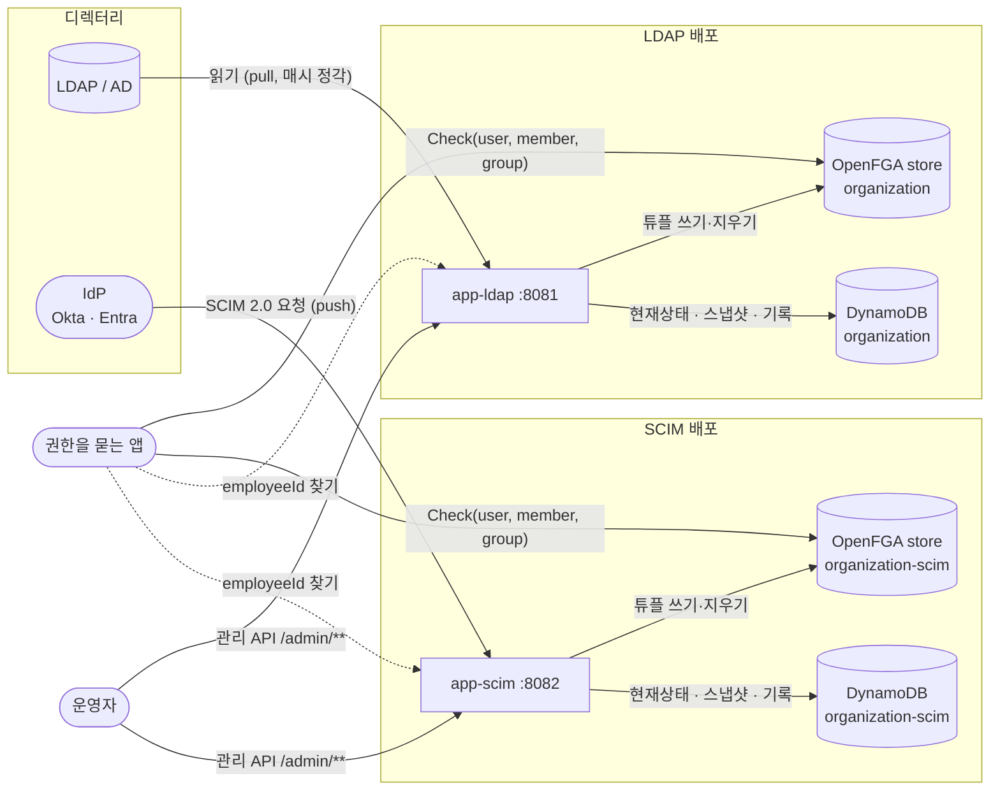
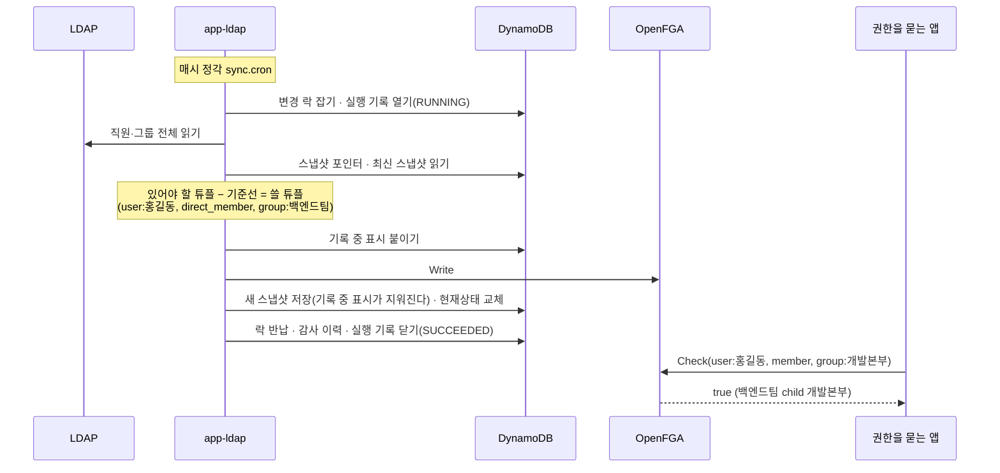

# 개요

> 기준 커밋: 44147b3 (ops-readiness, main 에 머지됨). 코드가 바뀌면 이 문서도 함께 고친다.
> 읽기 전에: [읽는 법(README.md)](README.md) — 이 묶음의 입구와 역할별 읽는 길. 모르는 말은 [용어집](02-용어집.md)에서 찾는다.

## 0. 처음이라면: LDAP·SCIM·OpenFGA 한 쪽 요약

이 서버는 바깥 기술 셋 사이에 선다. 셋을 처음 보면 이 절부터 읽는다. 말마다의 정의는 [02 용어집 — 기초](02-용어집.md#0-기초)에 있다.

**LDAP [디렉터리](02-용어집.md#디렉터리) — 이 서버가 읽어 온다(pull).** LDAP 서버(OpenLDAP, Active Directory 등)는 회사의 사람과 조직을 나무 모양으로 담는다. 엔트리마다 [DN](02-용어집.md#dn)이라는 전체 이름이 있다. 예: `uid=gd.hong,ou=people,dc=example,dc=com` — 맨 앞 `uid=gd.hong` 이 그 엔트리 자신의 이름이고, 나머지는 부모의 DN 이다. `ou=…` 엔트리는 [OU](02-용어집.md#ou)(조직 단위)로, 나무의 가지를 만든다. 이 서버는 정해진 주기마다 디렉터리 전체를 읽는다. 누가 어느 조직에 속하는지 읽는 법은 두 가지이고, 설정 `ldap.strategy` 로 고른다.

| 전략 | 조직은 | 소속은 | 예 |
|---|---|---|---|
| groupOfNames(기본) | 그룹 엔트리(`objectClass=groupOfNames`) | 그룹의 `member` 속성에 적힌 멤버의 DN. 멤버가 그룹이면 하위 조직이다. 한 사람이 여러 조직에 속할 수 있다 | 그룹 `cn=백엔드팀,ou=groups,dc=example,dc=com` 에 `member: uid=gd.hong,ou=people,dc=example,dc=com` |
| DIT | OU 엔트리 | 직원 엔트리가 놓인 부모 OU. OU 의 부모 OU 가 상위 조직이다. 한 사람의 소속은 하나다 | `uid=gd.hong,ou=백엔드팀,ou=개발본부,ou=company,dc=example,dc=com` |

**SCIM 과 IdP — IdP 가 보내온다(push).** [IdP](02-용어집.md#idp)(Okta, Microsoft Entra ID 등)는 계정을 한곳에서 관리하는 서비스다. 계정·그룹이 바뀌면 IdP 가 그 변경을 SCIM 2.0(HTTP 와 JSON 으로 된 표준, RFC 7643·7644)으로 다른 시스템에 밀어 넣는다. 이것이 [프로비저닝](02-용어집.md#프로비저닝)이고, 이 서버는 받는 쪽이다. 요청 하나는 리소스 하나의 변경 하나다 — 직원 만들기 `POST /scim/v2/Users`, 조직에 멤버 넣기 `PATCH /scim/v2/Groups/{id}` 처럼. IdP 는 바뀐 것을 주기마다 모아 보내거나 바뀔 때 보낸다. 그 주기와 방식은 IdP 와 그 설정이 정하고, 이 묶음은 실제 IdP 로 확인하지 못했다. 전체를 처음부터 다시 보내게 하는 재프로비저닝은 IdP 콘솔에서 사람이 건다. 이 서버가 IdP 에 "다시 보내 달라" 고 할 길은 없다.

**OpenFGA — [권한을 묻는 앱](02-용어집.md#권한을-묻는-앱)이 질문하는 곳.** [OpenFGA](https://openfga.dev) 는 관계로 권한을 판정하는 서버다. 말 넷만 알면 된다.

- [store](02-용어집.md#store) — 데이터를 담는 단위 하나. 이 묶음은 이 배포가 쓰는 store 를 [장부](02-용어집.md#장부)라 부른다.
- [인가 모델](02-용어집.md#인가-모델)(authorization model) — store 에 등록하는 타입과 관계의 정의. 이 서버의 모델은 타입 `user`·`group` 과, `group` 의 관계 `direct_member`·`child`·`member` 셋이다. `member` 는 계산 관계다 — `direct_member` 이거나 하위 조직(`child`)의 `member` 이면 참이다.
- [튜플](02-용어집.md#튜플)(tuple) — 관계 한 줄 `(user, relation, object)`. 예: `(user:<직원 id>, direct_member, group:<조직 id>)`. 이 서버가 OpenFGA 에 쓰는 것은 튜플뿐이다.
- [Check](02-용어집.md#check) — "이 user 가 이 object 의 이 relation 인가" 를 묻는 API. 모델의 계산 관계까지 풀어 답한다. 그래서 하위 조직의 직원이 상위 조직의 `member` 인지([롤업](02-용어집.md#롤업))는 OpenFGA 가 계산한다.

정리하면, 이 서버는 디렉터리(LDAP 또는 IdP)가 말하는 조직도를 OpenFGA 튜플로 옮겨 두는 다리다. 아래 절들이 그 다리를 설명한다.

## 이 시스템이 푸는 문제

회사의 여러 앱이 같은 질문을 한다. "이 사람이 이 조직에 속하는가 — 그 조직의 하위 조직에만 속해 있어도." 결재선, 문서 열람, 메뉴 권한이 모두 이 질문에 기댄다.

조직도는 디렉터리가 안다. 어떤 회사는 LDAP(또는 Active Directory)을, 어떤 회사는 SCIM 을 말하는 IdP(Okta, Microsoft Entra ID 등)를 쓴다. 앱마다 디렉터리를 직접 읽으면 조직 계층을 따라 올라가는 계산을 앱마다 다시 짜야 한다.

이 서버는 그 차이를 흡수한다. 디렉터리의 조직도를 [OpenFGA](https://openfga.dev) 의 관계(튜플)로 옮겨 둔다. 그러면 권한을 묻는 앱은 OpenFGA 에 질문 하나만 던지면 된다.

```
Check(user:<employeeId>, member, group:<orgCode>)
```

계층을 따라 올라가는 계산(롤업)은 OpenFGA 의 인가 모델이 한다. 이 서버는 직원이 직접 속한 조직(`direct_member`)과 조직의 상하 관계(`child`)만 쓴다.

이 서버가 하는 일은 셋이다.

1. **옮긴다.** 디렉터리를 읽거나 받아서 튜플로 바꿔 OpenFGA 장부에 쓰고 지운다.
2. **기록한다.** 조직도 자체(이름·이메일·계정명·소속)를 DynamoDB 의 [현재상태](02-용어집.md#현재상태)에 둔다. 튜플에는 [불변 id](02-용어집.md#불변-id)만 있어 사람이 읽을 수 없기 때문이다. 장부에 실제로 반영한 것은 [튜플 스냅샷](02-용어집.md#튜플-스냅샷)으로, 누가 언제 무엇을 바꿨는지는 [감사 이력](02-용어집.md#감사-이력)으로 남긴다.
3. **맞춘다.** 쓰기가 일부 실패하거나 중간에 멈춰도, 다음 회차·재시도·재적재가 장부를 조직도에 다시 맞춘다.

권한 판단 자체는 하지 않는다. 판단은 권한을 묻는 앱이 OpenFGA 에 직접 묻는다.

## 누가 쓰나

| 누구 | 이 시스템과 무엇을 주고받나 |
|---|---|
| 디렉터리 — LDAP/AD 서버 | app-ldap 이 주기적으로(설정 파일의 값은 매시 정각) 전체를 읽어 온다. 디렉터리는 이 서버를 모른다 |
| 디렉터리 — IdP | app-scim 의 SCIM 2.0 엔드포인트(`/scim/v2/Users`, `/scim/v2/Groups`)로 변경을 하나씩 보낸다. 응답으로 받은 `id` 를 저장해 이후 요청에 쓴다 |
| 권한을 묻는 앱 | OpenFGA 에 `Check(user:…, member, group:…)` 를 직접 묻는다. 로그인한 사용자를 이 서버의 [employeeId](02-용어집.md#employeeid)로 바꾸려고 [관리 API](02-용어집.md#관리-api)의 조회(`GET /admin/employees?userName=…`·`?externalId=…`)를 부른다 |
| 운영자 | 관리 API 로 동기화·재적재를 걸고 [실행 기록](02-용어집.md#실행-기록)·직원·조직·감사 이력을 본다. 지표(`/actuator/prometheus`)와 헬스 체크(`/actuator/health`)를 본다 |

## 큰 그림



그림의 두 배포는 함께 도는 것이 아니다. 한 회사는 둘 중 하나만 띄운다(아래 "배포 하나에 커넥터 하나"). 권한을 묻는 앱은 자기 배포의 store 하나만 본다.

데이터가 사는 곳은 둘이다.

- **OpenFGA 장부** — 튜플뿐이다. `(user:<직원 id>, direct_member, group:<조직 id>)` 와 `(group:<하위 조직 id>, child, group:<상위 조직 id>)` 두 가지다. 권한을 묻는 앱이 읽는 것은 이것뿐이다.
- **DynamoDB 테이블 하나** — 현재상태(직원·조직·소속), 튜플 스냅샷, 실행 기록, 감사 이력, 그리고 동시성·운영을 위한 줄들(변경 락, 표지판, 보류 목록, 책갈피, 하루 1회 표지)이다.

모양은 [04 데이터 모델](04-데이터-모델.md)에, 코드 구조는 [03 아키텍처](03-아키텍처.md)에 있다.

## 두 앱 — pull 과 push

LDAP 과 SCIM 은 성격이 정반대라 앱을 둘로 나눴다. 튜플 변환 규칙(`TupleMapper`), OpenFGA 쓰기, DynamoDB 저장, 관리 API 조회는 함께 쓴다.

| | app-ldap | app-scim |
|---|---|---|
| 모델 | pull — 이 서버가 읽어 온다 | push — IdP 가 보낸다 |
| 무엇이 촉발하나 | `sync.cron`(기본 `0 0 * * * *`, 매시 정각), `POST /admin/sync/full` | IdP 의 요청 하나하나 |
| 한 번에 다루는 양 | 디렉터리 전체 | 리소스 하나의 변경 |
| 무엇을 쓸지 정하는 법 | 방금 읽은 조직도와 직전 튜플 스냅샷을 비교한다([비교 경로](02-용어집.md#비교-경로)). 이 직전 스냅샷이 [기준선](02-용어집.md#기준선)이다 — "장부에 지금 이것이 있다" 고 보는 출발점. 기준선을 믿을 수 없으면(첫 회차, 지난 회차가 기록 전에 멈춤) 장부를 훑어 맞춘다 | 영향 범위만 담은 [최소 그림](02-용어집.md#최소-그림) 두 장을 만들고, 장부의 실제를 `Check` 로 물어 차이를 쓴다. 이렇게 물어 얻은 "지금 장부에 있는 줄" 이 [Check 기준선](02-용어집.md#check-기준선)이다 |
| 조직 계층(롤업) | groupOfNames 는 `member` 에 든 그룹 DN, DIT 는 OU 나무에서 나온다 | **IdP 가 중첩 그룹(조직의 멤버로 든 조직, `type: "Group"`)을 보낼 때만 생긴다.** Entra·Okta 가 보내는지는 확인하지 못했다. 보내지 않으면 SCIM 배포에는 롤업이 없다 — 상위 조직의 `member` Check 가 하위 조직 직원에게 거짓이다([13 — 2.2](13-한계와-알려진-문제.md#22-scim-배포의-조직-계층을-어디서-받는지-정해지지-않았다)) |
| 진실 | LDAP. 현재상태는 읽은 것을 그대로 받아 적는다 | 현재상태. 다시 읽어 올 원천이 없다 |
| 튜플 스냅샷의 쓰임 | 다음 회차의 기준선 | 감사·복구용 기록(아카이빙과 `tuples` 재적재가 남긴다). 판단에 읽지 않는다 |
| 관리 API `/admin/sync` | `full`, `rebuild`, `runs` | `rebuild?mode=tuples\|wipe`, `runs` — `full` 이 없다 |
| 하루 1회 작업 | 만료 스냅샷 정리(04~08시의 [하루 창](02-용어집.md#하루-창)) | [아카이빙](02-용어집.md#아카이빙)(03~08시), 만료 스냅샷 정리(04~08시) |
| 기본 포트·테이블·store | 8081, `organization`, `organization`(`application.yml` 의 값 — 클래스 기본값은 없다) | 8082, `organization-scim`, `organization-scim` |

## 배포 하나에 커넥터 하나

한 조직도는 한 원천으로만 동기화한다. 이것이 이 서버의 전제다.

- app-ldap 과 app-scim 은 서로 다른 DynamoDB 테이블과 OpenFGA store 를 쓴다. 두 앱의 `application.yml` 이 이름을 다르게 적는다(app-scim 은 `dynamodb.table-name: organization-scim`, `openfga.store-name: organization-scim`). 이름의 클래스 기본값은 없어 비우면 기동을 멈춘다. 이름을 바꿀 때도 늘 다르게 둔다.
- 운영(`prod`)은 테이블·store 를 만들지 않는다. 이름이 틀리면 엉뚱한 빈 저장소에 붙지 않고 기동을 멈춘다([11 — 순서와 실패](11-운영.md#21-순서와-실패)).
- 두 앱이 같은 테이블이나 store 를 함께 쓰는 경우는 설계에서 따지지 않는다. 그렇게 띄우면, 예컨대 한쪽의 재적재가 장부를 훑으며 다른 쪽이 쓴 튜플을 "있어야 할 줄에 없는 줄" 로 지운다. 이것을 막는 실행 중 검사는 없다([13 — 7.14](13-한계와-알려진-문제.md#714-두-앱이-테이블이나-store-를-함께-써도-막지-않는다)).
- 장부는 이 서버만 쓴다는 전제다. 다른 앱이 장부에 직접 쓴 튜플은 재적재가 지운다.
- 한 배포 안에서는 같은 앱을 여러 대 띄울 수 있다. 일은 [변경 락](02-용어집.md#변경-락) 하나로 클러스터 전체에서 한 번에 하나씩 돈다([08 동시성과 작업](08-동시성과-작업.md)).

## 일부러 하지 않는 것

| 하지 않는 것 | 까닭·대신 |
|---|---|
| 권한 판단 | 이 서버는 관계를 옮길 뿐이다. 판단은 권한을 묻는 앱이 OpenFGA 에 직접 묻는다 |
| 인증 | **아직 구현하지 않았다.** 관리 API(`/admin/**`), SCIM 엔드포인트(`/scim/v2/**`), actuator 가 모두 인증 없이 열려 있다. 실제 운영에 넣기 전에 반드시 앞단에서 보호해야 한다. 관리 API 와 감사 이력은 조직도와 이전 값(이름·이메일)을 그대로 보여 준다 |
| 로그인한 사용자를 employeeId 로 자동 변환 | 권한을 묻는 앱이 관리 API 로 한 번 조회해 얻는다 |
| 튜플에 조직명·계정명 넣기 | 이름은 개편 때마다 바뀐다. 튜플의 식별자는 불변 id 뿐이고, 이름은 현재상태에만 있다 |
| 평소에 장부 읽기 | 판단·쓰기 경로는 `Check` 만 쓴다. OpenFGA Read 는 [장부 훑기](02-용어집.md#장부-훑기)(재적재와, 기준선을 믿을 수 없는 LDAP 회차)에서만, ListObjects 는 쓰지 않는다 |
| 재시도 큐·실패 상태 머신 | 실제로 반영한 것만 스냅샷의 기준선에 넣으므로, 실패한 튜플은 다음 회차의 비교가 저절로 다시 잡는다. 결과를 모르는 튜플은 [불확실 줄](02-용어집.md#불확실-줄)로 따로 적는다 |
| LDAP 변경 통지 받기 | 매 회차 디렉터리 전체를 읽는다. 막힌 계정의 권한은 다음 정각 회차가 반영될 때 사라진다. 한 사람만 즉시 회수하는 API 는 없다 — 급하면 `POST /admin/sync/full` |
| LDAP referral 따라가기 | 검색 범위가 다른 도메인을 걸치면 경고만 남기고 그 부분은 읽지 않는다. 검색 베이스 자체가 referral 이라 받은 엔트리가 없으면 회차를 멈춘다([05 — referral](05-LDAP-동기화.md#38-referral)) |
| SCIM 의 일부 기능 | Bulk, `/Me`, 서버 루트 조회는 501 이다. 필터는 `eq` 와 `and` 만 받는다([06 SCIM](06-SCIM.md)) |
| 옛 데이터 이관 | 운영 배포 전이라 이관 코드를 만들지 않는다. 키 모양이 바뀌면 테이블을 다시 만든다 |

## 동작 둘러보기

각 문서는 그 동작이 언제 일어나는지, 무엇을 읽고 쓰는지, 어떤 순서인지, 실패하면 어떻게 되는지를 끝까지 다룬다.

**[05 LDAP 동기화](05-LDAP-동기화.md).** app-ldap 은 매시 정각(`sync.cron`) 변경 락을 잡고 LDAP 전체를 읽어 [디렉터리 그림](02-용어집.md#디렉터리-그림)을 만든다. [스냅샷 포인터](02-용어집.md#스냅샷-포인터)로 [기준선 상태](02-용어집.md#기준선-상태)("기준선을 믿을 수 있나" — 없음·기록 중·있음)를 정해 길을 고른다 — 기준선이 있으면 직전 스냅샷과 비교하고(비교 경로), 없거나 지난 회차가 기록 전에 멈췄으면 장부를 훑어 맞춘다([장부 맞추기](02-용어집.md#장부-맞추기)). 지울 튜플이 기준의 30%를 넘으면 [삭제 가드](02-용어집.md#삭제-가드)가 멈추되, 디렉터리가 막은 계정의 회수는 먼저 반영한다([비활성 회수만 반영](02-용어집.md#비활성-회수만-반영)). 쓰기는 [쓰기 단계](02-용어집.md#쓰기-단계)를 지켜 나가고, 실제로 반영된 것만 새 스냅샷에 담은 뒤 현재상태를 교체한다. 두 매핑 전략(groupOfNames, DIT), 필터, 계정 상태, AD 의 특수 속성, 읽기 재시도도 이 문서에 있다.

**[06 SCIM](06-SCIM.md).** app-scim 은 IdP 의 요청 하나하나를 [SCIM 쓰기](02-용어집.md#scim-쓰기)로 처리한다. 직원·조직의 `id` 는 서버가 발급한다. 모든 판단(존재 확인, [표지판](02-용어집.md#표지판)으로 하는 `userName`·조직 `externalId` 유일성)을 변경 락 안에서 하고, 영향 범위만 담은 최소 그림과 Check 기준선으로 무엇을 쓸지 정한다. 순환을 닫는 하위 조직 연결은 [보류 목록](02-용어집.md#보류-목록)에 둔다. 실패는 상태 코드로 IdP 에 알린다 — 다시 보내면 나을 실패는 503 과 `Retry-After` 다. 목록·필터 조회, PATCH 해석, 오류 응답도 이 문서에 있다.

**[07 재적재·초기화·아카이빙](07-재적재-초기화-아카이빙.md).** [재적재](02-용어집.md#재적재)는 관리자가 거는 전체 맞추기다. 있어야 할 튜플을 먼저 다 쓰고 장부를 훑어 나머지를 지우므로 장부를 비우는 순간이 없고 store 번호도 바뀌지 않는다. app-ldap 은 LDAP 을 다시 읽고, app-scim 은 현재상태를 진실로 본다. SCIM 의 [초기화](02-용어집.md#초기화)(`mode=wipe`)는 장부와 조직도를 모두 지우는 되돌릴 수 없는 작업이다. SCIM 의 하루 1회 아카이빙은 장부의 실제를 스냅샷으로 남기고 [드리프트](02-용어집.md#드리프트)를 세며 [남은 회수](02-용어집.md#남은-회수)를 지운다.

**[08 동시성과 작업](08-동시성과-작업.md).** 여러 대를 띄워도 일은 한 번에 하나다. 변경 락은 DynamoDB 조건부 쓰기로 만든 [리스](02-용어집.md#리스)이고, 쥔 동안 [갱신](02-용어집.md#갱신)한다. SCIM 쓰기는 [서버 안 줄](02-용어집.md#서버-안-줄)에 서고 다른 서버와는 백오프로 겨룬다. 회차는 요청과 떼어 돌고, [기한](02-용어집.md#기한)·서버 종료·[리스 상실](02-용어집.md#리스-상실)과 경주하며, 어떻게 끝나든 먼저 락을 반납하고 기록한다. 하루 한 번 작업은 [하루 1회 표지](02-용어집.md#하루-1회-표지)를 잡은 인스턴스만 돌고, 실패하면 하루 창 안의 다음 정각에 다시 돈다.

**[09 관리 API](09-관리-API.md).** `/admin/sync` 로 동기화·재적재를 걸면 202 와 실행 기록을 곧바로 주고, 결과는 `/admin/sync/runs/{runId}` 로 본다. `/admin/employees`·`/admin/organizations` 는 현재상태가 요구하는 값(`shouldHaveAccess`)과 OpenFGA 의 실제 판정(`openFgaCheck`)을 나란히 보여 준다 — 둘이 다르면 드리프트다. 검색은 접두사·정확 일치와 [커서](02-용어집.md#커서)로 한다. 오류는 RFC 9457 problem details 다 — 락 경합 409, 일시 장애 503.

**[10 감사 이력](10-감사-이력.md).** 직원·조직마다 언제, 무엇 때문에([원인](02-용어집.md#원인)), 무엇이 바뀌었는지 — 속성, 소속, [부여](02-용어집.md#부여)·[회수](02-용어집.md#회수)한 튜플 — 를 남긴다. 실패한 회차·요청이 그때까지 한 변경도 남긴다. 무엇이 빠질 수 있는지도 이 문서에 있다.

**[11 운영](11-운영.md).** 설정 전체와 `prod` 프로필, 기동 검사(테이블·store·LDAP 설정), IAM 권한, 지표와 경보 예, 헬스 체크와 프로브, 로그와 traceId, 여러 대 띄우기의 전제(시계 동기화, 하루 창)를 다룬다.

**[12 장애와 복구](12-장애와-복구.md).** LDAP·OpenFGA·DynamoDB 가 죽거나 느릴 때, 서버가 강제로 죽었을 때, 삭제 가드가 걸렸을 때, 스냅샷이 깨졌을 때, 기동이 멈췄을 때, 테이블을 PITR 로 복원했을 때 무엇이 남고 무엇이 다음에 고치는지, 사람이 무엇을 해야 하는지를 장애별로 정리한다.

그 밖에 [13 한계와 알려진 문제](13-한계와-알려진-문제.md), [14 개발 가이드](14-개발-가이드.md)(로컬 실행·시험), [15 결정 색인](15-결정-색인.md)이 있다. 역할별로 무엇을 어떤 순서로 읽을지는 [읽는 법(README.md)](README.md)에 있다.

## 한 사람의 권한이 생기기까지

LDAP 배포에서 홍길동이 백엔드팀(개발본부의 하위 조직)에 들어간 경우다.



그림의 `홍길동`·`백엔드팀`·`개발본부` 는 읽기 쉽게 적은 이름이다. 실제 튜플에는 이름이 아니라 불변 id(UUID 등)가 들어간다([04 — 식별자](04-데이터-모델.md#2-식별자)).

SCIM 배포라면 IdP 가 `PATCH /scim/v2/Groups/<백엔드팀 id>` 로 홍길동을 멤버로 넣는 요청 하나가 같은 튜플을 쓴다 — 락 안에서 그 튜플이 지금 장부에 있는지 `Check` 로 묻고, 없으니 쓰고, 멤버 줄을 저장한다. 실행 기록은 남지 않고 감사 이력만 남는다. 다만 개발본부까지 롤업되려면 IdP 가 백엔드팀을 개발본부의 멤버(`type: "Group"`)로 보냈어야 한다 — 위 "조직 계층" 줄의 경고다.

## 더 깊이

- 처음 설계: `docs/superpowers/specs/2026-08-14-organization-sync-design.md`(데이터 표 등 일부는 지금 코드와 다르다 — [04 데이터 모델](04-데이터-모델.md)이 지금의 모양이다)
- 슬라이드별 작업 기록: `docs/superpowers/specs/`, `docs/superpowers/plans/`
