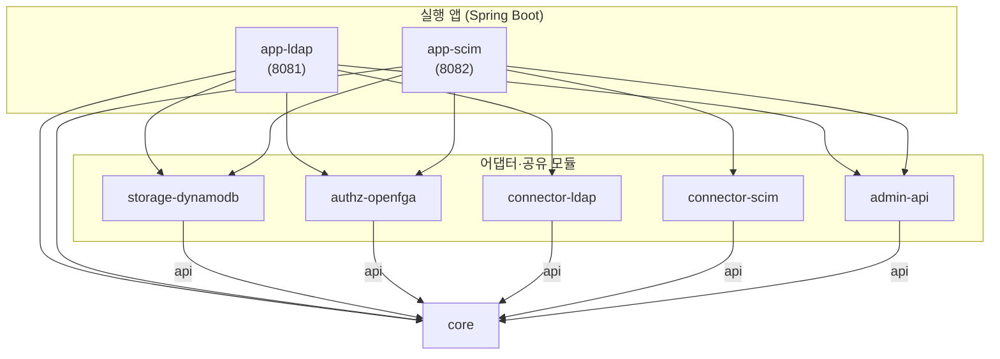
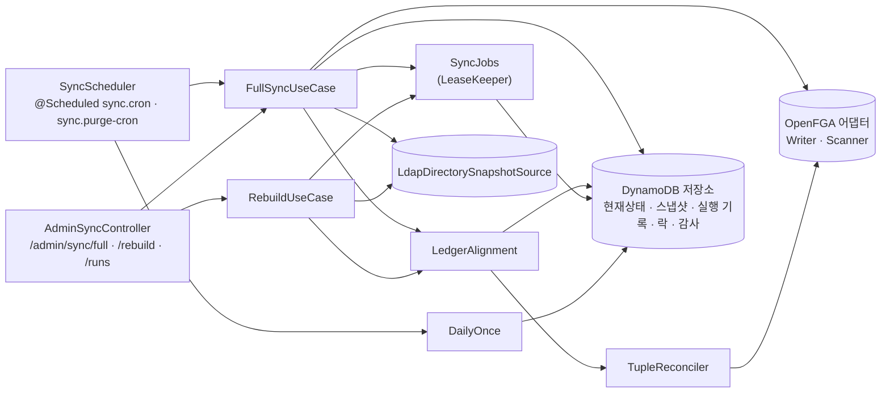
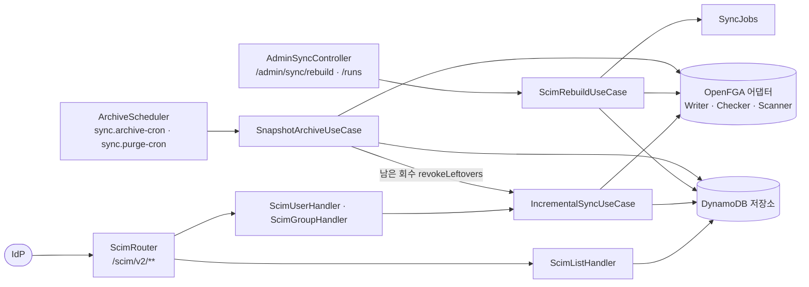

# 아키텍처

> 기준 커밋: 46169ab (main, 2026-10-25). 코드가 바뀌면 이 문서도 함께 고친다.
> 읽기 전에: [개요](01-개요.md), [용어집](02-용어집.md)

이 문서는 코드가 어떻게 나뉘어 있고 어떻게 이어지는지를 보인다. 각 동작이 실제로 어떻게 일어나는지는 05~12 에 있다. 데이터의 모양은 [04 데이터 모델](04-데이터-모델.md)에 있다.

## 1. 기술 바탕

| 무엇 | 버전·내용 | 어디서 정하나 |
|---|---|---|
| 언어 | Java 17(Gradle toolchain) | `build.gradle` |
| 프레임워크 | Spring Boot 3.5.16, WebFlux, Reactor | `gradle/libs.versions.toml` |
| DynamoDB | AWS SDK v2 2.28.29, `DynamoDbAsyncClient`(비동기) | `storage-dynamodb` |
| OpenFGA | OpenFGA Java SDK 0.9.11(비동기 `CompletableFuture`). 서버는 v1.10.0 이상 | `authz-openfga` |
| LDAP | Spring LDAP(`LdapTemplate`, JNDI — 블로킹) | `connector-ldap` |
| 지표·추적 | Micrometer, Prometheus 레지스트리, OpenTelemetry 브리지 | 두 app 모듈 |
| 보일러플레이트 | Lombok | 모든 모듈 |

시험은 두 갈래다. `./gradlew test` 는 `@ScaleTest`(태그 `scale`)를 빼고 돌고, `./gradlew scaleTest` 는 그것만 돈다. 둘 다 Docker(Testcontainers)가 필요하다. 자세한 것은 [14 개발 가이드](14-개발-가이드.md).

## 2. 모듈과 의존 방향

`settings.gradle` 의 모듈은 여덟이다. 아래 그림은 각 모듈 `build.gradle` 의 `main` 의존(`api`·`implementation project(...)`)만 그린 것이다.

규칙:

- **core 는 아무것도 모른다.** `core/build.gradle` 의 의존은 `reactor-core` 와 `slf4j-api` 뿐이다. 스프링도, AWS SDK 도, OpenFGA SDK 도, Micrometer 도 모른다. 지표는 콜백 인터페이스로 받는다([4. 포트와 어댑터](#4-포트와-어댑터)).
- **어댑터끼리는 서로 모른다.** 다섯 어댑터·공유 모듈의 프로젝트 의존은 모두 `api project(':core')` 하나뿐이다. `api` 라서 그 모듈을 쓰는 쪽에 core 가 그대로 노출된다. 외부 라이브러리를 `api` 로 내놓는 것은 connector-ldap 의 Spring LDAP 하나다(`LdapTemplate` 등이 공개 표면이라서 — app-ldap 의 헬스 체크가 쓴다).
- **조립은 앱이 한다.** 두 앱만 여러 모듈을 함께 의존하고, 유스케이스 빈을 만든다.
- 배포 하나는 커넥터 하나다. app-ldap 에는 connector-scim 이, app-scim 에는 connector-ldap 이 없다.
- `app-*` 에는 `java-library` 플러그인을 적용하지 않는다(루트 `build.gradle` — 아무도 앱을 의존하지 않으므로 노출할 API 가 없다).

시험 전용 의존(`testFixtures`)도 있다. core 의 testFixtures 에 [시험용 조직도](02-용어집.md#시험용-조직도) 픽스처와 컨테이너 정의(`Containers`)가 있고, 커넥터·authz-openfga·admin-api 의 testFixtures 가 그것을 넓힌다. 그림에는 넣지 않았다.

## 3. 모듈이 맡는 것

| 모듈 | 패키지 | 맡는 것 |
|---|---|---|
| `core` | `dev.starryeye.organization.core` | 도메인 모델(`model`), 포트(`port`), 유스케이스(`usecase`), 튜플 변환·비교(`tuple`), 삭제 가드(`guard`), 감사 이력 모음(`audit`), 조회 모델(`query`) |
| `storage-dynamodb` | `…storage` | 단일 테이블의 키 규칙(`Keys`), 테이블 생성(`TableInitializer`), 포트 아홉의 DynamoDB 구현과 일시 장애 인식기(`DynamoDbTemporaryFailures`), [일괄 요청](02-용어집.md#일괄-요청)·페이징·커서 도우미 |
| `authz-openfga` | `…authz` | store 해석·생성·인가 모델 등록(`StoreBootstrapper`), 튜플 쓰기(쓰기 단계·차단기·거절 쪼개기), Check·BatchCheck, 장부 훑기 |
| `connector-ldap` | `…ldap`, `…ldap.strategy` | LDAP 읽기 — 두 매핑 전략(groupOfNames, DIT), 페이징(RFC 2696), AD 범위 검색, 계정 상태, 식별 값, 재시도 규칙 |
| `connector-scim` | `…scim`, `…scim.dto` | SCIM 2.0 엔드포인트(`ScimRouter`), 요청 해석(필터·PATCH·속성 선택), 응답 만들기, 오류 번역, 일시 장애 분류 |
| `admin-api` | `…admin` | 두 앱이 함께 쓰는 관리 API 조회·감사 이력 엔드포인트, 조회 지표, 실행 기록 응답 모양(`SyncRunResponse`) |
| `app-ldap` | `…ldap.app` | LDAP 배포의 조립 — 유스케이스 결선, 정기 동기화·정리 스케줄러, `/admin/sync` 컨트롤러, 지표, 헬스 체크(LDAP 포함) |
| `app-scim` | `…scim.app` | SCIM 배포의 조립 — 유스케이스 결선, 아카이빙·정리 스케줄러, `/admin/sync` 컨트롤러, 지표, 헬스 체크 |

## 4. 포트와 어댑터

### 포트

포트는 모두 `core` 의 `dev.starryeye.organization.core.port` 에 있다. 반환 타입은 모두 `Mono`·`Flux` 다.

| 포트 | 하는 일 | 어댑터(모듈) | 쓰는 앱 |
|---|---|---|---|
| `DirectorySnapshotSource` | 원천 디렉터리 전체를 읽어 [디렉터리 그림](02-용어집.md#디렉터리-그림) 하나로 준다(`fetchAll`). 증분 개념이 없다 | `LdapDirectorySnapshotSource`(connector-ldap) | app-ldap 만. app-scim 에는 이 빈이 없다 |
| `DirectoryStateRepository` | [현재상태](02-용어집.md#현재상태) 읽기·쓰기, 역참조, [보류 목록](02-용어집.md#보류-목록), [표지판](02-용어집.md#표지판), [현재상태 교체](02-용어집.md#현재상태-교체) | `DynamoDbDirectoryStateRepository`(storage-dynamodb) | 둘 다 |
| `DirectorySearchRepository` | 관리 API 의 접두사 검색, 조직 요약, 조직의 직원 멤버 한 쪽, 하위 조직 | `DynamoDbDirectorySearchRepository` | 둘 다(admin-api) |
| `DirectoryQueryRepository` | SCIM 목록·필터 조회 — 정확 일치, 인덱스 순서의 위치, 세기·건너뛰기. 생성·변경 시각과 함께 준다 | `DynamoDbDirectoryQueryRepository` | app-scim |
| `TupleSnapshotRepository` | [튜플 스냅샷](02-용어집.md#튜플-스냅샷) 저장·읽기·정리, [기록 중 표시](02-용어집.md#기록-중-표시), [기준선 상태](02-용어집.md#기준선-상태) | `DynamoDbTupleSnapshotRepository` | 둘 다 |
| `SyncRunRepository` | [실행 기록](02-용어집.md#실행-기록) 열기·닫기·찾기, [죽은 기록 닫기](02-용어집.md#죽은-기록-닫기)(`abandon`) | `DynamoDbSyncRunRepository` | 둘 다 |
| `AuditLog` | [감사 이력](02-용어집.md#감사-이력) 쓰기·읽기 | `DynamoDbAuditLog` | 둘 다 |
| `MutationLock`(+ `LockLease`) | [변경 락](02-용어집.md#변경-락) 잡기·갱신·반납·[들여다보기](02-용어집.md#들여다보기) | `DynamoDbMutationLock` | 둘 다 |
| `PageBookmarkRepository` | SCIM 목록 [책갈피](02-용어집.md#책갈피) | `DynamoDbPageBookmarkRepository` | app-scim |
| `DailyJobClaims` | [하루 1회 표지](02-용어집.md#하루-1회-표지) | `DynamoDbDailyJobClaims` | 둘 다 |
| `RelationTupleWriter` | 델타를 장부에 반영(`apply`) | `OpenFgaRelationTupleWriter`(authz-openfga) | 둘 다 |
| `RelationTupleChecker` | `Check`·`BatchCheck` — 판정과 [Check 기준선](02-용어집.md#check-기준선) | `OpenFgaRelationTupleChecker` | 둘 다 |
| `RelationTupleScanner` | [장부 훑기](02-용어집.md#장부-훑기)(Read API 의 유일한 사용처) | `OpenFgaRelationTupleScanner` | 둘 다 |
| `TemporaryFailureRecognizer` | 라이브러리 예외가 [일시 장애](02-용어집.md#일시-장애)인지 알아본다 | `DynamoDbTemporaryFailures`, `OpenFgaTemporaryFailures` | app-scim(connector-scim 의 `TemporaryFailureClassifier` 가 모아 쓴다) |
| `TraceIds` | 요청의 traceId — SCIM 쓰기 감사 이력의 원인 id | `ScimUseCaseConfig.traceIds` 의 람다(app-scim) | app-scim |

포트 패키지에는 예외도 셋 있다 — `SnapshotIntegrityException`(기준선 스냅샷을 온전히 읽지 못함), `TemporaryFailureException`(일시 장애), `TupleWriteAbortedException`(차단기로 멈춤, 일시 장애의 하위).

### 지표 콜백

core 가 Micrometer 를 모르게 하려고, 지표로 남길 일은 콜백 인터페이스로 내보낸다.

| 콜백 | 정의 | app-ldap 결선 | app-scim 결선 |
|---|---|---|---|
| `LockObserver` | core `usecase` | `LockObserver.NOOP` — 락 지표가 없다 | `ScimSyncMetrics`(`scim.lock.wait`·`scim.lock.contended`·`scim.lock.lease_lost`) |
| `IncrementalSyncUseCase.DriftObserver` | core `usecase` | — | `ScimSyncMetrics`(`scim.drift.detected`) |
| `ArchiveDriftObserver` | core `usecase` | — | `ScimSyncMetrics`(`scim.archive.drift`·`scim.archive.drift.observed`) |
| `AuditObserver` | core `audit` | 람다 → `audit.write.failures` | 같다 |
| `IgnoredAttributeObserver` | connector-scim | — | `ScimSyncMetrics`(`scim.patch.ignored`) |

app-ldap 의 실행 기록 지표(`sync.duration`, `sync.tuples.*`, `sync.guard.aborted`)는 콜백이 아니라 `SyncMetrics.record` 를 스케줄러와 컨트롤러가 회차가 끝날 때 부른다. 마지막 성공 시각 게이지(`sync.last.success`)는 `LastSuccessGauge` 가 1분마다 실행 기록을 읽어 낸다. 지표 전체는 [11 운영](11-운영.md).

## 5. 스프링 결선

### 자동 구성과 스캔

라이브러리 모듈은 스프링 설정을 자동 구성(`META-INF/spring/org.springframework.boot.autoconfigure.AutoConfiguration.imports`)으로 낸다.

| 모듈 | 자동 구성 클래스 | 만드는 빈 |
|---|---|---|
| storage-dynamodb | `DynamoDbConfig` | `DynamoDbAsyncClient`, `TableInitializer`, 저장소 아홉, `MutationLock`(인스턴스 `holder` 는 기동마다 UUID), `Clock`(없을 때 `Clock.systemUTC()`), `DynamoDbTemporaryFailures` |
| authz-openfga | `OpenFgaConfig` | `StoreBootstrapper`, `OpenFgaStoreInitializer`, 쓰기·Check·장부 훑기 어댑터, `OpenFgaTemporaryFailures` |
| connector-ldap | `LdapConfig` | `LdapContextSource`, `LdapTemplate`, `LdapMappingStrategy`(`ldap.strategy` 가 `dit` 면 `DitStrategy`, 아니면 `GroupOfNamesStrategy`), `LdapDirectorySnapshotSource` |
| connector-scim | `ScimConfig` | 핸들러(`ScimUserHandler`·`ScimGroupHandler`·`ScimListHandler`), 목록 실행기, `MemberTypeResolver`, `RouterFunction`(SCIM 라우트) |
| admin-api | `AdminQueryConfig` | `AdminQueryUseCase`, `AdminQueryMetrics` |

두 앱은 `@SpringBootApplication(scanBasePackages = "dev.starryeye.organization")` 와 `@EnableScheduling` 이다(`LdapSyncApplication`, `ScimSyncApplication`). 스캔 범위가 넓어 admin-api 의 `@RestController`(`AdminQueryController`, `AuditHistoryController`)와 앱의 `@Component` 들이 잡힌다.

connector-scim 의 `ScimConfig` 는 `IncrementalSyncUseCase` 빈을 받는데, 그 빈은 app-scim 이 만든다. 커넥터가 유스케이스를 만들지 않고 앱이 만든 것을 받는 구조다.

시작할 때 두 초기화가 돈다.

- `TableInitializer.afterPropertiesSet` — `dynamodb.create-table-on-startup` 이 켜져 있으면 테이블을 만들거나 GSI2 모양을 확인한다. 실패하면 앱이 뜨지 않는다.
- `OpenFgaStoreInitializer.afterPropertiesSet` — store 를 미리 해석한다. 실패해도 경고만 남기고 뜬다(헬스 체크가 DOWN 을 보인다).

### app-ldap 결선

`UseCaseConfig`(app-ldap)가 만드는 빈이다.

| 빈 | 넘기는 것 |
|---|---|
| `DeletionGuard` | `sync.deletion-guard.enabled`·`threshold-ratio`·`min-baseline`(`SyncProperties`) |
| `SyncJobs`(`destroyMethod = "shutdown"`) | 실행 기록 저장소, 변경 락, `dynamodb.lock-renew-interval`, `LockObserver.NOOP`, `sync.job-timeout`, `AuditRecorder` |
| `DailyOnce` | `DailyJobClaims`, `Clock` |
| `AuditRecorder` | `AuditLog`, `audit.write.failures` 카운터, `Clock` |
| `FullSyncUseCase` | 디렉터리 원천, 스냅샷 저장소, 현재상태, 쓰기, 장부 훑기, 삭제 가드, `SyncJobs`, `Clock` |
| `RebuildUseCase` | 위와 같다 |

스캔으로 잡히는 컴포넌트: `SyncScheduler`, `AdminSyncController`, `SyncMetrics`, `LastSuccessGauge`, 헬스 체크 셋(`LdapHealthIndicator`, `DynamoDbHealthIndicator`, `OpenFgaHealthIndicator`).

### app-scim 결선

`ScimUseCaseConfig`(app-scim)가 만드는 빈이다.

| 빈 | 넘기는 것 |
|---|---|
| `ScimSyncMetrics` | `MeterRegistry`, `Clock` — 아래 여러 콜백을 한 객체가 구현한다 |
| `AuditRecorder` | app-ldap 과 같다 |
| `TraceIds` | Reactor Context 의 관측에서 지금 span 의 traceId 를 읽는 람다 |
| `IncrementalSyncUseCase` | 현재상태, 쓰기, Check, 변경 락, `dynamodb.lock-acquire-timeout`, `dynamodb.lock-renew-interval`, `ScimSyncMetrics`(드리프트·락 콜백), `AuditRecorder`, `TraceIds`, `dynamodb.lock-ttl`(표지판 넘겨받기 기준) |
| `SyncJobs`(`destroyMethod = "shutdown"`) | 실행 기록 저장소, 변경 락, `dynamodb.lock-renew-interval`, `ScimSyncMetrics`(락 콜백), `sync.job-timeout`(`@Value`, 기본 `30m`), `AuditRecorder` |
| `ScimRebuildUseCase` | 현재상태, 쓰기, 장부 훑기, 스냅샷 저장소, `SyncJobs`, `Clock` |
| `SnapshotArchiveUseCase` | 현재상태, Check, 스냅샷 저장소, 실행 기록 저장소, 변경 락(들여다보기만), `Clock`, `ScimSyncMetrics`(아카이빙 드리프트), `incrementalSyncUseCase::revokeLeftovers` |
| `DailyOnce` | app-ldap 과 같다 |

app-scim 에는 `DeletionGuard` 빈도 `SyncProperties` 클래스도 없다. 스캔으로 잡히는 컴포넌트: `ArchiveScheduler`, `AdminSyncController`, 헬스 체크 둘(`DynamoDbHealthIndicator`, `OpenFgaHealthIndicator`).

### 진입점

일은 모두 아래 자리에서 시작한다.

| 무엇이 촉발하나 | 진입점 | 부르는 유스케이스 |
|---|---|---|
| `sync.cron`(`application.yml` 의 값 `0 0 * * * *`, 매시 정각. 코드 기본값은 없어 키가 없으면 앱이 기동하지 못한다 — [13 — 7.1](13-한계와-알려진-문제.md#71-synccron-에-기본값이-없다)) | `SyncScheduler.전체동기화`(app-ldap) | `FullSyncUseCase.start(SCHEDULED, …)` |
| `sync.purge-cron`(`0 0 4 * * *`. app-scim 은 코드 기본값도 같고, app-ldap 은 코드 기본값이 없다 — 위와 같다) | `SyncScheduler.만료스냅샷정리`(app-ldap), `ArchiveScheduler.만료스냅샷정리`(app-scim) | `DailyOnce.run("ldap-purge"·"scim-purge", purgeExpired)` |
| `sync.archive-cron`(기본 `0 0 3 * * *`) | `ArchiveScheduler.스냅샷아카이빙`(app-scim) | `DailyOnce.run("scim-archive", SnapshotArchiveUseCase.execute)` |
| `POST /admin/sync/full[?force=true]` | `AdminSyncController.full`(app-ldap) | `FullSyncUseCase.start(MANUAL·FORCED, …)` |
| `POST /admin/sync/rebuild[?force=true]` | `AdminSyncController.rebuild`(app-ldap) | `RebuildUseCase.start` |
| `POST /admin/sync/rebuild?mode=…` | `AdminSyncController.rebuild`(app-scim) | `ScimRebuildUseCase.start` |
| `GET /admin/sync/runs`, `/runs/{runId}` | 각 앱의 `AdminSyncController` | `SyncRunRepository` 직접 |
| `GET /admin/employees…`, `/admin/organizations…` | `AdminQueryController`(admin-api) | `AdminQueryUseCase` |
| `GET /admin/…/history` | `AuditHistoryController`(admin-api) | `AuditLog.history` 직접 |
| SCIM `POST`·`PUT`·`PATCH`·`DELETE /scim/v2/Users…`·`/Groups…` | `ScimRouter` → `ScimUserHandler`·`ScimGroupHandler` | `IncrementalSyncUseCase.createUser`·`changeUser`·`removeUser`·`createGroup`·`changeGroup`·`removeGroup` |
| SCIM `GET` 목록·단건·`.search` | `ScimRouter` → `ScimListHandler`, 핸들러의 `get` | `DirectoryQueryRepository` 등 직접(유스케이스 없음) |
| `GET /actuator/health` | 헬스 체크(app 모듈) | 저장소·`StoreBootstrapper.findExistingStore`·LDAP 바인드 |

cron 값에 `-` 를 주면 그 스케줄이 꺼진다(스프링 `@Scheduled` 의 동작).

## 6. 주요 클래스 지도

### core — 유스케이스(`core.usecase`)

| 클래스 | 한 줄 |
|---|---|
| `FullSyncUseCase` | LDAP [동기화](02-용어집.md#동기화). 기준선 상태로 비교 경로·장부 맞추기(기준선 없음)·장부 맞추기(기록 중) 가운데 하나를 탄다 |
| `RebuildUseCase` | LDAP [재적재](02-용어집.md#재적재). LDAP 을 다시 읽어 `LedgerAlignment` 로 맞춘다 |
| `LedgerAlignment` | LDAP [장부 맞추기](02-용어집.md#장부-맞추기) — 기록 중 표시, `TupleReconciler`, 삭제 가드, 스냅샷, 현재상태 교체 |
| `TupleReconciler` | 두 앱 공통 장부 맞추기의 몸통 — D 쓰기, 장부 훑기, [지우기 전 확인](02-용어집.md#지우기-전-확인), 지우기, B·U 셈 |
| `SyncJobs` | [회차](02-용어집.md#회차)를 변경 락·실행 기록·기한·서버 종료·리스 상실과 함께 요청과 떼어 돌리고, 반납 뒤 감사 이력을 남긴다 |
| `LeaseKeeper` | 일하는 동안 리스를 갱신하고, 잃으면 일을 취소한다 |
| `IncrementalSyncUseCase` | [SCIM 쓰기](02-용어집.md#scim-쓰기) 여섯과 아카이빙의 `revokeLeftovers`. 락·서버 안 줄·Check 기준선·표지판·보류 목록·감사 이력을 엮는다 |
| `OrgGraph` | SCIM 쓰기 한 건의 튜플 그래프 — 순환 검사(위로 올라가며, 1만 조직 상한)와 보류 판단 |
| `UniqueMarkers` | [표지판](02-용어집.md#표지판) 차지·넘겨받기·놓기의 판단 |
| `LocalWriteQueue` | [서버 안 줄](02-용어집.md#서버-안-줄) |
| `AcquireBackoff` | 다른 서버가 쥔 락을 다시 시도하는 간격(지수 백오프 + full jitter) |
| `ScimRebuildUseCase` | SCIM 재적재 — `tuples`(GSI 열거를 본 테이블로 보강 — [07 — 열거 보강](07-재적재-초기화-아카이빙.md#열거-보강)), `wipe`(초기화) |
| `SnapshotArchiveUseCase` | SCIM [아카이빙](02-용어집.md#아카이빙) — 실제 튜플 스냅샷, 드리프트 수, 남은 회수 지우기 |
| `AdminQueryUseCase` | 관리 API 조회 — 직원 상세(소속과 상위 계층, 경로마다 Check), 조직 상세, 멤버 목록 |
| `DailyOnce` | 하루 1회 표지를 잡은 인스턴스만 작업을 돌린다 |
| `ScimRebuildMode`, `IncrementalSyncResult` | SCIM 재적재 모드, SCIM 쓰기 결과(`fullyApplied` 가 거짓이면 503) |
| `LockUnavailableException`, `ValueTooLongException`, `DirectoryConflictException`, `GroupGraphTooLargeException` | 락 못 잡음·리스 상실(503), 키 한도 초과(400), 유일 값 충돌(409), 조직 계층이 너무 큼(400) |

### core — 튜플·가드·감사

| 클래스 | 한 줄 |
|---|---|
| `TupleMapper`(`tuple`) | 디렉터리 그림 → 튜플. 두 커넥터가 공유하는 유일한 변환 규칙 |
| `TupleDiff`(`tuple`) | 기준과 목표의 차이 → 델타 |
| `IdNormalizer`(`tuple`) | [정규화](02-용어집.md#정규화) |
| `SnapshotIds`(`tuple`) | 스냅샷 id 만들기 |
| `TupleSubjects`(`tuple`) | 튜플이 가리키는 직원·조직을 꺼낸다(감사 이력의 대상, SCIM 재적재의 보강) |
| `DeletionGuard`, `DeletionGuardPolicy`, `GuardDecision`(`guard`) | [삭제 가드](02-용어집.md#삭제-가드)와 판정 |
| `AuditRecorder`(`audit`) | 사건 하나를 이력에 남긴다. 실패해도 오류로 끝나지 않는다 |
| `AuditChanges`, `RunAudit`(`audit`) | 사건의 대상별 변경 모음. 회차는 `RunAudit` 이 종류와 함께 든다 |
| `AuditCause`, `AuditKind`, `AuditEntry`, `AuditEvent`, `AuditRecord`(`audit`) | 이력의 원인·종류·한 줄·사건·읽은 줄 |

### 어댑터의 중심 클래스

| 클래스(모듈) | 한 줄 |
|---|---|
| `Keys`(storage-dynamodb) | 모든 PK·SK·GSI 키의 규칙, 키 한도 검사, 색인 키 자르기 |
| `DynamoDbDirectoryStateRepository`(storage-dynamodb) | 현재상태 — 멤버 줄·소속 줄 순서 규칙, 바뀐 것만 쓰기, 현재상태 교체 |
| `DynamoDbTupleSnapshotRepository`, `SnapshotChunks`(storage-dynamodb) | 스냅샷 저장 순서·무결성 검사·정리, 압축 묶음 |
| `DynamoDbMutationLock`(storage-dynamodb) | 토큰 조건부 쓰기로 만든 리스 락 |
| `BatchRequests`, `Paginator`, `Cursor`(storage-dynamodb) | 일괄 요청 재시도(5번, 100ms 부터 두 배), Query 페이징(`LastEvaluatedKey` 따라가기), 불투명 커서 |
| `StoreBootstrapper`(authz-openfga) | 장부 찾기·만들기·수렴, 인가 모델 등록 |
| `OpenFgaRelationTupleWriter`(authz-openfga) | [쓰기 단계](02-용어집.md#쓰기-단계), 앞 단계 실패 규칙, 연속 실패 차단기, 거절 쪼개기, 확정·불확실 실패 |
| `LdapDirectorySnapshotSource`(connector-ldap) | LDAP 읽기를 `boundedElastic` 에서 돌리고 재시도 규칙을 단다 |
| `GroupOfNamesStrategy`, `DitStrategy`(connector-ldap) | 두 매핑 전략. 같은 디렉터리 그림을 만든다 |
| `ScimRouter`(connector-scim) | SCIM 라우트와 오류 번역의 단일 지점 |
| `ScimPatchApplier`, `ScimMapper`(connector-scim) | PATCH 연산 적용, DTO ↔ 도메인 |
| `TemporaryFailureClassifier`(connector-scim) | 예외 원인 사슬을 따라 일시 장애(503)인지 가른다 |

LDAP 과 SCIM 커넥터의 세부는 [05 LDAP 동기화](05-LDAP-동기화.md)와 [06 SCIM](06-SCIM.md)에 있다.

## 7. 리액티브 규약

### 어디서 막히나(블로킹)

| 자리 | 무엇이 막히나 | 처리 |
|---|---|---|
| `LdapDirectorySnapshotSource.fetchAll` | LDAP 읽기 전체(Spring LDAP·JNDI, 페이징 포함) | `Mono.fromCallable(() -> strategy.read(template)).subscribeOn(Schedulers.boundedElastic())`. `retryWhen` 을 `subscribeOn` 아래(뒤)에 두어 재시도도 `boundedElastic` 에서 돈다. 매 시도가 처음부터 다시 읽는다 |
| `LdapHealthIndicator`(app-ldap) | LDAP 바인드 | 같은 방식으로 `boundedElastic` 에 격리 |
| `TableInitializer.afterPropertiesSet` | 테이블 확인·생성 | 기동 중에 `block()` |
| `OpenFgaStoreInitializer.afterPropertiesSet` | store 해석 | 기동 중에 `block()`(실패는 삼킨다) |
| `SyncJobs.shutdown` | 도는 회차가 반납·기록을 마치기를 기다림 | 종료 중에 `block(10초)` |

그 밖의 I/O 는 막히지 않는다. DynamoDB 는 `DynamoDbAsyncClient` 의 `CompletableFuture` 를, OpenFGA 는 SDK 의 `CompletableFuture` 를 `Mono.fromFuture(() -> …)` 로 감싼다. 이벤트 루프에서 LDAP 을 직접 부르면 앱 전체가 멈춘다 — LDAP 을 부르는 새 코드는 반드시 `boundedElastic` 으로 격리한다.

### 요청과 떼어 돌리기

- 회차(`SyncJobs.띄운다`)는 실행 기록을 연 뒤 일을 **자기 구독**으로 `boundedElastic` 에서 돌리고, 요청에는 연 기록(`RUNNING`)만 돌려준다. 앞단 프록시가 연결을 끊어도 회차는 멈추지 않는다.
- SCIM 쓰기(`IncrementalSyncUseCase.withLock`)도 락 잡기부터 반납까지를 따로 구독한다. IdP 가 연결을 끊어도 커밋까지 마치고 반납한다. 요청이 떠난 뒤의 실패·부분 반영은 경고 로그로만 남는다.
- 둘 다 요청의 Reactor Context 를 `contextWrite` 로 이어받는다. 그래서 회차와 요청의 로그가 같은 traceId 로 묶인다.

### traceId 가 흐르는 길

- `spring.reactor.context-propagation: auto` — Reactor Context 의 관측을 로그(MDC)로 옮기는 다리를 늘 건넌다(두 앱 `application.yml`). JVM 전역 스위치다.
- `@Scheduled` 메서드는 구독만 걸고 바로 돌아오므로, 스케줄러가 관측(`Observation`)을 만들어 Reactor Context 에 싣는다(`SyncScheduler.관측하며실행`, `ArchiveScheduler.관측하며실행`). 로그는 그 체인 안에서 남긴다.
- SCIM 쓰기의 감사 이력 원인 id 는 이 traceId 다(`TraceIds`).

### 그 밖의 약속

- **락 안의 일과 반납 뒤 할 일.** 회차의 일은 `Mono<Mono<SyncOutcome>>` 을 낸다. 바깥 `Mono` 가 락 안의 일이고, 그것이 내놓는 안쪽 `Mono` 가 [반납 뒤 할 일](02-용어집.md#반납-뒤-할-일)이다. 순서는 일 → 반납 → 반납 뒤 할 일 → 감사 이력 → 실행 기록 닫기다(`SyncJobs.끝까지_돌린다`).
- **먼저 반납하고 그다음 기록한다.** 운영자가 "끝남" 을 본 즉시 다시 걸면 받아져야 하기 때문이다.
- **경주.** 회차의 락 안 구간은 서버 종료 신호·기한(`timeout`)·리스 상실과 `Mono.firstWithSignal` 로 경주한다. 진 쪽은 취소된다.
- **시계.** 대기·한도를 재는 core 코드는 `Schedulers.parallel()` 의 시계와 타이머를 쓴다. 그래서 가상 시간 시험(`VirtualTimeScheduler`)이 그대로 된다. 운영에서 둘은 성질이 다르다.
  - 타이머·지연(`Mono.delay`, `timeout`, `Schedulers.parallel().schedule`)은 단조 시계로 잰다. 벽시계가 움직여도 늘거나 줄지 않는다. [멈춤 한도](02-용어집.md#멈춤-한도)(`LeaseKeeper` 의 마감)와 [서버 안 줄](02-용어집.md#서버-안-줄)의 시간 초과가 이것이다.
  - 시각 읽기 `Schedulers.parallel().now()` 는 Reactor 가 `System.currentTimeMillis` 로 준다 — 벽시계다. `AcquireBackoff.지금`([획득 한도](02-용어집.md#획득-한도)의 경과 시간), `UniqueMarkers` 의 지금([표지판](02-용어집.md#표지판)의 `claimedAt`과 넘겨받기 판단), `LeaseKeeper` 의 로그용 남은 시간이 이것이다. NTP 가 시계를 크게 옮기는 순간에는 이 값들이 늘거나 줄 수 있다.
  - 날짜·기록 시각은 주입한 `Clock` 빈(`Clock.systemUTC()`)을 쓴다. 락의 만료 시각도 저장소가 각 서버의 벽시계로 쓰고 판단한다([08 — TTL 과 시계](08-동시성과-작업.md#23-ttl-과-시계)).
- **동시성 상한.** 현재상태 저장소 안의 병렬 읽기·쓰기는 8(`DynamoDbDirectoryStateRepository.QUERY_CONCURRENCY`), 감사 이력 일괄 쓰기도 8, 스냅샷 정리는 4, 유스케이스의 병렬 읽기는 8(`LOAD_CONCURRENCY`), OpenFGA 쓰기 배치와 BatchCheck 는 `openfga.request-concurrency`(4)다.
- **페이징은 끝까지, 앞서 읽기는 한 쪽만.** DynamoDB Query 는 1MB 에서 끊긴다. 모든 Query 는 `Paginator.queryAll` 로 `LastEvaluatedKey` 를 따라간다. `expand` 로 반복하고 `concatMapIterable(…, 1)` 로 많아야 한 쪽만 앞서 읽는다 — 느린 소비자 아래에서 조직 전체를 끌어오지 않는다.
- **조립 시점 예외를 신호로.** 커서 해석처럼 던질 수 있는 일은 `Mono.defer` 로 감싸 구독 시점의 `onError` 로 만든다. 그래야 오류 번역(400 등)을 탄다.

## 8. 한국어 식별자

코드에는 한국어 식별자가 많다. 처음 보면 낯설지만 규칙이 일정하다.

### 어디에 쓰나

| 자리 | 언어 | 예 |
|---|---|---|
| 포트, 도메인 모델, 공개 메서드 대부분 | 영어 | `DirectoryStateRepository.replaceWith`, `TupleSnapshot.uncertain`, `FullSyncUseCase.start` |
| DynamoDB 키·속성, 설정 키, 지표 이름, JSON 필드, HTTP 경로 | 영어 | `BELONGS_TO#`, `writingSince`, `sync.job-timeout`, `scim.drift.detected` |
| 유스케이스 안의 단계 메서드 | 한국어 | `FullSyncUseCase.비교해_맞춘다`·`훑어_맞춘다`·`기준선_없이_맞춘다`·`비활성_회수만_반영한다`, `DynamoDbDirectoryStateRepository.직원을_지운다` |
| 상수(문구·한도·대기) | 한국어 | `FullSyncUseCase.기준선_없음`·`기준선_의심`, `SyncJobs.종료_사유`·`비정상_종료_사유`, `OpenFgaRelationTupleWriter.연속_실패_한도`, `LockUnavailableException.쓰기_경합_대기`·`긴_작업_대기` |
| 레코드·내부 타입 | 한국어 | `FullSyncUseCase.기준선`, `OrgGraph.거른결과`, `TupleReconciler` 의 `다시_정함` |
| 열거값 | 한국어 | `OpenFgaRelationTupleWriter.Phase` 의 `조직_지우기`·`직원`·`직원_넘침_쓰기`·`조직_쓰기`, `SkippedEntries.사유`, `SnapshotArchiveUseCase.한명` |
| 지역 변수·람다 인자 | 한국어 | `기록`, `줄`, `표지판`, `반납_뒤` |
| 일부 공개 API | 한국어 | `TemporaryFailureRecognizer.재시도_대기`, `TemporaryFailureException.기본_대기`, `LockUnavailableException.잡혀_있다`·`긴_작업이_쥐었다`, `LocalWriteQueue.줄을_선다`, `LocalWriteQueue.Turn.넘긴다`·`밀렸다` |
| 로그·예외·실행 기록 메시지, SCIM 오류의 `detail` | 한국어 | "기한 초과 — 30분", "다른 동기화·재적재가 진행 중입니다" |

### 읽는 법

- 낱말은 `_` 로 잇는다. `기준선_없이_맞춘다` = "기준선 없이 맞춘다".
- **메서드는 동사의 기본형(-다)으로 끝난다.** 그 메서드가 하는 일을 한 문장으로 적은 것이다. `직원을_지운다`, `남은_기록을_닫는다`, `표지판을_정리한다`.
- **참·거짓을 돌려주는 것은 -인가·-는가·-했다·-다 로 끝난다.** `거절인가`, `다시_읽어도_같은가`, `앞_단계가_실패했다`, `한_줄도_못_살렸다`, `키가_다르다`.
- **상수는 명사이거나 그 문구 자체다.** `…_사유` 는 실패 사유 문구, `…_대기` 는 `Duration`, `…_한도` 는 수다. 문구 상수의 값이 곧 실행 기록·로그에 나오는 말이라, 기록에서 본 문구로 코드를 찾을 수 있다.
- 실행 기록·로그의 한국어 문구로 `grep` 하면 그 문구를 만드는 자리가 바로 나온다.

### 다룰 때 주의

- 소스는 UTF-8 이다. 빌드 파일에 컴파일 인코딩 설정(`options.encoding`)이 없어, Java 17 의 javac 는 플랫폼 기본 인코딩을 쓴다. UTF-8 이 기본인 환경(macOS·리눅스의 보통 설정)을 전제로 한다 — 다른 환경에서 빌드한 적은 확인하지 못했다.
- 새 코드도 같은 규칙을 따른다. 포트·모델·저장 형식은 영어로, 유스케이스 안의 단계와 문구는 한국어로 쓴다.

## 더 깊이

- 모듈 경계와 포트의 처음 설계: `docs/superpowers/specs/2026-08-14-organization-sync-design.md`
- 요청과 떼어 돌리기, 기한, 차단기: `docs/superpowers/specs/2026-09-29-rebuild-jobs-fixed-store-design.md`
- 클러스터 하나의 변경 락(설계는 "작업 락"), 하루 1회 표지, 기록 중 표시: `docs/superpowers/specs/2026-09-30-cluster-jobs-baseline-design.md`
- 반납 뒤 할 일, 리스 갱신: `docs/superpowers/specs/2026-10-02-big-change-lock-design.md`
- 서버 안 줄과 백오프: `docs/superpowers/specs/2026-10-07-write-paths-design.md`
- 쓰기 단계(원자적 쓰기, S20): `docs/superpowers/specs/2026-10-05-ldap-read-design.md` §5
