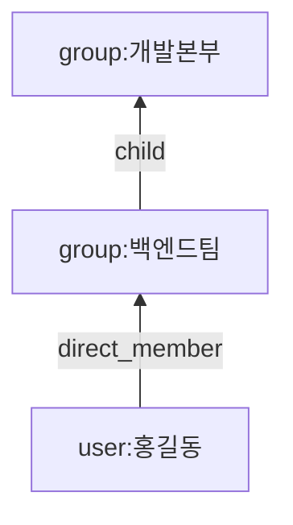

# 데이터 모델

> 기준 커밋: 5675b3c (ops-readiness, main 에 머지됨). 코드가 바뀌면 이 문서도 함께 고친다.
> 읽기 전에: [개요](01-개요.md), [용어집](02-용어집.md)

이 서버의 데이터는 두 곳에 산다.

- **OpenFGA [장부](02-용어집.md#장부)** — [튜플](02-용어집.md#튜플)이다. 권한을 묻는 앱이 읽는 것은 이것뿐이다.
- **DynamoDB 테이블 하나** — [현재상태](02-용어집.md#현재상태), [튜플 스냅샷](02-용어집.md#튜플-스냅샷), 그리고 운영에 필요한 기록(락, 실행 기록, 감사 이력 등)이다.

배포 하나는 커넥터 하나다. app-ldap 과 app-scim 은 테이블도 장부도 따로 쓴다. 기본 이름은 아래와 같다(`application.yml`).

| | app-ldap | app-scim |
|---|---|---|
| DynamoDB 테이블 `dynamodb.table-name` | `organization` | `organization-scim` |
| OpenFGA store `openfga.store-name` | `organization` | `organization-scim` |

이 문서의 예에는 아래 아이디를 쓴다.

| 무엇 | 아이디 |
|---|---|
| 직원 홍길동 | `3f6c1d52-8a0e-4b7d-9c21-5e0f7a4d2b18` |
| 조직 개발본부 | `5d0c7e2a-1b3f-4c8d-9e6a-2f4b8c1d7e90` |
| 조직 백엔드팀(개발본부의 하위 조직) | `8e4a2c6f-3d1b-4a9e-b7c5-0f2d6e8a4b13` |

---

## 1. OpenFGA

### 인가 모델

`authz-openfga/src/main/resources/authorization-model.fga` 의 전문이다. 실제로 등록하는 것은 같은 내용의 `authorization-model.json` 이다.

```
model
  schema 1.1

type user

type group
  relations
    define direct_member: [user]
    define child: [group]
    define member: direct_member or member from child
```

- `user` 는 관계가 없는 타입이다. 직원을 가리키는 자리로만 쓴다.
- `group.direct_member` — 직원이 이 조직에 직접 속한다. 이 서버가 쓴다.
- `group.child` — 다른 조직이 이 조직의 하위 조직이다. 이 서버가 쓴다.
- `group.member` — 계산 관계다. 직접 멤버이거나, 하위 조직의 `member` 이면 이 조직의 `member` 다. 이 서버는 쓰지 않고 묻기만 한다.

모델이 단조(monotonic)라는 점이 중요하다. 튜플을 지우면 권한은 줄어들기만 하고, 쓰면 늘어나기만 한다. [쓰기 단계](02-용어집.md#쓰기-단계)의 [안전성 논증](05-LDAP-동기화.md#83-왜-이-순서인가)이 이 성질에 기댄다.

### 튜플 두 가지

이 서버가 쓰는 튜플은 두 가지뿐이다. 둘 다 `RelationTuple`(core `model`)의 팩토리로 만든다.

| 종류 | 모양 | 뜻 | 팩토리 | 만드는 조건 |
|---|---|---|---|---|
| [direct_member](02-용어집.md#direct_member) | `(user:<직원 id>, direct_member, group:<조직 id>)` | 직원이 조직에 직접 속한다 | `RelationTuple.directMember` | 그 직원이 [활성](02-용어집.md#비활성)이고 그림에 있다 |
| [child](02-용어집.md#child) | `(group:<하위 id>, child, group:<상위 id>)` | 하위 조직이 상위 조직에 속한다 | `RelationTuple.child` | 하위 조직이 그림에 있고, 연결이 순환을 닫지 않는다 |

예:

```
(user:3f6c1d52-8a0e-4b7d-9c21-5e0f7a4d2b18, direct_member, group:8e4a2c6f-3d1b-4a9e-b7c5-0f2d6e8a4b13)
(group:8e4a2c6f-3d1b-4a9e-b7c5-0f2d6e8a4b13, child, group:5d0c7e2a-1b3f-4c8d-9e6a-2f4b8c1d7e90)
```

첫 줄은 "홍길동은 백엔드팀의 직속 멤버다", 둘째 줄은 "백엔드팀은 개발본부의 하위 조직이다" 이다. `child` 는 user 칸이 하위, object 칸이 상위다. 방향을 헷갈리기 쉽다.

튜플에는 조직명·계정명·이메일을 넣지 않는다. 식별자는 [불변 id](02-용어집.md#불변-id)뿐이다. 이름이 바뀌어도 튜플은 바뀌지 않는다. 그래서 OpenFGA 를 직접 열어 보면 누구의 튜플인지 읽기 어렵다 — 이름은 [관리 API](02-용어집.md#관리-api)로 본다.

디렉터리 그림을 튜플로 바꾸는 규칙은 `TupleMapper`(core `tuple`) 한 곳에만 있다.

| 메서드 | 답하는 질문 | 쓰는 곳 |
|---|---|---|
| `toTuples(그림)` | 있어야 할 튜플(D). 비활성 직원·그림에 없는 멤버를 빼고, 순환은 조직 id 사전순 DFS 로 back edge 를 버리고, 버린 연결을 `cutEdges` 로 준다 | LDAP 동기화·재적재, SCIM 재적재(버린 연결로 보류 목록을 다시 정한다) |
| `toTuples(그림, 보류)` | 위와 같되 [보류 목록](02-용어집.md#보류-목록)의 연결을 먼저 뺀다 | 아카이빙 |
| `toTuplesKeepingCycles(그림)` | 순환을 버리지 않은 목표. 순환 판단은 따로 한다(`OrgGraph`) | SCIM 쓰기 |
| `candidateTuples(그림)` | 멤버십에서 나올 수 있는 모든 튜플(활성·순환 무시). Check 로 물어볼 후보 | SCIM 쓰기, 아카이빙 |
| `inactiveMemberTuples(그림)` | 그림에 있는 비활성 직원의 `direct_member` | 삭제 가드의 [비활성 회수만 반영](02-용어집.md#비활성-회수만-반영) |

### 롤업

`member: direct_member or member from child` 때문에 권한이 하위 조직에서 상위 조직으로 올라간다.



이 두 튜플만 있으면 아래가 모두 참이다. 개발본부에 홍길동의 튜플을 따로 쓰지 않는다.

```
Check(user:홍길동, member, group:백엔드팀)   → true  (direct_member)
Check(user:홍길동, member, group:개발본부)   → true  (member from child)
Check(user:홍길동, direct_member, group:개발본부) → false (직접 멤버는 아니다)
```

(읽기 쉽게 이름으로 적었다. 실제 튜플에는 위 표의 아이디가 온다.)

### 권한을 묻는 앱이 묻는 것

[권한을 묻는 앱](02-용어집.md#권한을-묻는-앱)은 하나만 묻는다.

```
Check(user:<employeeId>, member, group:<orgCode>)
```

- `member` 로 묻는다. `direct_member` 로 물으면 상위 조직에 대해서는 늘 거짓이다.
- 앱은 로그인한 사용자를 먼저 [employeeId](02-용어집.md#employeeid)로 바꿔야 한다. 토큰의 사용자 식별과 자동으로 잇지 않는다. 관리 API `GET /admin/employees?userName=…` 이나 `?externalId=…` 로 찾는다([09 관리 API](09-관리-API.md)).
- 앱은 OpenFGA Check 캐시를 그대로 써도 된다. 이 서버 자신의 Check 만 캐시를 우회한다.

### 이 서버가 부르는 OpenFGA API

| API | 부르는 곳 | 옵션 |
|---|---|---|
| Write | `OpenFgaRelationTupleWriter.apply` — 모든 튜플 쓰기·지우기 | `transactions(true)`, `onDuplicate(IGNORE)`, `onMissing(IGNORE)`([멱등 옵션](02-용어집.md#멱등-옵션)). 배치 한도 `openfga.write-batch-size`(100), 동시 `openfga.request-concurrency`(4), 재시도 `openfga.max-retries`(3) |
| Check | `OpenFgaRelationTupleChecker.check` — 관리 API 조회 | `HIGHER_CONSISTENCY` |
| BatchCheck | `OpenFgaRelationTupleChecker.existing` — SCIM 쓰기의 [Check 기준선](02-용어집.md#check-기준선), 아카이빙 | `HIGHER_CONSISTENCY`, 50건씩, `correlationId` 로 응답을 잇는다 |
| Read | `OpenFgaRelationTupleScanner.scanAll` — [장부 훑기](02-용어집.md#장부-훑기) 전용 | `HIGHER_CONSISTENCY`, 페이지 100줄, 키 없는 요청(장부 전체) |
| ListStores·CreateStore·DeleteStore·ReadLatestAuthorizationModel·WriteAuthorizationModel | `StoreBootstrapper` — 장부 찾기·만들기(생성 스위치가 켜져 있을 때만), 인가 모델 비교·등록 | — |
| GetStore | `StoreBootstrapper.findExistingStore` — 헬스가 기억한 store 번호를 실제로 묻는다 | 404 면 "store 가 없다" |

ListObjects 는 쓰지 않는다. Read 는 장부 훑기만 쓴다 — `GetStore`·`ReadLatestAuthorizationModel` 은 튜플을 읽지 않으므로 이 원칙의 Read 가 아니다. Write 에 모델 id 를 넘기지 않아 서버의 최신 모델이 쓰인다. OpenFGA 서버는 v1.10.0 이상이어야 한다(`on_duplicate`·`on_missing` 이 그 버전부터 있다. [루트 README.md](../../README.md) 의 "요구 버전" 절).

### 장부를 찾고 만드는 법

`StoreBootstrapper.resolveStore`(authz-openfga)가 store 이름으로 store 번호를 해석한다. 쓰기·Check·Read 가 모두 이것을 거친다.

1. 이름이 `openfga.store-name` 인 store 를 목록에서 찾는다(continuation token 이 빌 때까지 모든 페이지).
2. 둘 이상이면 멈춘다 — 어느 쪽이 진짜인지 모르므로 오류를 내고 사람이 정리해야 한다.
3. 없으면, `openfga.create-store` 가 켜져 있을 때만 만든다(클래스 기본값·`prod` 는 `false`, 로컬 yml 은 `true`). 꺼져 있으면 `StoreNotFoundException` — "OpenFGA store <이름> 이 없다 — 처음 설치라면 openfga.create-store=true 로 한 번 띄운다". 만들었으면 만든 직후 목록을 다시 보고, 같은 이름이 여럿이면 가장 먼저 만든 것(createdAt, 같으면 id 사전순)을 쓴다. 그것이 내 것이 아니면 방금 만든 내 store 를 지운다(`convergeAfterCreate`). 빈 OpenFGA 에 인스턴스 둘이 동시에 처음 떠도 하나로 모인다.
4. 인가 모델을 맞춘다. 최신 모델(`readLatestAuthorizationModel`)을 읽어 `schema_version`·`type_definitions`·`conditions` 를 JSON 트리로 견주고, 같으면 쓰지 않는다. 모델이 없거나 다르거나 읽기가 실패하면 쓴다(`writeAuthorizationModel`). 견줄 때 빈 객체가 곧 내용인 칸(`this` — 직접 관계, `wildcard` — `user:*`)은 지우지 않는다. 성공하면 store 번호를 프로세스 안에 기억한다.

- 실패는 기억하지 않는다. 다음 호출이 다시 시도한다. 앱 시작 때 `OpenFgaStoreInitializer` 가 한 번 미리 해석한다. `StoreNotFoundException` 이면 기동을 멈추고, 그 밖의 실패(닿지 않음 등)는 기동을 막지 않는다([11 — 장부](11-운영.md#23-장부)).
- 모델은 내용이 다를 때만 쓰므로 기동마다 버전이 쌓이지 않는다. 같은 store 로 두 번 부트스트랩해도 모델이 하나인 것을 시험이 본다.
- `openfga.store-name` 에는 기본값이 없다. 비었으면 `StoreBootstrapper` 를 만들 때 기동을 멈춘다.
- 헬스 체크(`OpenFgaHealthIndicator`)는 `findExistingStore` 로 보기만 하고 store 를 만들지 않는다. 번호를 기억했으면 `GetStore` 로 실제로 묻고, 404 면 "store 가 없다" 로 DOWN 이다.
- 장부 번호는 한 번 만들면 바뀌지 않는다. 이 서버가 store 를 지우는 경우는 3번의 동시 생성 정리뿐이다.

### 튜플 칸의 길이

OpenFGA 튜플의 `user` 칸은 512바이트까지다. 이 수는 `KeyValueLimits`(core `model`)의 주석이 "실제 OpenFGA 로 확인했다" 고 적은 것이다. 이 묶음은 그 확인을 재현하지 않았다. 다른 문서는 이 한도를 말할 때 이 절을 가리킨다. 이 한도 때문에 SCIM 조직에 넣는 멤버 아이디를 500바이트로 막는다(`user:<id>` 면 507, `group:<id>` 면 506바이트까지 들어가므로 작은 쪽을 내렸다). 자세한 것은 [6. 키 길이 한도](#6-키-길이-한도).

---

## 2. 식별자

### 원천별 불변 id

| 원천 | 직원 id | 조직 id | 설정 |
|---|---|---|---|
| LDAP groupOfNames | 식별 속성 값. 기본 `entryUUID` | 그룹 엔트리의 식별 속성 값. 기본 `entryUUID` | `ldap.group-of-names.user-id-attribute`, `group-id-attribute` |
| LDAP DIT | 식별 속성 값. 기본 `entryUUID` | OU 엔트리의 식별 속성 값. 기본 `entryUUID` | `ldap.dit.user-id-attribute`, `group-id-attribute` |
| Active Directory | `objectGUID` 로 설정 | `objectGUID` 로 설정 | 위와 같은 설정 |
| SCIM | POST 때 서버가 발급하는 UUID | POST 때 서버가 발급하는 UUID | 없음 |

LDAP:

- `entryUUID`(RFC 4530)는 OpenLDAP·389DS·UnboundID 가 엔트리마다 만들어 두고 개명해도 바꾸지 않는다.
- `objectGUID` 는 16바이트 이진 값이다. 식별 속성 이름이 `objectGUID`(대소문자 무시)면 JNDI 이진 속성으로 자동 선언하고(`LdapConfig.jndiEnvironment`), AD 도구가 보여 주는 소문자 GUID 문자열로 바꾼다 — 앞 세 마디는 바이트 순서를 뒤집는다(`LdapIdentifiers.guid`). 16바이트가 아니면 데이터 오류(`DirectoryDataException`)다.
- 식별 값은 [정규화](02-용어집.md#정규화)를 거친다(`IdNormalizer.normalize`). 식별 속성이 없거나 빈 엔트리는 건너뛰고, 정규화 뒤 겹치는 엔트리는 먼저 읽은 쪽만 남긴다.
- `uid`·`cn`·`ou` 같은 이름 기반 속성도 설정할 수 있다. 그러면 개명이 삭제+생성이 된다 — 새 id 의 직원·조직이 생기고 옛 것의 튜플은 지워진다.

SCIM:

- `ScimUserHandler`·`ScimGroupHandler`(connector-scim)가 POST 마다 `UUID.randomUUID().toString()` 으로 새 아이디를 만든다(v4, 소문자, 하이픈). 요청 본문의 `id` 는 무시한다. PUT 도 경로의 `id` 가 기준이다.
- IdP 는 응답으로 받은 `id` 를 저장해 PATCH·PUT·DELETE 의 경로와 조직의 `members[].value` 에 쓴다. `members[].value` 도 정규화를 거치지만 UUID 에는 바뀌는 글자가 없다.
- 지운 직원과 같은 `userName` 으로 다시 만들어도 새 아이디라, 옛 아이디에 남은 권한을 물려받지 않는다.

### 직원의 식별자 넷

| 값 | 무엇 | 튜플에 쓰는가 | 예(SCIM) |
|---|---|---|---|
| `id` ([employeeId](02-용어집.md#employeeid)) | 불변 id | 쓴다 — `user:<id>` | `3f6c1d52-8a0e-4b7d-9c21-5e0f7a4d2b18` |
| [userName](02-용어집.md#username) | 계정명. LDAP 은 로그인 속성의 원본 값 | 쓰지 않는다 | `gd.hong` |
| [displayName](02-용어집.md#displayname) | 사람이 읽는 이름 | 쓰지 않는다 | `홍길동` |
| [externalId](02-용어집.md#externalid) | 원천의 외부 식별자. LDAP 은 절대 DN | 쓰지 않는다 | `00u1abcd2EFGH3ijk4l5` |

조직은 `id`([orgCode](02-용어집.md#orgcode)), `displayName`, `externalId` 셋이다. 조직에는 `userName` 이 없다.

LDAP 의 `externalId` 는 절대 DN 이다. 두 전략(groupOfNames, DIT) 모두 서버가 준 DN(컨텍스트 베이스에 상대적)에 `ldap.base-dn` 을 붙여 `LdapName` 으로 다시 쓴다(`LdapDns.절대로`). 예: `uid=gd.hong,ou=people,dc=example,dc=com`. 관리 API 의 직원 검색·상세 응답에 이 값이 실린다([09 — 직원](09-관리-API.md#3-직원)).

### 서버가 만드는 다른 아이디

| 아이디 | 형식 | 만드는 곳 |
|---|---|---|
| 스냅샷 id | `yyyyMMdd'T'HHmmssSSS-<LDAP\|SCIM>`(UTC). 예 `20261025T040000123-LDAP` | `SnapshotIds.generate`(core `tuple`) |
| 실행 기록 `runId` | UUID | `DynamoDbSyncRunRepository.start` |
| 감사 이력 원인 id | 회차면 `runId`, SCIM 요청이면 traceId(16진수 32자), traceId 를 모르면 임의 UUID | `AuditCause.run`, `AuditCause.scimRequest` |
| 락 토큰 | UUID. 회차는 시도마다 새로(`MutationLock.acquireOnce`), SCIM 쓰기는 줄 서기 한 번에 하나를 만들어 다시 시도에도 같은 토큰을 쓴다 | `MutationLock.acquireOnce`, `IncrementalSyncUseCase.잡는다` |
| 하루 1회 표지 `owner` | 잡을 때마다 UUID. 완료·해제의 조건이다 | `DailyOnce.run` |
| 락 `holder` | 인스턴스마다 UUID(재시작하면 바뀐다). 로그용이고 배제 판단에 쓰지 않는다 | `DynamoDbConfig.mutationLock` |

---

## 3. DynamoDB 단일 테이블

### 테이블 정의

`TableInitializer.createTable`(storage-dynamodb)이 만드는 모양이다. 테이블이 없고 `dynamodb.create-table-on-startup` 이 켜져 있을 때만 만든다(클래스 기본값·`prod` 는 `false`, 로컬 yml 은 `true`). `dynamodb.require-protection` 이면 삭제 보호를 켠 채 만들고 PITR 도 켠다. 테이블 이름(`dynamodb.table-name`)에는 기본값이 없다.

| 항목 | 값 |
|---|---|
| 기본 키 | 파티션키 `PK`(S), 정렬키 `SK`(S) |
| 과금 | `PAY_PER_REQUEST` |
| 선언한 속성 | `PK`, `SK`, `GSI1PK`, `GSI1SK`, `displayNameKey`, `externalId` — 모두 문자열(S) |
| GSI | `GSI1`, `GSI2`, `GSI3` — [4. GSI](#4-gsi) |
| TTL | `expiresAt` 속성(epoch 초). 테이블이 ACTIVE 가 된 뒤 켠다 — [5. TTL](#5-ttl) |

기동 때 늘 이 모양과 맞춰 본다(`TableInitializer.ensureTable`). 없는데 생성이 꺼져 있으면 기동을 멈춘다. 있으면 GSI1·GSI2·GSI3 의 유무와 키, GSI2 프로젝션(`INCLUDE` 이고 비키 속성이 정확히 `userName`·`displayName`·`active`·`externalId`), `expiresAt` TTL(`ENABLED` 또는 `ENABLING`)을 보고, 다르면 다른 점을 모두 적어 "테이블을 다시 만들어야 한다" 는 오류로 기동을 멈춘다. `require-protection` 이면 삭제 보호와 PITR 도 켜져 있어야 한다. 운영 배포 전이라 키 모양이 바뀌면 테이블을 다시 만든다는 것이 전제다([11 — 테이블](11-운영.md#22-테이블)).

키 규칙은 `Keys`(storage-dynamodb) 한 곳에만 있다. 키 문자열을 다른 곳에서 손으로 만들지 않는다.

### 아이템 한눈에

| 아이템 | PK | SK | GSI | TTL | 쓰는 앱 |
|---|---|---|---|---|---|
| [직원 META](#직원-meta) | `USER#<직원 id>` | `META` | GSI1·GSI2·GSI3 | 없음 | 둘 다 |
| [조직 META](#조직-meta) | `GROUP#<조직 id>` | `META` | GSI1·GSI3 | 없음 | 둘 다 |
| [멤버 줄](#멤버-줄) | `GROUP#<조직 id>` | `MEMBER#USER#<직원 id>` / `MEMBER#GROUP#<하위 id>` | 없음 | 없음 | 둘 다 |
| [소속 줄](#소속-줄) | `USER#<직원 id>` / `GROUP#<하위 id>` | `BELONGS_TO#GROUP#<조직 id>` | 없음 | 없음 | 둘 다 |
| [표지판](#표지판) | `UNIQUE#USERNAME` / `UNIQUE#GROUP_EXTERNAL_ID` | 값의 키 | 없음 | 없음 | SCIM |
| [보류 줄](#보류-줄) | `CYCLE_CUT` | `EDGE#<부모 id>\|<자식 id>` | 없음 | 없음 | SCIM |
| [스냅샷 메타](#스냅샷-메타) | `SNAPSHOT#<스냅샷 id>` | `META` | GSI1 | 없음(`retainUntil`) | 둘 다 |
| [본문 묶음](#본문-묶음) | `SNAPSHOT#<스냅샷 id>` | `CHUNK#0000` … | 없음 | 없음 | 둘 다 |
| [불확실 묶음](#불확실-묶음) | `SNAPSHOT#<스냅샷 id>` | `UNCERTAIN#0000` … | 없음 | 없음 | 둘 다(실제로는 U 가 생기는 회차만) |
| [옛 형식 튜플 줄](#옛-형식-튜플-줄) | `SNAPSHOT#<스냅샷 id>` | `TUPLE#<user>\|<relation>\|<object>` | 없음 | 없음 | 지금은 쓰지 않는다 |
| [스냅샷 포인터](#스냅샷-포인터) | `SNAPSHOT_POINTER` | `LATEST` | 없음 | 없음 | 둘 다(`writingSince` 는 LDAP 만) |
| [변경 락](#변경-락) | `LOCK#MUTATION` | `META` | 없음 | `expiresAt` | 둘 다 |
| [실행 기록](#실행-기록) | `SYNCRUN#<yyyy-MM>` | `<시작 시각>#<runId>` | 없음 | `expiresAt` | 둘 다 |
| [감사 이력 줄](#감사-이력-줄) | `AUDIT#USER#<id>` / `AUDIT#GROUP#<id>` | `<시각>#<원인 id>#<조각 번호>` | 없음 | `expiresAt` | 둘 다 |
| [책갈피](#책갈피) | `PAGE#<USER\|GROUP>#<ASC\|DESC>` | `START#<startIndex>` | 없음 | `expiresAt` | SCIM |
| [하루 1회 표지](#하루-1회-표지) | `DAILY#<작업>#<yyyy-MM-dd>` | `META` | 없음 | `expiresAt` | 둘 다 |

시각을 정렬키에 넣을 때는 늘 `Keys.sortableTimestamp` 를 거친다 — 밀리초 3자리를 고정해 `yyyy-MM-dd'T'HH:mm:ss.SSS'Z'` 로 쓴다. `Instant.toString()` 은 소수 자릿수가 달라져 문자열 순서가 시각 순서와 어긋날 수 있기 때문이다. 속성값의 시각(`createdAt` 등)은 정밀도를 잃지 않게 `Instant.toString()` 을 그대로 쓴다 — 소수 자릿수가 일정하지 않다.

### 파티션 모양

한 파티션에 여러 종류의 줄이 산다. 백엔드팀과 홍길동의 파티션을 정렬키 순서대로 적으면 이렇다.

```
PK = GROUP#8e4a2c6f-…(백엔드팀)
  SK = BELONGS_TO#GROUP#5d0c7e2a-…(개발본부)  ← 백엔드팀이 개발본부의 하위 조직이라는 소속 줄
  SK = MEMBER#GROUP#…                         ← 백엔드팀의 하위 조직이 있다면 그 멤버 줄
  SK = MEMBER#USER#3f6c1d52-…(홍길동)         ← 직원 멤버 줄
  SK = MEMBER#USER#…                          ← 다른 직원 멤버 줄
  SK = META                                   ← 조직 META(이름표)

PK = USER#3f6c1d52-…(홍길동)
  SK = BELONGS_TO#GROUP#8e4a2c6f-…(백엔드팀)  ← 소속 줄
  SK = META                                   ← 직원 META
```

- 조직 파티션의 멤버만 읽을 때는 `begins_with(SK, "MEMBER#")`, 그 가운데 직원만은 `MEMBER#USER#`, 하위 조직만은 `MEMBER#GROUP#` 로 읽는다.
- 조직 파티션을 통째로 읽는 `findGroup` 도 `META` 와 `MEMBER#` 줄만 골라 `DirectoryGroup` 을 만든다. 소속 줄은 접두가 달라 멤버로 오인되지 않는다.
- 멤버만 필요 없으면 META 하나만 GetItem 으로 읽는다(`findGroupHeader`, `findUser`). 읽는 양이 조직 크기를 따라가지 않게 하려는 것이다.

### 직원 META

| 키 | 값 |
|---|---|
| PK | `USER#<직원 id>` |
| SK | `META` |
| GSI1PK | `USER_INDEX` |
| GSI1SK | `Keys.indexKeyForWrite(userName)` — 소문자, 1024바이트 이하로 자름. `userName` 이 없거나 비면 직원 id |
| `displayNameKey`(GSI2 정렬키) | `Keys.indexKeyForWrite(displayName)`. `displayName` 이 없거나 비면 쓰지 않는다 — 그 직원은 GSI2 에 실리지 않는다 |

| 속성 | 타입 | 뜻 | 없을 수 있나 |
|---|---|---|---|
| `active` | BOOL | 활성 여부 | 늘 있다 |
| `externalId` | S | [externalId](02-용어집.md#externalid). GSI3 파티션키 | 있다 |
| `userName` | S | 계정명(원본 그대로) | 있다 |
| `displayName` | S | 표시명(원본 그대로) | 있다 |
| `email` | S | 이메일 하나 | 있다 |
| `nameFormatted`, `familyName`, `givenName`, `middleName`, `honorificPrefix`, `honorificSuffix` | S | 이름 여섯 칸(RFC 7643 `name`). `formatted` 만 `displayName` 과 헷갈리지 않게 `nameFormatted` 로 이름을 바꿨다 | 있다 |
| `createdAt` | S | 처음 만든 시각(`Instant.toString()`) | 이 기능 전에 만든 아이템에는 없다 |
| `updatedAt` | S | 마지막으로 **바뀐** 시각 | 위와 같다 |

예(SCIM 으로 만든 직원):

```json
{
  "PK": "USER#3f6c1d52-8a0e-4b7d-9c21-5e0f7a4d2b18",
  "SK": "META",
  "GSI1PK": "USER_INDEX",
  "GSI1SK": "gd.hong",
  "displayNameKey": "홍길동",
  "active": true,
  "externalId": "00u1abcd2EFGH3ijk4l5",
  "userName": "gd.hong",
  "displayName": "홍길동",
  "email": "gd.hong@example.com",
  "familyName": "홍",
  "givenName": "길동",
  "createdAt": "2026-10-25T04:00:00.123456Z",
  "updatedAt": "2026-10-25T04:00:00.123456Z"
}
```

쓰는 법(`DynamoDbDirectoryStateRepository` 의 `writeMeta`):

- PutItem 이 아니라 UpdateItem 이다. 키를 뺀 속성을 모두 `SET` 하고, 없을 수 있는 속성 가운데 이번 값에 없는 것은 `REMOVE` 한다 — 결과는 통째 교체와 같다.
- `updatedAt` 은 지금, `createdAt` 은 `if_not_exists` 로 처음 한 번만 넣는다. 처음 만들 때 두 시각은 같다.
- 저장본과 같으면 쓰지 않는다. 비교는 쓰려는 값을 한 번 아이템으로 만들었다 되읽은 값과 한다(빈 문자열은 저장되지 않아 되읽으면 null 이 되기 때문이다). 같은 값을 다시 쓰면 GSI1 의 `USER_INDEX` 한 파티션으로 쓰기가 몰리므로, 바뀐 것만 쓰는 것이 중요하다.
- 키 규칙이 바뀌어 저장된 아이템이 지금 규칙으로 만든 아이템과 다르면(두 시각은 빼고 비교), 값이 같아도 다시 쓴다(`Stored.current`).

### 조직 META

| 키 | 값 |
|---|---|
| PK | `GROUP#<조직 id>` |
| SK | `META` |
| GSI1PK | `GROUP_INDEX` |
| GSI1SK | `Keys.indexKeyForWrite(displayName)`. `displayName` 이 없거나 비면 조직 id |

| 속성 | 타입 | 뜻 |
|---|---|---|
| `externalId` | S | 없을 수 있다. GSI3 파티션키 |
| `displayName` | S | 없을 수 있다 |
| `createdAt`, `updatedAt` | S | 직원 META 와 같은 규칙. 조직은 이름표가 바뀌거나 **멤버가 바뀌어도** `updatedAt` 이 움직인다. 하위 조직이 지워지면 상위 조직의 `updatedAt` 만 올린다 |

조직 META 에는 `displayNameKey` 를 쓰지 않는다. 그래서 조직은 GSI2 에 실리지 않는다.

예(LDAP groupOfNames 로 읽은 조직):

```json
{
  "PK": "GROUP#8e4a2c6f-3d1b-4a9e-b7c5-0f2d6e8a4b13",
  "SK": "META",
  "GSI1PK": "GROUP_INDEX",
  "GSI1SK": "백엔드팀",
  "externalId": "cn=backend,ou=groups,dc=example,dc=com",
  "displayName": "백엔드팀",
  "createdAt": "2026-10-25T04:00:01.002Z",
  "updatedAt": "2026-10-25T04:00:01.002Z"
}
```

### 멤버 줄

| 키·속성 | 값 |
|---|---|
| PK | `GROUP#<조직 id>` |
| SK | `MEMBER#USER#<직원 id>` 또는 `MEMBER#GROUP#<하위 조직 id>`(`Keys.memberSk`) |
| `addedAt` | S. 처음 멤버가 된 시각 |

```json
{ "PK": "GROUP#8e4a2c6f-3d1b-4a9e-b7c5-0f2d6e8a4b13",
  "SK": "MEMBER#USER#3f6c1d52-8a0e-4b7d-9c21-5e0f7a4d2b18",
  "addedAt": "2026-10-25T04:00:01.010Z" }
```

- 이미 있는 멤버는 다시 쓰지 않는다. 다시 쓰면 `addedAt` 이 "최초 합류" 가 아니라 "마지막 동기화" 가 된다.
- GSI 키가 없다. 직원·조직 열거와 검색에 섞이지 않는다.
- 멤버 줄이 있는데 [튜플](02-용어집.md#튜플)이 없을 수 있다 — 비활성 직원, 순환이라 보류한 하위 조직이다. 멤버 줄은 디렉터리가 말한 사실이고, 튜플은 그 가운데 권한이 되는 것이다.

### 소속 줄

| 키·속성 | 값 |
|---|---|
| PK | `USER#<직원 id>`(직원 멤버) 또는 `GROUP#<하위 조직 id>`(하위 조직 멤버) — `Keys.memberPk` |
| SK | `BELONGS_TO#GROUP#<조직 id>`(`Keys.belongsToSk`) |
| `addedAt` | S |

```json
{ "PK": "USER#3f6c1d52-8a0e-4b7d-9c21-5e0f7a4d2b18",
  "SK": "BELONGS_TO#GROUP#8e4a2c6f-3d1b-4a9e-b7c5-0f2d6e8a4b13",
  "addedAt": "2026-10-25T04:00:01.010Z" }
```

멤버 줄과 소속 줄의 순서 규칙(`writeMembership`, `deleteUser`, `deleteGroup`):

- 넣을 때: 소속 줄 → 멤버 줄.
- 뺄 때: 멤버 줄 → 소속 줄.
- 직원 삭제: 소속 줄로 그 직원이 속한 조직을 찾아 그 조직들의 멤버 줄을 먼저 지우고, 직원 파티션(META·소속 줄)을 나중에 비운다.
- 조직 삭제: 상위 조직들의 "이 조직" 멤버 줄과 이 조직의 멤버 줄 → 상위 조직의 `updatedAt` → 이 조직의 소속 줄과 멤버들의 소속 줄 → META 맨 마지막. 지우기는 25개씩 묶어 보낸다. META 가 마지막이라 중간에 멈춰도 같은 삭제를 다시 부르면 남은 것을 마저 지운다.

이렇게 하면 어디서 멈춰도 남는 것은 "멤버 줄 없는 소속 줄" 뿐이다. 역참조(`findGroupIdsContaining`)는 소속 줄을 읽은 뒤 멤버 줄을 GetItem 으로 확인하므로 이 찌꺼기를 걸러 낸다. 반대 방향(소속 줄 없는 멤버 줄)이 남으면 역참조가 그 소속을 놓쳐, 조직을 지워도 권한이 남는다 — 그래서 막는다.

### 표지판

SCIM 테이블에만 생긴다. [표지판](02-용어집.md#표지판) 참고.

| 키·속성 | 값 |
|---|---|
| PK | `UNIQUE#USERNAME`(직원 userName) 또는 `UNIQUE#GROUP_EXTERNAL_ID`(조직 externalId) |
| SK | 값의 키. userName 은 소문자(`Locale.ROOT`), externalId 는 값 그대로(`UniqueKind.key`) |
| `ownerId` | S. 그 값을 쥔 직원·조직 id |
| `claimedAt` | N. 차지한 시각(epoch **밀리초**) |

```json
{ "PK": "UNIQUE#USERNAME", "SK": "gd.hong",
  "ownerId": "3f6c1d52-8a0e-4b7d-9c21-5e0f7a4d2b18", "claimedAt": 1792900800123 }
```

- 쓰기는 모두 조건부다 — 차지(`attribute_not_exists(PK)`, 실패하면 기존 줄을 돌려받는다), 넘겨받기(`ownerId = :옛_주인`), 놓기(`ownerId = :주인`). 락이 겹치는 틈에서도 남의 표지판을 덮어쓰지 않는다.
- 값이 없거나 공백뿐이면 표지판을 만들지 않는다. 키가 1024바이트를 넘으면 400 이다.
- GSI 키가 없다. 종류마다 파티션 하나라 [초기화](02-용어집.md#초기화)가 주인 목록을 강한 일관성으로 읽어 GSI 에서 빠진 직원·조직을 찾는 데도 쓴다.

### 보류 줄

SCIM 테이블에만 생긴다. [보류 목록](02-용어집.md#보류-목록) 참고.

| 키·속성 | 값 |
|---|---|
| PK | `CYCLE_CUT` |
| SK | `EDGE#<부모 조직 id>\|<자식 조직 id>`(`Keys.cutEdgeSk`) |
| `parent`, `child` | S. 키에도 있지만 줄만 보고 읽을 수 있게 둔다 |

```json
{ "PK": "CYCLE_CUT",
  "SK": "EDGE#8e4a2c6f-3d1b-4a9e-b7c5-0f2d6e8a4b13|5d0c7e2a-1b3f-4c8d-9e6a-2f4b8c1d7e90",
  "parent": "8e4a2c6f-3d1b-4a9e-b7c5-0f2d6e8a4b13",
  "child": "5d0c7e2a-1b3f-4c8d-9e6a-2f4b8c1d7e90" }
```

위 예는 "개발본부를 백엔드팀의 하위 조직으로 넣으려 했는데 순환이라 튜플을 쓰지 않았다" 는 뜻이다. 아이디에는 `|` 가 없으므로(정규화) 구분자로 쓸 수 있다. 보통은 비어 있어 읽기 한 번으로 끝난다.

### 스냅샷 메타

[튜플 스냅샷](02-용어집.md#튜플-스냅샷) 하나의 머리다.

| 키 | 값 |
|---|---|
| PK | `SNAPSHOT#<스냅샷 id>` |
| SK | `META` |
| GSI1PK | `SNAPSHOT_INDEX` |
| GSI1SK | `Keys.sortableTimestamp(createdAt)` |

| 속성 | 타입 | 뜻 |
|---|---|---|
| `createdAt` | S | 만든 시각 |
| `source` | S | `LDAP` 또는 `SCIM` |
| `tupleCount` | N | B 의 줄 수 |
| `chunkCount` | N | 본문 묶음 수. 튜플이 0줄이어도 1 이다(빈 목록의 압축본) |
| `uncertainCount` | N | U 의 줄 수. U 가 비면 이 칸이 없다 |
| `uncertainChunkCount` | N | 불확실 묶음 수. U 가 비면 이 칸이 없다 |
| `retainUntil` | N | 보관 기한(epoch 초) = 저장 시각 + `dynamodb.snapshot-retention-days`(기본 7일) |

```json
{ "PK": "SNAPSHOT#20261025T040000123-LDAP", "SK": "META",
  "GSI1PK": "SNAPSHOT_INDEX", "GSI1SK": "2026-10-25T04:00:00.123Z",
  "createdAt": "2026-10-25T04:00:00.123Z", "source": "LDAP",
  "tupleCount": 152340, "chunkCount": 18,
  "uncertainCount": 2, "uncertainChunkCount": 1,
  "retainUntil": 1793505600 }
```

`expiresAt` 이 없다는 점이 중요하다 — [5. TTL](#5-ttl).

### 본문 묶음

| 키·속성 | 값 |
|---|---|
| PK | `SNAPSHOT#<스냅샷 id>` |
| SK | `CHUNK#0000`, `CHUNK#0001`, …(`Keys.chunkSk`, 0~9999) |
| `data` | B. gzip 압축본을 자른 한 부분, 350,000바이트 이하 |

압축 전 본문은 튜플을 한 줄에 하나씩 `\n` 으로 이은 UTF-8 문자열이다. 한 줄의 모양은 [옛 형식 튜플 줄](#옛-형식-튜플-줄)의 SK 와 같다.

```
TUPLE#user:3f6c1d52-8a0e-4b7d-9c21-5e0f7a4d2b18|direct_member|group:8e4a2c6f-3d1b-4a9e-b7c5-0f2d6e8a4b13
TUPLE#group:8e4a2c6f-3d1b-4a9e-b7c5-0f2d6e8a4b13|child|group:5d0c7e2a-1b3f-4c8d-9e6a-2f4b8c1d7e90
```

줄바꿈이 든 튜플은 적지 않고 실패한다(아이디에는 공백류가 없다 — 정규화). 루트 README.md 는 UUID 아이디 규모 테스트에서 압축본 6.0MB·묶음 18개를 적었다(10만 명 규모의 값으로 쓰인다. 이 묶음은 재지 않았다).

### 불확실 묶음

[불확실 줄](02-용어집.md#불확실-줄)(U)을 본문과 같은 방식으로 압축해 나눈 것이다. SK 만 `UNCERTAIN#0000`, `UNCERTAIN#0001`, …(`Keys.uncertainChunkSk`)로 다르다. U 가 비면 하나도 쓰지 않는다.

### 옛 형식 튜플 줄

묶음 형식 전에는 튜플 한 줄을 아이템 하나(SK `TUPLE#<user>|<relation>|<object>`)로 저장했다. 지금은 쓰지 않는다.

- 메타에 `chunkCount` 가 없으면 옛 형식이라 보고 기준선으로 읽지 않는다(`SnapshotIntegrityException` — "메타에 묶음 수가 없다 — 옛 형식"). 운영 배포 전이라 이관하지 않는다.
- 남아 있는 옛 형식 줄은 보관 기한이 지나면 정리 작업이 BatchWriteItem 으로 함께 지운다(`deleteOldFormatRows`).

### 스냅샷 포인터

| 키·속성 | 값 |
|---|---|
| PK | `SNAPSHOT_POINTER` |
| SK | `LATEST` |
| `snapshotId` | S. 최신 스냅샷 id. 없을 수 있다 |
| `writingSince` | S. [기록 중 표시](02-용어집.md#기록-중-표시) — 쓰기를 시작한 시각. 없을 수 있다 |

```json
{ "PK": "SNAPSHOT_POINTER", "SK": "LATEST",
  "snapshotId": "20261025T040000123-LDAP" }
```

LDAP 회차가 쓰기 직전에 기록 중 표시를 붙이면 이렇게 된다(UpdateItem — 스냅샷 번호는 그대로).

```json
{ "PK": "SNAPSHOT_POINTER", "SK": "LATEST",
  "snapshotId": "20261025T040000123-LDAP",
  "writingSince": "2026-10-25T05:00:03.871Z" }
```

포인터 줄이 없을 때 기록 중 표시를 붙이면 `writingSince` 만 있는 줄이 생긴다. 세 [기준선 상태](02-용어집.md#기준선-상태)는 이 줄의 모습으로 정한다.

스냅샷 저장 순서(`DynamoDbTupleSnapshotRepository.save`):

1. 메타 — PutItem.
2. 본문 묶음 — 번호 순서로 하나씩 PutItem.
3. 불확실 묶음 — 번호 순서로 하나씩 PutItem(U 가 있을 때만).
4. 포인터 — `{PK, SK, snapshotId}` 로 통째 PutItem. 이때 `writingSince` 가 사라진다.

- 메타가 먼저라 묶음을 쓰다 죽어도 정리 작업이 메타로 그 묶음을 찾아 지운다. 포인터가 마지막이라 반쪽 스냅샷이 기준선이 되지 않는다.
- 묶음을 BatchWriteItem 으로 묶지 않는 까닭: 묶음 하나가 최대 약 350 WCU 라 여러 개를 한 번에 보내면 한 파티션의 쓰기 한도(초당 1,000)에 걸려 일부만 처리된다. 하나씩 보내면 스로틀이 요청 전체의 오류로 와 AWS SDK 의 재시도가 받는다.

스냅샷 읽기(`findLatest`, `findById`)는 파티션을 강한 일관성으로 읽고 다음을 검사한다. 하나라도 어긋나면 빈 기준선으로 넘어가지 않고 `SnapshotIntegrityException`(core `port`) — 메시지 끝은 "POST /admin/sync/rebuild 로 복구하세요" 다.

- 포인터가 가리키는 스냅샷의 메타가 있다.
- 메타에 묶음 수가 있다.
- 읽은 묶음 수가 메타와 같고, 번호가 0 부터 끊기지 않는다.
- 이어 붙인 본문이 gzip 으로 풀리고(빠지거나 깨진 묶음은 gzip 이 알아챈다), 모든 줄이 `TUPLE#` 줄이다.
- 푼 튜플 수가 메타의 `tupleCount` 와 같다.
- U 칸이 있으면 U 도 같은 검사를 받는다(메시지에 "불확실" 이 붙는다).
- B 와 U 가 겹치면 `TupleSnapshot` 생성자가 `IllegalArgumentException` 으로 거절한다. 이것만 `SnapshotIntegrityException` 이 아니다. 저장할 때도 같은 생성자를 거치므로 겹친 스냅샷은 애초에 만들어지지 않는다.

정리(`purgeExpired`, 하루 1회 `sync.purge-cron` 기본 `0 0 4-8 * * *` — 하루 창 안에서 성공할 때까지 매시, [하루 1회 표지](#하루-1회-표지) `ldap-purge`·`scim-purge`):

1. 포인터를 강한 일관성으로 읽어 최신 id 를 얻는다. 읽지 못하면 정리 전체를 멈춘다(최신이 없다고 보지 않는다).
2. GSI1 `SNAPSHOT_INDEX` 를 최신순으로 훑어 `retainUntil ≤ 지금` 이고 최신이 아닌 스냅샷을 고른다(GSI1 이 `ALL` 이라 다시 읽지 않는다).
3. 스냅샷마다 메타가 아닌 줄(묶음은 하나씩 DeleteItem, 옛 형식 줄은 [일괄 요청](02-용어집.md#일괄-요청))을 먼저, 메타를 마지막에 지운다. 동시에 4개 스냅샷까지.

### 변경 락

[변경 락](02-용어집.md#변경-락) 아이템이다. 테이블마다 하나다.

| 키·속성 | 값 |
|---|---|
| PK | `LOCK#MUTATION` |
| SK | `META` |
| `token` | S. 이번 점유의 토큰(UUID) |
| `holder` | S. 인스턴스 id(로그용) |
| `purpose` | S. `WRITE`·`REBUILD`·`SYNC`([용도](02-용어집.md#용도)) |
| `expiresAt` | N. 리스 만료(epoch 초) = 지금 + `dynamodb.lock-ttl`(30초). 테이블 TTL 속성과 같은 칸이다 |

```json
{ "PK": "LOCK#MUTATION", "SK": "META",
  "token": "b0e7c2d4-6a1f-4f3e-9c8b-7d5a2e1f0c93",
  "holder": "4c9e1a7b-2d3f-4e5a-8b6c-1f0e9d8c7b6a",
  "purpose": "SYNC", "expiresAt": 1792900830 }
```

| 동작 | DynamoDB 호출 | 조건 |
|---|---|---|
| 잡기 | PutItem | `attribute_not_exists(PK) OR expiresAt < :now OR token = :token` — 아무도 없거나, 만료됐거나, 내 토큰(응답을 잃은 재시도, 시도 한도로 끊긴 뒤의 다시 시도)이면. 조건이 깨지면 기존 줄을 돌려받아 쥔 쪽의 용도를 안다. SCIM 쓰기의 시도는 이 요청에 시도 한도(`apiCallTimeout`)를 단다 |
| 갱신 | UpdateItem `SET expiresAt` | `token = :token`. 깨지면 "변경 락 리스를 잃었습니다" |
| 반납 | DeleteItem | `token = :token`. 깨지면 경고만 남긴다 — 이미 남이 가져갔다 |
| 들여다보기 | GetItem(강한 일관성) | `expiresAt ≥ 지금` 인 줄만 쥔 것으로 본다 |

테이블 TTL 은 만료된 락 줄을 늦게 지우므로, 코드는 `expiresAt` 을 직접 비교한다. 자세한 동작은 [08 동시성과 작업](08-동시성과-작업.md).

### 실행 기록

| 키 | 값 |
|---|---|
| PK | `SYNCRUN#<yyyy-MM>`(시작 시각의 UTC 연월, 예 `SYNCRUN#2026-10`) |
| SK | `<Keys.sortableTimestamp(startedAt)>#<runId>` |

| 속성 | 타입 | 뜻 |
|---|---|---|
| `runId` | S | UUID |
| `source` | S | `LDAP`·`SCIM` |
| `trigger` | S | [트리거](02-용어집.md#트리거) |
| `startedAt` | S | 시작 시각 |
| `finishedAt` | S | 끝난 시각. `RUNNING` 이면 없다 |
| `status` | S | [실행 상태](02-용어집.md#실행-상태) |
| `writtenCount`, `deletedCount`, `failureCount` | N | 쓴·지운·실패한 튜플 수 |
| `snapshotId` | S | 남긴 스냅샷 id. 없을 수 있다 |
| `message` | S | 사유·메모. 없을 수 있다 |
| `expiresAt` | N | 시작 시각 + `dynamodb.syncrun-retention-days`(30일) |

```json
{ "PK": "SYNCRUN#2026-10",
  "SK": "2026-10-25T04:00:00.015Z#9a7c3e1f-5b2d-4c8e-a6f0-3d1b7e9c2a54",
  "runId": "9a7c3e1f-5b2d-4c8e-a6f0-3d1b7e9c2a54",
  "source": "LDAP", "trigger": "SCHEDULED",
  "startedAt": "2026-10-25T04:00:00.015Z", "finishedAt": "2026-10-25T04:01:12.480Z",
  "status": "SUCCEEDED", "writtenCount": 3, "deletedCount": 1, "failureCount": 0,
  "snapshotId": "20261025T040112301-LDAP", "expiresAt": 1795492800 }
```

- 매번 통째 PutItem 이다. 열 때 `RUNNING` 으로 한 번, 끝날 때 결과로 한 번 쓴다.
- 죽은 회차를 닫는 `abandon` 만 조건 `status = RUNNING` 을 단다 — 방금 끝난 기록을 덮어쓰지 않는다.
- 읽기는 이번 달 파티션을 최신순으로 읽고, 모자라면 지난달까지 읽는다(`findRecent`, `findById`). 보관이 30일이라 그보다 앞선 달은 보지 않는다. 최종 일관성 읽기다.
- [죽은 기록 닫기](02-용어집.md#죽은-기록-닫기)는 `findRunning` 으로 두 파티션을 Query 하며 `status = RUNNING` 거름식을 단다. 거름식은 읽은 뒤에 걸러 읽기 용량은 두 파티션 전체만큼 든다.

### 감사 이력 줄

[감사 이력](02-용어집.md#감사-이력) 한 줄(대상 하나 × 사건 하나)이다. 목록 값이 어림 300,000바이트(`DynamoDbAuditLog.PART_BUDGET`)를 넘으면 한 줄을 조각 몇 개로 나눈다. 아이템 한도 400KB 안에 머물게 하려는 것이라, 300~400KB 사이의 줄도 조각이 된다.

| 키 | 값 |
|---|---|
| PK | `AUDIT#USER#<직원 id>` 또는 `AUDIT#GROUP#<조직 id>`(`Keys.auditPk`). 직원·조직 파티션과 따로라 그것을 지워도 남는다 |
| SK | `<Keys.sortableTimestamp(시각)>#<원인 id>#<조각 번호 네 자리>`. 조각이 하나여도 `#0000` 이 붙는다 |

| 속성 | 타입 | 뜻 | 어느 조각에 |
|---|---|---|---|
| `at` | S | 사건의 시각 | 모든 조각 |
| `source`, `kind`, `causeId` | S | [원인](02-용어집.md#원인) | 모든 조각 |
| `part`, `parts` | N | 조각 번호, 전체 조각 수 | 모든 조각 |
| `expiresAt` | N | `at` + `dynamodb.audit-retention-days`(30일) | 모든 조각 |
| `created`, `deleted` | BOOL | 참일 때만 쓴다 | 0번 |
| `attributes` | L(M) | 바뀐 속성 `{name, before, after}` — 없던 값은 칸이 없다 | 0번 |
| `joined`, `left` | L(S) | 들어간·나간 조직 id | 앞 조각부터 채움 |
| `membersAdded`, `membersRemoved` | L(S) | 조직 줄만. `USER#<id>`·`GROUP#<id>` | 앞 조각부터 채움 |
| `granted`, `revoked` | L(S) | 쓴·지운 튜플. `<user>\|<relation>\|<object>` | 앞 조각부터 채움 |

빈 목록은 쓰지 않는다. 조각 하나에 담는 목록 값은 어림 300,000바이트(값의 UTF-8 바이트 + 4)까지다(`DynamoDbAuditLog.PART_BUDGET`).

```json
{ "PK": "AUDIT#USER#3f6c1d52-8a0e-4b7d-9c21-5e0f7a4d2b18",
  "SK": "2026-10-25T04:01:12.290Z#9a7c3e1f-5b2d-4c8e-a6f0-3d1b7e9c2a54#0000",
  "at": "2026-10-25T04:01:12.290Z",
  "source": "LDAP", "kind": "SYNC", "causeId": "9a7c3e1f-5b2d-4c8e-a6f0-3d1b7e9c2a54",
  "part": 0, "parts": 1, "expiresAt": 1795492872,
  "attributes": [ { "name": "displayName", "before": "홍길동", "after": "홍길동(개발)" } ],
  "joined": [ "8e4a2c6f-3d1b-4a9e-b7c5-0f2d6e8a4b13" ],
  "granted": [ "user:3f6c1d52-8a0e-4b7d-9c21-5e0f7a4d2b18|direct_member|group:8e4a2c6f-3d1b-4a9e-b7c5-0f2d6e8a4b13" ] }
```

- 쓰기는 BatchWriteItem(25개씩)이다. 일괄 요청 하나가 끝내 실패해도 나머지는 계속 쓰고, 실패한 아이템 수를 돌려준다.
- 읽기는 대상 파티션을 역순으로 Query 한다. 역순이라 한 줄의 조각은 번호가 큰 것부터 오고 0번이 마지막이다. 0번에서 끊어 합치고, 조각이 모자란 줄은 버린다 — 빠질 수는 있어도 틀린 줄은 돌려주지 않는다. 다음 쪽 커서는 늘 0번 조각의 키를 가리킨다.

### 책갈피

SCIM 테이블에만 생긴다. [책갈피](02-용어집.md#책갈피) 참고.

| 키·속성 | 값 |
|---|---|
| PK | `PAGE#<USER\|GROUP>#<ASC\|DESC>`(`Keys.pagePk`) |
| SK | `START#<startIndex>`(`Keys.pageSk`) — 이 책갈피로 이어 읽는 `startIndex` |
| `position` | S. 저장소가 만든 불투명 위치(GSI1 커서) |
| `totalResults` | N. 이 가져오기의 첫 페이지에서 센 전체 수 |
| `expiresAt` | N. 지금 + 15분(`DynamoDbPageBookmarkRepository.TTL`) |

```json
{ "PK": "PAGE#USER#ASC", "SK": "START#101",
  "position": "<불투명 위치>", "totalResults": 100000, "expiresAt": 1792901700 }
```

테이블 TTL 은 늦게 지우므로 읽을 때 `expiresAt` 을 직접 보고, 지났으면 없는 것으로 본다. 강한 일관성으로 읽는다 — 다른 인스턴스가 바로 전에 쓴 책갈피를 놓치면 앞을 건너뛰어 읽느라 페이지당 비용이 전원 수로 뛴다.

### 하루 1회 표지

| 키·속성 | 값 |
|---|---|
| PK | `DAILY#<작업>#<yyyy-MM-dd>`(앱 시계의 UTC 날짜). 작업은 `ldap-purge`, `scim-archive`, `scim-purge` |
| SK | `META` |
| `state` | S. `CLAIMED`(잡음) 또는 `DONE`(완료) |
| `owner` | S. 잡을 때마다 새로 만드는 UUID |
| `leaseUntil` | N. [임대](02-용어집.md#임대) 끝(epoch 초) = 잡은 때 + `sync.job-timeout` + 5분 |
| `expiresAt` | N. 지금 + 3일 |

```json
{ "PK": "DAILY#scim-archive#2026-10-25", "SK": "META",
  "state": "CLAIMED", "owner": "7d2c9e41-0b3a-4f6e-8a15-c3e9f2d17b60",
  "leaseUntil": 1792893900, "expiresAt": 1793152800 }
```

| 동작 | DynamoDB 호출 | 조건 |
|---|---|---|
| 잡기 | PutItem(`state = CLAIMED`) | `attribute_not_exists(PK) OR (state = CLAIMED AND leaseUntil < :now)` — 줄이 없거나, 임대가 끝난 잡음이면. `DONE` 이면 못 잡는다 |
| 완료 | UpdateItem `SET state = DONE` | `owner = :owner` |
| 해제 | DeleteItem | `owner = :owner` |

완료·해제의 조건이 깨지면(남의 표지이거나 없음) INFO 만 남기고 아무것도 하지 않는다. 날짜가 키에 있어 다음 날은 새 줄이다. 동작은 [07 — 하루 1회 표지](07-재적재-초기화-아카이빙.md#8-하루-1회-표지).

---

## 4. GSI

| 인덱스 | 파티션키 | 정렬키 | 프로젝션 | 실리는 아이템 |
|---|---|---|---|---|
| GSI1 | `GSI1PK` | `GSI1SK` | `ALL` | 직원 META(`USER_INDEX`), 조직 META(`GROUP_INDEX`), 스냅샷 메타(`SNAPSHOT_INDEX`) |
| GSI2 | `GSI1PK`(같은 속성) | `displayNameKey` | `INCLUDE` — `userName`, `displayName`, `active`, `externalId` | `displayName` 이 있는 직원 META 만 |
| GSI3 | `externalId` | `PK` | `KEYS_ONLY` | `externalId` 가 있는 직원·조직 META |

DynamoDB 는 인덱스의 키 속성을 전부 가진 아이템만 인덱스에 싣는다. 멤버 줄·소속 줄·표지판·보류 줄·락·실행 기록·감사 이력·책갈피·하루 1회 표지에는 GSI 키 속성이 없어 어느 인덱스에도 실리지 않는다. GSI 읽기는 모두 최종 일관성이다 — 방금 쓴 것이 잠깐 안 보일 수 있다.

### GSI1

직원·조직·스냅샷을 **열거**하고, 계정명·조직명으로 찾는다. Scan 을 쓰지 않으려고 META 마다 고정 파티션키를 단다(Scan 은 같은 테이블의 스냅샷 묶음까지 읽는다).

| 쓰는 곳 | 질의 |
|---|---|
| LDAP 현재상태 교체 `replaceWith` | `USER_INDEX`·`GROUP_INDEX` 전체 — `ALL` 이라 저장본을 함께 받아 비교한다 |
| SCIM 재적재·아카이빙 `loadAll` | `USER_INDEX`·`GROUP_INDEX` 전체에서 아이디만 뽑는다. 직원은 BatchGet(100개씩, 강한 일관성), 조직은 조직마다 파티션을 다시 읽는다 |
| 관리 API 직원 `?userName=` | `USER_INDEX` 에서 `begins_with(GSI1SK, 소문자 접두사)` |
| 관리 API 조직 `?displayName=` | `GROUP_INDEX` 에서 `begins_with(GSI1SK, 소문자 접두사)` |
| SCIM `filter=userName eq`, 조직 `displayName eq` | `GSI1SK = 소문자 값` — 대소문자만 다른 둘이 있으면 둘 다 나온다 |
| SCIM 필터 없는 목록, `totalResults` 세기, 건너뛰기 | 파티션을 정렬키 순(내림차순이면 역순)으로 |
| 스냅샷 정리 `purgeExpired` | `SNAPSHOT_INDEX` 를 최신순으로. 포트의 `listRecent` 도 같은 질의지만 main 코드에서 부르는 곳이 없다 |

`USER_INDEX`·`GROUP_INDEX` 는 파티션키 값이 하나라 GSI 쓰기가 한 파티션으로 몰린다. 그래서 META 는 바뀌었을 때만 쓴다([직원 META](#직원-meta)).

### GSI2

관리 API 의 직원 표시명 접두사 검색(`GET /admin/employees?displayName=`) 전용이다. `GSI1PK = USER_INDEX` 이고 `begins_with(displayNameKey, 소문자 접두사)` 로 찾는다. `INCLUDE` 라 검색 결과 한 줄(아이디·계정명·표시명·활성·`externalId`)을 그리는 데 본 테이블을 다시 읽지 않는다. `externalId` 는 GSI3 의 파티션키 속성이지만 이 인덱스에서는 키가 아니라 비키 속성으로 실을 수 있다(DynamoDB Local 2.5.3 으로 확인했다. 실제 AWS 는 확인하지 못했다).

- 조직 META 에는 `displayNameKey` 가 없어 실리지 않는다. 조직 표시명 검색은 GSI1 이다.
- 프로젝션 속성 목록은 인덱스를 만들 때 굳는다. 그래서 기동 때 모양 검사가 프로젝션도 본다(`TableInitializer.GSI2_PROJECTION` 하나를 생성과 검사가 함께 쓴다) — 목록이 다른 옛 테이블이면 기동을 멈춘다. 이 목록은 쓰는 쪽(`DynamoDbDirectoryStateRepository` 의 속성 이름)·읽는 쪽(`DynamoDbDirectorySearchRepository.toUserSummary`)과 같아야 한다.

### GSI3

`externalId` 로 직원·조직을 정확히 찾는다. 새 속성을 만들지 않고 아이템이 이미 가진 `externalId` 를 파티션키로, 본 테이블 `PK` 를 정렬키로 쓴다.

- 질의: `externalId = :값 AND begins_with(PK, "USER#")`(조직이면 `"GROUP#"`), 결과에서 `SK = META` 만 남긴다(`pksByExternalId`).
- `KEYS_ONLY` 라 찾은 `PK` 로 본 테이블을 강한 일관성으로 다시 읽고, `externalId` 가 아직 같은 것만 돌려준다. 인덱스가 늦어도 낡은 속성을 돌려주지 않는다.
- 쓰는 곳: 관리 API `?externalId=`(직원·조직), SCIM `filter=externalId eq`.
- SCIM 조직의 `externalId` 유일성 판정은 GSI3 가 아니라 [표지판](#표지판)이다.

---

## 5. TTL

테이블 TTL 은 `expiresAt` 속성(epoch 초) 하나만 본다(`Keys.EXPIRES_AT`). 이 속성을 쓰는 아이템은 다섯이다.

| 아이템 | `expiresAt` | 설정 |
|---|---|---|
| 변경 락 | 리스 만료 = 잡은·갱신한 때 + 30초 | `dynamodb.lock-ttl` |
| 실행 기록 | 시작 시각 + 30일 | `dynamodb.syncrun-retention-days` |
| 감사 이력 줄 | 사건 시각 + 30일 | `dynamodb.audit-retention-days` |
| 책갈피 | 쓴 때 + 15분 | 상수 |
| 하루 1회 표지 | 쓴 때 + 3일 | 상수 |

- 테이블 TTL 은 만료된 아이템을 늦게(며칠 걸릴 수 있다) 지운다. 그래서 락과 책갈피는 읽을 때 `expiresAt` 을 직접 비교한다. 감사 이력은 기한이 막 지난 줄이 며칠 보일 수 있다.
- 감사 이력 보관을 늘리려면 실행 기록 보관도 함께 늘린다 — 이력의 원인 회차로 거슬러 갈 곳이 먼저 사라지면 안 된다. 다만 실행 기록 읽기는 이번 달과 지난달만 보므로, 30일보다 길게 늘려도 그 이전 기록은 관리 API 로 찾히지 않는다.
- 기존 테이블에 TTL 을 켜 주지 않는다. `TableInitializer` 는 테이블을 새로 만들 때만 TTL 을 켜고, 있는 테이블은 `expiresAt` TTL 이 켜져 있는지(`ENABLED`·`ENABLING`) 확인해 아니면 기동을 멈춘다 — 손으로 만들며 TTL 을 빠뜨리면 실행 기록·감사 이력·책갈피가 끝없이 쌓이기 때문이다.

TTL 이 **없는** 아이템과 그 까닭:

| 아이템 | 까닭 |
|---|---|
| 직원·조직 META, 멤버 줄, 소속 줄 | 현재상태다. 디렉터리가 지울 때 지운다 |
| 표지판, 보류 줄 | 현재상태와 함께 산다. 주인이 사라지면 쓰기 경로·초기화가 지운다 |
| 스냅샷 메타·본문 묶음·불확실 묶음 | TTL 은 아이템마다 붙은 시각만 보고 지워 최신인지 모른다. 최신(비교 기준)까지 지워지면 다음 LDAP 회차가 기준선을 잃는다. 대신 메타의 `retainUntil` 과 정리 작업 `purgeExpired` 가 최신을 건너뛰며 지운다 |
| 스냅샷 포인터 | 최신을 가리키는 유일한 줄이다 |

---

## 6. 키 길이 한도

### 한도

| 키 | 한도(UTF-8 바이트, 접두어 포함) | 상수 |
|---|---|---|
| 파티션키(본 테이블·GSI) | 2048 | `Keys.MAX_PARTITION_KEY_BYTES` |
| 정렬키(본 테이블·GSI) | 1024 | `Keys.MAX_SORT_KEY_BYTES` |

실제 DynamoDB 는 한도를 넘는 키를 `ValidationException` 으로 거절한다. DynamoDB Local 은 호출에 따라 거절하지 않기도 한다(Query 의 파티션키 값) — 그래서 시험은 Local 의 거절에 기대지 않고 요청을 보냈는지를 본다(`Keys` 주석).

### 쓸 때 — 색인 정렬키를 자른다

색인 정렬키 둘(`GSI1SK` — 직원 userName·조직 displayName, `displayNameKey` — 직원 displayName)은 `Keys.indexKeyForWrite` 로 만든다.

1. 소문자로 바꾼다(`Locale.ROOT`) — `Keys.indexKey`.
2. 1024바이트 이하면 그대로 쓴다.
3. 넘으면 코드 포인트 경계에서 1024바이트 이하로 자른다.

- 소문자로 **먼저** 바꾸고 자른다. U+0130(İ)은 소문자로 바꾸면 2바이트에서 3바이트가 되므로, 원래 값을 먼저 자르면 소문자 키가 한도를 넘을 수 있다.
- 서로게이트 쌍(4바이트 문자)을 가르지 않는다. 홀로 남은 서로게이트는 `?` 로 바뀌어 키가 달라진다.
- 원래 값은 `userName`·`displayName` 속성에 그대로 있다. 키만 앞부분을 가진다.
- 실제로 잘리는 것은 LDAP 값뿐이다. 조직 표시명의 기본 속성이 자유 서술인 `description` 이라 길 수 있다. SCIM 은 같은 한도를 넘는 값을 core 가 먼저 거절한다(아래).
- 잘린 값은 이름으로 정확히 찾히지 않는다(조회 키는 자르지 않으므로). 목록·정렬·짧은 접두사 검색에는 나온다.
- `externalId` 는 GSI3 의 파티션키 속성 그 자체라 자르지 않는다.

### SCIM 쓰기의 한도

SCIM 쓰기는 락 안에서, 표지판을 차지하기 전, OpenFGA 를 보기 전에 `KeyValueLimits`(core `model`)로 한도를 본다. 넘으면 `ValueTooLongException` → 400 `invalidValue` 이고 아무것도 쓰지 않는다.

| 값 | 한도 | 재는 법 |
|---|---|---|
| 직원 `userName`, 직원·조직 `displayName` | 1024바이트 | 소문자로 바꾼 뒤 |
| 직원·조직 `externalId` | 1024바이트 | 값 그대로(공백뿐인 값도) |
| 조직에 **넣는** 멤버의 아이디 | 500바이트 | 값 그대로. 빼는 멤버는 보지 않는다 |
| 표지판 키 | 1024바이트(`UniqueKind.MAX_KEY_BYTES`) | 포트 계약으로 한 번 더 본다 |

### 읽을 때 — 한도를 넘는 조회 키

한도를 넘는 키의 아이템은 있을 수 없다. 그래서 클라이언트 값이 키가 되는 읽기는 접두어까지 붙인 최종 키를 재고, 넘으면 DynamoDB 를 부르지 않고 "없음" 으로 답한다. 실제 DynamoDB 에 보내면 `ValidationException` 이 나 요청이 500 이 되기 때문이다.

| 읽기 | 재는 것 | 넘을 때 |
|---|---|---|
| `findUser`, `findGroup`, `findGroupHeader`, `findMemberRefs` | `USER#<id>`·`GROUP#<id>` 파티션키 | 빈 결과 |
| `findUsers`, `findMemberTypes` | 키마다 | 넘는 키만 빼고 일괄 읽기(BatchGet) |
| `findMembers`, `containsMember` | 조직 파티션키와 `MEMBER#…` 정렬키 | 그 후보는 멤버가 아니다 |
| `findGroupIdsContaining` | 멤버 쪽 파티션키 | 빈 결과 |
| `findUserIdsByExternalId`, `findGroupIdsByExternalId` | `externalId`(GSI3 파티션키) | 빈 결과 |
| 관리 API 검색 | 소문자로 바꾼 접두사(GSI 정렬키) | 빈 쪽 |
| 조직 요약·직원 멤버 목록·하위 조직 | `GROUP#<orgCode>` | 빈 결과·빈 쪽 |
| SCIM 단건·정확 일치 조회 | 파티션키, 소문자 값 | 404 또는 빈 목록(`totalResults` 0) |
| 감사 이력 | `AUDIT#…` 파티션키 | 빈 쪽 |
| 관리 API 의 커서(검색·조직 멤버 목록·감사 이력) | 커서 안의 정렬키(1024), 검색 커서는 `PK` 도(2048) | 400 |

### 막지 않는 것

LDAP 에서 온 아이디와 DN 의 길이는 쓰기 전에 보지 않는다. 아이디는 파티션키(`USER#<id>`·`GROUP#<id>`, 2048바이트)뿐 아니라 정렬키에도 들어간다 — [멤버 줄](#멤버-줄)의 `MEMBER#USER#<id>`·`MEMBER#GROUP#<id>`, [소속 줄](#소속-줄)의 `BELONGS_TO#GROUP#<조직 id>` 다. 정렬키 한도는 1024바이트라, 소속이 있는 직원·조직은 아이디가 약 1,000바이트만 넘어도 파티션키보다 먼저 이 한도에 닿는다. DN(`externalId`, GSI3 파티션키)은 2048바이트가 한도다. 어느 쪽이든 넘으면 그 아이템의 쓰기를 DynamoDB 가 거절하고 그 회차의 현재상태 교체가 실패한다(루트 README.md 의 "긴 표시명·계정명은 색인 키만 잘라 저장한다" 문단도 같은 한계를 적는다). 기본 식별 속성(`entryUUID`, `objectGUID`)은 36자라 해당하지 않는다.

---

## 7. 읽기 일관성

| 강한 일관성(`consistentRead=true`) | 최종 일관성 |
|---|---|
| 직원·조직 META GetItem(`findUser`, `findGroupHeader`, SCIM 응답용 `DynamoDbDirectoryQueryRepository.findUser`·`findGroupHeader`) | 모든 GSI 질의(GSI1·GSI2·GSI3) |
| 조직 파티션 Query(`findGroup`, `findMemberRefs`, 관리 API 멤버 목록·하위 조직) | 관리 API 조직 요약 GetItem(`DynamoDbDirectorySearchRepository.findGroupSummary`) |
| BatchGetItem 전부(`BatchRequests.get`) | 실행 기록 Query(`SYNCRUN#…`) |
| 역참조(소속 줄 Query + 멤버 줄 GetItem) | 감사 이력 Query(`AUDIT#…`) |
| 스냅샷 포인터, 스냅샷 파티션 | |
| 변경 락 들여다보기 | |
| 표지판 주인 목록·비우기 | |
| 보류 목록 | |
| 책갈피 | |

쓰기 판단에 쓰는 읽기는 강한 일관성이다. SCIM 쓰기에서는 기준선이 OpenFGA 의 Check 라, 현재상태를 낡게 읽으면 그것이 곧 잘못된 지우기가 되기 때문이다(`DynamoDbDirectoryStateRepository` 클래스 주석 "강한 일관성"). 강한 읽기는 RCU 가 두 배다.

GSI 가 최종 일관성이라 생기는 일과 그 대응:

- LDAP 현재상태 교체는 GSI1 로 저장본을 읽어 비교한다. LDAP 앱에는 그와 동시에 직원·조직을 쓰는 경로가 없고 이전 회차는 끝나 있어, 인덱스가 이미 맞춰져 있다고 전제한다.
- SCIM 재적재는 락 직전에 커밋된 쓰기가 아직 GSI 에 없으면 그 대상을 빠뜨릴 수 있다. 그래서 지우기 전에, 지울 후보가 가리키는 대상 가운데 열거에서 빠진 것을 본 테이블에서 강한 일관성으로 다시 읽는다([07 재적재·초기화·아카이빙](07-재적재-초기화-아카이빙.md)).
- 관리 API `?externalId=` 는 방금 만든 리소스가 잠깐(보통 1초 미만) 안 나올 수 있다.

---

## 더 깊이

배경이 궁금하면 아래 설계 문서를 본다. 본문은 이 문서들 없이 이해되도록 썼다. 2026-08-14 설계의 §6 표는 지금 코드와 다르다(스냅샷 형식·TTL·쓰기 순서) — 이 문서가 지금의 모양이다.

- 멤버 줄·소속 줄: `docs/superpowers/specs/2026-09-16-strong-membership-lookup-design.md`
- GSI1 소문자 키·GSI3·책갈피·TTL: `docs/superpowers/specs/2026-09-25-scim-list-filter-design.md`, `2026-09-25-gsi1-hot-partition-design.md`
- GSI2 `displayNameKey`: `docs/superpowers/specs/2026-10-08-audit-finish-design.md`
- 기동 검사(모양·보호), GSI2 프로젝션의 `externalId`, 하루 1회 표지의 상태·임대, 모델 비교: `docs/superpowers/specs/2026-10-27-ops-readiness-design.md` §3·§4·§9·§11
- 스냅샷 압축 묶음, `createdAt`: `docs/superpowers/specs/2026-10-09-bulk-paths-design.md`, `2026-10-09-updated-at-export-design.md`
- 감사 이력 줄: `docs/superpowers/specs/2026-10-10-audit-log-design.md`
- 표지판: `docs/superpowers/specs/2026-10-14-unique-markers-design.md`
- 키 한도: `docs/superpowers/specs/2026-10-17-scim-standard-rest-design.md`
- 불확실 줄, 기준선 상태, 색인 키 자르기: `docs/superpowers/specs/2026-10-20-revocation-convergence-design.md`
