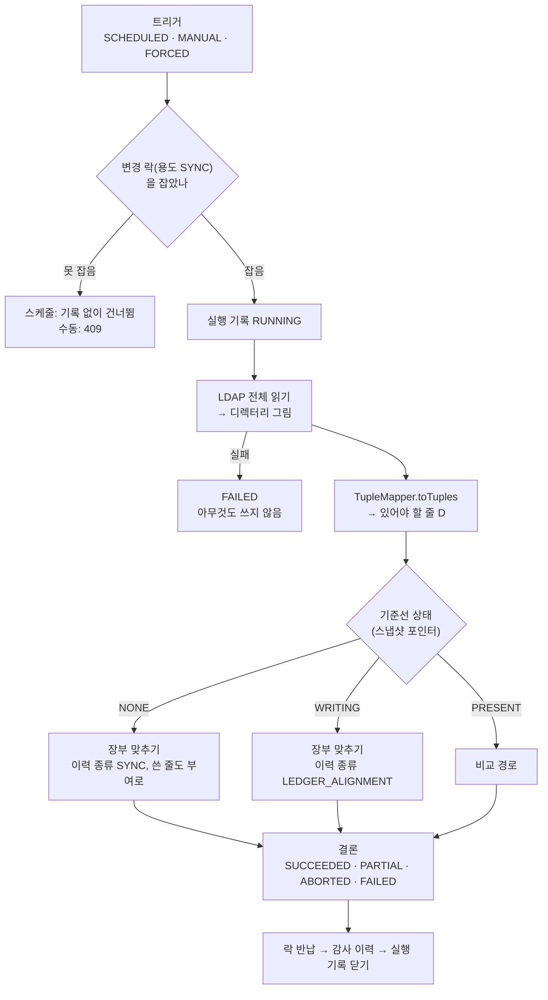
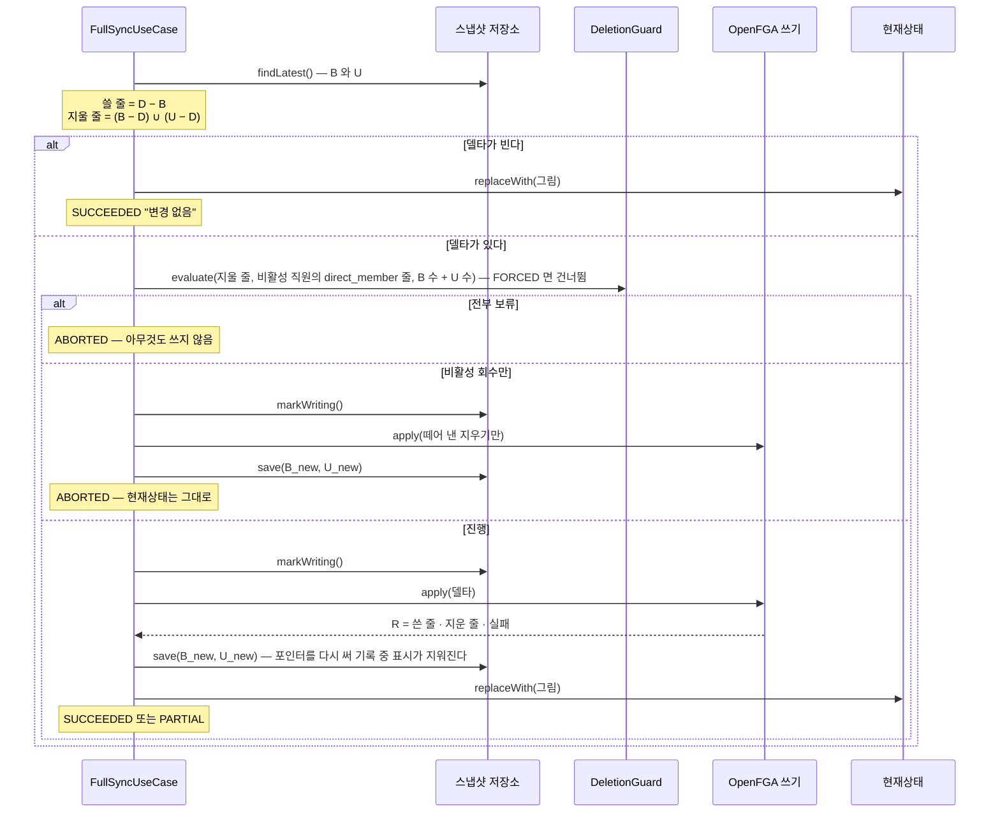
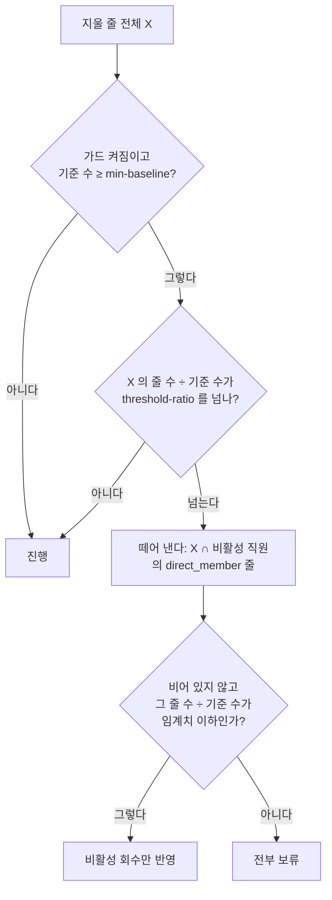
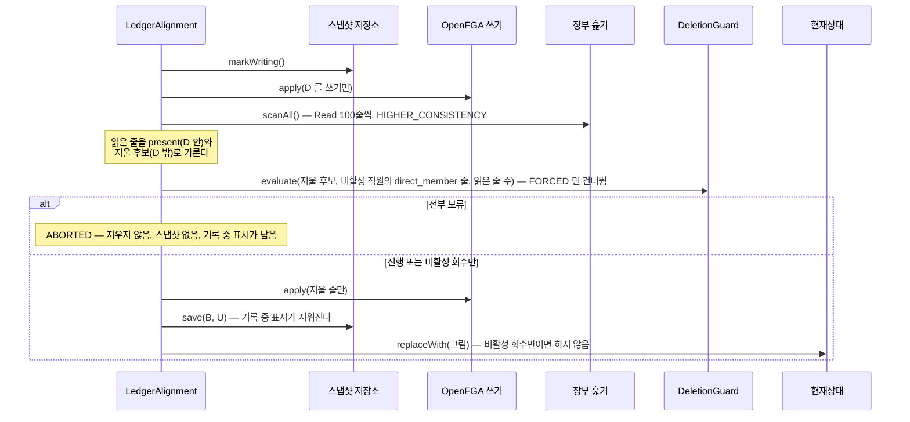
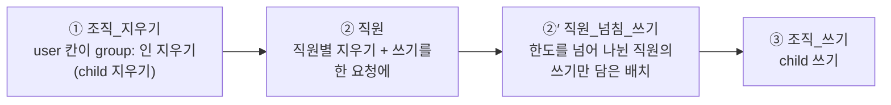

# LDAP 동기화

> 기준 커밋: 5675b3c (ops-readiness, main 에 머지됨). 코드가 바뀌면 이 문서도 함께 고친다.
> 읽기 전에: [개요](01-개요.md), [용어집](02-용어집.md), [데이터 모델 — 스냅샷 포인터](04-데이터-모델.md#스냅샷-포인터)

이 문서는 app-ldap 의 [동기화](02-용어집.md#동기화) [회차](02-용어집.md#회차) 하나를 처음부터 끝까지 따라간다. LDAP 을 어떻게 읽는지, 읽은 것을 어떻게 [튜플](02-용어집.md#튜플)로 바꾸는지, 무엇을 쓰고 지울지를 어떻게 정하는지, OpenFGA 에 어떤 순서로 쓰는지, 무엇을 DynamoDB 에 남기는지, 그리고 회차가 끝날 수 있는 모든 길을 다룬다.

다른 문서가 맡는 것:

- [변경 락](02-용어집.md#변경-락)·[리스](02-용어집.md#리스)·[기한](02-용어집.md#기한)·서버 종료와의 경주, 실행 기록을 여닫는 구조 — [08 동시성과 작업](08-동시성과-작업.md)
- [재적재](02-용어집.md#재적재)(`POST /admin/sync/rebuild`) — [07 재적재·초기화·아카이빙](07-재적재-초기화-아카이빙.md). 재적재는 이 문서의 [장부 맞추기](#7-장부-맞추기)를 그대로 쓴다.
- 관리 API 전체 — [09 관리 API](09-관리-API.md)
- [감사 이력](02-용어집.md#감사-이력)의 모양 — [10 감사 이력](10-감사-이력.md)
- 지표·경보·설정 전체 — [11 운영](11-운영.md)
- 장애별 처방 — [12 장애와 복구](12-장애와-복구.md), 알려진 한계 — [13 한계와 알려진 문제](13-한계와-알려진-문제.md)

코드가 사는 곳:

| 단계 | 클래스 | 모듈(패키지) |
|---|---|---|
| 회차 걸기 | `SyncScheduler`, `AdminSyncController` | app-ldap |
| 회차의 몸통, 길 고르기, 비교 경로 | `FullSyncUseCase` | core (`usecase`) |
| 장부 맞추기 | `LedgerAlignment`, `TupleReconciler` | core (`usecase`) |
| 디렉터리 읽기 | `LdapDirectorySnapshotSource`, `GroupOfNamesStrategy`, `DitStrategy`, `PagedLdapSearch`, `RangedAttributeReader`, `AccountStatus`, `LdapIdentifiers`, `ActiveDirectoryPrimaryGroup`, `SkippedEntries`, `UnmatchedMemberGuard`, `EmptyMembershipGuard`, `LdapDns` | connector-ldap (`ldap`, `ldap.strategy`) |
| 튜플 변환·비교 | `TupleMapper`, `TupleDiff` | core (`tuple`) |
| 삭제 가드 | `DeletionGuard`, `DeletionGuardPolicy`, `GuardDecision` | core (`guard`) |
| OpenFGA 쓰기·장부 훑기 | `OpenFgaRelationTupleWriter`, `OpenFgaRelationTupleScanner` | authz-openfga |
| 스냅샷 | `DynamoDbTupleSnapshotRepository` | storage-dynamodb |
| 현재상태 교체 | `DynamoDbDirectoryStateRepository.replaceWith` | storage-dynamodb |
| 설정 | `SyncProperties`(app-ldap), `LdapProperties`·`LdapConfig`(connector-ldap — 기동 때 검사), `OpenFgaProperties`(authz-openfga) | |

---

## 1. 한눈에



1. 트리거가 `FullSyncUseCase.start` 를 부른다. [변경 락](02-용어집.md#변경-락)을 [용도](02-용어집.md#용도) `SYNC` 로 잡고 [실행 기록](02-용어집.md#실행-기록)을 `RUNNING` 으로 연다. 요청에는 이 기록을 곧바로 준다([2절](#2-회차를-거는-것)).
2. LDAP 을 끝까지 읽어 [디렉터리 그림](02-용어집.md#디렉터리-그림)을 만든다([3절](#3-디렉터리-읽기)). 읽기가 실패하거나, 그림에 사람 소속이 하나도 없으면([빈 소속 규칙](#빈-소속-규칙)) 장부에 아무것도 하지 않고 `FAILED` 다.
3. 그림을 [있어야 할 줄](02-용어집.md#있어야-할-줄) D 로 바꾼다([4절](#4-디렉터리-그림과-있어야-할-줄)).
4. [스냅샷 포인터](02-용어집.md#스냅샷-포인터)를 읽어 [기준선 상태](02-용어집.md#기준선-상태)로 길을 고른다([5절](#5-길-고르기--기준선-상태)).
5. 고른 길을 탄다 — [비교 경로](#6-비교-경로) 또는 [장부 맞추기](#7-장부-맞추기). 두 길 모두 OpenFGA 에 쓰고([8절](#8-openfga-쓰기)), [튜플 스냅샷](02-용어집.md#튜플-스냅샷)을 남기고([9절](#9-스냅샷-저장)), [현재상태](02-용어집.md#현재상태)를 교체한다([10절](#10-현재상태-교체)).
6. 결론을 정한다([11절](#11-회차가-끝나는-길)). `SyncJobs` 가 락을 반납하고, 감사 이력을 남기고, 실행 기록을 닫는다([08](08-동시성과-작업.md), [10](10-감사-이력.md)).

2~5 는 모두 락을 쥔 채 돈다(`FullSyncUseCase.synchronize` 가 [반납 뒤 할 일](02-용어집.md#반납-뒤-할-일)로 내놓는 것은 이미 정한 결론뿐이다). 그래서 이 구간 전체가 [기한](02-용어집.md#기한)(`sync.job-timeout`, 기본 30분)·서버 종료·[리스 상실](02-용어집.md#리스-상실)과 경주한다.

---

## 2. 회차를 거는 것

| [트리거](02-용어집.md#트리거) | 무엇이 거나 | 삭제 가드 | 락을 못 잡으면 |
|---|---|---|---|
| `SCHEDULED` | `sync.cron`(기본 `0 0 * * * *`, 매시 정각. 기본값은 `SyncProperties` 에만 있고 `@Scheduled(cron = "#{@syncProperties.cron}")` 가 속성 빈을 읽는다 — yml 에 키가 없어도 뜬다) → `SyncScheduler.전체동기화` | 본다 | 기록 없이 건너뛴다. 로그 "다른 인스턴스가 동기화·재적재 중이라 이번 스케줄을 건너뛴다" |
| `MANUAL` | `POST /admin/sync/full` → `AdminSyncController.full` | 본다 | 409, 사유 "다른 동기화·재적재가 진행 중입니다"(아래 각주) |
| `FORCED` | `POST /admin/sync/full?force=true` | **건너뛴다** — 비교 경로와 장부 맞추기 모두 | 409 |

- 오류 응답은 RFC 9457 problem details 이고, 409 의 사유는 `detail` 칸에 실린다. 락을 잡거나 실행 기록을 여는 중의 일시 장애는 409 가 아니라 503 + `Retry-After` 다 — 회차는 시작하지 않았다([09 — 오류](09-관리-API.md#오류)).
- `sync.cron` 은 스프링 cron(초 칸이 있다)이다. `-` 를 주면 정기 동기화가 꺼진다.
- 여러 대를 띄우면 정각에 모든 인스턴스의 스케줄러가 깨지만, 락을 잡은 한 대만 돈다. 나머지는 오류가 아니라 건너뜀이다.
- 같은 락을 재적재(용도 `REBUILD`)도 쓴다. 재적재가 도는 동안 동기화는 걸리지 않는다. 락의 구조는 [08](08-동시성과-작업.md).
- `force=true` 는 "사람이 보고 승인했다" 는 통로다. 삭제 가드만 건너뛴다. 그 밖의 검사(LDAP [데이터 오류](02-용어집.md#데이터-오류) — 사람 소속이 하나도 없는 그림 포함 —, 기준선 무결성 등)는 그대로다.
- 스케줄러는 관측(`Observation`) `sync.ldap.full` 을 만들어 Reactor Context 에 싣는다. 회차의 로그가 traceId 하나로 묶인다(`SyncScheduler.관측하며실행`).

수동으로 걸면 202 와 방금 연 기록을 받는다(`SyncRunResponse`). 결과는 `GET /admin/sync/runs/{runId}` 로 본다([09](09-관리-API.md)).

```
POST /admin/sync/full
→ 202 Accepted
{
  "runId": "9a7c3e1f-5b2d-4c8e-a6f0-3d1b7e9c2a54",
  "source": "LDAP",
  "trigger": "MANUAL",
  "startedAt": "2026-10-25T05:12:03.120Z",
  "finishedAt": null,
  "status": "RUNNING",
  "writtenCount": 0, "deletedCount": 0, "failureCount": 0,
  "snapshotId": null,
  "message": null
}
```

---

## 3. 디렉터리 읽기

### 3.1 읽기 한 번의 모양

`LdapDirectorySnapshotSource.fetchAll` 이 읽는다.

- `Mono.fromCallable(() -> strategy.read(template))` 를 `Schedulers.boundedElastic()` 에서 돌린다. Spring LDAP(JNDI)은 블로킹이라 이벤트 루프에서 부르면 앱이 멈춘다.
- 재시도(`retryWhen`)를 `subscribeOn` 뒤에 둔다. 재시도도 `boundedElastic` 에서 돌고, **시도마다 처음부터 다시 읽는다** — 앞 시도의 부분 결과가 섞이지 않는다([3.13](#313-재시도와-타임아웃)).
- 다 읽으면 "LDAP 에서 직원 N명, 조직 M개를 읽었다" 를 남긴다.
- 전략은 기동할 때 `ldap.strategy` 로 정한다(`LdapConfig.ldapMappingStrategy`). `group-of-names` 면 `GroupOfNamesStrategy`, `dit` 면 `DitStrategy` 다(대소문자 무시). **그 밖의 값은 오타까지 기동을 멈춘다**(`LdapConfig.설정을_검사한다` — `ldap.strategy 는 group-of-names 또는 dit 다(받은 값: …)`). 기본값은 `group-of-names` 다. DIT 디렉터리를 groupOfNames 로 잘못 읽어 조직 없는 조직도가 되는 일을 막는다.
- 계정 만료를 판정할 "지금" 은 읽기 한 번에 한 번 잡는다(`clock.instant()`). 그 회차의 모든 직원이 같은 시각으로 판정된다. 재시도하면 새 시각을 잡는다.

### 3.2 두 매핑 전략

두 전략은 서로 다르게 읽지만 같은 모양의 디렉터리 그림(`DirectorySnapshot`)을 만든다.

**groupOfNames**(기본, `GroupOfNamesStrategy.read`) — 그룹 엔트리가 조직이고, 그룹의 `member` 값이 소속이다. SCIM 의 `members` 와 같은 구조다.

1. 직원을 검색한다. 베이스 `user-search-base`, 필터 `user-filter`, 페이징.
2. 그룹을 검색한다. 베이스 `group-search-base`, 필터 `group-filter`, 페이징. 멤버가 AD [범위 검색](02-용어집.md#범위-검색)으로 잘린 그룹은 이어받는다([3.7](#37-ad-범위-검색)).
3. 직원 엔트리를 [직원](02-용어집.md#직원)으로 만든다. [식별 속성](02-용어집.md#식별-속성)이 없거나 id 가 겹치는 엔트리는 건너뛴다([3.11](#311-건너뛰는-엔트리)).
4. 그룹 엔트리를 [조직](02-용어집.md#조직)으로 만든다. 같은 규칙으로 건너뛴다.
5. 그룹마다 `member` 값을 하나씩 읽은 직원·그룹의 DN 과 대조한다. 대조는 문자열 비교가 아니라 `LdapDns.대조키` 로 한다 — `LdapName` 으로 파싱해 속성 이름과 값을 소문자로 맞추고, 다중값 RDN(`cn=hgd+ou=Seoul`)은 쌍을 정렬한다. 그래서 `CN=Hong\, Gildong,OU=...` 와 `cn=hong\, gildong,ou=...` 가 같은 엔트리로 대조된다.
   - 직원 DN 과 맞으면 그 직원이 멤버(`MemberRef.user`), 그룹 DN 과 맞으면 그 그룹이 [하위 조직](02-용어집.md#하위-조직)(`MemberRef.group`)이다.
   - 어느 쪽과도 맞지 않는 값(컴퓨터·연락처, 건너뛴 엔트리를 가리키는 값)은 세기만 하고 버린다.
   - 파싱할 수 없는 `member` 값은 데이터 오류다("조직 '…'(dn=…) 의 member '…' 를 해석하지 못했습니다").
6. [AD 기본 그룹](02-용어집.md#ad-기본-그룹) 소속을 더한다([3.9](#39-ad-기본-그룹)).
7. 사람으로 대조된 멤버가 하나도 없으면 멈춘다([DN 대조 가드](#dn-대조-가드)).
8. 그림 전체에 사람 소속이 하나도 없으면 멈춘다([빈 소속 규칙](#빈-소속-규칙)) — 직원 0명, 조직 0개, `member` 값이 하나도 없는 그림처럼 7번이 보지 않는 모양이다.

**DIT**(`DitStrategy.read`) — OU 트리가 조직 계층이고, 직원 엔트리의 부모 OU 가 소속이다.

1. OU 를 검색한다. 베이스 `root-dn`, 필터 `org-unit-filter`. 검색 범위는 하위 트리 전체(SUBTREE)라 `root-dn` 자신도 필터에 맞으면 조직이 된다.
2. 직원을 검색한다. 베이스 `root-dn`, 필터 `user-filter`.
3. OU 를 조직으로 만든다. 식별 속성이 없거나 id 가 겹치는 OU 는 건너뛴다. 서로 다른 부모 아래 같은 이름의 OU(`ou=support,ou=DEV` 와 `ou=support,ou=OPS`)가 이름 기반 id 로 한 id 가 되면, 둘을 한 조직으로 뭉쳐 양쪽 부모에 연결하는 대신 뒤의 것을 뺀다 — 조용히 권한이 넓어지는 것을 막는다. 뺀 OU 의 DN 은 색인에 넣지 않으므로 그 아래 엔트리는 부모를 찾지 못한다. 하위 OU 는 상위 연결 없는 조직으로, 직원은 소속 없는 직원으로 남는다.
4. OU 마다 부모 DN 을 [대조 키](02-용어집.md#대조-키)로 되짚어, 부모가 읽은 OU 면 그 부모의 하위 조직으로 넣는다.
5. 직원마다 부모 DN 의 OU 가 소속 조직이다. 부모를 찾지 못한 직원은 **직원으로는 적재하되 소속이 없다**(사유 "부모 조직을 찾지 못해 소속 없이 적재").
6. 그림 전체에 사람 소속이 하나도 없으면 데이터 오류로 멈춘다([빈 소속 규칙](#빈-소속-규칙)) — 직원 0명, 조직 0개, 부모 조직을 찾은 직원 0명이 모두 여기다. 메시지의 세부에 "부모 조직을 찾은 직원 0명 — root-dn 과 org-unit-filter 가 직원이 있는 곳을 조직으로 읽는지 확인하라(AD 의 CN=Users 는 OU 가 아니다, 점검 S22)" 가 실리고, 건너뛴 직원이 있으면 그 요약이 뒤에 붙는다. AD 의 `CN=Users` 는 OU 가 아니라 컨테이너라서 생기는 일이다.

| | groupOfNames | DIT |
|---|---|---|
| 조직 | 그룹 엔트리 | OU 엔트리 |
| 소속 | 그룹의 `member` 값 | 직원 엔트리의 부모 OU |
| 직원 한 명의 소속 | 여럿일 수 있다 | 하나뿐 |
| 하위 조직 | `member` 값이 그룹 DN | OU 의 부모 OU |
| 순환 | 생길 수 있다([4.3](#43-순환을-버린다)) | 트리라 생기지 않는다 |
| AD 범위 검색 | 한다(`member`) | 해당 없음 |
| AD 기본 그룹 | 더한다 | 없다 |
| "소속이 하나도 안 잡힘" 검사 | `UnmatchedMemberGuard`(DN 대조) 다음에 빈 소속 규칙 | 빈 소속 규칙 |

### 3.3 속성 매핑과 기본값

설정 키는 `ldap.group-of-names.*` 와 `ldap.dit.*` 로 나뉜다. 이름이 같은 키는 뜻도 같다.

| 설정 | groupOfNames 기본 | DIT 기본 | 뜻 |
|---|---|---|---|
| `user-search-base` | `ou=people` | — | 직원 검색 베이스(`ldap.base-dn` 에 상대적) |
| `group-search-base` | `ou=groups` | — | 그룹 검색 베이스 |
| `root-dn` | — | `ou=company` | OU·직원 검색 베이스 |
| `user-filter` | `(objectClass=inetOrgPerson)` | `(objectClass=inetOrgPerson)` | 직원 필터(RFC 4515). 해석하지 않고 그대로 서버에 보낸다. AD 는 `(&(objectCategory=person)(objectClass=user))` |
| `group-filter` | `(objectClass=groupOfNames)` | — | 그룹 필터. AD 는 `(objectClass=group)` |
| `org-unit-filter` | — | `(objectClass=organizationalUnit)` | OU 필터 |
| `user-id-attribute` | `entryUUID` | `entryUUID` | 직원 [불변 id](02-용어집.md#불변-id). AD 는 `objectGUID` |
| `group-id-attribute` | `entryUUID` | `entryUUID` | 조직 불변 id. AD 는 `objectGUID` |
| `user-login-attribute` | `uid` | `uid` | [userName](02-용어집.md#username). AD 는 `sAMAccountName` |
| `user-name-attribute` | `displayName` | `displayName` | 직원 [displayName](02-용어집.md#displayname) |
| `user-mail-attribute` | `mail` | `mail` | 직원 이메일 |
| `group-name-attribute` | `description` | `description` | 조직 displayName. LDAP 그룹·OU 에는 표시명 표준 속성이 없어 `description` 을 쓴다 |
| `member-attribute` | `member` | — | 그룹의 멤버 속성 |

값을 채우는 규칙:

- **id** — 식별 속성의 첫 값을 읽어 [정규화](02-용어집.md#정규화)(`IdNormalizer.normalize`)한다. 없거나 비면 그 엔트리를 건너뛴다.
- **userName** — 로그인 속성의 **원본 값**이다. 정규화하지 않는다(`uid: hong gd` 는 `hong gd`). 없으면 식별 값(정규화 전)으로 대신한다.
- **직원 displayName** — `user-name-attribute` → `cn` → userName 가운데 처음으로 비어 있지 않은 값. 표시명 속성·`cn`·로그인 속성이 모두 없으면 userName 이 식별 값이라 UUID 가 표시명이 된다.
- **조직 displayName** — `group-name-attribute` → DN 의 첫 RDN 값(`LdapDns.첫_RDN_값`. 이스케이프를 푼 원본, 대소문자 그대로).
- **email** — `user-mail-attribute` 의 첫 값. 없으면 비운다.
- **이름 여섯 칸** — `sn` → familyName, `givenName` → givenName, `middleName` → middleName, `generationQualifier` → honorificSuffix(`LdapPersonName.from`). formatted·honorificPrefix 는 비운다.
- **[externalId](02-용어집.md#externalid)** — 두 전략 모두 서버가 준 DN(컨텍스트 베이스에 상대적)에 `ldap.base-dn` 을 붙여 `LdapName` 으로 다시 쓴 절대 DN 이다(`LdapDns.절대로`). 예 `uid=gd.hong,ou=people,dc=example,dc=com`.
- **active** — [3.10](#310-계정-상태).

접속 설정은 `ldap.url`(기본 `ldap://localhost:1389`), `ldap.base-dn`(기본 `dc=example,dc=com`), `ldap.bind-dn`, `ldap.bind-password` 다. 운영(`prod`)은 `ldaps://` 를 요구하고(`ldap.require-tls`) 비밀번호를 환경 변수 `LDAP_BIND_PASSWORD` 로 받는다. 바인드 DN 이 있는데 비밀번호가 비었거나 풀리지 않은 자리표시자면 기동을 멈춘다([11 — app-ldap 설정](11-운영.md#14-app-ldap--ldap)).

### 3.4 불변 id — entryUUID 와 objectGUID

- `entryUUID`(RFC 4530)는 OpenLDAP·389DS·UnboundID 가 엔트리마다 만들고 개명해도 바꾸지 않는 운영 속성이다. 운영 속성이라 이름을 대 요청해야 온다.
- AD 의 `objectGUID` 는 16바이트 이진 값이다.
  - 식별 속성 넷(groupOfNames·DIT 의 직원·조직) 가운데 이름이 `objectGUID`(대소문자 무시)인 것이 있으면 JNDI 환경 `java.naming.ldap.attributes.binary` 에 자동으로 선언한다(`LdapConfig.jndiEnvironment`). 선언이 없으면 JNDI 가 바이트를 문자열로 뭉갠다.
  - 바이트를 AD 도구(`Get-ADUser`)가 보여 주는 소문자 GUID 문자열로 바꾼다(`LdapIdentifiers.guid`). 앞 세 부분(4·2·2바이트)은 리틀 엔디언이라 바이트를 뒤집는다.

    ```
    바이트   01 02 03 04 05 06 07 08 09 0a 0b 0c 0d 0e 0f 10
    문자열   04030201-0605-0807-090a-0b0c0d0e0f10
    ```
  - 16바이트가 아니면 데이터 오류 "objectGUID 는 16바이트여야 합니다(N바이트): <dn>", 이진으로 오지 않았으면 "objectGUID 가 이진으로 오지 않았습니다 — 컨텍스트 소스의 이진 선언을 확인하세요: <dn>" 이다.
- `uid`·`cn`·`ou`·`employeeNumber` 같은 이름 기반 속성도 쓸 수 있다. 그러면 개명이 삭제+생성이다 — 새 id 의 직원·조직이 생기고 옛 id 의 튜플은 지워진다. 큰 조직을 개명하면 삭제 가드에 걸린다([13.3](#133-가드를-넘는-개편)). 대소문자만 바꿔도 새 사람이다.
- 정규화 뒤 id 가 겹치면 먼저 읽은 엔트리를 남기고 뒤의 것을 건너뛴다(`DuplicateIdGuard`).

### 3.5 요청하는 속성

쓰는 속성만 이름을 대 요청한다(`UserAttributes.요청`, `PagedLdapSearch.속성목록`). 비워 두면 서버가 모든 사용자 속성을 주고, 운영 속성(`entryUUID`)은 오지 않는다. 빈 이름과 대소문자만 다른 이름은 뺀다.

| 검색 | 요청하는 속성 |
|---|---|
| 직원(두 전략) | 식별·로그인·표시명·메일 속성, `cn`, `userAccountControl`, `accountExpires`, `pwdAccountLockedTime`, `sn`, `givenName`, `middleName`, `generationQualifier` |
| 직원(groupOfNames 만 더) | `primaryGroupID` |
| 그룹(groupOfNames) | 식별·이름·멤버 속성, `objectSid` |
| OU(DIT) | 식별·이름 속성 |

`objectSid` 는 설정과 상관없이 늘 이진 속성으로 선언한다(AD 기본 그룹의 RID 를 읽는 데 쓴다). 그 속성이 없는 디렉터리에는 해가 없다.

### 3.6 페이징

검색은 모두 `PagedLdapSearch.search` 를 거친다.

- paged results 컨트롤(RFC 2696)을 `ldap.page-size`(기본 500) 크기로, critical 로 보낸다. 서버가 "더 있다" 는 쿠키를 주는 동안 이어 읽는다.
- **페이징 전체를 커넥션 하나에서 돈다**(`LdapTemplates.한_커넥션에서`). 쿠키는 커넥션에 묶인 상태라 다른 커넥션에서 내밀면 실제 OpenLDAP·AD 가 "paged results cookie is invalid" 로 거절한다.
- **응답에 페이징 컨트롤이 없으면 회차를 멈춘다.** 표준을 지키는 서버는 컨트롤을 붙이거나 오류로 답한다(RFC 4511 §4.1.11). 컨트롤 없는 응답은 받은 목록이 전부인지 알 수 없다. 데이터 오류로 재시도 없이 실패한다 — "LDAP 서버가 페이징 요청(RFC 2696, critical)에 페이징 응답 컨트롤을 붙이지 않았다 — 받은 목록이 전부인지 알 수 없어 회차를 멈춘다. 서버(또는 사이의 프록시)가 paged results 를 지원하는지 확인하라 (페이징을 끄려면 ldap.page-size=0): base=…, filter=…".
- `ldap.page-size` 가 0 이하면 페이징 없이 한 번에 검색한다.
- 템플릿은 `ignoreSizeLimitExceededException=false` 다(`LdapTemplates.configured`). 서버가 관리 한도로 결과를 자르면 조용히 잘린 목록을 주는 대신 예외가 올라와 `FAILED` 다.

페이징이 없거나 잘린 목록을 그대로 받으면, 읽지 못한 사람들이 "디렉터리에서 사라진 사람" 으로 보여 그들의 권한이 지워진다. 페이징 없이 검색하면 AD 는 `MaxPageSize`(1000)만큼만 주고 조용히 멈춘다(`PagedLdapSearch` 주석).

### 3.7 AD 범위 검색

AD 는 다중값 속성 하나에서 한 번에 돌려주는 값의 수를 `MaxValRange`(버전·정책에 따라 1,000·1,500·5,000)로 제한한다. 넘으면 **속성 이름을 바꿔서** 준다.

```
member                 →  (값 없음)
member;range=0-1499    →  1,500개
```

`member` 만 이름으로 찾으면 빈 속성을 읽고 끝난다 — 6,000명짜리 그룹이 멤버 0명으로 읽혀 6,000줄이 지울 줄이 된다. 그래서 `RangedAttributeReader` 가 이어받는다(groupOfNames 의 그룹 검색만 해당).

1. 첫 읽기(`읽는다`) — 검색 응답에서 범위가 붙은 속성(`member;range=N-M`)이 있으면 그것을 쓴다. 상한이 `*` 면 끝이다. 범위가 붙은 속성이 없으면 평범한 속성이 전부다(속성이 아예 없으면 멤버 0명 — 정상).
2. 잘린 그룹만 골라 **커넥션 하나에서** 이어받는다(`GroupOfNamesStrategy.범위가_잘린_멤버를_이어받는다`). 로그 "멤버가 범위 검색으로 잘린 조직 N개를 이어받는다".
3. 그룹마다 **범위 0 부터 다시** 묻는다 — `member;range=0-*`, 이어서 `member;range=<상한+1>-*` … 상한이 `*` 인 범위 응답이 올 때까지(`전부_읽는다`). 첫 범위 응답은 검색을 돌린 다른 커넥션에서 왔고, 값의 순서는 같은 커넥션 안에서만 일관된다(MS-ADTS). 섞어 쓰면 누락과 중복이 난다.
4. 끝까지 못 읽으면 `IncompleteAttributeReadException` 을 던진다 — 되물었는데 범위 속성이 없음, 값을 더 주지 않는데 완료 신호도 없음, 범위 응답이 1,000번을 넘음, 읽다 끊김. **읽은 만큼을 돌려주지 않는다.** 부분 목록은 "멤버가 줄었다" 와 구별되지 않고 그것이 곧 권한 삭제이기 때문이다.

진짜로 멤버가 없어진 경우는 여기 걸리지 않는다. 서버는 범위 옵션 없이 값 0개를 준다 — "이게 전부다" 라서 완료로 읽힌다. 범위 옵션을 쓰지 않는 서버(OpenLDAP 등)에서는 동작이 바뀌지 않는다.

`IncompleteAttributeReadException` 은 재시도하지 않는 실패 목록([3.13](#313-재시도와-타임아웃))에 없으므로 일시 장애로 보고 처음부터 다시 읽는다.

### 3.8 referral

검색 범위가 자식 도메인이나 위임된 서브트리를 걸치면 서버가 그 부분을 검색 결과 참조(referral, RFC 4511 §4.5.3)로 준다. **따라가지 않는다** — 다른 DC 의 주소·자격 증명·DNS 가 필요하고, AD 도메인 루트에서는 DNS 파티션까지 읽게 된다.

- JNDI 는 참조를 만나면 열거 끝에 `PartialResultException` 을 던진다. Spring 은 기본으로 이것을 DEBUG 로 삼키는데, `LdapTemplates.configured` 가 `ignorePartialResultException=false` 로 꺼서 `PagedLdapSearch` 가 받는다.
- 엔트리를 받은 검색이면 **검색마다 경고 한 줄**을 남기고 계속한다(페이지마다 참조가 와도 한 줄). 그때까지 받은 엔트리와 다음 페이지는 그대로 읽는다. 경고: "LDAP 검색이 referral 을 만나 그 부분을 읽지 않았다 — 따라가지 않는다. 검색 범위가 다른 도메인·위임 서브트리를 걸치는지 확인하라: base=…, filter=…, <JNDI 메시지>".
- **참조를 만났는데 엔트리를 하나도 받지 못했으면 실패한다**(데이터 오류, 재시도 없음). 검색 베이스 자체가 참조, 대개 이 DC 의 이름 공간 밖이다. 빈 결과로 읽으면 전원이 빠진 회차가 된다. 판정은 페이지마다 한다 — 베이스가 참조인 응답에는 페이징 컨트롤이 없어 반복이 끝나지 않기 때문이다.
- 경고가 보이면 그 부분의 직원은 이번 회차에 없는 것과 같다. 이미 적재된 장부라면 큰 빠짐은 삭제 가드가 막는다.

### 3.9 AD 기본 그룹

AD 는 사용자의 기본 그룹(대개 Domain Users) 소속을 그 그룹의 `member` 에 적지 않고 사용자의 `primaryGroupID`(그룹의 RID)로만 나타낸다(MS-ADA3). `member` 만 보면 관리자가 어떤 그룹을 사용자의 기본 그룹으로 바꾸는 순간 그 조직 권한이 지워진다. groupOfNames 만 이것을 다룬다(`ActiveDirectoryPrimaryGroup`, `GroupOfNamesStrategy.기본그룹_멤버를_모은다`).

1. 직원의 `primaryGroupID` 를 정수로 읽는다. 없으면 아무 일도 없다(OpenLDAP).
2. 그룹의 `objectSid` 에서 RID(마지막 하위 권한, 부호 없는 32비트, 리틀 엔디언)를 읽는다(MS-DTYP §2.4.2.2).
3. 직원의 `primaryGroupID` 와 RID 가 같은 그룹이 읽은 그룹 안에 있으면 그 직원을 그 조직의 직원 멤버로 더한다. 읽지 않은 그룹(Domain Users 513 을 검색 범위 밖에 둔 경우)을 가리키면 아무 소속도 더하지 않는다.

- 직원과 그룹은 한 도메인 안에서 검색해야 한다. RID 는 도메인 안에서만 유일하고 이 코드는 도메인 SID 를 보지 않는다. 글로벌 카탈로그(포트 3268)는 여러 도메인을 함께 주므로 쓰지 않는다.
- 기본 그룹이 그룹 검색 범위 안에 있으면 그 그룹을 기본 그룹으로 가진 직원 전원이 그 조직의 멤버가 된다.
- 데이터 오류: `primaryGroupID` 가 정수가 아님, `objectSid` 가 이진이 아니거나 SID 형식이 아님(개정 1, 길이 = 8 + 4 × 하위 권한 수), 같은 RID 의 그룹이 둘("속성 'objectSid' 의 RID N 를 가진 그룹이 둘입니다 — 한 도메인에서 RID 는 유일해야 합니다. 그룹 검색 베이스가 여러 도메인을 걸치는지(글로벌 카탈로그 등) 확인하세요: …").
- RID 로 더한 멤버는 [3.12](#dn-대조-가드)의 대조 집계에 들지 않는다.

### 3.10 계정 상태

디렉터리가 막았다고 표시한 계정은 [비활성](02-용어집.md#비활성)(`active=false`)으로 읽는다(`AccountStatus.막혔는가`). 셋 가운데 하나라도 해당하면 비활성이다.

| 속성 | 표준 | 비활성으로 읽는 값 |
|---|---|---|
| `userAccountControl` | AD(MS-ADTS) | `ACCOUNTDISABLE` 비트(`0x2`)가 켜짐. **비트로** 본다 — `66050`(비활성 + 암호 만료 없음)도 비활성이다 |
| `accountExpires` | AD | 1601-01-01 UTC 부터 100나노초 단위의 시각이 읽기 시작 시각 이전이거나 **같음**. `0` 과 `9223372036854775807`(`Long.MAX_VALUE`)은 "만료 없음" |
| `pwdAccountLockedTime` | OpenLDAP ppolicy | 값이 `000001010000Z` — 관리자만 풀 수 있는 영구 잠금. 다른 값은 잠긴 시각(일시 잠금)이라 **활성**이다 |

- **속성이 없으면 활성이다.** AD 의 둘은 OpenLDAP 에, ppolicy 는 AD 에 없다. 동기화 계정이 이 속성을 읽을 권한이 없어도 전원이 활성으로 읽힌다.
- AD 두 속성의 값이 정수가 아니면(공백이 섞여도) 데이터 오류로 그 회차가 실패한다. 메시지에 그 엔트리의 DN 이 실린다 — "속성 'userAccountControl' 의 값 '…' 가 정수가 아닙니다 — AD 표준 밖이라 계정이 막혔는지 판단할 수 없습니다: dn=…".
- 식별 속성이 없는 엔트리는 계정 상태를 읽지 않는다. id 가 겹쳐 건너뛰는 엔트리는 이미 읽은 뒤에 가려내므로, 그 엔트리의 계정 상태 값이 표준 밖이면 회차가 실패한다.
- 비활성 직원은 소속(멤버 줄·소속 줄)이 남고 [direct_member](02-용어집.md#direct_member) 튜플만 사라진다. 다시 풀면 다음 회차가 다시 쓴다.

### 3.11 건너뛰는 엔트리

엔트리 하나 때문에 10만 명 회차를 멈추지 않는다. 자리를 정할 수 없는 엔트리는 빼고 계속하고, 검색마다 사유별 건수와 예시(다섯 개까지)를 **경고 한 줄**로 남긴다(`SkippedEntries`).

| 사유(`SkippedEntries.사유`) | 무엇 | 결과 |
|---|---|---|
| `식별_속성_없음` | 식별 속성이 없거나 빈 직원·그룹·OU | 그 엔트리를 뺀다 |
| `아이디_겹침` | 정규화 뒤 앞서 읽은 엔트리와 같은 id | 뒤의 엔트리를 뺀다. 예시에 건너뛴 DN 과 유지된 DN 을 함께 싣는다 |
| `부모_조직_없음` | DIT 에서 부모 OU 를 못 찾은 직원 | 직원으로 적재하되 소속이 없다 |
| `읽지_않은_member` | groupOfNames 에서 읽은 직원도 조직도 아닌 `member` 값 | 값을 버린다. 값마다가 아니라 요약 한 줄 |

경고의 모양:

```
직원 검색에서 엔트리 3건을 건너뛰었다 — 식별 속성 'entryUUID' 이 없거나 비었음 2건(예: dn='uid=svc1,ou=people,dc=example,dc=com'; dn='uid=svc2,ou=people,dc=example,dc=com'), 아이디 겹침 1건(예: …(건너뛴 dn='…', 유지된 dn='…'))
member 값 12건을 건너뛰었다 — 읽은 직원도 조직도 아님(컴퓨터·연락처이거나 위에서 건너뛴 엔트리일 수 있다) 12건(예: 조직 '…'(dn='…') 의 member '…'; … 외 7건)
```

**받은 것이 있는데 하나도 남지 않으면 멈춘다**(`아무도_남지_않으면_멈춘다`, 데이터 오류, 재시도 없음). 직원 검색이 엔트리를 받았는데 남은 직원이 0명, 그룹(OU) 검색이 엔트리를 받았는데 남은 조직이 0개인 경우다 — 대개 식별 속성 이름이 틀린 설정이다. 메시지: "직원 검색이 엔트리 N건을 받았지만 하나도 남지 않았다(식별 속성 '…') — <요약>". `member` 값 집계에는 이 규칙을 쓰지 않는다.

일부만 빠지는 경우는 막지 않는다. 이미 적재된 장부가 있으면 큰 빠짐은 삭제 가드가 막고, 첫 적재에서는 경고 한 줄이 유일한 신호다.

### 3.12 사람 소속이 없는 그림은 멈춘다

두 검사가 읽기 끝에서 그림을 본다. 둘 다 [데이터 오류](02-용어집.md#데이터-오류)라 다시 읽지 않고, 회차는 `FAILED` 이며, `force` 로도 넘기지 못한다. 동기화와 재적재가 같은 `fetchAll` 을 타므로 둘 다 같다.

#### DN 대조 가드

groupOfNames 에서 조직이 하나라도 있고 `member` 값이 하나라도 있는데, **사람으로 대조된 값이 0개**면 `UnmatchedMemberGuard.확인한다` 가 `MemberMatchingFailedException`(데이터 오류의 하위)을 던진다.

```
조직 40개의 member 값 9812개 중 사람으로 대조된 것이 하나도 없습니다(그룹으로 대조된 것 39개). 사용자 검색 베이스와 그룹 member 값의 DN 형태가 어긋났는지 확인하십시오.
```

- 하위 조직으로 대조된 값은 세지 않는다. 그룹은 검색 베이스 바로 아래 평평하게 있고 사용자만 조직 OU 아래 깊이 있는 트리에서, 하위 조직만 맞고 사람은 전부 어긋나도 통과하면 "모든 조직이 사람 없이 적재되고 성공" 이 되기 때문이다.
- [AD 기본 그룹](#39-ad-기본-그룹)(RID) 소속도 이 셈에서 뺀다. RID 소속이 하나라도 있어도 DN 대조가 전부 어긋나면 잡는다 — 아래 빈 소속 규칙만으로는 RID 소속 하나에 통과해 버린다.
- 부분 불일치(컴퓨터·연락처가 섞인 그룹)는 막지 않는다 — [3.11](#311-건너뛰는-엔트리)의 요약으로만 남는다.

#### 빈 소속 규칙

두 전략이 그림을 만든 직후 같은 한 곳(`EmptyMembershipGuard.확인한다`)에서 본다.

> 디렉터리 그림에 **사람 소속**(조직의 멤버 가운데 직원이고, 그 id 가 그림의 직원에 있는 것 — 활성 여부와 상관없이)이 하나도 없으면 `DirectoryDataException` 이다.

```
디렉터리 그림에 사람 소속이 하나도 없다(사용자 0명, 조직 40개, member 값 0개) — 비어 있는 검색의 베이스·필터를 확인하라
```

- 괄호의 세 번째 자리는 전략마다 다르다. groupOfNames 는 `member` 값 수, DIT 는 부모 조직을 찾지 못했다는 힌트다([3.2](#32-두-매핑-전략)). 사용자 수·조직 수로 어느 검색이 비었는지 본다.
- 덮는 모양: 직원 0명(직원 검색만 0건이면 groupOfNames 는 DN 대조 가드가 먼저 잡는다), 조직 0개, `member` 값이 하나도 없는 그림, DIT 에서 부모 조직을 찾은 직원이 0명인 그림.
- **왜 데이터 오류인가.** RFC 4511 에서 엔트리를 하나도 못 찾은 검색은 오류가 아니라 성공이다 — 검색 베이스·필터가 틀려도, 서비스 계정이 읽을 권한이 없어 엔트리가 보이지 않아도 서버는 0건과 성공 코드를 준다. 그 그림을 받아들이면 장부의 모든 사람이 "디렉터리에서 사라진" 것이 되어, 삭제 가드가 전부 보류로 멈춘 뒤 `force` 로 넘기면 장부가 통째로 지워진다. 그래서 표준 신호가 아니라 이쪽의 한 규칙으로 판정한다 — SCIM `mode=tuples` 의 [빈 조직도 규칙](02-용어집.md#빈-조직도-규칙)과 같은 모양이다.
- 첫 적재든, 기준 수가 `min-baseline` 미만이든, 가드를 끈 배포든 같다. 빈 그림이 장부 맞추기(장부 훑기)까지 가지 않는다.
- 활성 여부를 보지 않는 까닭: 시계 오류로 전원이 비활성으로 읽히는 경우는 소속을 지우지 않고 권한 줄만 없앤다 — 그것은 삭제 가드가 본다([6.4](#64-삭제-가드)).
- 첫 소속을 찾는 즉시 멈추므로 비용은 소속 수가 아니라 첫 소속까지의 거리다.

### 3.13 재시도와 타임아웃

읽기가 예외로 끝나면 `LdapDirectorySnapshotSource.재시도_규칙` 이 처음부터 다시 읽는다.

| 설정 | 기본 | 뜻 |
|---|---|---|
| `ldap.max-retries` | 5 | 다시 읽는 횟수(첫 시도 빼고) |
| `ldap.retry-min-backoff` | 10s | 첫 재시도 전 대기. 두 배씩 는다 |
| `ldap.retry-max-backoff` | 2m | 대기 상한 |
| `ldap.connect-timeout` | 10s | TCP 접속과 **bind 응답** 대기(JNDI `com.sun.jndi.ldap.connect.timeout`). bind DN 을 쓰는 컨텍스트 생성은 동기 bind 라 이 값이 잰다 |
| `ldap.read-timeout` | 150s | bind 이후 응답 대기(`com.sun.jndi.ldap.read.timeout`). 예: 다음 페이지. AD 의 `MaxQueryDuration`(120초)보다 길다 |

- 대기는 10·20·40·80·120초에 Reactor 기본 지터(±50%, 상·하한 안에서)가 붙어 합계 140~345초, 약 2~6분이다. 도메인 컨트롤러 재부팅을 버티려는 값이다.
- 재시도마다 경고 "LDAP 읽기 실패, 재시도 N회차" 를 남긴다.
- 다 쓰면 마지막 실패를 그대로 던진다(`RetryExhaustedException` 으로 감싸지 않는다). 실행 기록의 메시지에 진짜 원인이 남는다.

**다시 읽어도 같은 실패는 재시도하지 않는다**(`다시_읽어도_같은가`).

| 예외 | 뜻 |
|---|---|
| `DirectoryDataException`(+ `MemberMatchingFailedException`) | 데이터·설정 오류 — 정수가 아닌 계정 상태·`primaryGroupID`, 16바이트가 아닌 `objectGUID`, SID 형식이 아닌 `objectSid`, 같은 RID 의 그룹 둘, 해석할 수 없는 DN, 페이징 응답 컨트롤 없음, 엔트리 없는 referral, 아무도 남지 않는 읽기, 사람 대조 0 |
| `AuthenticationException` | LDAP 결과 코드 49 — 인증 실패(비밀번호 오류, 잠긴 서비스 계정) |
| `NoPermissionException` | 50 — 권한 없음 |
| `NameNotFoundException` | 32 — 없는 이름(검색 베이스 오타) |
| `InvalidNameException` | 34 — DN 문법 |
| `SizeLimitExceededException` | 4 — 크기 한도 |
| `InvalidSearchFilterException` | 보내기 전에 JNDI 가 거절한 필터 문법 |

그 밖은 — 모르는 종류까지 — 일시 장애로 보고 재시도한다. 연결 끊김, 서버 busy·unavailable, 응답 시간 초과, `IncompleteAttributeReadException` 이 여기 든다.

재시도가 걸리는 것은 **예외**뿐이다. LDAP 이 잘못된 답을 정상으로 주는 경우(필터 실수로 0명)는 여기 걸리지 않는다. 사람 소속이 하나도 없는 그림은 [빈 소속 규칙](#빈-소속-규칙)이 데이터 오류로 멈추고(재시도 없음), 일부가 크게 빠진 그림은 [삭제 가드](#64-삭제-가드)가 잡는다.

---

## 4. 디렉터리 그림과 있어야 할 줄

### 4.1 디렉터리 그림

읽기의 결과는 `DirectorySnapshot(users, groups)`(core `model`)다. 온보딩 문서는 이것을 [디렉터리 그림](02-용어집.md#디렉터리-그림)이라 부른다.

- `users` — id → `DirectoryUser(id, externalId, userName, displayName, email, active, name)`
- `groups` — id → `DirectoryGroup(id, externalId, displayName, members)`. `members` 는 `MemberRef(USER|GROUP, id)` 의 집합이다.

groupOfNames 의 예. 아이디는 [04](04-데이터-모델.md) 의 예와 같다.

```
dn: uid=gd.hong,ou=people,dc=example,dc=com
entryUUID: 3f6c1d52-8a0e-4b7d-9c21-5e0f7a4d2b18
uid: gd.hong
displayName: 홍길동
mail: gd.hong@example.com

dn: cn=backend,ou=groups,dc=example,dc=com
objectClass: groupOfNames
entryUUID: 8e4a2c6f-3d1b-4a9e-b7c5-0f2d6e8a4b13
description: 백엔드팀
member: uid=gd.hong,ou=people,dc=example,dc=com

dn: cn=dev,ou=groups,dc=example,dc=com
objectClass: groupOfNames
entryUUID: 5d0c7e2a-1b3f-4c8d-9e6a-2f4b8c1d7e90
description: 개발본부
member: cn=backend,ou=groups,dc=example,dc=com
```

```
users:
  3f6c1d52-… → DirectoryUser(id=3f6c1d52-…, externalId="uid=gd.hong,ou=people,dc=example,dc=com",
                              userName="gd.hong", displayName="홍길동", email="gd.hong@example.com", active=true)
groups:
  8e4a2c6f-… → DirectoryGroup(id=8e4a2c6f-…, externalId="cn=backend,ou=groups,dc=example,dc=com",
                               displayName="백엔드팀", members={USER 3f6c1d52-…})
  5d0c7e2a-… → DirectoryGroup(id=5d0c7e2a-…, externalId="cn=dev,ou=groups,dc=example,dc=com",
                               displayName="개발본부", members={GROUP 8e4a2c6f-…})
```

같은 조직도를 DIT 로 두면 `ou=dev,ou=company,…` 아래 `ou=backend` 가 있고 `uid=gd.hong` 이 `ou=backend` 아래에 있다. 그림은 같은 모양이다 — 개발본부의 멤버에 백엔드팀(GROUP), 백엔드팀의 멤버에 홍길동(USER). `root-dn`(`ou=company`)이 OU 필터에 맞으면 그것도 맨 위 조직으로 들어가 개발본부를 하위 조직으로 갖는다.

### 4.2 TupleMapper.toTuples

`TupleMapper.toTuples(그림)`(core `tuple`)이 [있어야 할 줄](02-용어집.md#있어야-할-줄) D 를 만든다. LDAP 과 SCIM 이 함께 쓰는 유일한 변환 규칙이다. 조직명은 튜플에 넣지 않는다.

1. 조직마다(id 사전순), 멤버 가운데 `GROUP` 인 것(타입·id 순)을 부모 → 자식 인접 목록으로 모은다. 그림에 없는 하위 조직이면 경고를 남기고 건너뛴다.
2. 순환을 버린다([4.3](#43-순환을-버린다)).
3. 남은 연결마다 [child](02-용어집.md#child) 튜플 `(group:<자식>, child, group:<부모>)` 를 만든다.
4. 조직마다 멤버 가운데 `USER` 인 것을 본다.
   - 그림에 없는 직원이면 경고를 남기고 건너뛴다.
   - **비활성이면 만들지 않는다.**
   - 활성이면 `(user:<직원>, direct_member, group:<조직>)` 을 만든다.

예([4.1](#41-디렉터리-그림)의 그림):

```
(user:3f6c1d52-8a0e-4b7d-9c21-5e0f7a4d2b18, direct_member, group:8e4a2c6f-3d1b-4a9e-b7c5-0f2d6e8a4b13)
(group:8e4a2c6f-3d1b-4a9e-b7c5-0f2d6e8a4b13, child, group:5d0c7e2a-1b3f-4c8d-9e6a-2f4b8c1d7e90)
```

`member` 튜플은 만들지 않는다. 홍길동이 개발본부의 `member` 라는 것은 OpenFGA 가 [롤업](02-용어집.md#롤업)으로 푼다.

id 는 여기서 다시 정규화하지 않는다. 커넥터가 이미 정규화했고, 같은 규칙으로 만든 튜플끼리만 비교해야 델타가 흔들리지 않는다.

### 4.3 순환을 버린다

groupOfNames 에서는 A 가 B 를, B 가 A 를 멤버로 가질 수 있다. 순환을 그대로 쓰면 롤업이 끝없이 돈다. `TupleMapper.removeCycles` 가 DFS 색칠법으로 back edge(이미 방문 중인 조직으로 돌아가는 연결)만 버린다.

- 시작점과 방문 순서를 조직 id 사전순으로 고정한다. 같은 그림이면 늘 같은 연결이 버려진다.
- 자기 자신을 멤버로 가진 그룹도 같은 규칙으로 버린다.
- 버린 연결마다 경고 "조직 '<부모>' → '<자식>' 간선이 순환을 만들어 제외합니다" 를 남긴다. 연결의 멤버 줄은 현재상태에 그대로 남는다.
- LDAP 은 [보류 목록](02-용어집.md#보류-목록)을 쓰지 않는다. 회차마다 그림 전체로 다시 정한다.

### 4.4 경고

`TupleMappingResult.warnings` 는 회차가 "튜플 변환 경고: …" 로 로그에만 남긴다. 실행 기록에는 싣지 않고 회차를 멈추지도 않는다. LDAP 커넥터는 대조된 멤버만 그림에 넣으므로, 실제로 보이는 경고는 대개 순환이다.

### 4.5 비활성 직원의 direct_member 줄

`TupleMapper.inactiveMemberTuples(그림)` 은 그림에 있는 **비활성** 직원 u 가 조직 g 의 직원 멤버일 때의 `direct_member(u, g)` 를 모은다. 곧 "디렉터리가 그 사람을 여전히 보여 주고 소속도 그대로인데 막았다고 말한" 줄이다. `toTuples` 가 빼는 바로 그 줄이다.

- 엔트리가 사라져서(그림에 없음) 생기는 지우기, 소속이 빠져서 생기는 지우기는 들지 않는다.
- 삭제 가드가 걸렸을 때만 쓴다([6.4](#64-삭제-가드)).
- 계산은 가드를 볼 때마다 한다. `FullSyncUseCase.비교해_맞춘다` 와 `LedgerAlignment.가드로_본다` 가 `DeletionGuard.evaluate` 의 인자로 미리 넘기기 때문이다. 그래서 트리거가 `FORCED` 가 아닌 회차(재적재는 `force=true` 가 아닐 때)에서, 비교 경로는 델타가 있을 때마다, 장부 맞추기는 지울 후보가 0 이어도 늘 그림의 소속 전체를 한 번 훑는다.

---

## 5. 길 고르기 — 기준선 상태

`FullSyncUseCase.synchronize` 는 `TupleSnapshotRepository.baselineState()` 로 [스냅샷 포인터](04-데이터-모델.md#스냅샷-포인터)(PK `SNAPSHOT_POINTER`, SK `LATEST`)를 강한 일관성으로 읽고 길을 고른다.

| 상태 | 포인터 모습 | 길 | 이력 종류([원인](02-용어집.md#원인)) | 실행 기록 메시지 앞머리 |
|---|---|---|---|---|
| `NONE` | 줄이 없거나 두 칸이 다 없다 | [장부 맞추기](#7-장부-맞추기) | `SYNC` — 쓴 줄도 [부여](02-용어집.md#부여)로 남긴다 | `기준선 없음(첫 회차 또는 새 테이블) — 장부를 훑어 맞춤` |
| `WRITING` | `writingSince` 칸이 있다(`snapshotId` 가 있어도 이것이 먼저) | [장부 맞추기](#7-장부-맞추기) | `LEDGER_ALIGNMENT` — 지운 줄만 남긴다 | `기준선 의심(지난 회차가 기록 전에 멈춤) — 장부를 훑어 맞춤` |
| `PRESENT` | `writingSince` 없이 `snapshotId` 가 있다 | [비교 경로](#6-비교-경로) | `SYNC` | — |

각 길의 까닭:

- **PRESENT → 비교.** 직전 스냅샷이 "장부에 반영된 것" 을 정확히 안다. 장부를 읽지 않고 그것과 비교하면 된다 — 평소 회차는 OpenFGA Read 를 한 번도 부르지 않는다.
- **WRITING → 장부 맞추기.** [기록 중 표시](02-용어집.md#기록-중-표시)가 남았다는 것은 지난 회차가 OpenFGA 에 쓰기 시작한 뒤 스냅샷을 저장하지 못하고 멈췄다는 뜻이다(저장 실패, 기한 초과, 서버 종료, 리스 상실, 강제 종료, 장부 맞추기의 전부 보류). 그 회차가 무엇을 썼는지 스냅샷이 모른다. 직전 스냅샷과 비교하면 그 사이 쓰였다가 디렉터리에서 되돌려진 줄을 영원히 지우지 못하거나, 지워졌다가 되돌려진 줄을 영원히 쓰지 못한다. 그래서 장부를 직접 훑어 맞춘다.
- **NONE → 장부 맞추기.** 첫 회차이거나 테이블을 새로 만들었다. 빈 기준선과 비교하면 지울 줄이 늘 0 이라, store 에 이미 있는 줄(테이블만 새로 만든 경우)을 영원히 지우지 못한다. 빈 장부의 첫 설치라면 D 를 다 쓰고 장부를 한 번 훑을 뿐이라 결과가 같다.

두 장부 맞추기 길은 같은 절차이고, 감사 이력만 다르다([7.5](#75-기준선-없음과-기록-중의-차이)).

---

## 6. 비교 경로

`FullSyncUseCase.비교해_맞춘다` 다.



### 6.1 기준선 읽기

`FullSyncUseCase.baseline` 이 `findLatest()` 로 최신 스냅샷을 읽어 `기준선(B, U)` 을 만든다.

- **B**(`TupleSnapshot.tuples`) — 장부에 있다고 확실히 아는 줄.
- **U**(`TupleSnapshot.uncertain`) — 보냈는데 결과를 몰라 장부에 있는지 모르는 줄([불확실 줄](02-용어집.md#불확실-줄)).
- [기준 수](02-용어집.md#기준-수) = |B| + |U|.

읽기는 스냅샷 파티션을 강한 일관성으로 읽고 무결성을 검사한다([04 — 스냅샷 포인터](04-데이터-모델.md#스냅샷-포인터)). 하나라도 어긋나면 빈 기준선으로 넘어가지 않고 `SnapshotIntegrityException` 으로 회차를 `FAILED` 로 끝낸다.

| 경우 | 메시지 |
|---|---|
| 포인터는 PRESENT 인데 최신을 읽지 못함(그 사이 사라짐) | `스냅샷 포인터는 기준선이 있다고 하는데 최신 스냅샷을 읽지 못했습니다 — POST /admin/sync/rebuild 로 복구하세요` |
| 메타가 없음 | `기준선 스냅샷 <id> 의 메타가 없습니다 — POST /admin/sync/rebuild 로 복구하세요` |
| 묶음 수·번호·본문·줄 수가 메타와 다름, 옛 형식 | `스냅샷 <id> 를 온전히 읽지 못했습니다(<사정>) — POST /admin/sync/rebuild 로 복구하세요` |

빈 기준선과 비교하면 지울 줄이 0 이라 그 회차는 아무것도 지우지 않고 `SUCCEEDED` 가 된다. 그래서 멈춘다. 이 오류는 저절로 낫지 않는다 — 기록 중 표시를 붙이기 전이라 포인터가 그대로 PRESENT 이고, 매 회차가 같은 자리에서 실패한다. 재적재는 기준선 스냅샷을 읽지 않으므로 그것으로 고친다([07](07-재적재-초기화-아카이빙.md)).

### 6.2 델타

`FullSyncUseCase.델타를_정한다`:

```
쓸 줄  = D − B
지울 줄 = (B − D) ∪ (U − D)
```

- `TupleDiff.between(B, D)` 가 D − B 와 B − D 를 내고, U 가운데 D 에 없는 줄을 지울 줄에 더한다.
- U 는 B 와 겹치지 않으므로 U ∩ D 는 D − B 에 저절로 든다 — 다시 쓴다.
- [멱등 옵션](02-용어집.md#멱등-옵션) 덕에 U 의 줄을 다시 보내도 안전하다. 이미 있으면 쓰기가 무시되고, 없으면 지우기가 무시된다. OpenFGA Read 를 쓰지 않고, 비용은 U 의 크기에 비례한다.
- 쓸 줄은 D 안, 지울 줄은 D 밖이라 겹치지 않는다(겹치면 쓰기 어댑터가 `IllegalArgumentException` 으로 거절한다).

U 를 두는 까닭: 결과를 모르는 쓰기를 B 에서 빼 두기만 하면, 그 줄이 실제로는 반영됐는데 목표에서 빠질 때 지울 기준이 없어 권한이 영원히 남는다. 결과를 모르는 지우기를 B 에 남겨 두면, 실제로는 지워졌는데 목표에 다시 들 때 쓸 줄로 잡히지 않아 권한이 영원히 빠진다. U 에 따로 적으면 다음 회차가 목표에 따라 쓰거나 지운다.

### 6.3 변경 없음

델타가 비면(이때 U 도 반드시 비어 있다 — U 의 줄은 D 에 있으면 쓸 줄, 없으면 지울 줄에 든다):

- OpenFGA 를 부르지 않는다. 로그 "변경 없음. OpenFGA 를 호출하지 않는다".
- 새 스냅샷을 만들지 않는다. 직전 스냅샷이 계속 기준선이다(정리 작업은 최신 포인터가 가리키는 스냅샷을 기간과 상관없이 지우지 않는다).
- **현재상태는 교체한다**(`state.replaceWith`). 튜플이 안 바뀌어도 이름·이메일·계정명이 바뀌었을 수 있다. 그림이 그대로면 쓰기가 0번이다([10절](#10-현재상태-교체)).
- 결론: `SUCCEEDED`, 건수 0, `snapshotId` 없음, 메시지 `변경 없음`(`SyncOutcome.noChange`).

### 6.4 삭제 가드

트리거가 `FORCED` 가 아니면 쓰기 전에 [삭제 가드](02-용어집.md#삭제-가드)를 본다(`DeletionGuard.evaluate`, core `guard`).



| 설정 | 기본 | 뜻 |
|---|---|---|
| `sync.deletion-guard.enabled` | `true` | `false` 면 늘 진행 |
| `sync.deletion-guard.threshold-ratio` | `0.3` | 지울 수 ÷ 기준 수가 이 값을 **넘으면** 걸린다(같으면 통과) |
| `sync.deletion-guard.min-baseline` | `10` | 기준 수가 이보다 작으면 비율이 무의미하므로 보지 않는다 |

판정 순서:

1. 지울 줄 전체로 본다. 통과하면 델타 전체를 반영한다.
2. 넘으면 지울 줄 가운데 [비활성 직원의 direct_member 줄](#45-비활성-직원의-direct_member-줄)과 겹치는 것만 떼어, **같은 기준 수, 같은 임계치**로 다시 본다.
3. 떼어 낸 것이 비어 있지 않고 통과하면 [비활성 회수만 반영](02-용어집.md#비활성-회수만-반영)한다. 아니면 [전부 보류](02-용어집.md#전부-보류)다.

가드가 걸렸을 때의 문구(두 경우 모두 지울 줄 **전체**의 초과 문구다):

```
삭제 대상 413건(기준 스냅샷 1000건의 41.3%)이 임계치 30.0%를 초과했습니다. 강제 실행하려면 force=true 로 재요청하세요
```

비교 경로의 기준 이름은 "기준 스냅샷", 기준 수는 |B| + |U| 다.

**전부 보류.** 로그 "삭제 가드 발동: …". 기록 중 표시를 붙이기 전이라 장부·스냅샷·현재상태 모두 그대로다. 결론 `ABORTED`, 건수 0, 메시지는 위 문구다. 다음 회차도 같은 기준선으로 같은 델타를 내므로, 디렉터리가 바뀌거나 사람이 `force=true` 로 넘길 때까지 매 회차 같은 판정이다. 그동안 부여도 멈춘다.

**비활성 회수만 반영**(`FullSyncUseCase.비활성_회수만_반영한다`):

1. 기록 중 표시를 붙인다.
2. 떼어 낸 지우기만 쓴다 — `TupleDelta.deleteOnly(회수)`.
3. [6.6](#66-새-스냅샷의-b-와-u)의 식으로 스냅샷을 저장한다. 기록 중 표시가 지워진다.
4. **현재상태는 바꾸지 않는다.** 가드가 걸린 회차는 디렉터리 그림을 받아들이지 않은 회차다.
5. **부여와 나머지 지우기는 보류한다.** 부여만 반영하면 조직을 옮기는 직원이 옛 소속(지우기 보류)과 새 소속(쓰기 반영)을 함께 갖는다.
6. 결론 `ABORTED`, 건수는 실제로 나간 것. 메시지:

```
삭제 가드 발동 — 비활성 회수 3건만 반영하고 나머지 지우기 410건·쓰기 410건은 보류 / 삭제 대상 413건(기준 스냅샷 1000건의 41.3%)이 임계치 30.0%를 초과했습니다. 강제 실행하려면 force=true 로 재요청하세요
```

- 문구의 "비활성 회수 N건" 은 **반영하려 한** 수다. 실제로 지운 수는 실행 기록의 `deletedCount` 다.
- 지우다 [연속 실패 차단기](02-용어집.md#연속-실패-차단기)로 멈추면 나간 지우기로 스냅샷을 남기고 `FAILED` 다. 메시지는 위 결론 뒤에 " / " 와 차단기 문구다. 이때도 현재상태는 바꾸지 않는다.
- 일부 반영하는 동안 관리 API 는 회차 전 현재상태를 보여 준다 — 새로 비활성이 된 직원의 `active` 가 `true` 로 보인다. 실제 판정은 직원 상세의 `openFgaCheck` 가 보여 준다([09](09-관리-API.md)).
- 다음 회차는 비교 경로다. 반영한 회수는 이미 B 에서 빠졌으므로, 남은 지우기로 가드를 다시 본다. 대개 떼어 낼 비활성 줄이 없어 전부 보류가 된다(새로 비활성이 된 직원이 있으면 그것만 다시 일부 반영된다).

비활성 부분까지 가드를 넘으면(시계 오류, 잘못된 정책으로 대량 비활성) 비활성을 따로 빼 주지 않고 전부 보류한다. 비활성을 가드 밖으로 통째로 빼지 않는 까닭이다.

### 6.5 기록 중 표시와 쓰기

가드를 지나면:

1. `snapshots.markWriting()` — 포인터 줄에 `SET writingSince = 지금`(UpdateItem). 스냅샷 번호는 그대로다.
2. 기록 중 표시가 성공한 **뒤에만** `writer.apply(델타, 기록::tuples)` 를 부른다. 기록 중 표시를 남기지 못하면 쓰지 않는다 — 그 오류로 `FAILED` 다.
3. 쓰기 배치가 끝날 때마다 쓴 줄과 지운 줄을 회차의 감사 이력 모음에 더한다(부여·[회수](02-용어집.md#회수)). 회차가 도중에 멈춰도 이미 끝난 쓰기 배치는 남는다([10](10-감사-이력.md)).

기록 중 표시가 쓰기보다 먼저인 까닭: 쓰는 도중이나 쓴 뒤·저장 전에 무슨 일이 생겨도, 다음 회차가 "기준선을 믿을 수 없다" 는 것을 알게 하려는 것이다([5절](#5-길-고르기--기준선-상태)).

쓰기의 세부는 [8절](#8-openfga-쓰기)이다.

### 6.6 새 스냅샷의 B 와 U

쓰기 결과를 R(쓴 줄, 지운 줄, 실패)이라 하자. `FullSyncUseCase.스냅샷을_저장한다`:

```
U_new = (U − (R.쓴 줄 ∪ R.지운 줄)) ∪ R.불확실 실패
B_new = ((B − R.지운 줄) ∪ R.쓴 줄) − U_new
```

- 이번에 결과가 확정된 줄만 U 에서 나간다. U 의 줄을 다시 보냈는데 거절되거나 보내지 않았으면 여전히 모르므로 U 에 남는다.
- [확정 실패](02-용어집.md#확정-실패)한 쓰기는 B_new 에 들지 않는다 → 다음 회차의 D − B 가 다시 잡는다. 확정 실패한 지우기는 B_new 에 남는다 → 다음 회차의 B − D 가 다시 잡는다. 재시도 큐가 따로 없는 까닭이다.
- [불확실 실패](02-용어집.md#불확실-실패)는 쓰기든 지우기든 U_new 로 간다.
- 마지막에 B 에서 U 를 빼 둘이 겹치지 않게 닫는다. 겹친 스냅샷은 `TupleSnapshot` 생성자가 거절한다.

예:

| | 값 |
|---|---|
| B | {t1, t2, t3} |
| U | {u1, u2} |
| D | {t1, t2, t4, u1} |
| 쓸 줄 | D − B = {t4, u1} |
| 지울 줄 | (B − D) ∪ (U − D) = {t3} ∪ {u2} = {t3, u2} |
| R | 쓴 줄 {t4}, 지운 줄 {t3, u2}, u1 은 불확실 실패 |
| U_new | ({u1, u2} − {t4, t3, u2}) ∪ {u1} = {u1} |
| B_new | (({t1, t2, t3} − {t3, u2}) ∪ {t4}) − {u1} = {t1, t2, t4} |

다음 회차에 D 가 그대로면 쓸 줄 = {u1}, 지울 줄 = ∅ — u1 을 한 번 더 보낸다.

스냅샷 저장은 포인터를 통째로 다시 써 기록 중 표시를 지운다([9절](#9-스냅샷-저장)). 저장한 스냅샷 id 가 실행 기록의 `snapshotId` 가 된다.

### 6.7 현재상태 교체와 결론

스냅샷을 저장한 **뒤** `state.replaceWith(그림, 기록.directoryListener())` 로 현재상태를 그림에 맞춘다([10절](#10-현재상태-교체)). 바뀐 직원·조직은 하나마다 감사 이력 모음에 더한다.

결론(`FullSyncUseCase.commit`):

- 실패가 없으면 `SUCCEEDED` — 건수는 쓴 줄·지운 줄 수.
- 실패가 있으면 `PARTIAL` — 메시지 `N건의 튜플 적용에 실패했습니다. 다음 동기화가 다시 시도합니다`. `failureCount` 는 확정·불확실 실패를 모두 센다.

순서가 스냅샷 → 현재상태인 까닭: 스냅샷은 "장부에 반영된 것" 이라 쓰기 직후에 남겨야 기록 중 표시를 지울 수 있다. 현재상태 교체가 실패해도 스냅샷은 이미 맞다. 다음 회차는 비교 경로로 가고, 튜플이 그대로면 변경 없음 길에서 현재상태 교체만 다시 한다.

쓰기가 차단기로 멈추면(`TupleWriteAbortedException`) 그때까지의 결과(`partial()`)로 같은 식을 써 스냅샷을 남기고 현재상태도 교체한 뒤 `FAILED` 로 끝낸다. 이미 나간 쓰기를 모른 척하면 기준선이 장부와 어긋나기 때문이다. 실행 상태만 보면 현재상태도 못 바꾼 것처럼 읽히므로, 메시지 끝에 ` — 현재상태는 디렉터리대로 교체했다` 를 붙인다(`FullSyncUseCase.현재상태_교체`). 권한은 틀리지 않는다 — 현재상태는 판단에 쓰이지 않고(관리 API 의 `shouldHaveAccess` 와 감사 이력만 읽는다), B 는 실제로 나간 줄이고 U 는 모르는 줄이라 다음 회차가 수렴한다.

---

## 7. 장부 맞추기

기준선 상태가 `NONE` 또는 `WRITING` 인 회차다. `FullSyncUseCase.장부를_맞춘다` 가 `LedgerAlignment.align` 을 부르고, 그 몸통은 `TupleReconciler.reconcile` 이다(재적재도 같은 몸통을 쓴다 — [07](07-재적재-초기화-아카이빙.md)).

D 를 먼저 다 쓰고 나서 장부를 훑어 D 에 없는 줄을 지운다. **장부를 비우는 순간이 없다** — 권한 질의는 내내 정상으로 답한다.



### 7.1 순서

1. **기록 중 표시를 붙인다**(`markWriting`). 이 청소가 중간에 멈춰도 다음 회차가 다시 맞춘다. 포인터 줄이 없으면(`NONE`) `writingSince` 만 있는 줄이 생긴다.
2. **D 를 쓴다** — `TupleDelta.writeOnly(D)`. 이미 있는 줄은 OpenFGA 가 무시한다. D 가 비면 부르지 않는다.
3. **장부를 훑는다**([장부 훑기](02-용어집.md#장부-훑기), `OpenFgaRelationTupleScanner.scanAll`). 장부 전체를 메모리에 모으지 않고 흘려 보내며 가른다.
   - D 에 있는 줄 → `present`(장부가 실제로 담고 있는 D 의 줄)
   - D 에 없는 줄 → [지울 후보](02-용어집.md#지울-후보)(`stale`)
   - 읽은 줄 수 → `scanned`
   - 로그 "장부 훑기: N줄을 읽어 있어야 할 줄에 없는 M줄을 찾았다 (Kms)".
4. **훑기 전 불확실 쓰기를 U 에 넣는다.** 2단계에서 불확실 실패한 쓰기 가운데 훑을 때 장부에 없던 줄이다. 클라이언트가 포기한 뒤, 훑은 뒤에 서버가 늦게 반영할 수 있어 훑기가 실제를 알려 주지 못한다. 훑을 때 있던 줄은 반영이 확실하니 `present` 에 둔다.
5. **지우기 전에 확인한다**(`LedgerAlignment.가드로_본다`) — [7.2](#72-지울-후보와-삭제-가드).
6. **지운다** — `TupleDelta.deleteOnly(지울 줄)`. 지운 줄은 쓰기 배치마다 감사 이력 모음에 회수로 더한다.
7. **스냅샷을 저장한다** — [7.3](#73-새-스냅샷의-b-와-u). 기록 중 표시가 지워진다.
8. **현재상태를 교체한다.** 비활성 회수만 반영했으면 하지 않는다.

LDAP 의 장부 맞추기는 지우기 전에 D 를 다시 정하지 않는다(`TupleReconciler.DesiredRevision.NONE`). 다시 정하기는 SCIM 재적재만 쓴다.

### 7.2 지울 후보와 삭제 가드

`force` 가 아니면 같은 `DeletionGuard.evaluate` 를 본다 — 동기화는 트리거 `FORCED`, 재적재는 `force=true`(트리거 `FORCED_REBUILD`)가 `force` 다. 다른 것은 기준이다.

- 지울 줄 = 지울 후보 전체(D 밖의 모든 장부 줄 — 이 서버가 쓰지 않은 찌꺼기까지).
- 기준 수 = 훑으며 읽은 줄 수, 기준 이름 = "훑은 장부".
- 비활성 회수 = 지울 후보 ∩ 비활성 직원의 `direct_member` 줄.

| 판정 | 하는 일 | 결론 |
|---|---|---|
| 진행 | 후보를 다 지운다 | 실패 유무로 `SUCCEEDED`·`PARTIAL` |
| 비활성 회수만 반영 | 떼어 낸 것만 지운다. 보류한 후보는 장부에 그대로 있으니 새 스냅샷의 B 에 든다. 현재상태는 바꾸지 않는다 | `ABORTED`, 메시지 `삭제 가드 발동 — 비활성 회수 N건만 반영하고 나머지 지우기 M건·쓰기 0건은 보류 / 삭제 대상 …(훑은 장부 …)` |
| 전부 보류 | 하나도 지우지 않는다. **스냅샷을 남기지 않는다** — 기록 중 표시가 남는다 | `ABORTED`, 메시지는 가드 문구. 건수는 아래 |

- 이 길은 가드를 보기 전에 D 를 이미 다 썼으므로 보류할 쓰기가 없다(문구의 "쓰기 0건"). 그래서 가드가 걸린 장부 맞추기에서는 조직을 옮기는 직원이 옛 소속과 새 소속을 함께 가질 수 있다.
- 전부 보류에서는 기록 중 표시가 남아 다음 회차도 `WRITING` 으로 같은 장부 맞추기를 탄다. `NONE` 회차가 전부 보류로 끝나도 기록 중 표시가 남았으니 다음 회차는 `WRITING` 길이다(이력 종류도 `LEDGER_ALIGNMENT` 로 바뀐다). 사람이 `force=true` 로 넘기기 전까지 **매 회차 D 전체를 다시 쓰고 장부를 처음부터 훑는다**(10만 명이면 쓰기 배치 약 1,100개와 Read 약 1,100번).
- 전부 보류의 실행 기록은 이미 쓴 D 의 수를 남긴다(`SyncOutcome.held`) — `writtenCount`·`failureCount` 는 D 쓰기의 결과대로, `deletedCount` 는 0, 스냅샷은 없다. 그래서 `sync.tuples.written` 도 그만큼 센다. 보류했지만 D 는 이미 장부에 있다는 뜻이다.
- 빈 장부의 첫 설치는 읽은 줄 = D, 지울 후보 = ∅ 라 가드가 걸리지 않는다. 읽은 줄 수가 `min-baseline`(10)보다 작으면 가드를 보지 않는다.

### 7.3 새 스냅샷의 B 와 U

`TupleReconciler.Reconciliation.합친다`:

```
U = (훑기 전 쓰기의 불확실 실패 − present) ∪ 지우기의 불확실 실패
B = (present ∪ (지울 후보 − 지운 줄)) − U
```

- 지울 후보 가운데 지워지지 않은 것이 확실한 줄 — 거절된 줄, 차단기로 보내지 않은 줄, 가드가 보류한 줄 — 은 장부에 그대로 있으므로 B 에 남는다. 다음 회차가 다시 지운다.
- `present` 는 쓰기 뒤에 훑었으므로, 다시 쓰기가 실패했어도 전부터 장부에 있던 줄은 B 에 든다. 빼면 그 사람이 나중에 조직도에서 빠져도 지울 기준이 없어 권한이 영원히 남는다.
- 애초에 장부에 없었는데 쓰기까지 확정 실패한 D 의 줄은 B 에도 U 에도 없다. 다음 비교 경로가 D − B 로 다시 쓴다.

예(`min-baseline` 을 넘지 않는 작은 장부라 가드는 보지 않는다):

| | 값 |
|---|---|
| D | {t1, t2, t3} |
| 회차 전 장부 | {t1, z1, z2} — z 는 D 에 없는 찌꺼기 |
| D 쓰기 | t1·t2 성공, t3 불확실 실패(실제로는 반영되지 않음) |
| 훑기 | 읽은 줄 {t1, t2, z1, z2} → present {t1, t2}, 지울 후보 {z1, z2} |
| 훑기 전 불확실 − present | {t3} |
| 지우기 | z1 지움, z2 불확실 실패 |
| U | {t3} ∪ {z2} = {t3, z2} |
| B | ({t1, t2} ∪ {z2}) − {t3, z2} = {t1, t2} |
| 다음 회차(비교 경로) | 쓸 줄 {t3}, 지울 줄 {z2} |

결론(`Reconciliation.outcome`):

- 지우기가 차단기로 멈췄으면 `FAILED` — 스냅샷은 남긴다. 현재상태도 교체하고 메시지 끝에 ` — 현재상태는 디렉터리대로 교체했다` 를 붙인다(`LedgerAlignment`). 비활성 회수만 반영 중이었으면 교체하지 않고 그 한마디도 붙이지 않는다.
- 일부만 지웠으면(비활성 회수만) `ABORTED`.
- 아니면 실패 유무로 `SUCCEEDED`·`PARTIAL`.
- 어느 쪽이든 결론의 메시지 앞에 길의 사정(`기준선_없음`·`기준선_의심`)과 " / " 가 붙는다(`SyncOutcome.withNote`). 성공이면 사정 한 줄만 남는다.

**D 쓰기(2단계)에서 차단기가 서면** 그 오류가 그대로 올라간다. 스냅샷을 남기지 않고 기록 중 표시가 남아, 다음 회차가 다시 장부를 맞춘다. 장부 맞추기 안의 오류는 모두 메시지 앞에 사정이 붙는다 — 예: `기준선 의심(지난 회차가 기록 전에 멈춤) — 장부를 훑어 맞춤 / OpenFGA 쓰기 배치가 3번 연달아 실패해 …`. 기한·서버 종료·리스 상실 같은 취소는 이 감싸기를 거치지 않는다.

### 7.4 장부 훑기

`OpenFgaRelationTupleScanner.scanAll` — 이 서버에서 OpenFGA Read 를 부르는 유일한 자리다.

- 빈 요청(키 없음)이 장부 전체를 뜻한다. 한 페이지 100줄, `HIGHER_CONSISTENCY`(캐시 우회). 이어받기 토큰이 빌 때까지 넘긴다.
- 페이지가 실패하면 그 페이지만 쓰기와 같은 정책(`openfga.max-retries`, 200ms 부터)으로 다시 읽는다. 처음부터 다시 훑지 않는다(이미 흘려 보낸 줄이 두 번 나온다). 거절(400)은 다시 읽지 않는다.
- 다 쓰면 원래 오류로 회차가 `FAILED` 다. D 는 이미 썼고 기록 중 표시가 남아 다음 회차가 다시 맞춘다.

### 7.5 기준선 없음과 기록 중의 차이

| | `NONE` | `WRITING` |
|---|---|---|
| 절차 | 같다 | 같다 |
| 이력 종류 | `SYNC` 그대로 | `LEDGER_ALIGNMENT` 로 바꾼다(`RunAudit.kind`) |
| 쓴 줄 | 쓰기 배치마다 부여로 남긴다 — 첫 적재의 부여 이력을 잃지 않으려고 | 남기지 않는다 — 멱등 옵션 때문에 원래 있던 줄과 새로 생긴 줄을 가를 수 없다 |
| 지운 줄 | 회수로 남긴다 | 회수로 남긴다 |
| 로그·메시지 | `기준선 없음(첫 회차 또는 새 테이블) — 장부를 훑어 맞춤` | `기준선 의심(지난 회차가 기록 전에 멈춤) — 장부를 훑어 맞춤` |

### 7.6 맞추는 동안의 틈

[쓰기 단계](02-용어집.md#쓰기-단계)의 보장은 `apply` 한 번 안의 것이다. 장부 맞추기는 D 쓰기(`apply` 한 번)와 지우기(또 한 번)가 따로라, 그 사이 조직을 옮기는 직원은 옛 조직과 새 조직의 권한을 함께 갖는다. 장부를 비우는 순간(인가 공백)을 두지 않으려고 고른 틈이다.

---

## 8. OpenFGA 쓰기

비교 경로와 장부 맞추기 모두 `RelationTupleWriter.apply(델타, 묶음마다)` 를 부르고, 구현은 `OpenFgaRelationTupleWriter`(authz-openfga)다. SCIM 쓰기도 같은 어댑터를 쓴다.

### 8.1 요청 하나의 모양

[쓰기 배치](02-용어집.md#쓰기-배치) 하나가 OpenFGA Write 요청 하나다. 지우기(`deletes`)와 쓰기(`writes`)를 함께 담는다(`toRequest`). 옵션은 늘 같다(`writeOptions`).

| 옵션 | 값 | 까닭 |
|---|---|---|
| `transactions` | `true` | 요청 하나가 트랜잭션 하나다 — 그 안의 지우기와 쓰기가 원자적이다. SDK 0.9.11 의 기본값이지만 못박는다(꺼지면 SDK 가 줄마다 나눠 보낸다) |
| `on_duplicate` | `IGNORE` | 이미 있는 튜플을 써도 오류가 아니다 |
| `on_missing` | `IGNORE` | 없는 튜플을 지워도 오류가 아니다 |

두 IGNORE 가 [멱등 옵션](02-용어집.md#멱등-옵션)이다. OpenFGA 서버 v1.10.0 이상이 필요하다. 그래서 U 의 줄을 다시 보내도, 장부 맞추기가 D 전체를 다시 써도, 쓰기 배치가 통째로 실패하지 않는다. 대가로 "쓴 줄" 가운데 원래 있던 것과 새로 생긴 것을 가를 수 없다.

모델 id 는 넘기지 않는다 — 서버가 최신 [인가 모델](02-용어집.md#인가-모델)을 쓴다. 쓰기 전에 `StoreBootstrapper.resolveStore()` 로 [장부](02-용어집.md#장부)를 해석한다. 이것이 실패하면 쓰기 배치를 하나도 보내지 않고 그 오류로 끝난다.

### 8.2 쓰기 단계

`batchesFor` 가 델타를 쓰기 배치로 나눈다. 쓰기 배치는 단계(`Phase`) 순서로 나가고 **단계는 겹치지 않는다** — 앞 단계의 쓰기 배치가 모두 끝난 뒤에야 다음 단계가 나간다.



- **① 조직_지우기** — user 칸이 `group:` 인 지우기, 곧 상위 연결(`child`) 지우기. 정렬해 한도씩 담는다.
- **② 직원** — user 칸이 직원인 지우기와 쓰기를 직원별로 모아, **한 직원의 줄을 쪼개지 않고** 쓰기 배치에 담는다. 쓰기 배치 하나에는 한도까지 여러 직원이 들어간다. 조직을 옮기는 직원은 옛 조직 지우기와 새 조직 쓰기가 한 요청이라 한 번에 넘어간다.
- **②′ 직원_넘침_쓰기** — 한 직원의 변경이 한도보다 많으면 그 직원만 여러 쓰기 배치로 나눈다. 그 직원의 지우기만 담은 배치는 ② 에, 쓰기만 담은 배치는 이 단계에 둔다. 지우기만 담은 배치가 모두 끝난 뒤에야 쓰기만 담은 배치가 나가므로 옛 소속과 새 소속을 함께 갖는 순간이 없다. 그 직원은 원자적이지 않다.
- **③ 조직_쓰기** — `child` 쓰기. 정렬해 한도씩 담는다.

네 단계에 공통인 것:

- 한도는 `openfga.write-batch-size`(기본 100)이고 지우기와 쓰기를 **합친** 수다.
- 줄과 직원을 이름순으로 정렬하므로 같은 델타는 늘 같은 쓰기 배치를 만든다.
- 코드의 열거값은 넷이지만, [루트 README.md](../../README.md) 와 이 묶음은 이것을 "세 단계" 로 부른다(②′ 는 ② 의 꼬리다). 이 문서와 [02 — 쓰기 단계](02-용어집.md#쓰기-단계)는 그림의 표기 ①②②′③ 으로 가리킨다.

### 8.3 왜 이 순서인가

인가 모델이 단조(`define member: direct_member or member from child`)다. 튜플을 더하면 권한이 늘기만 하고, 빼면 줄기만 한다. 이 순서면 **어느 단계에서 멈춰도, 앞 상태와 뒤 상태 어느 쪽도 주지 않는 권한을 가진 사람이 없다.**

- ① 뒤 조직 그래프는 (앞 ∩ 뒤)다.
- ② 동안 직원 한 명의 줄은 모두 앞이거나 모두 뒤다. 그래프가 양쪽의 부분집합이라 그 직원의 권한은 앞 상태의 것 이하이거나 뒤 상태의 것 이하다. ②′ 로 나뉜 직원은 지우기만 담은 배치가 나가는 동안 앞의 것 이하, 쓰기만 담은 배치가 나가는 동안 뒤의 것 이하다.
- ③ 에서는 모든 직원이 이미 뒤에 있고 그래프는 뒤를 향해 자라기만 한다.

이름순으로 한꺼번에 보내면 깨진다. `group:` 이 `user:` 보다 앞서므로 조직 C 의 새 상위 연결 `(group:C, child, group:NEW)` 이 C 에서 빠지는 직원의 지우기보다 먼저 나간다. 그 직원은 잠시 NEW 의 구성원이 되고, 그 상태로 멈추면 다음 회차까지 남는다. 두 조직이 상위를 맞바꿀 때 순환이 쓰이는 일도 단계로 막힌다.

조직의 상위를 바꾸는 줄은 ① 과 ③ 으로 갈려 한 쓰기 배치가 아니다. 그 사이 구성원이 옛 상위의 권한을 잃은 뒤 새 상위의 권한을 얻는다 — 줄어드는 쪽이라 새지 않는다.

### 8.4 앞 단계 실패 규칙

부분집합 논증은 "앞 단계가 다 반영된 뒤에 뒤 단계가 나간다" 에 기댄다. 그래서 [앞 단계 실패 규칙](02-용어집.md#앞-단계-실패-규칙)이 있다(`보내되_연속_실패면_멈춘다`).

- 앞 단계에 실패한 쓰기 배치(줄이 하나라도 실패한 쓰기 배치 — 거절을 쪼개다 한 줄만 남은 것도)가 있으면, 뒤 단계의 쓰기 배치는 **지우기만 보내고 쓰기는 보내지 않는다.**
  - 지우기만 있는 쓰기 배치는 그대로 나간다. 쓰기만 있는 쓰기 배치는 아예 나가지 않는다.
  - 보내지 않은 쓰기는 사유 "앞 단계 실패로 보내지 않음" 의 확정 실패로 결과에 담긴다.
- 지우기는 늘 보낸다 — 권한을 줄이기만 하므로 논증을 깨지 않는다. 막으면 비활성·퇴사자의 회수가 한 회차 늦는다.
- 실패는 제 단계의 나머지를 막지 않는다.
- 보내지 않은 쓰기가 있으면 `apply` 한 번에 경고 한 줄 "OpenFGA 쓰기: <단계> 단계에서 실패한 줄이 있어 뒤 단계의 쓰기 N줄을 보내지 않았다 — 지우기는 보냈다. 다음 동기화가 다시 정한다" 를 남긴다.

비용: 영구히 거절되는 줄 하나가 데이터를 고칠 때까지 매 회차 뒤 단계의 부여를 막는다. 첫 적재라면 하위 조직 연결 쓰기 전부, 곧 상위 조직으로의 롤업 전체다. 회수는 막지 않는다. 일부러 권한이 덜 생기는 쪽(fail-closed)을 골랐다.

### 8.5 거절은 반으로 쪼갠다

OpenFGA 가 요청 내용을 거절하면(400, SDK 의 `FgaApiValidationError` — 없는 타입, 너무 긴 아이디 등) 다시 보내도 같으므로 재시도하지 않는다. 대신 `쪼개며_보낸다` 가 그 쓰기 배치를 반으로 나눠 다시 보낸다.

1. 대상(user 칸 — 직원·하위 조직)이 둘 이상이면 대상 경계로 반씩 나눈다. 옮기는 직원의 지우기와 쓰기가 갈라지지 않는다.
2. 대상이 하나면 줄 단위로 반씩 나눈다(지우기 다음 쓰기로 이어 붙인 목록의 구간).
3. 두 반을 차례로 보낸다. 거절되면 다시 나눈다.
4. 한 줄까지 좁혀도 거절되면 그 줄만 확정 실패로 남긴다(사유는 오류의 근원 메시지). 로그 "OpenFGA 가 한 줄을 거절했다 — 실패로 남긴다: …".

그래서 나쁜 줄 하나가 같은 쓰기 배치의 99줄을 끌고 가지 않는다. 쪼갠 쓰기 배치는 원자적이지 않다.

### 8.6 확정 실패와 불확실 실패

| 실패 | 언제 | 코드 | 새 스냅샷에서 |
|---|---|---|---|
| [확정 실패](02-용어집.md#확정-실패) | 400 거절(한 줄까지 좁힌 뒤), 보내지 않음(차단기 "연속 실패로 보내지 않음", 앞 단계 실패 규칙 "앞 단계 실패로 보내지 않음") | `TupleFailure(tuple, reason)`, `uncertain == false` | 쓰이지도 지워지지도 않은 것으로 본다 |
| [불확실 실패](02-용어집.md#불확실-실패) | 보냈는데 일시 오류가 재시도 뒤에도 남음 | `TupleFailure.uncertain(...)` | U 로 간다 |

일시 오류(400 이 아닌 모든 오류 — 5xx, 연결 끊김, 응답 시간 초과)는 쓰기 배치마다 `openfga.max-retries`(기본 3)번, 200ms 에서 시작해 두 배씩(Reactor 기본 지터) 다시 보낸다(`OpenFgaErrors.일시_오류만_다시`). 다 쓰면 원래 오류를 그대로 던지고, 그 쓰기 배치의 모든 줄이 불확실 실패가 된다. 일시 오류는 쪼개지 않는다 — 쪼개도 같이 실패한다.

멱등 옵션 덕에 "첫 시도가 반영되고 응답만 잃은" 경우에도 재시도는 안전하다. 재시도가 성공하면 그냥 성공이다. 불확실 실패는 재시도까지 모두 실패해 끝내 결과를 모르는 경우다.

### 8.7 연속 실패 차단기

한 줄도 반영하지 못한 쓰기 배치가 **3번 연달아**(`연속_실패_한도 = 3`, 설정이 아니다) 나오면 남은 쓰기 배치를 보내지 않고 멈춘다.

- 세는 것은 "한 줄도 못 살린" 쓰기 배치 — 실패가 있고 쓴 줄도 지운 줄도 없는 것 — 뿐이다. 거절을 쪼개 일부라도 반영됐으면 OpenFGA 가 죽은 것이 아니므로 셈을 0 으로 되돌린다. 인가 모델이 통째로 없어 모든 줄이 거절되면 세 쓰기 배치 뒤에 멈춘다.
- 앞 단계 실패 규칙으로 보내지 않은 쓰기는 세지 않는다. 세면 앞 단계 실패 하나 뒤에 쓰기만 있는 쓰기 배치 셋이 와도 멈춰 `PARTIAL` 이 `FAILED` 가 된다.
- 결과는 보낸 순서대로 센다. 멈춤 표시는 다음 쓰기 배치가 나가기 전에 선다. 이미 나간 쓰기 배치(많아야 동시 수 − 1개)는 결과를 기다려 실제 결과로 센다 — 락을 반납한 뒤 늦게 떨어지는 쓰기가 없다.
- 멈추면 `TupleWriteAbortedException`(core `port`, [일시 장애](02-용어집.md#일시-장애)의 하위)을 던진다. `partial()` 에 실제로 반영된 것과, 보내지 않은 줄(확정 실패 "연속 실패로 보내지 않음")이 담긴다. 메시지:

```
OpenFGA 쓰기 배치가 3번 연달아 실패해 남은 57개 배치를 보내지 않고 멈췄다 — 마지막 오류: <세 번째 실패의 사유>
```

- 차단기가 서면 차단기가 이긴다 — 앞 단계에서 멈추면 뒤 단계는 지우기도 나가지 않는다.

OpenFGA 가 죽은 채로 쓰기 배치 1,100개를 하나하나 재시도하면 수십 분 동안 락을 쥔다. 드문 실패 한두 건은 차단기 없이 `PARTIAL` 로 넘긴다.

차단기로 멈춘 뒤 회차가 무엇을 남기는지는 자리마다 다르다([11절](#11-회차가-끝나는-길)).

### 8.8 동시성과 설정

| 설정 | 기본 | 뜻 |
|---|---|---|
| `openfga.write-batch-size` | 100 | 쓰기 배치 하나의 지우기 + 쓰기 수 |
| `openfga.request-concurrency` | 4 | **같은 단계 안에서만** 동시에 보내는 쓰기 배치 수(`flatMapSequential`). 결과는 보낸 순서대로 센다 |
| `openfga.max-retries` | 3 | 일시 오류 재시도. 첫 대기 200ms(코드 상수) |
| `openfga.api-url` | `http://localhost:8080` | |
| `openfga.store-name` | `organization` | 장부 이름 |
| (상수) `연속_실패_한도` | 3 | 차단기 |

`묶음마다` 콜백은 실제로 보낸 요청의 응답이 오는 즉시 그 결과로 불린다. 보내지 않은 쓰기 배치는 알리지 않는다. 그래서 회차가 도중에 취소돼도 끝난 쓰기 배치는 감사 이력에 남는다. 응답을 잃은 쓰기 배치는 실패만 담은 결과로 알리므로 부여·회수로 남지 않는다.

---

## 9. 스냅샷 저장

`DynamoDbTupleSnapshotRepository.save`(storage-dynamodb). 아이템 모양은 [04 — 스냅샷 메타](04-데이터-모델.md#스냅샷-메타), [본문 묶음](04-데이터-모델.md#본문-묶음), [불확실 묶음](04-데이터-모델.md#불확실-묶음), [스냅샷 포인터](04-데이터-모델.md#스냅샷-포인터)에 있다.

- id 는 `SnapshotIds.generate(지금, LDAP)` — `yyyyMMdd'T'HHmmssSSS-LDAP`(UTC), 예 `20261025T050112301-LDAP`.
- B 와 U 를 각각 `SnapshotChunks.encode` 로 gzip 압축해 350,000바이트 이하 [묶음](02-용어집.md#묶음)으로 나눈다. U 가 비면 U 묶음을 만들지 않는다.
- 보관 기한 `retainUntil` = 저장 시각 + `dynamodb.snapshot-retention-days`(기본 7일).

순서:

1. **메타** — PutItem(`SNAPSHOT#<id>`, `META`). `tupleCount`·`chunkCount`, U 가 있으면 `uncertainCount`·`uncertainChunkCount`, `retainUntil`, GSI1 키.
2. **본문 묶음** — `CHUNK#0000` 부터 번호 순서로 하나씩 PutItem.
3. **불확실 묶음** — `UNCERTAIN#0000` 부터 하나씩(U 가 있을 때만).
4. **포인터** — `{PK: SNAPSHOT_POINTER, SK: LATEST, snapshotId}` 를 통째로 PutItem. `writingSince` 가 이때 사라진다.

이 순서가 안전한 까닭:

- **포인터가 마지막이다.** 2·3 에서 죽어도 포인터는 옛 스냅샷을 가리키고 기록 중 표시가 남는다. 반쪽 스냅샷이 기준선이 되지 않고, 다음 회차는 `WRITING` 으로 장부를 맞춘다.
- **메타가 먼저다.** 묶음을 쓰다 죽어도 그 파티션에는 메타가 있으므로 하루 1회 정리 작업이 기한이 지난 뒤 메타로 찾아 지운다(최신이 아니니까).
- **포인터 하나가 두 일을 한다.** 최신 스냅샷을 바꾸는 것과 기록 중 표시를 지우는 것이 PutItem 한 번이다. 둘 사이에 틈이 없다.
- 묶음을 BatchWriteItem 으로 묶지 않는다. 묶음 하나가 최대 약 350 WCU 라 여럿을 한 번에 보내면 한 파티션의 쓰기 한도(초당 1,000)에 걸려 일부만 처리된다. 하나씩이면 스로틀이 요청 전체의 오류로 와 AWS SDK 재시도가 받는다.

변경이 있는 회차는 한 줄만 바뀌어도 스냅샷 한 벌을 통째로 새로 쓴다. 루트 README.md 는 10만 명 규모에서 압축본 약 6MB·묶음 18개, 보관 7일에 매시 변경이면 최대 약 168벌을 적었다(이 문서에서 재지 않았다).

---

## 10. 현재상태 교체

`DynamoDbDirectoryStateRepository.replaceWith(그림, 변경마다)`(storage-dynamodb)가 [현재상태](02-용어집.md#현재상태)를 디렉터리 그림에 통째로 맞춘다([현재상태 교체](02-용어집.md#현재상태-교체)). 아이템 모양은 [04 — 직원 META](04-데이터-모델.md#직원-meta), [조직 META](04-데이터-모델.md#조직-meta), [멤버 줄](04-데이터-모델.md#멤버-줄), [소속 줄](04-데이터-모델.md#소속-줄).

### 10.1 읽는 것

- **저장본** — GSI1 의 `USER_INDEX`·`GROUP_INDEX` 두 파티션을 끝까지 Query 한다(`storedIndex`). GSI1 은 ALL 프로젝션이라 META 의 모든 속성이 함께 온다. 이것으로 비교도 하고 "사라진 것" 도 찾는다.
- 그림의 **조직마다** 그 조직 파티션의 멤버 줄 정렬키(`MEMBER#` 로 시작)를 Query 한다(`existingMemberSks`).
- 사라질 조직마다 멤버 목록(`findMemberRefs`), 사라질 직원마다 그 직원 파티션을 읽는다.

GSI 는 최종 일관성이다. LDAP 앱에는 회차와 동시에 직원·조직을 쓰는 경로가 없고 앞 회차는 끝나 있어, 인덱스가 이미 맞춰져 있다고 전제한다. 인덱스가 늦으면 "다르다" 로 잘못 보고 한 번 더 쓰거나(무해), "같다" 로 잘못 보고 안 쓴다(그 엔티티가 다음에 바뀔 때까지 낡은 값이 남는다).

### 10.2 쓰는 것과 순서

1. **직원 갱신** — 그림의 직원마다 `writeUser`. 동시 8.
2. **조직 갱신** — 그림의 조직마다 `writeGroup`. 동시 8.
   - 떠난 멤버(저장된 멤버 줄에 있는데 그림에 없음): 멤버 줄 → 소속 줄 순서로 지운다.
   - META 를 쓴다(이름표나 멤버가 바뀌었을 때만).
   - 새로 온 멤버: 소속 줄 → 멤버 줄 순서로 쓴다.
   - 이미 있는 멤버는 다시 쓰지 않는다 — `addedAt` 이 "최초 합류" 로 남는다.
3. **사라진 조직 삭제** — 저장본에 있는데 그림에 없는 조직. 먼저 그 조직들의 멤버를 **전부 읽고**, 그다음 지운다(`deleteGroup`). 하위 조직을 지우면 상위 조직의 그 멤버 줄도 지우므로, 읽기와 지우기가 섞이면 이력에 남길 "나간 멤버" 가 빠진다.
4. **사라진 직원 삭제** — `직원을_지운다`. 소속 줄로 그 직원이 속한 조직을 찾아 그 조직들의 멤버 줄부터 지우고, 직원 파티션(META·소속 줄)을 나중에 비운다.

순서가 이래야 하는 까닭: 퇴사한 직원을 먼저 지우면 그 직원이 속한 조직들의 멤버 줄이 먼저 사라진다. 그 뒤의 `writeGroup` 은 "떠난 멤버 없음" 으로 읽어, 조직의 `updatedAt` 도 못 찍고 멤버 변경이 이력에서 사라진다. 조직을 먼저 갱신하면 `writeGroup` 이 떠난 멤버를 직접 보고 변경으로 잡는다. 그 뒤의 삭제는 이미 지워진 줄을 다시 지워도 DeleteItem 이 성공하므로 안전하다.

멤버 줄과 소속 줄의 순서 규칙(넣을 때 소속 줄 먼저, 뺄 때 멤버 줄 먼저)은 중간에 실패해도 "소속 줄만 남는" 안전한 방향으로만 어긋나게 하려는 것이다([02 — 소속 줄](02-용어집.md#소속-줄)).

### 10.3 그림이 그대로면 0 을 쓴다

- 직원: 쓰려는 값을 아이템으로 한 번 만들었다가 되읽은 값(`toUser(userItem(user))`)을 저장본과 비교한다. 빈 문자열은 저장되지 않아 되읽으면 `null` 이 되기 때문이다. 같으면 쓰지 않는다.
- 조직: 이름표(`GroupHeader`)를 같은 방식으로 비교하고, 멤버 정렬키 집합을 비교한다. 이름표가 같고 떠난·새로 온 멤버가 없으면 쓰지 않는다.
- 비교에서 두 시각(`createdAt`·`updatedAt`)은 뺀다. 하나라도 남기면 모든 저장본이 다르게 보여 매 회차가 전원을 다시 쓴다 — GSI1 의 `USER_INDEX` 한 파티션으로 쓰기가 몰린다.
- 저장본이 지금 키 규칙으로 만든 아이템과 다르면(`Stored.current` 가 거짓) 값이 같아도 다시 쓴다. 이것은 값이 바뀐 것이 아니라 이력에 남기지 않는다.

그래서 변경 없는 회차의 현재상태 비용은 읽기뿐이다 — META 전부(GSI1 두 파티션)와 조직마다 멤버 Query 한 번.

### 10.4 색인 키 자르기와 키 한도

- 색인 정렬키 둘 — `GSI1SK`(직원 userName, 조직 displayName)와 `displayNameKey`(직원 displayName, GSI2) — 는 `Keys.indexKeyForWrite` 로 만든다. 소문자로 **먼저** 바꾸고(`Locale.ROOT`), UTF-8 1024바이트를 넘으면 코드 포인트 경계에서 자른다. 원래 값은 `userName`·`displayName` 속성에 그대로 있다.
- 조직 표시명의 기본 속성이 자유 서술 `description` 이라 실제로 잘리는 것은 대개 이 값이다. 잘린 값은 이름으로 정확히 찾히지 않지만 목록·정렬·짧은 접두사 검색에는 나온다.
- `externalId`(DN)는 GSI3 의 파티션키 속성 그 자체라 자르지 않는다. LDAP 에서 온 아이디와 DN 의 길이는 쓰기 전에 보지 않는다. 아이디나 DN 이 키 한도(파티션키 2048바이트, 정렬키 1024바이트 — 멤버 줄·소속 줄의 정렬키에도 아이디가 든다)를 넘는 엔트리가 있으면 그 아이템 쓰기를 DynamoDB 가 거절해 현재상태 교체가 실패한다. 기본 식별 속성(UUID 36자)은 해당하지 않는다. 자세한 것은 [04 — 키 길이 한도](04-데이터-모델.md#6-키-길이-한도).

### 10.5 이력과 실패

직원·조직 하나의 저장·삭제가 끝날 때마다 그 비교 결과(`DirectoryChanges.UserDiff`·`GroupDiff`)로 `변경마다` 를 부른다 — 회차의 감사 이력 모음이 받는다. 도중에 실패해도 끝난 변경은 알린 뒤다.

교체가 실패하면 회차는 `FAILED` 다. 이 시점에 스냅샷은 이미 저장돼 있다. 다음 회차는 비교 경로이고, 튜플이 그대로면 변경 없음 길에서 교체만 다시 한다. 같은 아이템이 매번 거절되면(키 한도) 매 회차가 같은 자리에서 `FAILED` 다.

---

## 11. 회차가 끝나는 길

### 11.1 결론이 정해진 끝

| 끝 | 실행 상태 | 메시지 | OpenFGA 에 한 것 | 새 스냅샷 | 기록 중 표시 | 현재상태 | 다음 회차 |
|---|---|---|---|---|---|---|---|
| 변경 없음 | `SUCCEEDED` | `변경 없음` | 부르지 않음 | 없음 — 직전 것이 계속 기준선 | 붙이지 않음 | 교체(대개 쓰기 0) | 비교 경로 |
| 비교 경로, 실패 없음 | `SUCCEEDED` | 없음 | 델타 전부 | 남김 | 지워짐 | 교체 | 비교 경로 |
| 비교 경로, 일부 실패 | `PARTIAL` | `N건의 튜플 적용에 실패했습니다. 다음 동기화가 다시 시도합니다` | 반영된 것 | 남김(확정 실패한 쓰기는 B 밖, 불확실은 U) | 지워짐 | 교체 | 비교 경로가 실패한 줄을 다시 잡음 |
| 장부 맞추기, 실패 없음·일부 실패 | `SUCCEEDED`·`PARTIAL` | `기준선 없음(…)` 또는 `기준선 의심(…)` 한 줄, `PARTIAL` 이면 뒤에 ` / N건의 …` | D 쓰기, 후보 지우기 | 남김 | 지워짐 | 교체 | 비교 경로 |
| 가드 — 비활성 회수만(비교 경로) | `ABORTED` | `삭제 가드 발동 — 비활성 회수 N건만 반영하고 나머지 지우기 M건·쓰기 K건은 보류 / 삭제 대상 …` | 떼어 낸 지우기만 | 남김 | 지워짐 | **그대로** | 비교 경로. 남은 지우기로 대개 전부 보류 |
| 가드 — 비활성 회수만(장부 맞추기) | `ABORTED` | `<사정> / 삭제 가드 발동 — … 쓰기 0건은 보류 / 삭제 대상 …(훑은 장부 …)` | D 쓰기 + 떼어 낸 지우기 | 남김(보류한 후보는 B) | 지워짐 | **그대로** | 비교 경로 |
| 가드 — 전부 보류(비교 경로) | `ABORTED` | `삭제 대상 N건(기준 스냅샷 M건의 X%)이 임계치 30.0%를 초과했습니다. …` | 없음 | 없음 | 붙이지 않음 | 그대로 | 비교 경로, 같은 델타면 같은 판정 |
| 가드 — 전부 보류(장부 맞추기) | `ABORTED`(쓴 수·실패 수는 D 쓰기대로, 지운 수 0) | `<사정> / 삭제 대상 N건(훑은 장부 M건의 X%)…` | D 쓰기만 | 없음 | **남음** | 그대로 | `WRITING` — 장부 맞추기를 다시 |
| 차단기 — 비교 경로 | `FAILED` | `OpenFGA 쓰기 배치가 3번 연달아 실패해 남은 N개 배치를 보내지 않고 멈췄다 — 마지막 오류: … — 현재상태는 디렉터리대로 교체했다` | 멈추기 전까지 나간 것 | 남김(그때까지의 R 로) | 지워짐 | 교체 | 비교 경로 |
| 차단기 — 비활성 회수만 반영 중 | `FAILED` | `<비활성 회수만 결론> / <차단기 문구>` | 나간 지우기 | 남김 | 지워짐 | 그대로 | 비교 경로 |
| 차단기 — 장부 맞추기의 D 쓰기 중 | `FAILED` | `<사정> / <차단기 문구>` | 나간 D 쓰기 | 없음 | **남음** | 그대로 | `WRITING` |
| 차단기 — 장부 맞추기의 지우기 중 | `FAILED` | `<사정> / <차단기 문구> — 현재상태는 디렉터리대로 교체했다`. 비활성 회수만이었으면 `<사정> / <보류 사유> / <차단기 문구>` | D 쓰기 + 나간 지우기 | 남김 | 지워짐 | 교체(비활성 회수만이었으면 그대로) | 비교 경로 |

끝의 ` — 현재상태는 디렉터리대로 교체했다` 는 차단기로 멈췄지만 현재상태를 실제로 교체한 두 길(비교 경로, 비활성 회수만이 아닌 장부 맞추기의 지우기)에만 붙는다. 교체하지 않은 차단기 길(비활성 회수만 반영 중, 장부 맞추기의 D 쓰기 중)에는 붙지 않는다.

`<사정>` 은 `기준선 없음(첫 회차 또는 새 테이블) — 장부를 훑어 맞춤` 또는 `기준선 의심(지난 회차가 기록 전에 멈춤) — 장부를 훑어 맞춤` 이다.

### 11.2 오류·취소로 끝나는 끝

모두 `FAILED` 다. 메시지는 예외의 메시지이고(없으면 예외 클래스 이름), 장부 맞추기 안에서 난 오류면 앞에 `<사정> / ` 가 붙는다. 이미 나간 쓰기는 되돌리지 않는다.

| 끝 | 메시지 | 남는 것 | 기록 중 표시 | 다음 회차 |
|---|---|---|---|---|
| LDAP 읽기 실패(일시 장애, 재시도를 다 씀) | 마지막 예외의 메시지 | 없음 | 그대로 | 같은 길. 디렉터리가 돌아오면 정상 |
| 데이터 오류(`DirectoryDataException` — 빈 소속 규칙 포함) | [3절](#3-디렉터리-읽기)의 각 문구 | 없음 | 그대로 | 고칠 때까지 매 회차 같은 실패. `force` 로도 넘기지 못한다 |
| 기준선 무결성 오류(`SnapshotIntegrityException`) | `… — POST /admin/sync/rebuild 로 복구하세요` | 없음 | 그대로(PRESENT) | 재적재 전까지 매 회차 같은 실패 |
| 기록 중 표시 실패 | DynamoDB 오류 | 없음 | 붙지 않음 | 같은 길 |
| 장부 해석 실패, 차단기가 아닌 쓰기 오류 | 그 오류 | 나간 쓰기 | 남음 | `WRITING` |
| 장부 훑기 실패 | `<사정> / <오류>` | D 쓰기 | 남음 | `WRITING` |
| 스냅샷 저장 실패 | 그 오류 | 쓰기 전부(포인터를 못 썼으면 기준선은 옛 것) | 남음 | `WRITING` |
| 현재상태 교체 실패 | 그 오류 | 쓰기, 스냅샷, 교체의 일부 | 지워짐 | 비교 경로. 대개 변경 없음 길에서 교체를 다시 |
| [기한](02-용어집.md#기한) 초과 | `기한 초과 — 30분` | 멈춘 자리까지 | 붙인 뒤·저장 전이면 남음 | 기록 중 표시가 남았으면 `WRITING`, 아니면 같은 길 |
| 서버 종료 | `서버 종료로 중단` | 위와 같다 | 위와 같다 | 위와 같다 |
| [리스 상실](02-용어집.md#리스-상실) | `작업 도중 락 리스를 잃었습니다` | 위와 같다 | 위와 같다 | 위와 같다 |
| 강제 종료(kill -9, 정전) | 기록이 `RUNNING` 으로 남고 다음 회차가 [죽은 기록 닫기](02-용어집.md#죽은-기록-닫기)로 `비정상 종료로 중단` 으로 닫는다 | 위와 같다 | 위와 같다 | 위와 같다 |

락을 못 잡은 것은 회차가 아니다 — 실행 기록이 생기지 않는다(스케줄은 건너뜀, 수동은 409). 기한·종료·리스 상실·강제 종료의 구조는 [08](08-동시성과-작업.md), 각 장애의 처방은 [12](12-장애와-복구.md).

### 11.3 끝난 뒤

결론이 정해지면 `SyncJobs` 가 락을 반납하고, 회차의 감사 이력 모음을 결론과 함께 남기고([10](10-감사-이력.md)), 실행 기록을 닫는다. 이력 쓰기가 실패해도 결론은 그대로이고 메시지 앞에 "감사 기록 N건 실패" 가 붙는다. 닫힌 기록으로 `SyncMetrics.record` 가 지표를 남긴다([14절](#14-이-회차가-내는-지표)).

---

## 12. 회수는 언제 닿나

| 디렉터리에서 한 일 | 디렉터리 그림 | 튜플 | 현재상태 | 삭제 가드에서 |
|---|---|---|---|---|
| 계정을 막음 — `userAccountControl` 0x2, `accountExpires` 지남, ppolicy 영구 잠금 | 직원이 남고 `active=false` | 그 직원의 `direct_member` 전부를 지운다 | 직원 META `active=false`. 멤버 줄·소속 줄은 남는다 | 비활성 회수 — 가드가 걸려도 따로 떼어 본다 |
| 엔트리를 지움, 검색 베이스·필터 밖으로 옮김 | 직원이 없다 | 지운다 | 직원 META·소속 줄과 조직 쪽 멤버 줄을 지운다 | 일반 지우기 — 가드가 걸리면 보류 |
| 그룹에서 뺌(groupOfNames), 다른 OU 로 옮김(DIT) | 소속이 바뀐다 | 옛 줄을 지우고 새 줄을 쓴다 | 멤버 줄·소속 줄이 바뀐다 | 일반 지우기 |
| 막았던 계정을 다시 풂 | `active=true` | 다시 쓴다 | `active=true` | — |

**시간.** 회수 목표는 "다음 정각 + 회차 시간" 이다.

1. 디렉터리에서 막는다(예: 10:05).
2. 다음 정각 회차(11:00)가 LDAP 을 읽을 때 반영된다. `accountExpires` 는 그 회차의 읽기 시작 시각과 비교한다 — 10:30 에 만료되는 계정은 11:00 회차에서 비활성이 된다.
3. 그 회차의 OpenFGA 쓰기에서 그 직원의 쓰기 배치가 끝나는 순간 권한이 사라진다. 지우기는 앞 단계 실패 규칙에 막히지 않는다.

최악은 정각 읽기 직후에 막은 경우로, 약 1시간 + 회차 시간이다. 10만 명 규모의 회차 시간은 재지 않았다(루트 README.md 에도 잰 값이 없다). 늦어지는 경우:

- LDAP 이 잠깐 죽으면 재시도 대기(약 2~6분)만큼 늦다. 재시도를 다 쓰면 그 회차는 `FAILED` 이고 다음 정각까지 늦다.
- 그 직원의 지우기가 거절되거나 결과를 모르면 다음 정각 회차가 다시 지운다.
- 삭제 가드가 걸리면: 막은 계정은 비활성 회수만 반영으로 먼저 나간다(비활성 부분도 임계치를 넘지 않는 한). **엔트리를 지운 퇴사자는 `force=true` 로 넘길 때까지 보류된다.**
- 장부 맞추기 길에서 차단기가 D 쓰기 중에 서면 지우기까지 가지 못한다.

급하면 `POST /admin/sync/full` 이 비상 경로다. 회차 하나를 통째로 돈다 — 한 사람만 즉시 회수하는 API 는 없다. 다른 회차가 돌고 있으면 409 다.

---

## 13. 예시

예에서는 읽기 쉽게 불변 id 대신 짧은 값을 쓴다 — `user:kim` 의 `kim` 은 실제로는 김 씨 엔트리의 `entryUUID` 다. 기준선 상태는 모두 `PRESENT`(비교 경로)다.

### 13.1 조직을 옮기는 직원

김(kim)이 백엔드팀(BACKEND)에서 플랫폼팀(PLATFORM)으로 옮겼다. 두 팀 모두 개발본부(DEV)의 하위 조직이다. groupOfNames 라면 관리자가 `cn=backend` 의 `member` 에서 김을 빼고 `cn=platform` 에 넣었다.

1. 그림: BACKEND 의 멤버에서 김이 빠지고 PLATFORM 의 멤버에 김이 들었다.
2. 델타:
   - 쓸 줄 `(user:kim, direct_member, group:PLATFORM)`
   - 지울 줄 `(user:kim, direct_member, group:BACKEND)`
3. 가드: 지울 줄 1 ÷ 기준 수(예: 1,000) = 0.1% → 진행.
4. 기록 중 표시 → 쓰기. 두 줄은 직원 단계의 **한 쓰기 배치**에 함께 든다. 요청 하나가 원자적이라 김은 BACKEND 에서 PLATFORM 으로 한 번에 넘어간다. `Check(user:kim, member, group:DEV)` 는 내내 참이다.
5. 스냅샷: B_new = B − {BACKEND 줄} ∪ {PLATFORM 줄}.
6. 현재상태: 조직 갱신 단계에서 BACKEND 의 떠난 멤버(김) — 멤버 줄 → 소속 줄 지우기, META `updatedAt`. PLATFORM 의 새 멤버(김) — 소속 줄 → 멤버 줄 쓰기, META `updatedAt`. 김의 직원 META 는 바뀐 것이 없으면 쓰지 않는다.
7. 결론 `SUCCEEDED`, `writtenCount` 1, `deletedCount` 1. 감사 이력에 김의 부여·회수와 두 조직의 멤버 변경이 남는다.

같은 이동이 하위 조직 단위로 일어나면(조직 C 의 상위를 P1 에서 P2 로) `(group:C, child, group:P1)` 지우기는 ① 단계, `(group:C, child, group:P2)` 쓰기는 ③ 단계로 갈린다. 그 사이 C 의 구성원은 P1 권한을 잃은 뒤 P2 권한을 얻는다.

### 13.2 퇴사자

**계정을 막은 경우.** AD 관리자가 최(choi)의 계정을 비활성화했다(`userAccountControl` 512 → 514, 0x2 가 켜짐).

1. 그림: 최가 그대로 있고 `active=false`. 소속(SALES)도 그대로다.
2. D 에서 최의 `direct_member` 가 빠진다 → 지울 줄 `(user:choi, direct_member, group:SALES)` 등.
3. 가드 통과 → 지운다. 이 줄들은 `inactiveMemberTuples` 에도 들어 있어, 같은 회차에 큰 개편이 있어도 먼저 나간다([13.3](#133-가드를-넘는-개편)).
4. 현재상태: 최의 직원 META 가 `active=false` 로 바뀐다. 멤버 줄·소속 줄은 남는다. 관리 API 에서 최는 SALES 의 멤버로 보이지만 `openFgaCheck` 는 거짓이다.
5. 나중에 다시 풀면 다음 회차가 같은 줄을 다시 쓴다.

**엔트리를 지운 경우.** 최의 엔트리가 디렉터리에서 삭제됐다.

1. 그림에 최가 없다. 그룹의 `member` 에 지운 DN 이 남아 있으면 "읽은 직원도 조직도 아님" 으로 세고 버린다. 남든 빠지든 그림은 같다.
2. 지울 줄은 같다. 하지만 비활성 회수가 아니므로 가드가 걸리면 보류된다.
3. 현재상태: 사라진 직원 삭제 단계에서 SALES 의 멤버 줄을 먼저 지우고, 최의 파티션(META·소속 줄)을 비운다.

### 13.3 가드를 넘는 개편

기준 수 |B| + |U| = 1,000. 조직 개편으로 400명이 새로 만든 팀들로 옮겼고(새 팀은 새 `entryUUID`), 옛 팀 10개가 없어졌다. 같은 회차에 관리자가 3명의 계정을 막았다(`userAccountControl` 비활성 비트).

1. 델타:
   - 지울 줄 413 — 옮긴 400명의 옛 `direct_member`, 옛 팀의 `child` 10, 비활성이 된 3명의 `direct_member` 3.
   - 쓸 줄 410 — 새 `direct_member` 400, 새 팀의 `child` 10.
2. 가드: 413 ÷ 1,000 = 41.3% > 30% → 걸린다.
3. 떼어 낸다: 지울 줄 ∩ 비활성 직원의 `direct_member` 줄 = 비활성이 된 3명의 줄 3. 3 ÷ 1,000 = 0.3% ≤ 30% → **비활성 회수만 반영.**
4. 기록 중 표시 → 3줄 지우기 → 스냅샷(B 에서 3줄이 빠짐). 현재상태는 그대로다(관리 API 는 개편 전 조직도를 보여 준다).
5. 결론 `ABORTED`:

```
삭제 가드 발동 — 비활성 회수 3건만 반영하고 나머지 지우기 410건·쓰기 410건은 보류 / 삭제 대상 413건(기준 스냅샷 1000건의 41.3%)이 임계치 30.0%를 초과했습니다. 강제 실행하려면 force=true 로 재요청하세요
```

6. 지표 `sync.guard.aborted` 가 1 오르고, `sync.last.success` 는 움직이지 않는다.
7. 다음 정각: 기준 수 997, 지울 줄 410 → 41.1% → 걸린다. 떼어 낼 비활성 줄이 없다 → **전부 보류.** 아무것도 쓰지 않는다. 메시지 `삭제 대상 410건(기준 스냅샷 997건의 41.1%)이 임계치 30.0%를 초과했습니다. 강제 실행하려면 force=true 로 재요청하세요`. 옮긴 400명은 새 팀 권한 없이 옛 팀 권한을 그대로 갖는다.
8. 운영자가 디렉터리를 확인하고 `POST /admin/sync/full?force=true` 를 건다. 트리거 `FORCED` 라 가드를 건너뛰고 델타 전체를 반영한다 → `SUCCEEDED`. 400명은 직원 단계에서 각자의 지우기와 쓰기가 한 쓰기 배치 안에 함께 들어 한 번에 옮겨지고, 옛 팀의 `child` 지우기가 먼저, 새 팀의 `child` 쓰기가 마지막에 나간다.

이 개편이 `entryUUID` 를 쓰는 디렉터리에서 팀 **개명**이었다면 id 가 그대로라 지울 줄이 생기지 않는다. 이름 기반 id 라면 개명이 곧 위와 같은 삭제+생성이다.

### 13.4 응답을 잃은 쓰기

정각 회차가 쓰기 배치 30개를 보내는 중이다. 12번째 쓰기 배치에 세 줄이 있다 — 김의 이동(BACKEND 지우기, PLATFORM 쓰기)과 신입 박(park)의 `(user:park, direct_member, group:SALES)` 쓰기.

1. 첫 시도: OpenFGA 가 커밋했지만 응답이 오는 길에 연결이 끊겼다.
2. 재시도 3번(200ms 부터): OpenFGA 앞단이 잠시 503 을 준다. 모두 실패한다. 멱등 옵션 덕에 재시도가 성공했다면 그냥 성공이었을 것이다.
3. 세 줄이 불확실 실패가 된다(사유는 마지막 오류의 근원 메시지). 차단기 셈 1. 13번째 쓰기 배치가 성공해 셈이 0 으로 돌아간다.
4. 결론 `PARTIAL` — `3건의 튜플 적용에 실패했습니다. 다음 동기화가 다시 시도합니다`, `failureCount` 3.
5. 새 스냅샷:
   - U_new = {BACKEND 줄, PLATFORM 줄, park 줄}
   - B_new 에서는 BACKEND 줄이 빠진다(B 에 있었지만 U_new 로 갔다). PLATFORM·park 줄은 들지 않는다.
6. 다음 정각, 디렉터리가 그대로면:
   - 쓸 줄 = D − B ⊇ {PLATFORM 줄, park 줄}
   - 지울 줄 = (B − D) ∪ (U − D) ⊇ {BACKEND 줄}
   - 같은 세 줄이 다시 나간다(김의 두 줄은 다시 한 쓰기 배치에 든다). 이미 반영돼 있으니 OpenFGA 는 무시하고 성공을 준다. 세 줄은 U 를 떠나 B 로(또는 B 밖으로) 간다.
7. 만약 그 사이 김이 BACKEND 로 되돌아갔다면: D 에 BACKEND 줄이 있고 PLATFORM 줄은 없다. BACKEND 줄은 B 에 없으니 쓸 줄, PLATFORM 줄은 U − D 라 지울 줄이다. OpenFGA 가 실제로 무엇을 반영했든 결과가 맞다 — U 를 두는 까닭이다.

OpenFGA 가 통째로 죽었다면 한 줄도 못 살린 쓰기 배치가 3개 연달아 나와 차단기가 선다. 나간 쓰기 배치의 결과(성공한 것, 불확실 실패한 것)와 보내지 않은 줄(확정 실패)로 스냅샷을 남기고, 현재상태도 교체한 뒤 `FAILED` 다. 다음 정각이 나머지를 잡는다.

---

## 14. 이 회차가 내는 지표

이름만 적는다. 태그·Prometheus 이름·경보 예는 [11 운영](11-운영.md).

| 이름 | 종류 | 언제 |
|---|---|---|
| `sync.duration` | 타이머(태그 `source`·`trigger`·`status`) | 회차가 닫힐 때(`SyncMetrics.record`) |
| `sync.tuples.written`, `sync.tuples.deleted`, `sync.tuples.failed` | 카운터(태그 `source`) | 회차가 닫힐 때, 실행 기록의 건수만큼 |
| `sync.guard.aborted` | 카운터 | `ABORTED` 로 닫힐 때(비활성 회수만 반영 포함) |
| `sync.last.success` | 게이지(태그 `source=LDAP`) | 1분마다 실행 기록에서 마지막 `SUCCEEDED`·`PARTIAL` 의 끝난 시각을 읽는다(`LastSuccessGauge`) |
| `audit.write.failures` | 카운터 | 감사 이력 줄을 쓰지 못했을 때 |

- `SyncMetrics.record` 는 스케줄러와 관리 컨트롤러가 회차가 닫힐 때 부른다. 실행 기록을 닫지 못하면 부르지 않는다.
- 장부 맞추기가 전부 보류로 끝나도 이미 쓴 D 의 수가 `sync.tuples.written` 에 든다. `sync.duration` 의 `trigger` 태그에는 재적재의 `REBUILD`·`FORCED_REBUILD` 도 온다.
- app-ldap 은 락 지표를 내지 않는다(`LockObserver.NOOP`).
- 스케줄러가 만드는 관측 `sync.ldap.full` 은 traceId 를 위한 것이다.

---

## 15. 설정 한눈에

이 회차에 영향을 주는 설정이다. 전체는 [11 운영](11-운영.md).

| 설정 | 기본 | 어디서 |
|---|---|---|
| `sync.cron` | `0 0 * * * *` | [2절](#2-회차를-거는-것) |
| `sync.job-timeout` | `30m` | [08](08-동시성과-작업.md) |
| `sync.deletion-guard.enabled` / `threshold-ratio` / `min-baseline` | `true` / `0.3` / `10` | [6.4](#64-삭제-가드) |
| `ldap.url`, `ldap.base-dn`, `ldap.bind-dn`, `ldap.bind-password` | `ldap://localhost:1389`, `dc=example,dc=com`, —, —(`prod` 는 `${LDAP_BIND_PASSWORD}`) | [3.3](#33-속성-매핑과-기본값) |
| `ldap.require-tls` | `false`(`prod` 는 `true`) | [11](11-운영.md#14-app-ldap--ldap) |
| `ldap.strategy` | `group-of-names` — `group-of-names`·`dit` 밖의 값은 기동을 멈춘다 | [3.1](#31-읽기-한-번의-모양) |
| `ldap.page-size` | `500` | [3.6](#36-페이징) |
| `ldap.connect-timeout` / `read-timeout` | `10s` / `150s` | [3.13](#313-재시도와-타임아웃) |
| `ldap.max-retries` / `retry-min-backoff` / `retry-max-backoff` | `5` / `10s` / `2m` | [3.13](#313-재시도와-타임아웃) |
| `ldap.group-of-names.*`, `ldap.dit.*` | [3.3](#33-속성-매핑과-기본값) 의 표 | [3.3](#33-속성-매핑과-기본값) |
| `openfga.write-batch-size` / `request-concurrency` / `max-retries` | `100` / `4` / `3` | [8.8](#88-동시성과-설정) |
| `dynamodb.snapshot-retention-days` | `7` | [9절](#9-스냅샷-저장) |

---

## 더 깊이

- 불확실 줄, 기준선 없는 회차, 가드의 비활성 회수, 색인 키 자르기, 매시 주기: `docs/superpowers/specs/2026-10-20-revocation-convergence-design.md`
- 기록 중 표시, 장부 맞추기와 가드: `docs/superpowers/specs/2026-09-30-cluster-jobs-baseline-design.md`
- 장부를 버리지 않는 재적재, 차단기, 기한: `docs/superpowers/specs/2026-09-29-rebuild-jobs-fixed-store-design.md`
- 쓰기 단계, AD 기본 그룹, referral, 건너뛰는 엔트리, 재시도 분류: `docs/superpowers/specs/2026-10-05-ldap-read-design.md`
- 불변 id, 이름 폴백, 요청 속성: `docs/superpowers/specs/2026-10-04-immutable-identifiers-design.md`
- 실제 DN 대조와 사람 대조 검사: `docs/superpowers/specs/2026-09-24-real-dn-matching-design.md`
- 빈 소속 규칙, `FORCED_REBUILD`, 전부 보류의 건수, 차단기 메시지, 설정 검사: `docs/superpowers/specs/2026-10-27-ops-readiness-design.md` §5·§12·§13
- 계정 상태: `docs/superpowers/specs/2026-09-25-ldap-disabled-account-design.md`
- 스냅샷 묶음과 현재상태의 바뀐 것만 쓰기: `docs/superpowers/specs/2026-10-09-bulk-paths-design.md`
