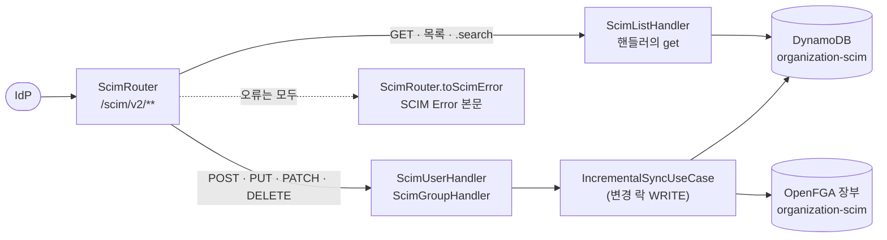
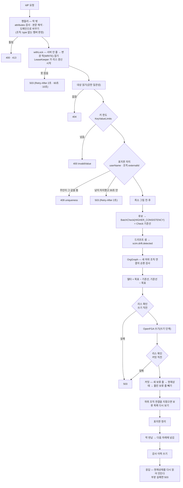
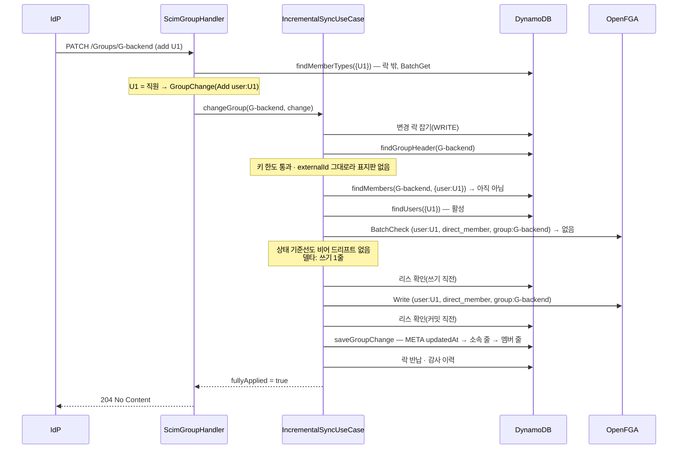

# SCIM

> 기준 커밋: 44147b3 (ops-readiness, main 에 머지됨). 코드가 바뀌면 이 문서도 함께 고친다.
> 읽기 전에: [개요](01-개요.md), [용어집](02-용어집.md), [데이터 모델](04-데이터-모델.md)(식별자·표지판·책갈피·키 한도)

app-scim 은 IdP(Okta, Microsoft Entra ID 등)가 보내는 SCIM 2.0 요청을 받아 [장부](02-용어집.md#장부)와 [현재상태](02-용어집.md#현재상태)에 반영한다. 이 문서는 그 모든 동작을 다룬다. 엔드포인트, 리소스 모양, 조회와 필터, PATCH 해석, 쓰기 한 건의 흐름, 오류 응답, 예시, IdP 별 메모 순이다.

다른 문서가 맡는 것:

- [변경 락](02-용어집.md#변경-락)을 잡고 갱신하고 반납하는 세부, [서버 안 줄](02-용어집.md#서버-안-줄)과 백오프 — [08 동시성과 작업](08-동시성과-작업.md)
- SCIM 재적재·[초기화](02-용어집.md#초기화)·하루 1회 [아카이빙](02-용어집.md#아카이빙) — [07 재적재·초기화·아카이빙](07-재적재-초기화-아카이빙.md)
- SCIM 요청이 남기는 [감사 이력](02-용어집.md#감사-이력)의 모양 — [10 감사 이력](10-감사-이력.md)
- 지표·경보·설정 전체 — [11 운영](11-운영.md), 장애별 대처 — [12 장애와 복구](12-장애와-복구.md)

---

## 1. 한눈에

### 1.1 누가 무엇을 하나

| 클래스 | 모듈 | 하는 일 |
|---|---|---|
| `ScimRouter` | connector-scim | 라우트 표, 라우트 밖 요청(501·405·404), 오류 번역. 오류 응답은 여기 한 곳에서만 만든다 |
| `ScimUserHandler`·`ScimGroupHandler` | connector-scim | 단건 GET 과 POST·PUT·PATCH·DELETE. 본문 해석, 유스케이스 호출, 응답 만들기 |
| `ScimListHandler`·`ScimUserListing`·`ScimGroupListing`·`ScimPager` | connector-scim | 목록·필터·`.search`, 페이지 자르기, [책갈피](02-용어집.md#책갈피) |
| `ScimGroupStream` | connector-scim | 멤버를 싣는 조직 응답을 흘려 쓴다 |
| `ScimFilter`·`ScimQuery`·`ScimAttributeProjection` | connector-scim | 필터 문법, 조회 파라미터, `attributes`·`excludedAttributes` |
| `ScimMapper`·`ScimPatchApplier` | connector-scim | DTO ↔ 도메인, PATCH 연산 해석 |
| `StateMemberTypeResolver` | connector-scim | `type` 이 없는 멤버가 직원인지 하위 조직인지 현재상태로 판정 |
| `ScimRfcAttributes`·`IgnoredAttributeObserver` | connector-scim | RFC 가 정의했지만 저장하지 않는 직원 속성을 가르고, 버린 것을 지표로 알린다 |
| `ScimDiscovery` | connector-scim | `/ResourceTypes`·`/Schemas` |
| `TemporaryFailureClassifier` | core `port` | 예외가 [일시 장애](02-용어집.md#일시-장애)(503)인지 원인 사슬을 따라 가른다. 관리 API 예외 처리기도 같은 분류기를 쓴다 |
| `IncrementalSyncUseCase` | core `usecase` | [SCIM 쓰기](02-용어집.md#scim-쓰기) 여섯 — `createUser`·`changeUser`·`removeUser`·`createGroup`·`changeGroup`·`removeGroup` |
| `UniqueMarkers`·`OrgGraph` | core `usecase` | [표지판](02-용어집.md#표지판) 판단, 순환 검사와 [보류 목록](02-용어집.md#보류-목록) |
| `KeyValueLimits`·`GroupChange` | core `model` | [키 한도](02-용어집.md#키-한도), 저장소를 읽기 전에 정리한 조직 변경 |
| `ScimConfig` | connector-scim | 위 핸들러와 라우트를 빈으로 만든다. `IncrementalSyncUseCase` 빈은 app-scim 의 `ScimUseCaseConfig` 가 만든다 |
| `ScimSyncMetrics` | app-scim | `scim.drift.detected`, `scim.patch.ignored`, `scim.lock.*`, `scim.revocations{kind}` 지표. `ArchiveDriftObserver` 도 구현해 아카이빙의 게이지 `scim.archive.drift{kind}`·`scim.archive.drift.observed` 도 낸다([07 — 드리프트 게이지](07-재적재-초기화-아카이빙.md#드리프트-게이지)) |

### 1.2 읽기와 쓰기는 길이 다르다

- **읽기**(단건 GET, 목록, `.search`)는 유스케이스를 거치지 않는다. 락 없이 저장소(`DirectoryQueryRepository`, `DirectoryStateRepository`)를 바로 읽는다. 재적재가 도는 동안에도 받는다.
- **쓰기**(POST·PUT·PATCH·DELETE)는 `IncrementalSyncUseCase` 를 거친다. 변경 락(용도 `WRITE`)을 잡은 뒤 존재 확인·유일성·튜플 계산을 모두 한다. 이것이 SCIM 쓰기다.
- SCIM 쓰기는 [회차](02-용어집.md#회차)가 아니다. [실행 기록](02-용어집.md#실행-기록)을 남기지 않는다. 요청마다 감사 이력(종류 `SCIM_REQUEST`, 원인 id 는 요청의 traceId)만 남긴다.
- 예외가 하나 있다. 저장하는 속성에 하나도 닿지 않는 직원 PATCH 는 락 없이 지금 모습을 돌려준다([§5.2](#52-직원-patch)).



### 1.3 id 는 서버가 발급한다

- 직원·조직 POST 마다 `UUID.randomUUID().toString()` 으로 새 [불변 id](02-용어집.md#불변-id)를 만든다(`ScimUserHandler.create`, `ScimGroupHandler.create`). 요청 본문의 `id` 는 무시한다.
- PUT·PATCH·DELETE 는 경로의 `id` 가 정본이다. 본문의 `id`·`userName`·`externalId` 가 달라도 리소스를 옮기지 않는다.
- 이 `id` 가 튜플에 실리고, 관리 API 는 이것을 [employeeId](02-용어집.md#employeeid)·[orgCode](02-용어집.md#orgcode)라 부른다.
- IdP 는 응답으로 받은 `id` 를 저장해 이후 요청의 경로와 조직의 `members[].value` 에 쓴다. 그래서 IdP 는 아직 받지 못한 `id` 를 가리킬 수 없다. 직원과 조직을 먼저 만든 뒤 멤버를 PATCH 하는 순서가 된다.
- 지운 직원과 같은 `userName` 으로 다시 만들어도 새 `id` 라, 옛 `id` 에 남은 권한을 물려받지 않는다.

---

## 2. 엔드포인트

### 2.1 라우트 표

`ScimRouter.scimRoutes` 가 등록하는 라우트 전부다. 경로는 모두 `/scim/v2` 아래다.

| 메서드 | 경로 | 처리 | 성공 | 요청 → 응답 본문 | 그 밖에 나올 수 있는 상태 코드 |
|---|---|---|---|---|---|
| POST | `/Users` | `ScimUserHandler.create` → `createUser` | 201 + `Location` | User → User | 400, 409, 413, 503, 500 |
| GET | `/Users/{id}` | `ScimUserHandler.get` | 200 | — → User | 400(속성 고르기), 404 |
| GET | `/Users` | `ScimListHandler.listUsers` | 200 | — → ListResponse | 400 |
| POST | `/Users/.search` | `ScimListHandler.searchUsers` | 200 | SearchRequest → ListResponse | 400, 413 |
| PUT | `/Users/{id}` | `ScimUserHandler.replace` → `changeUser` | 200 | User → User | 400, 404, 409, 413, 503, 500 |
| PATCH | `/Users/{id}` | `ScimUserHandler.patch` → `changeUser`(또는 락 없이 읽기) | 200 | PatchOp → User | 400, 404, 409, 413, 503, 500 |
| DELETE | `/Users/{id}` | `ScimUserHandler.delete` → `removeUser` | 204 | — → 없음 | 404, 503, 500 |
| POST | `/Groups` | `ScimGroupHandler.create` → `createGroup` | 201 + `Location` | Group → Group | 400, 409, 413, 503, 500 |
| GET | `/Groups/{id}` | `ScimGroupHandler.get` | 200 | — → Group | 400, 404 |
| GET | `/Groups` | `ScimListHandler.listGroups` | 200 | — → ListResponse | 400 |
| POST | `/Groups/.search` | `ScimListHandler.searchGroups` | 200 | SearchRequest → ListResponse | 400, 413 |
| PUT | `/Groups/{id}` | `ScimGroupHandler.replace` → `changeGroup` | 200 | Group → Group | 400, 404, 409, 413, 503, 500 |
| PATCH | `/Groups/{id}` | `ScimGroupHandler.patch` → `changeGroup` | 204. `attributes` 쿼리가 있으면 200 | PatchOp → 없음(또는 Group) | 400, 404, 409, 413, 503, 500 |
| DELETE | `/Groups/{id}` | `ScimGroupHandler.delete` → `removeGroup` | 204 | — → 없음 | 404, 503, 500 |
| GET | `/ServiceProviderConfig` | `ScimRouter.serviceProviderConfig` | 200 | — → ServiceProviderConfig | — |
| GET | `/ResourceTypes` | `ScimDiscovery.resourceTypes` | 200 | — → ListResponse | 403(`filter`) |
| GET | `/ResourceTypes/{name}` | `ScimDiscovery.resourceType` | 200 | — → ResourceType | 403, 404 |
| GET | `/Schemas` | `ScimDiscovery.schemas` | 200 | — → ListResponse | 403 |
| GET | `/Schemas/{id}` | `ScimDiscovery.schema` | 200 | — → Schema | 403, 404 |
| GET | `/scim/v2`, `/scim/v2/` | 서버 루트 조회 | — | — | 501 |
| POST | `/scim/v2/.search` | 서버 루트 조회 | — | — | 501 |

- 표의 "그 밖에 나올 수 있는 상태 코드" 는 그 경로에 고유한 것이다. 어느 경로든 저장소·OpenFGA 의 일시 장애는 503, 버그는 500 이다([§7](#7-오류-응답)).
- 모든 성공 응답의 `Content-Type` 은 `application/scim+json` 이다(`ScimRouter.SCIM_JSON`, RFC 7644 §3.1).
- 201 의 `Location` 은 본문 `meta.location` 과 같은 상대 경로다 — `/scim/v2/Users/<id>`, `/scim/v2/Groups/<id>`(`ScimMapper.userLocation`·`groupLocation`).
- 직원 PATCH 와 PUT 은 200 과 리소스, 조직 PATCH 는 204 가 기본이다. 조직 PATCH 에 `attributes` 쿼리 파라미터를 붙이면 RFC 7644 §3.5.2 대로 200 과 고른 속성을 돌려준다. `excludedAttributes` 만 있으면 그대로 204 다(`ScimGroupHandler.patch`).
- 쓰기 응답(POST·PUT, `attributes` 가 있는 조직 PATCH)에도 `attributes`·`excludedAttributes` 가 적용된다. 잘못된 값이면 **쓰기 전에** 400 이다 — 본문을 읽기 전에 검사하므로 아무것도 바뀌지 않는다.

### 2.2 라우트 밖 요청 — 501, 405, 404

위 표의 어느 라우트에도 맞지 않는 `/scim/v2/**` 요청은 마지막 라우트 `ScimRouter.라우트_밖` 이 받는다. 스프링 기본 404 는 SCIM Error 형식이 아니라 IdP 가 읽지 못하기 때문이다.

1. 경로가 `/scim/v2/Bulk`, `/scim/v2/Me`, `/scim/v2/Me/**` 이면 메서드와 상관없이 **501**. "지원하지 않는 SCIM 엔드포인트입니다: <경로>".
2. 경로는 있는데 메서드가 틀리면 **405** 와 `Allow` 헤더. 값은 그 경로가 받는 메서드를 이름순으로 쉼표로 이은 것이다. "이 경로는 <메서드> 를 받지 않습니다: <경로>".
3. 그 밖이면 **404**. "없는 SCIM 경로입니다: <경로>".

경로별 `Allow`(시험 `ScimRouteMissTest` 가 고정한다):

| 경로 | `Allow` |
|---|---|
| `/scim/v2/Users`, `/scim/v2/Groups` | `GET,POST` |
| `/scim/v2/Users/{id}`, `/scim/v2/Groups/{id}` | `DELETE,GET,PATCH,PUT` |
| `/scim/v2/Users/.search`, `/scim/v2/Groups/.search` | `DELETE,GET,PATCH,POST,PUT` — `.search` 는 `{id}` 에도 맞아 둘의 합이다 |
| `/scim/v2/ServiceProviderConfig`, `/Schemas`, `/Schemas/{id}`, `/ResourceTypes`, `/ResourceTypes/{name}` | `GET` |
| `/scim/v2`, `/scim/v2/` | `GET` |
| `/scim/v2/.search` | `POST` |

알아 둘 점:

- `GET /scim/v2/Users/.search` 는 `GET /Users/{id}` 라우트에 `id=".search"` 로 맞아 404("직원을 찾을 수 없습니다: .search")다.
- 서버 루트에 GET 이 아닌 메서드(예: `DELETE /scim/v2`)는 501 이 아니라 405 다. 501 은 루트 **조회**(GET, `POST /.search`)에만 난다.
- `/scim/v2` 밖의 경로(예: `/scim/v1/Users`)는 이 라우터가 받지 않는다. 그 응답은 스프링 기본이고 SCIM Error 가 아니다.

### 2.3 요청 형식과 본문 한도

| 항목 | 규칙 | 코드 |
|---|---|---|
| 요청 `Content-Type` | JSON 이어야 한다. 시험이 확인한 것은 `application/scim+json` 과 `application/json` 이다. 디코더가 읽지 못하는 형식은 415 | WebFlux 의 Jackson 디코더, `ScimRouter.상태_문구` |
| 본문 한도 | `spring.codec.max-in-memory-size`(설정하지 않으면 256KB). 넘으면 413. [루트 README.md](../../README.md) 는 이것을 멤버 약 7천 명으로 어림한다(추정, 재지 않았다) | `ScimConfig.scimRouterFunction`, `ScimRouter.기본_본문_한도` |
| 빈 본문 | POST·PUT·PATCH·`.search` 는 400 `invalidSyntax` "요청 본문이 비어 있습니다" | 각 핸들러 |
| 깨진 JSON, 타입이 맞지 않는 값 | 400 `invalidSyntax` "요청 본문을 해석할 수 없습니다" | `ScimRouter.toScimError`(`DecodingException`) |
| 속성 이름의 대소문자 | 가리지 않는다(RFC 7643 §2.1). `"Members"`, `"Active"`, `"OP"`, `"PATH"`, `"VALUE"` 도 읽는다. 같은 속성이 대소문자만 달리 두 번 오면 어느 값이 쓰이는지 정하지 않았다 | DTO 의 `@JsonFormat(ACCEPT_CASE_INSENSITIVE_PROPERTIES)` |
| 모르는 속성 | 본문(POST·PUT)에서는 조용히 무시한다. 지표도 없다 | DTO 의 `@JsonIgnoreProperties(ignoreUnknown = true)` |
| `schemas` | POST·PUT·PATCH 본문의 `schemas` 는 확인하지 않는다. `.search` 본문만 `urn:ietf:params:scim:api:messages:2.0:SearchRequest` 를 요구한다(없으면 400 `invalidSyntax`) | `ScimQuery.fromSearch` |
| `meta` | 본문의 `meta` 는 읽기 전용이라 쓰지 않는다 | `ScimMeta` |
| 응답 속성 이름 | RFC 표기 그대로(`userName`, `Resources` 등) | DTO |

413 은 400 이 아니다. 400 이면 IdP 가 같은 본문을 되풀이하기 때문이다. 413 의 문구에는 한도(바이트)를 싣는다.

### 2.4 발견 엔드포인트

**`GET /ServiceProviderConfig`** — 지원하는 기능을 선언한다. 필드 순서는 정해져 있지 않다(`Map.of`).

```json
{
  "schemas": ["urn:ietf:params:scim:schemas:core:2.0:ServiceProviderConfig"],
  "patch": {"supported": true},
  "bulk": {"supported": false, "maxOperations": 0, "maxPayloadSize": 0},
  "filter": {"supported": true, "maxResults": 100},
  "changePassword": {"supported": false},
  "sort": {"supported": true},
  "etag": {"supported": false},
  "authenticationSchemes": []
}
```

- `filter.supported` 가 참이지만 받는 것은 `eq` 와 `and` 뿐이다([§4.3](#43-필터)). RFC 7644 는 지원 여부만 선언하게 하고 부분 지원은 400 `invalidFilter` 로 알리게 한다.
- `authenticationSchemes` 가 비어 있다. 인증은 아직 구현하지 않았다([개요](01-개요.md)).

**`GET /ResourceTypes`, `GET /Schemas`** — ListResponse 로 둘(User, Group)을 준다. 클래스를 불러올 때 한 번 짓고, 응답마다 복사본을 내보낸다.

- 단건(`/ResourceTypes/{name}`, `/Schemas/{id}`)의 이름·URN 은 대소문자를 가리지 않는다. 모르면 404("없는 자원 종류입니다: x", "없는 스키마입니다: x").
- `filter` 쿼리 파라미터가 있으면 403(RFC 7644 §4, "이 엔드포인트는 filter 를 받지 않습니다 — RFC 7644 §4"). 다른 쿼리 파라미터는 무시한다.
- 스키마에는 실제로 저장하고 돌려주는 속성만 싣는다. 공통 속성(`id`, `externalId`, `meta`)과 enterprise 확장은 싣지 않는다. 응답 DTO 와 어긋나지 않는지는 `ScimDiscoverySchemaAlignmentTest` 가 지킨다.

| 스키마 | 싣는 속성 |
|---|---|
| User | `userName`(필수, `uniqueness: server`, `caseExact: false`), `name`(여섯 하위 속성), `displayName`, `emails`(복수 — `value`, `type`(정규값 `work`), `primary`), `active`(boolean) |
| Group | `displayName`, `members`(복수 — `value`(필수, `immutable`), `type`(정규값 `User`·`Group`, `immutable`)) |

문자열 속성은 모두 `caseExact: false` 로 선언된다(`ScimDiscovery.속성`).

---

## 3. 리소스 모양

### 3.1 직원(User)

[직원](02-용어집.md#직원)은 현재상태의 [직원 META](04-데이터-모델.md#직원-meta) 한 아이템이다. 저장하는 속성은 아래가 전부다.

| SCIM 속성 | POST·PUT 에서 저장하는 법 | 응답 |
|---|---|---|
| `id` | 본문 값 무시. POST 는 새 UUID, PUT 은 경로 | 그대로 |
| `userName` | 필수. 없거나 공백뿐이면 400 `invalidSyntax` "userName 은 필수입니다"(`ScimMapper.toDirectoryUser`). 원본 그대로 저장 | 그대로 |
| `externalId` | 그대로. 없으면 비운다 | 있으면 싣는다 |
| `displayName` | 비어 있으면 `name.formatted`, 그것도 비면 `userName` 을 쓴다 | 그대로 |
| `name` | 여섯 칸(`formatted`, `familyName`, `givenName`, `middleName`, `honorificPrefix`, `honorificSuffix`)을 보낸 그대로. 없으면 이름 없음 | 이름이 없으면 `name` 을 싣지 않는다 |
| `emails` | **하나만** 저장한다. `primary: true` 인 첫 원소, 없으면 첫 원소의 `value` | 이메일이 있으면 `[{"value":…, "type":"work", "primary":true}]`, 없으면 `[]` |
| `active` | 없으면 **활성(true)**([§5.2](#52-직원-patch)). 불리언으로 읽히지 않는 값(`"yes"`)은 400 `invalidSyntax` | 그대로 |
| `meta` | 무시 | `resourceType: "User"`, `created`, `lastModified`, `location` |

- PUT 은 통째 교체다. 본문에 없는 속성은 비워진다. 특히 `active` 가 없는 PUT 은 직원을 **활성으로** 만든다.
- 그 밖의 속성(`groups`, `phoneNumbers`, `addresses`, enterprise 확장 등)은 POST·PUT 본문에서 조용히 버린다. 지표도 없다(지표는 PATCH 만 — [§5.4](#54-받아서-버리는-직원-속성과-지표)).
- 직원의 소속은 User 리소스에 싣지 않는다. User `groups` 를 내보내지도 받지도 않는다. 소속은 조직의 `members` 로만 바꾼다.
- 키에 들어가는 값(`userName`, `displayName`, `externalId`)은 길이 한도가 있다([§6.3](#63-키-한도)).

응답 예(필드 순서는 DTO `ScimUser` 의 순서다):

```json
{
  "schemas": ["urn:ietf:params:scim:schemas:core:2.0:User"],
  "id": "3f6c1d52-8a0e-4b7d-9c21-5e0f7a4d2b18",
  "externalId": "00u1abcd2EFGH3ijk4l5",
  "userName": "gd.hong",
  "name": {"familyName": "홍", "givenName": "길동"},
  "displayName": "홍길동",
  "emails": [{"value": "gd.hong@example.com", "type": "work", "primary": true}],
  "active": true,
  "meta": {
    "resourceType": "User",
    "created": "2026-10-25T04:00:00.123456Z",
    "lastModified": "2026-10-25T04:00:00.123456Z",
    "location": "/scim/v2/Users/3f6c1d52-8a0e-4b7d-9c21-5e0f7a4d2b18"
  }
}
```

### 3.2 조직(Group)

[조직](02-용어집.md#조직)은 [조직 META](04-데이터-모델.md#조직-meta)(곧 [이름표](02-용어집.md#이름표))와 [멤버 줄](02-용어집.md#멤버-줄)들이다.

| SCIM 속성 | 저장하는 법 | 응답 |
|---|---|---|
| `id` | 본문 값 무시. POST 는 새 UUID, PUT 은 경로 | 그대로 |
| `externalId` | 그대로. 비어 있지 않으면 다른 조직과 겹칠 수 없다([§6.4](#64-표지판--username-과-조직-externalid)) | 있으면 싣는다 |
| `displayName` | 그대로. 필수가 아니다 | 있으면 싣는다 |
| `members[].value` | [정규화](02-용어집.md#정규화)(`IdNormalizer.normalize`)한 id. 없거나 공백이면 400 `invalidSyntax` "members 원소에 value 가 없습니다" | `value` |
| `members[].type` | `"Group"`(대소문자 무시)이면 [하위 조직](02-용어집.md#하위-조직), 그 밖의 값이면 직원. **없으면 현재상태로 판정**(아래) | `"User"` 또는 `"Group"` |
| `members[].display`, `$ref` | 버린다 | 싣지 않는다 |
| `meta` | 무시 | `resourceType: "Group"`, `created`, `lastModified`, `location` |

- PUT 은 통째 교체다. `members` 가 없는 PUT 은 **멤버를 모두 뺀다**(`ScimMapper.toDirectoryGroup` 이 빈 목록으로 본다).
- 서버가 모르는 id 를 멤버로 받아도 거절하지 않는다. 멤버 줄만 저장하고, 그 id 의 직원이 실제로 있기 전에는 튜플을 만들지 않는다.

> **롤업은 IdP 가 중첩 그룹을 보낼 때만 생긴다.** `child` 튜플은 `type: "Group"` 인(또는 현재상태로 조직이라 판정된) 멤버에서만 나온다. Entra·Okta 가 조직의 멤버로 다른 조직을 SCIM 으로 보내는지는 확인하지 못했다. 보내지 않으면 SCIM 배포에는 [롤업](02-용어집.md#롤업)이 없다 — 상위 조직의 `member` Check 가 하위 조직 직원에게 거짓이다([13 — 2.2](13-한계와-알려진-문제.md#22-scim-배포의-조직-계층을-어디서-받는지-정해지지-않았다)).

**`type` 이 없는 멤버.** RFC 7643 에서 `type` 은 선택 필드다. 그런데 SCIM 이 중첩 조직을 나타내는 유일한 수단이기도 하다. 직원 id 와 조직 id 는 이름 공간이 달라 겹칠 수 있으므로, 없는 `type` 을 직원으로 단정하면 조직을 중첩하려던 요청이 엉뚱한 `direct_member` 튜플이 된다.

- 요청에서 `type` 없는 id 를 먼저 모아 `StateMemberTypeResolver.resolveAll` 이 **한 번에** 판정한다. `DirectoryStateRepository.findMemberTypes` 가 직원 META 와 조직 META 를 BatchGet(키 100개씩, [강한 일관성](02-용어집.md#강한-일관성))으로 읽는다.
- 조직 META 가 있으면 조직, 직원 META 만 있으면 직원, 둘 다 있으면 조직, 둘 다 없으면 직원으로 둔다.
- 있는 직원으로 판정되면 로그가 없다. Entra·Okta 의 정상 경로다. 조직으로 추정했거나 없는 id 가 있으면 요청당 경고 한 줄을 남긴다 — 수와 id 앞 10개(id 마다 64자까지).
- 이 판정은 **락 밖**에서, 핸들러가 본문을 도메인으로 바꿀 때 한다(`ScimMapper.toDirectoryGroup`, `ScimPatchApplier.toGroupChange`). `type` 을 모두 보냈으면 저장소를 읽지 않는다.

응답 예(멤버를 싣는 응답은 흘려 쓰므로 `members` 가 맨 뒤다 — [§4.6](#46-멤버를-싣는-조직-응답은-흘려-쓴다)):

```json
{
  "schemas": ["urn:ietf:params:scim:schemas:core:2.0:Group"],
  "id": "8e4a2c6f-3d1b-4a9e-b7c5-0f2d6e8a4b13",
  "externalId": "backend-team",
  "displayName": "백엔드팀",
  "meta": {
    "resourceType": "Group",
    "created": "2026-10-25T04:00:01.002Z",
    "lastModified": "2026-10-25T04:10:00.517Z",
    "location": "/scim/v2/Groups/8e4a2c6f-3d1b-4a9e-b7c5-0f2d6e8a4b13"
  },
  "members": [
    {"value": "5d0c7e2a-1b3f-4c8d-9e6a-2f4b8c1d7e90", "type": "Group"},
    {"value": "3f6c1d52-8a0e-4b7d-9c21-5e0f7a4d2b18", "type": "User"}
  ]
}
```

### 3.3 meta 의 시각

- `created` 는 처음 만든 시각, `lastModified` 는 저장하는 속성이 **실제로 바뀐** 마지막 시각이다(META 의 `createdAt`·`updatedAt`). 처음 만들면 둘이 같다.
- 같은 값을 다시 보내면 저장소가 쓰지 않으므로 `lastModified` 가 그대로다(`DynamoDbDirectoryStateRepository.saveUser` 의 비교).
- 조직은 멤버만 바뀌어도, 하위 조직이 지워져도 움직인다. 직원의 소속이 바뀌는 것은 직원의 변경이 아니다.
- 시각을 모르면(이 기능 전에 만든 아이템) 그 칸을 싣지 않는다(`ScimMapper.meta`).
- `meta.lastModified` 로 거르는 필터는 받지 않는다(400 `invalidFilter`).

---

## 4. 조회

### 4.1 단건 GET

- `GET /Users/{id}` 는 `DirectoryQueryRepository.findUser` 로 직원 META 를 GetItem 한다(강한 일관성). 없으면 404 "직원을 찾을 수 없습니다: <id>".
- `GET /Groups/{id}` 는 이름표를 먼저 GetItem 한다(`findGroupHeader`, 강한 일관성). 없으면 응답을 쓰기 전에 404 "조직을 찾을 수 없습니다: <id>". 이어서 `members` 가 응답에 남으면 멤버 줄을 흘려 쓰고, 남지 않으면 이름표만 쓴다.
- id 가 키 한도를 넘으면 DynamoDB 를 부르지 않고 없음으로 답한다 — 404 다([04 키 길이 한도](04-데이터-모델.md#6-키-길이-한도)).

### 4.2 속성 고르기 — attributes, excludedAttributes

RFC 7644 §3.9 의 `attributes`·`excludedAttributes` 는 리소스를 돌려주는 **모든** 응답(단건 GET, 목록, `.search`, 쓰기 응답)에 적용한다(`ScimAttributeProjection`).

- URL 에서는 쉼표 목록이다. 앞뒤 공백을 떼고 빈 이름은 버린다. `.search` 본문에서는 문자열 배열이다.
- 이름은 최상위 속성과 한 단계 하위 속성(`name.givenName`, `members.value`)이다. 대소문자를 가리지 않고, 그 리소스의 코어 스키마 URN 이 붙어도 된다. 다른 URN 이 붙으면 모르는 이름이다.
- 받는 이름은 응답 DTO 가 실제로 내보내는 경로뿐이다(`ScimResourceType` 의 목록). 그 밖이면 400 `invalidValue` "알 수 없는 속성입니다: x".
- 둘을 함께 주면 400 `invalidValue` "attributes 와 excludedAttributes 는 함께 쓸 수 없습니다".
- `id` 와 `schemas` 는 어느 경우에도 남는다(`id` 는 RFC 7643 `returned: always`).
- 조직에서 `members` 가 응답에 남지 않으면(예: `excludedAttributes=members`) **멤버 줄을 읽지 않는다**. 응답 크기가 조직 크기를 따라가지 않는다.

| 리소스 | 고를 수 있는 경로 |
|---|---|
| User | `schemas`, `id`, `externalId`, `userName`, `name`(+ 여섯 하위), `displayName`, `emails`(+ `value`·`type`·`primary`), `active`, `meta`(+ `resourceType`·`created`·`lastModified`·`location`) |
| Group | `schemas`, `id`, `externalId`, `displayName`, `members`(+ `value`·`type`·`display`), `meta`(+ 네 하위) |

### 4.3 필터

받는 것은 좁은 부분집합 하나다(`ScimFilter.parse`).

```
filter   = term *( SP "and" SP term )
term     = attrPath SP "eq" SP compValue
attrPath = [ 리소스의 코어 스키마 URN ":" ] attrName
compValue = JSON 문자열 / true / false
```

- 공백은 정확히 한 칸이다. 두 칸 이상, `or`·`not`, 다른 연산자(`co`, `sw` 등), 괄호, 대괄호 값 경로(`emails[type eq "work"].value`), 하위 속성(`name.givenName`, `meta.lastModified`), 숫자·`null` 값은 모두 400 `invalidFilter` 다. 경우를 나열하지 않고 한 규칙으로 거절한다.
- `eq`·`and` 키워드는 대소문자를 가리지 않는다. 속성 이름도 가리지 않는다. 값의 `true`·`false` 는 소문자여야 한다.
- 문자열 값은 RFC 8259 JSON 문자열이다. 큰따옴표만 구분자이고 이스케이프(`\"`, `\\`, `\n`, `\uXXXX` 등)를 푼다. 작은따옴표로 감싼 값은 400 이다.
- 빈 필터(`filter=`)는 400 `invalidFilter` "필터가 비어 있습니다".
- 문법 오류의 문구에는 받은 입력이 붙는다(예: "지원하지 않는 값입니다: '5' — 문자열과 true/false 만 받습니다 — filter: userName eq 5"). 입력 조각은 셋이다 — 끝의 필터 원문, 받지 않는 속성 경로, 받지 않는 값 token. **각각 앞 100자(코드 포인트)까지만** 싣고, 넘으면 `…` 를 붙인다(`ScimFilter.Parser.앞부분`). 원문만 자르면 token 이 필터의 대부분일 때 문구 길이에 상한이 없기 때문이다 — 인증 없는 엔드포인트가 본문 한도(256KB)까지 메아리치지 않게 한다.

**리소스별로 받는 속성.** 필터에는 인덱스로 찾을 수 있는 조건이 적어도 하나 있어야 한다. 그 조건 하나로 후보를 찾고(찾는 조건), `and` 로 붙은 나머지 조건은 후보 위에서 메모리로 확인한다. 전원을 훑는 필터는 받지 않는다.

| 리소스 | 받는 속성 | 찾는 조건(이 순서로 첫째를 고른다) | 찾는 법 |
|---|---|---|---|
| User | `id`, `userName`, `externalId`, `displayName`, `active`(불리언) | `id` → `userName` → `externalId` | `id`: META GetItem(강한). `userName`: [GSI1](04-데이터-모델.md#gsi1) 의 `GSI1SK = 소문자 값`(최종 일관성). `externalId`: [GSI3](04-데이터-모델.md#gsi3) 로 id 를 찾고 본 테이블을 강하게 다시 읽는다 |
| Group | `id`, `displayName`, `externalId` | `id` → `displayName` → `externalId` | 같은 방식. `displayName` 은 GSI1 |

- 찾는 조건이 없으면 400 `invalidFilter` — 직원은 "id·userName·externalId 중 하나의 eq 가 있어야 합니다 — 전원을 훑는 필터는 받지 않습니다", 조직은 "id·displayName·externalId 중 하나의 eq 가 있어야 합니다".
- 받지 않는 속성은 400 "필터할 수 없는 속성입니다: x", 타입이 맞지 않으면(예: `active eq "true"`, `userName eq true`) 400 "속성 'x' 에 맞지 않는 값입니다: y".

**대소문자.**

| 속성 | 비교 |
|---|---|
| `userName`, `displayName`(직원·조직) | 가리지 않는다(RFC 7643 `caseExact=false`). `Locale.ROOT` 소문자로 비교한다 — 인덱스 키(`Keys.indexKey`)와 같은 규칙이다(`ScimText`). 대소문자만 다른 둘이 있으면 둘 다 나온다 |
| `id`, `externalId` | 가린다 |
| `active` | 불리언 일치 |

**일관성.** `userName`·`displayName` 필터는 GSI1, `externalId` 필터는 GSI3 를 지나므로 방금 만든 리소스가 잠깐 안 보일 수 있다. IdP 가 "있는지 필터로 본 뒤 없으면 POST" 하는 순서라면, 그 틈에 온 중복 POST 는 [표지판](#64-표지판--username-과-조직-externalid)이 409 로 막는다. `id` 필터와 단건 GET 은 강한 일관성이다.

### 4.4 페이지와 정렬

`ScimQuery.of` 가 RFC 7644 §3.4.2.4 의 규칙을 한 번에 정리한다.

| 파라미터 | 규칙 |
|---|---|
| `startIndex` | 1 부터. 1 미만이면 1. 정수가 아니면 400 `invalidValue` "startIndex 는 정수여야 합니다: x" |
| `count` | 없으면 100. 음수면 0, 100 초과면 100(`ScimQuery.MAX_COUNT`). 정수가 아니면 400 `invalidValue` |
| `count=0` | 리소스 없이 `totalResults` 만 준다. 응답에 `Resources` 칸이 없다 |
| `sortBy` | 직원은 `userName`, 조직은 `displayName` 만(URN 붙어도 된다). 그 밖이면 400 `invalidValue` "정렬은 userName 로만 할 수 있습니다: x". 목록은 늘 이 순서라 사실상 검사만 한다 |
| `sortOrder` | `ascending`(기본) 또는 `descending`(대소문자 무시). 그 밖이면 400 `invalidValue` |

ListResponse 모양:

```json
{
  "schemas": ["urn:ietf:params:scim:api:messages:2.0:ListResponse"],
  "totalResults": 100000,
  "startIndex": 101,
  "itemsPerPage": 100,
  "Resources": [ … ]
}
```

- `itemsPerPage` 는 실제로 담은 수다. 결과가 0건이면 `Resources` 는 빈 배열이다.
- 필터 결과는 메모리에서 정렬해 자른다(`ScimPager.filtered`). 순서는 인덱스와 같다 — 소문자 `userName`(조직은 `displayName`. 값이 없으면 id), 같으면 id. `startIndex` 가 결과 수보다 크면 빈 배열이다.
- 필터 없는 목록의 순서는 GSI1 정렬키 순서(내림차순이면 역순)다.

### 4.5 필터 없는 목록 — 책갈피와 세기

필터 없는 목록은 GSI1 의 `USER_INDEX`·`GROUP_INDEX` 파티션을 정렬키 순서로 읽는다. DynamoDB 에는 offset 이 없으므로, IdP 가 페이지를 `startIndex=1, 101, 201…` 순서로 부른다는 점을 이용한다. 다음 페이지를 이어 읽을 위치를 DynamoDB 에 15분 동안 [책갈피](04-데이터-모델.md#책갈피)로 둔다(`ScimPager.unfiltered`).

| 요청 | 하는 일 |
|---|---|
| `startIndex=1` | 파티션 **세기**(COUNT) + 처음부터 `count` 건 읽기 → 다음 위치가 있으면 책갈피 `START#<1+받은 수>` 저장 |
| `startIndex=N`, 책갈피 있음 | 책갈피 자리부터 `count` 건. `totalResults` 는 책갈피에 적힌 값 → 다음 책갈피 저장 |
| `startIndex=N`, 책갈피 없음 | 세기 + 앞 N−1 건을 키만 읽으며 건너뛰기 + `count` 건 → 책갈피 저장 |
| `count=0` | 세기만 |

- **세기**는 `Select.COUNT` Query 다(`DynamoDbDirectoryQueryRepository.count`). 1MB 마다 끊기므로 `LastEvaluatedKey` 를 끝까지 따라간다. 돌려받는 것은 수뿐이지만 읽는 양은 파티션 전체(직원이면 전원)다. 그래서 첫 페이지에 한 번만 센다.
- **건너뛰기**는 앞 N−1 건을 키만 투영해 읽는다(`skip`). 읽는 양이 N 을 따른다. 책갈피가 없을 때만 한다.
- `totalResults` 는 그 가져오기의 첫 페이지에서 센 값이다. 가져오는 동안 직원이 늘거나 줄어도 바뀌지 않는다.
- 책갈피 키는 `PAGE#<USER|GROUP>#<ASC|DESC>` / `START#<startIndex>` 다. 필터는 키에 들지 않는다 — 필터 결과에는 책갈피를 쓰지 않는다.
- 책갈피는 강한 일관성으로 읽는다. 다른 인스턴스가 바로 전에 쓴 책갈피도 본다. 앱을 여러 대 띄워도 이어진다.
- 같은 키에 두 가져오기가 쓰면 덮어쓴다. 둘 다 올바른 위치다.
- 읽을 때 `expiresAt` 을 직접 보고 지났으면 없는 것으로 본다(테이블 TTL 은 늦게 지운다).
- 책갈피 읽기가 실패하면 경고 로그를 남기고 건너뛰기로 대신한다. 저장이 실패하면 이번 페이지는 그대로 돌려주고, 다음 페이지는 건너뛰기로 떨어진다. 어느 쪽도 요청을 실패시키지 않는다.
- 목록의 항목은 GSI1(최종 일관성, 투영 `ALL`)에서 바로 만든다. 방금 바뀐 값이 잠깐 옛 값으로 보일 수 있다.

### 4.6 멤버를 싣는 조직 응답은 흘려 쓴다

`members` 가 응답에 남는 조직 응답은 본문을 `Content-Length` 없이 청크로 보낸다(`ScimGroupStream`). 대상은 `GET /Groups/{id}`, `members` 가 남는 `GET /Groups`·`POST /Groups/.search`(`count > 0`), POST·PUT 의 응답, `attributes` 로 `members` 를 고른 조직 PATCH 의 응답이다.

1. 조직 이름표를 먼저 읽는다. 없으면 404, 이 단계의 저장소 장애면 503 — 둘 다 첫 바이트 전에 나간다.
2. 이름표와 `meta` 를 JSON 으로 쓰고 `"members":[` 를 붙인다.
3. 멤버 줄을 `DirectoryStateRepository.findMemberRefs`(키만, 강한 일관성)로 한 쪽씩 읽는 대로 JSON 으로 바꾼다. 100명씩(`ScimGroupStream.멤버_묶음`) 버퍼 하나로 내보낸다.
4. `]}` 로 닫는다. 목록이면 조직을 하나씩 차례로 쓰고 맨 끝에 `"itemsPerPage":<실제로 쓴 조직 수>` 를 붙인다.

- 멤버 순서는 하위 조직이 먼저, 그다음 직원이고 각각 id 순이다. 멤버 줄 정렬키가 `MEMBER#GROUP#…` < `MEMBER#USER#…` 이기 때문이다.
- 메모리에는 조직 전체가 들지 않는다. 느린 클라이언트가 받아 가지 않아도 많아야 DynamoDB 한 쪽 앞서 읽고 멈춘다. 다만 **읽는 양은 그대로 조직 전체**다 — 멤버 전체를 달라는 요청이기 때문이다.
- 목록은 앞 조직을 다 쓰기 전에 뒤 조직을 읽지 않는다. 목록을 만든 뒤 지워진 조직은 이름표가 비어 건너뛴다.
- **첫 바이트가 나간 뒤 저장소가 실패하면 상태 코드를 바꿀 수 없어 연결이 끊긴다.** 닫는 괄호를 쓰지 않으므로 완결된 200 JSON 은 나가지 않는다. IdP 에는 네트워크 오류로 보인다.
- JSON 객체의 필드 순서에는 뜻이 없다(RFC 8259 §4). 그래서 `members` 는 맨 뒤, 목록의 `itemsPerPage` 는 맨 끝이다.
- `members` 를 빼면(`excludedAttributes=members`, 또는 `members` 를 고르지 않은 `attributes`) 멤버 줄을 읽지 않고 이름표만 한 번에 보낸다.

### 4.7 .search

`POST /Users/.search`·`/Groups/.search` 는 같은 조회를 본문으로 보낸다(RFC 7644 §3.4.3). 본문은 `ScimSearchRequest` 다.

```json
{
  "schemas": ["urn:ietf:params:scim:api:messages:2.0:SearchRequest"],
  "filter": "userName eq \"gd.hong\"",
  "attributes": ["userName", "active"],
  "startIndex": 1,
  "count": 10
}
```

- `schemas` 에 SearchRequest URN 이 없으면 400 `invalidSyntax` "SearchRequest 스키마가 없습니다: …".
- 그 밖의 규칙(필터, 페이지, 정렬, 속성 고르기, 흘려 쓰기)은 URL 조회와 같다. 둘 다 `ScimQuery` 하나로 바뀐다.

---

## 5. PATCH 해석

### 5.1 공통 규칙

본문은 PatchOp 다.

```json
{
  "schemas": ["urn:ietf:params:scim:api:messages:2.0:PatchOp"],
  "Operations": [
    {"op": "replace", "path": "active", "value": false}
  ]
}
```

- `Operations` 가 없거나 비면 400 `invalidSyntax` "PATCH 요청에 Operations 가 없습니다".
- `op` 는 `add`·`replace`·`remove` 다. 앞뒤 공백을 떼고 대소문자를 가리지 않는다(Entra 는 `"Replace"` 로 보낸다). 비면 400 `invalidSyntax` "op 가 비어 있습니다" 다. 그 밖의 op 는 리소스와 path 에 따라 오류가 다르다(`ScimPatchApplier`).
  - 직원 PATCH — 400 `invalidSyntax` "알 수 없는 op 입니다: x".
  - 조직 PATCH, path 가 `members`·`externalId` — 400 `invalidSyntax` "알 수 없는 op 입니다: x".
  - 조직 PATCH, path 가 `displayName` 이거나 없음 — 400 `invalidSyntax` "이 path 에는 replace 또는 add 만 지원합니다: x".
  - 조직 PATCH, path 가 `members[...]` — 400 `invalidPath` "members 필터는 remove 에만 지원합니다: op=x, path=…".
  - 조직 PATCH, 그 밖의 path — 400 `invalidPath` "지원하지 않는 path 입니다: <path>".
- `path` 의 속성 이름은 대소문자를 가리지 않는다. 코어 스키마 URN 접두(`urn:ietf:params:scim:schemas:core:2.0:User:` / `…:Group:`, 대소문자 무시)를 붙여도 된다 — `…:User:active` 는 `active` 와 같다. 확장 스키마(enterprise 등) 접두는 떼지 않는다.
- **경로 없는 값**(path 없이 값 객체를 보내는 `add`·`replace`)은 값 객체의 키 하나하나를 path 로 보고 같은 규칙으로 푼다. 키에도 코어 URN 접두를 붙여도 된다. 값이 객체가 아니면 400 `invalidSyntax` "값은 객체여야 합니다".
- **path 없는 `remove`** 는 무엇을 지울지 가리키지 않았다. RFC 7644 §3.5.2.2 대로 400 `noTarget` "remove 에는 path 가 있어야 합니다".
- 연산은 배열 순서대로 쌓인다.
- **요청 하나는 모두 반영되거나 모두 거절된다**(RFC 7644 §3.5.2). 연산 하나가 400 이면 같은 요청의 다른 연산도 반영되지 않는다.

모양 검사는 대부분 락 밖에서 끝난다. 직원 PATCH 의 값 검사(`active` 값, 빈 `userName`, `emails` 모양 등)는 락 안의 계산에서 나온다. 그때도 아무것도 쓰지 않고 400 으로 끝난다.

### 5.2 직원 PATCH

저장하는 속성에 대한 연산(`ScimPatchApplier.storedAttribute`)이다. 이 속성들은 적용할 수 있는 모양이면 엄격하게 적용한다.

| path | `add`·`replace` | `remove` |
|---|---|---|
| `userName` | 그 값으로 바꾼다. null·빈 문자열·공백뿐이면 400 `invalidValue` "userName 은 필수입니다 — 빈 값으로 바꿀 수 없습니다" | 400 `mutability` "userName 은 필수라 지울 수 없습니다" |
| `displayName` | 바꾼다(문자열로) | 비운다 |
| `externalId` | 바꾼다 | 비운다 |
| `active` | 아래 "active 값" | **활성(true)** 이 된다 |
| `name` | 값 객체에 있는 하위 속성만 바꾼다. 모르는 하위 키는 무시한다 | 여섯 칸을 모두 비운다 |
| `name.formatted`, `name.familyName`, `name.givenName`, `name.middleName`, `name.honorificPrefix`, `name.honorificSuffix` | 그 칸을 바꾼다 | 그 칸을 비운다 |
| `emails` | 배열에서 `primary: true` 인 것, 없으면 첫째의 `value`. 배열이 아니면 400 `invalidSyntax` "emails 값은 배열이어야 합니다" | 비운다 |
| `emails[type eq "work"]` | 값 객체의 `value`. 이메일이 없는데 `replace` 면 400 `noTarget` "바꿀 work 이메일이 없습니다: <path>" | 비운다 |
| `emails[type eq "work"].value` | 값 그대로. `replace` 의 `noTarget` 규칙은 같다 | 비운다 |
| (path 없음) | 값 객체의 키마다 위 규칙 | 400 `noTarget` |

`emails[type eq "work"]` 은 대괄호 안이 정확히 `type eq "work"`(대소문자 무시, 대괄호 안쪽 공백 허용)일 때만 적용한다. `"home"` 처럼 다른 type, `emails[primary eq true].value`, 필터 없는 `emails.value`, `.display` 는 저장된 이메일을 고르지 못해 받아서 버린다([§5.4](#54-받아서-버리는-직원-속성과-지표)). 그 모양으로 보내는 IdP 는 이메일 갱신이 조용히 빠진다.

**active 값.** JSON 불리언, 또는 문자열 `"true"`·`"false"`(대소문자 무관)만 받는다(`ScimPatchApplier.asBoolean`). Entra 가 문자열로 보낸다. 그 밖(`"yes"`, `"1"`, `" true"`, `""`, `null`)은 400 `invalidValue` "active 는 true 또는 false 여야 합니다: <값>" 이다. 거짓으로 읽으면 조용히 비활성화하기 때문이다.

**"active 가 없으면 활성이다".** 규칙은 하나다. POST·PUT 본문에 `active` 가 없을 때, PATCH 로 `active` 를 `remove` 할 때 모두 활성이다.

- 까닭: RFC 7643 §4.1.1 과 RFC 7644 §3.5.1 이 기본값을 서비스 제공자에게 맡긴다. 경우마다 다르게 두면(예: PUT 은 유지, remove 는 비활성) 원칙이 둘이 된다.
- 반대로 "없음 = 비활성" 으로 두면 `active` 를 싣지 않는 POST 가 권한 없는 직원을 만든다. 지금 쓰는 IdP(Entra·Okta)는 비활성화를 `active=false` 로 명시해 보낸다(루트 README.md 의 서술이다. IdP 동작은 확인하지 못했다).
- 결과: `active` 를 빠뜨린 PUT, `remove active` 는 비활성 직원을 **다시 활성으로** 만든다. 그 직원의 `direct_member` 튜플이 다시 쓰인다.

**락 없이 돌려주는 PATCH.** 연산이 모두 저장하지 않는 속성(예: Entra 의 `manager`)이면 우리 현재상태에 아무 말도 하지 않는다(`ScimPatchApplier.touchesNoStoredUserAttribute`). 그때는 락·Check·쓰기·저장 없이 지금 모습을 200 으로 돌려준다. 저장하는 속성이 하나라도 섞이면(같은 값이라도) 락 안에서 처리한다. 가르는 규칙은 적용과 같은 `storedAttribute` 하나이고, 요청만 보고 정한다. 락 없이 읽으므로 같은 순간 지워지는 직원이면 지우기 직전 모습일 수 있다(GET 과 같다). 직원이 없으면 404 다.

### 5.3 조직 PATCH

조직 PATCH 는 **저장소를 읽지 않고** `GroupChange` 로 정리된다(`ScimPatchApplier.toGroupChange`). 지금 멤버인지 같은 판단은 유스케이스가 락 안에서 한다. 락 밖에서 읽은 목록으로 계산하면 동시에 온 두 PATCH 가 서로가 넣은 멤버를 지우기 때문이다.

| path | `add` | `replace` | `remove` |
|---|---|---|---|
| `members` | 값 배열의 멤버를 넣는다. 이미 있으면 그대로 | 목록을 통째로 바꾼다 | **값이 없으면 멤버 전원을 뺀다**(RFC 7644 §3.5.2.2). **값이 있으면 400 `invalidValue`**(아래) |
| `members[value eq "<id>"]` | 400 `invalidPath` | 400 `invalidPath` | 그 id 를 뺀다 |
| `displayName` | 바꾼다 | 바꾼다 | 400 `invalidSyntax` "이 path 에는 replace 또는 add 만 지원합니다: remove" |
| `externalId` | 바꾼다. 문자열(숫자·불리언은 문자열로)만. 객체·배열은 400 `invalidValue` "externalId 는 문자열이어야 합니다" | 같다 | 비운다 |
| (path 없음) | 값 객체의 `displayName`·`externalId` 를 바꾸고, `members` 를 **넣는다** | `displayName`·`externalId` 를 바꾸고, `members` 로 **교체한다** | 400 `noTarget` |
| 그 밖 | 400 `invalidPath` "지원하지 않는 path 입니다: <path>" | | |

- 경로 없는 값에서 `displayName`·`externalId`·`members` 밖의 키는 조용히 무시한다.
- `members` 값은 배열이어야 하고(아니면 400 `invalidSyntax` "members 값은 배열이어야 합니다") 원소는 객체여야 한다("members 원소는 객체여야 합니다"). 한 연산에 여러 멤버를 넣을 수 있다.
- `replace members`(또는 경로 없는 `replace` 의 `members`)는 목표 목록을 정한다. 그 앞에 쌓인 멤버 연산은 뜻이 없어진다. 그 뒤의 연산은 그 목록 위에 쌓인다(`GroupChange.replacing`, `adding`).

**`members[value eq "<id>"]`.** 대괄호 안은 목록 조회와 같은 `ScimFilter` 가 읽는다. 그래서 값 안의 작은따옴표(`o'brien`)에서 끊기지 않는다.

- 받는 모양은 한 항 `value eq "<id>"` 뿐이다. 두 항 이상이거나 `value` 가 아니거나 빈 값이면 400 `invalidPath` "members 필터는 value eq \"<아이디>\" 한 항만 지원합니다: …". 문법 오류(작은따옴표, 공백 두 칸)는 400 `invalidFilter` 다.
- 필터에는 종류가 없다. 같은 id 의 직원과 하위 조직이 **둘 다** 멤버일 때만 현재상태를 물어 조직이 있으면 하위 조직을, 아니면 직원을 뺀다(`GroupChange.replay`, `IncrementalSyncUseCase.종류판정`). 그때 경고 로그가 남는다. 하나만 멤버면 그것을 뺀다.

**값 붙은 `remove members` 는 400 이다.** `{"op":"remove","path":"members","value":[{"value":"…"}]}` 는 RFC 7644 로 읽으면 "멤버 전원 삭제" 이고, `value` 는 `remove` 에 정의되지 않은 칸이다. "그 멤버만" 으로 추측하지 않고 거절한다. 문구(`ScimPatchApplier.REMOVE_WITH_VALUE`):

> members 에서 멤버를 골라 빼려면 path 에 필터를 쓰세요: members[value eq "<id>"]. Microsoft Entra ID 는 SCIM 테넌트 URL 에 ?aadOptscim062020 을 붙이면 이 형식으로 보냅니다.

- Entra 는 `aadOptscim062020` 옵션 없이는 멤버 한 명을 이 모양으로 뺀다(루트 README.md 의 서술이다 — Entra 동작은 확인하지 못했다). 그러면 그 멤버는 빠지지 않고 Entra 프로비저닝 로그에 실패로 남는다.
- 요청 하나가 원자적이므로, 값 붙은 remove 가 섞인 요청은 같은 요청의 add 도 반영되지 않는다.

**응답.** 성공하면 204(본문 없음)다. 응답을 만들려고 멤버를 읽지 않는다. `attributes` 쿼리 파라미터가 있으면 200 과 고른 속성이다. 부분 실패는 둘 다 503 이다.

### 5.4 받아서 버리는 직원 속성과 지표

직원 PATCH 가 저장하지 않는 속성을 만나면 RFC 가 정의했는지로 가른다(`ScimRfcAttributes.userAttribute`).

| 경우 | path 형식 | 경로 없는 값의 키 |
|---|---|---|
| RFC 7643 이 정의했지만 저장하지 않는 속성 | 받아서 버린다(200) | 받아서 버린다 |
| RFC 에 없는 이름 — 오타(`name.givenNmae`), 커스텀 확장(`urn:…:extension:<이름>:2.0:User:…`), URN 없는 enterprise 이름(`department`) | 400 `invalidPath` "지원하지 않는 path 입니다: <path>" | 조용히 무시한다 |

RFC 가 정의한 직원 속성(코어 User §4.1, enterprise 확장 §4.3)은 아래다. 하위 속성이 있으면 그것도 RFC 가 정의한 것이어야 한다.

| 표 | 저장하지 않아 버리는 것 |
|---|---|
| 코어 User | `nickName`, `profileUrl`, `title`, `userType`, `preferredLanguage`, `locale`, `timezone`, `password`, `phoneNumbers`, `ims`, `photos`, `groups`, `entitlements`, `roles`, `x509Certificates`, `addresses`, 그리고 work 가 아닌 `emails` 모양 |
| enterprise(`urn:ietf:params:scim:schemas:extension:enterprise:2.0:User:`) | `employeeNumber`, `costCenter`, `organization`, `division`, `department`, `manager`(`value`·`$ref`·`displayName`) |

**거절하지 않는 까닭.** PATCH 는 원자적이다. 이 속성 하나를 400 으로 거절하면 같은 요청의 `active=false` 까지 반영되지 않아 퇴사자 권한이 남는다. 저장하지도 돌려주지도 않으니 어긋나도 드러날 곳이 없다.

**대신 지표로 본다.** 버린 속성은 `IgnoredAttributeObserver.ignored` 로 알리고, app-scim 의 `ScimSyncMetrics` 가 카운터 `scim.patch.ignored{attribute}`(Prometheus `scim_patch_ignored_total`)를 올린다.

- 태그 `attribute` 는 RFC 정규 이름(`phoneNumbers`, `manager`, `emails` 등)이나 `other`(표에 없는 경로 없는 값의 키)뿐이다. 요청 문자열이 태그가 되지 않아 태그 수가 늘 유한하다.
- 한 요청에서 이름마다 한 번 센다. 락 안의 계산이 다시 돌 수 있어 집합으로 모은다.
- 로그는 DEBUG 한 줄이고 직원 id 와 속성 이름만 남긴다. 값(전화번호·주소)은 개인정보라 남기지 않는다. WARN 이 아닌 까닭은 IdP 가 갱신마다 같은 연산을 다시 보내기 때문이다.
- 꾸준히 오르는 이름이 있으면 IdP 매핑에서 빼도 된다는 신호다.

---

## 6. 쓰기 흐름

### 6.1 한 건의 뼈대

SCIM 쓰기 여섯은 같은 뼈대를 탄다. 조직 삭제만 Check 를 하지 않는다([§6.10](#610-연산별-요약)).



순서대로 풀면 이렇다.

1. **락 밖.** 핸들러가 `attributes`·`excludedAttributes` 를 검사하고, 본문을 읽어 도메인 값으로 바꾼다(`ScimMapper`, `ScimPatchApplier`). 조직이면 `type` 없는 멤버를 현재상태로 판정한다. 여기서 틀리면 아무것도 잡지 않고 4xx 다.
2. **락.** `IncrementalSyncUseCase.withLock` 이 서버 안 줄에 서고, 차례가 오면 변경 락을 용도 `WRITE` 로 잡는다. 다른 서버와는 백오프로 겨룬다. 줄과 겨룸을 합쳐 `dynamodb.lock-acquire-timeout`(기본 3초) 안에 못 잡으면 503 이다. 획득 시도 하나는 `min(남은 한도, 1초)`(하한 200ms)에서 끊고, 끊긴 시도는 같은 토큰으로 곧바로 다시 시도한다([시도 한도](02-용어집.md#시도-한도)). 잡으면 `LeaseKeeper` 가 `dynamodb.lock-renew-interval`(기본 10초)마다 [리스](02-용어집.md#리스)를 [갱신](02-용어집.md#갱신)한다. 세부는 [08](08-동시성과-작업.md).
3. **대상 읽기.** 락을 잡은 **뒤** 직원·조직을 강한 일관성으로 읽는다. 없으면 빈 결과이고 핸들러가 404 로 바꾼다. 존재 확인도 락 안이다.
4. **키 한도**([§6.3](#63-키-한도)). 넘으면 400 `invalidValue`. 표지판·OpenFGA·DynamoDB 어디에도 쓰지 않았다.
5. **표지판**([§6.4](#64-표지판--username-과-조직-externalid)). 생성이거나 값이 바뀔 때만 차지한다.
6. **[최소 그림](02-용어집.md#최소-그림)**([§6.5](#65-최소-그림)). 변경 전·후 [디렉터리 그림](02-용어집.md#디렉터리-그림) 두 장.
7. **[Check 기준선](02-용어집.md#check-기준선)과 드리프트**([§6.6](#66-check-기준선-드리프트-델타)).
8. **순환 검사**([§6.9](#69-순환과-보류-목록)). 새로 생기는 `child` 연결만 본다.
9. **[델타](02-용어집.md#델타)**를 정한다.
10. **리스 확인(쓰기 직전) → OpenFGA 쓰기 → 리스 확인(커밋 직전)**([§6.7](#67-리스-재확인과-openfga-쓰기)).
11. **커밋**([§6.8](#68-커밋-규칙)). 실제로 반영된 만큼만 현재상태에 남긴다. 직원의 `active` 는 예외다.
12. **보류 목록 다시 보기.** 하위 조직 연결을 지운 요청만.
13. **표지판 정리.**
14. **반납 → 감사 이력 → 응답**([§6.11](#611-응답은-락을-푼-뒤에-나간다)).

변경이 없으면(델타가 비면) OpenFGA 를 부르지 않는다. 그래도 커밋 직전 리스 확인과 커밋은 한다 — 이름 변경 같은 튜플과 무관한 수정을 저장해야 하고, 커밋은 조건 없는 덮어쓰기라 확인 없이 하면 안 되기 때문이다.

### 6.2 요청과 떼어 돈다

락 잡기부터 반납까지는 요청의 구독과 따로 돈다(`withLock` 의 `subscribe`, [03 요청과 떼어 돌리기](03-아키텍처.md#요청과-떼어-돌리기)).

- IdP 가 연결을 끊어도 커밋까지 마치고 반납한다. 끊기는 순간 반납하면 이미 보낸 OpenFGA 쓰기가 다음 요청의 Check 뒤에 떨어져 그 요청의 기준선이 틀린다.
- 요청의 Reactor Context(traceId)는 이어받는다. 로그와 감사 이력의 원인 id 가 같은 traceId 로 묶인다.
- 요청이 떠난 뒤의 실패·부분 반영은 받을 곳이 없어 경고 로그로만 남는다. "요청이 떠난 뒤 SCIM 쓰기가 부분 반영으로 끝났다 — 실패한 튜플 N개. IdP 는 이 결과를 받지 못했다".
- SCIM 쓰기에는 기한이 없다. `sync.job-timeout` 은 회차(재적재)에만 걸린다. 오래 걸리는 쓰기는 리스를 갱신하며 끝까지 간다.

### 6.3 키 한도

클라이언트가 보낸 값이 DynamoDB 키가 되는 자리는 길이를 본다(`KeyValueLimits`, UTF-8 바이트). 락 안에서, 표지판을 차지하기 전, OpenFGA 를 보기 전에 본다(`IncrementalSyncUseCase.한도를_본다`). 실제 DynamoDB 는 한도를 넘는 키를 거절하는데, OpenFGA 를 쓴 뒤에 거절당하면 둘이 어긋나기 때문이다.

| 값 | 한도 | 재는 법 | 보는 연산 |
|---|---|---|---|
| 직원 `userName`, 직원·조직 `displayName` | 1024 | `Locale.ROOT` 소문자로 바꾼 뒤(바이트가 늘 수 있다 — U+0130) | 직원 POST·PUT·PATCH(바꾼 결과), 조직 POST·PUT·PATCH(바뀐 이름표) |
| 직원·조직 `externalId` | 1024 | 값 그대로(공백뿐인 값도) | 같다 |
| 조직에 **넣는** 멤버의 id | 500 | 값 그대로 | 조직 POST·PUT(전 목록), PATCH(넣는 멤버, `GroupChange.added`). 빼는 멤버는 보지 않는다 — 없는 값을 빼는 것과 같다 |
| 표지판 키 | 1024(`UniqueKind.MAX_KEY_BYTES`) | 포트 계약으로 한 번 더 | 표지판 차지 |

- 멤버 id 한도는 두 곳 가운데 작은 쪽을 내린 값이다. 멤버 줄 정렬키 `MEMBER#GROUP#<id>`(1024)로는 1011바이트, OpenFGA 튜플의 `user` 칸 한도 512바이트([04 — 튜플 칸의 길이](04-데이터-모델.md#튜플-칸의-길이))로는 506바이트까지다.
- 넘으면 `ValueTooLongException` → 400 `invalidValue` "<속성> 이(가) <한도>바이트를 넘습니다". 문구에는 값을 싣지 않는다. 같은 요청은 다시 보내도 늘 넘으므로 영구 거절이다.
- 여러 값이 넘으면 먼저 넘는 하나만 알린다 — 직원은 `userName`, `displayName`, `externalId` 순, 조직은 `displayName`, `externalId`, `members` 순.
- 직원 PUT·PATCH 와 조직 PUT·PATCH 는 대상을 먼저 읽는다. 그래서 없는 대상에 긴 값을 보내면 400 이 아니라 404 다.
- 자세한 것: [04 SCIM 쓰기의 한도](04-데이터-모델.md#scim-쓰기의-한도).

### 6.4 표지판 — userName 과 조직 externalId

SCIM 이 유일하게 지키는 값은 둘이다. 직원 `userName`(대소문자 무시, RFC 7643 `uniqueness: server`)과 조직 `externalId`(대소문자 구분, 이 서버의 규칙)다. 직원 `externalId` 는 겹침을 막지 않는다. 둘 다 최종 일관성 GSI 를 보지 않고 [표지판](04-데이터-모델.md#표지판) 줄로 지킨다(`UniqueMarkers`). 그래서 방금 저장된 값과도 겹치지 않는다.

**언제 차지하나.**

| 연산 | 차지하는 값 | 끝난 뒤 놓는 값 |
|---|---|---|
| 직원 POST | 요청의 `userName` | (깨끗이 끝나면 없음 — 새 직원이 쥔다) |
| 직원 PUT·PATCH | 바뀐 `userName` — 소문자 키가 달라질 때만. `Kim` → `kim` 은 차지하지 않는다 | 옛 `userName` |
| 직원 DELETE | 차지하지 않는다 | 그 직원의 `userName` |
| 조직 POST | 요청의 `externalId`(비어 있지 않을 때) | (없음) |
| 조직 PUT·PATCH | 바뀐 `externalId` — 값이 달라질 때만. PUT 에 `externalId` 가 없으면 비우는 것이다 | 옛 `externalId` |
| 조직 DELETE | 차지하지 않는다 | 그 조직의 `externalId` |

값이 없거나 공백뿐이면 표지판을 만들지 않는다.

**차지할 때의 판단**(`UniqueMarkers.차지한다`). 조건부 쓰기(`attribute_not_exists`) 하나로 차지한다. 이미 줄이 있으면 그 주인을 강한 일관성으로 읽어 판단한다.

| 남은 표지판 | 결과 |
|---|---|
| 없다 | 차지했다. 계속한다 |
| 주인이 지금 그 값을 쥐고 있다(주인 META 의 값 키가 같다) — **주인이 나여도** | 409 `uniqueness`. 생성에는 "자기 자신" 이 없다 — 같은 id·같은 값으로 다시 온 POST 도 기존 것을 덮어쓰지 않는다 |
| 주인이 나이고 값을 쥐고 있지 않다 | 통과. 락 TTL(30초)이 지났으면 시각만 새로 쓴다 |
| 주인이 남이고 값을 쥐고 있지 않다, 차지한 지 30초(`dynamodb.lock-ttl`) 안 | 503 `Retry-After` 2초 — 다른 쓰기가 차지하고 아직 저장하지 않았을 수 있다 |
| 주인이 남이고 값을 쥐고 있지 않다, 30초가 지났다 | 넘겨받는다(옛 주인 조건부). 그새 바뀌었으면 503 |

- 409 문구: "이미 같은 userName 을 쓰는 직원이 있습니다: userName=<값>, id=<주인 id>", "이미 같은 externalId 를 쓰는 조직이 있습니다: externalId=<값>, id=<주인 id>".
- 503 의 응답 문구는 일반 문구다("일시적으로 처리할 수 없습니다 — 2초 뒤 다시 보내 주세요").
- 같은 직원·조직의 PUT·PATCH·DELETE 재시도는 "주인이 나" 라 곧바로 통과한다. POST 재시도는 새 id 라 30초까지 기다릴 수 있다.

**정리**(`IncrementalSyncUseCase.표지판을_정리한다`). 정리는 결과를 바꾸지 않는다.

- 깨끗이(값 + 전부 반영) 끝나면 결과를 알므로 주인을 다시 읽지 않고 놓을 값을 놓는다.
- 그 밖(오류·일부 튜플 실패·빈 끝)이면 주인을 한 번 읽어, 건드린 값 가운데 주인이 지금 쥐지 않은 것만 놓는다. 예: 새 직원 POST 가 실패해 레코드가 없으면 그 `userName` 표지판을 놓는다 — 다음 POST 가 409 에 막히지 않는다.
- [리스 상실](02-용어집.md#리스-상실)이나 리스 확인 실패(`LockUnavailableException`)로 끝나면 정리하지 않는다. 남이 락을 쥐었을 수 있어 락 없이 쓰지 않는다. 남은 표지판은 30초 뒤 넘겨받는다.
- 놓기는 조건부(`ownerId = :주인`)라 남의 것을 지우지 않는다. 놓기가 실패해도 경고만 남긴다.

`externalId` 없는 조직 POST 는 재시도를 막지 못한다. 응답을 잃은 POST 를 IdP 가 다시 보내면 같은 이름의 조직이 둘 생길 수 있다. 조직 `displayName` 은 겹쳐도 되는 속성(RFC 7643 `uniqueness: none`)이라 막을 신호가 없다. 관리 API `GET /admin/organizations?displayName=…` 로 찾아 멤버 없는 쪽을 가려낸다([09 관리 API](09-관리-API.md)).

### 6.5 최소 그림

SCIM 은 리소스 하나의 변경만 온다. 그래서 영향 범위만 담은 최소 그림 두 장을 만들어 각각 `TupleMapper` 에 넣는다. 튜플 생성 규칙(비활성 제외, 그림에 없는 멤버 건너뛰기)이 한 곳에만 있게 하려는 것이다.

아래 표에 두 말이 나온다.

- **대역** — 그림에 진짜 저장본 대신 넣는 직원 값이다. 직원 POST 의 전 그림에는 아직 저장된 직원이 없으므로, 요청한 직원을 **비활성으로** 바꾼 값을 대신 넣는다(아래 첫 갈래).
- **확인 없이 지울 줄** — 조직 PUT·PATCH 에서 빠지는 멤버의 줄이다. Check 로 있는지 묻지 않고 지울 줄에 바로 더해 "없으면 무시"([멱등 옵션](02-용어집.md#멱등-옵션))로 지운다(`IncrementalSyncUseCase` 의 `확인없이_지울것`). 아래 마지막 갈래.

| 연산 | 전 | 후 | 초점 |
|---|---|---|---|
| 직원 POST | 그 직원이 속한 조직들의 이름표(멤버는 그 직원 하나만) + 그 직원을 **비활성으로** 둔 대역 | 같은 조직들 + 요청한 직원 | `user:<id>` |
| 직원 PUT·PATCH | 같은 조직들 + 저장본 | 같은 조직들 + 바뀐 직원 | `user:<id>` |
| 직원 DELETE | 같은 조직들 + 저장본 | 조직도 직원도 없는 그림 | `user:<id>` |
| 조직 POST | 이 조직을 하위 조직으로 적어 둔 상위 조직들(이름표, 멤버는 이 조직 하나만). 없던 조직은 **전 그림에서 뺀다** | 상위 조직들 + 요청한 조직(멤버 전부) | `group:<id>` |
| 조직 PUT·PATCH | 이 조직 + 바뀌는 멤버 가운데 남는 것 | 이 조직 + 반영 뒤 멤버가 될 것 | `group:<id>` |
| 조직 DELETE | 그림을 만들지 않는다 | | |

- 직원이 속한 조직은 역참조 `findGroupIdsContaining`(소속 줄 + 멤버 줄 확인, 강한 일관성)으로 찾고 이름표만 GetItem 한다. 동료는 싣지 않는다 — 동료의 튜플은 초점을 언급하지 않아 어차피 걸러진다.
- 직원 POST 의 대역이 비활성인 까닭: 없는 직원과 비활성 직원은 튜플 기여가 0 으로 같다. 요청값 자체를 대역으로 쓰면 전·후가 같아져, 조직이 먼저 참조해 둔 신규 직원의 첫 튜플이 영원히 만들어지지 않는다. 정상 흐름에서는 IdP 가 새 id 를 모르므로 POST 직원은 소속이 없고 쓸 튜플도 없다.
- 조직 POST 에서 없던 조직을 전 그림에서 빼는 까닭: 멤버 0개인 조직은 상위 조직의 `child` 연결을 성립시키지만 없는 조직은 그렇지 않다. 0개짜리 대역을 넣으면 전 그림에도 연결이 생겨 델타가 빈다.
- 조직 POST 는 멤버로 적힌 하위 조직의 이름표를 **멤버를 비운 채** 싣는다(`expandWithReferencedGroups`). 존재만 알면 `child` 를 만들 수 있고, 멤버까지 실으면 그 하위 조직의 무관한 튜플이 델타에 샌다. 멤버 직원은 `findUsers`(BatchGet 100개씩)로 한 번에 읽는다.
- 조직 PUT·PATCH 는 상위 조직을 싣지 않는다. 이미 있는 조직이라 상위와의 `child` 가 바뀌지 않는다. 비용이 조직 크기가 아니라 **바뀌는 멤버 수**를 따른다.
  - 증분(PATCH 의 add·id 빼기): 요청에 나온 멤버만 `findMembers`(BatchGet)로 지금 멤버인지 본다. 요청에 나온 멤버는 전·후가 같아도 그림에 남겨 그 멤버의 드리프트를 고친다. 나오지 않은 멤버는 보지 않는다.
  - 전체 교체(PUT, `replace members`, 경로 없는 `members` 교체): 저장된 멤버 id 를 `findMemberRefs` 로 한 번 훑고, 들어오는 멤버만 그림에 싣는다.
  - 빠지는 멤버는 그림에 싣지 않는다. 그 직원을 읽지도 Check 하지도 않고, 그 줄을 확인 없이 지울 줄로 바로 지운다. 멤버 전원 빼기·빈 교체도 조직 크기만큼 읽지 않는다.

두 그림에서 나온 튜플은 모두 **[초점](02-용어집.md#초점)을 언급하는 것**(`RelationTuple.mentions` — user 칸이나 object 칸이 초점)으로 좁힌다. 그림을 넓히는 변경이 생겨도, 직원 하나의 PUT 이 조직 전체를 Check 하는 비용이 돌아오지 않게 하는 마지막 울타리다.

### 6.6 Check 기준선, 드리프트, 델타

`IncrementalSyncUseCase.diffAndApply` 가 한다.

1. **후보.** 두 그림의 `TupleMapper.candidateTuples` 를 합쳐 초점으로 좁힌다. 후보는 활성 여부도 순환도 보지 않은 "혹시 있을지 모르는 튜플" 이다. 비활성 직원의 잘못 남은 튜플이 후보에 들어와야 고칠 수 있기 때문이다.
2. **Check 기준선.** 후보를 `RelationTupleChecker.existing` 으로 묻는다. `BatchCheck` 를 50건씩, `openfga.request-concurrency`(기본 4)만큼 동시에, `HIGHER_CONSISTENCY`(캐시 우회)로 부른다. 성립한 것이 "지금 장부에 있는 것"(`actual`)이다. 후보가 비면 OpenFGA 를 부르지 않는다.
3. **드리프트.** 전 그림에서 순환을 버리지 않고 만든 있어야 했던 튜플을 초점으로 좁히고, 보류 목록에 있는 연결(OpenFGA 에 없는 것이 맞다)을 뺀 것을 [상태 기준선](02-용어집.md#상태-기준선)으로 둔다. `actual` 에만 있는 것은 `extra`, 상태 기준선에만 있는 것은 `missing` 이다. 하나라도 있으면 경고 로그 "OpenFGA 어긋남 발견: 있어선 안 될 튜플 N건, 빠진 튜플 M건" 과 함께 `DriftObserver.observed` → 카운터 `scim.drift.detected{kind=extra|missing}` 를 올린다. 델타 계산에는 쓰지 않는다 — 관측만 한다.
4. **목표.** 후 그림에서 순환을 버리지 않고 만든 튜플을 초점으로 좁힌 뒤, `OrgGraph.거른다` 가 순환을 닫는 새 연결을 뺀다([§6.9](#69-순환과-보류-목록)).
5. **델타.** `TupleDiff.between(actual, 목표)` — 쓸 줄 = 목표 − `actual`, 지울 줄 = `actual` − 목표. 조직 PUT·PATCH 는 확인 없이 지울 줄을 지울 줄에 더한다.

왜 현재상태가 아니라 Check 인가.

- 현재상태로 기준선을 만들면 "있어야 했던 것" 이 된다. 장부와 어긋난 튜플이 전·후에서 똑같이 빠져 델타가 빈다. 계산은 매번 정확한데 틀린 곳을 볼 방법이 없다.
- Check 는 장부의 실제다. 현재상태와 장부가 어긋난 튜플도 보이고, 그 대상을 건드리는 다음 쓰기가 고친다.
- **Check 가 실패하면 현재상태로 대신하지 않는다.** 대신하면 조용히 옛 동작이 되고, 그것이 하필 장부와 현재상태가 어긋나는 순간이다. 그 요청을 실패시켜 IdP 가 재시도하게 한다. 직원 연산은 그래도 요청한 `active` 를 저장한다([§6.8](#68-커밋-규칙)).
- BatchCheck 응답에 개별 오류가 있거나 수가 모자라거나 `correlationId` 가 어긋나면 그 50건 요청 전체를 실패로 본다(`OpenFgaRelationTupleChecker.toFound`). 답을 못 받은 항목을 "없음" 으로 내리면 지워야 할 튜플의 삭제를 건너뛰기 때문이다.

드리프트 지표가 세지 않는 것: 조직 삭제(Check 가 없다), 확인 없이 지울 줄, 아카이빙의 남은 회수 지우기(`revokeLeftovers` — 같은 줄을 `scim.archive.drift` 가 센다). 이 지표는 누군가 다시 건드린 리소스에서만 드러난다. 아무도 건드리지 않은 드리프트는 하루 아카이빙이 본다([07](07-재적재-초기화-아카이빙.md)).

### 6.7 리스 재확인과 OpenFGA 쓰기

`IncrementalSyncUseCase.반영하고_커밋한다` 가 한다.

1. **쓰기 직전 리스 확인.** `MutationLock.renew` 로 리스를 갱신한다. 토큰 조건부 쓰기라, 성공했다는 것이 곧 "아직 내가 쥐고 있다" 는 증거다. 실패하면 쓰지 않고 `LockUnavailableException` → 503. 사유 "쓰기 직전 리스 재확인 실패" 로 `scim.lock.lease_lost` 를 올린다.
2. **OpenFGA 쓰기.** `RelationTupleWriter.apply(델타, 기록::tuples)`. [쓰기 배치](02-용어집.md#쓰기-배치)·[쓰기 단계](02-용어집.md#쓰기-단계)·[앞 단계 실패 규칙](02-용어집.md#앞-단계-실패-규칙)·[연속 실패 차단기](02-용어집.md#연속-실패-차단기)·[멱등 옵션](02-용어집.md#멱등-옵션)은 LDAP 과 같다. 배치가 끝날 때마다 실제로 쓰고 지운 줄을 감사 이력 모음에 더한다 — 뒤가 실패해도 쓴 줄은 이력에 남는다.
3. **커밋 직전 리스 확인.** 같은 방법이다. 사유 "커밋 직전 리스 재확인 실패". 커밋은 조건 없는 덮어쓰기라, 30초 넘게 멈춘 요청이 확인 없이 커밋하면 다른 인스턴스가 저장한 비활성화를 되돌린다.
4. **커밋.**

이 확인으로도 완벽한 상호 배제는 아니다. OpenFGA 에 [펜싱](02-용어집.md#펜싱) 토큰이 없어, 커밋 직전 확인과 커밋 사이에 30초 넘게 멈추는 좁은 틈은 남는다. 대신 지표로 센다([08](08-동시성과-작업.md)).

쓰기 결과에는 반영된 줄과 실패(확정·불확실)가 담긴다. 실패가 하나라도 있으면 `IncrementalSyncResult.fullyApplied` 가 거짓이고 응답은 503 이다. 차단기가 서면 결과가 아니라 `TupleWriteAbortedException`(일시 장애) 오류로 끝난다.

### 6.8 커밋 규칙

멤버십 커밋은 반드시 쓰기 결과를 보고 **실제로 반영된 만큼만** 현재상태에 남긴다. 실패한 부분을 반영된 것처럼 저장하면, 재시도의 "이전" 이 목표값으로 오염돼 그 드리프트를 영원히 다시 잡지 못하기 때문이다.

결과별로 정리하면 이렇다.

| 연산 | 실패 없음 | 결과에 실패가 담김 | OpenFGA 단계 오류(Check 오류·쓰기 오류·차단기) | 리스 상실·리스 확인 실패 |
|---|---|---|---|---|
| 직원 POST | 레코드 저장 → 201 | **레코드를 만들지 않는다** → 503 | 레코드를 만들지 않는다 → 503(분류에 따라 500) | 저장하지 않는다 → 503 |
| 직원 PUT·PATCH | 저장 → 200 | **요청값(`active` 포함)을 저장한다** → 503 | 리스를 다시 확인한 뒤 **요청값을 저장**하고 원래 오류를 낸다 | 저장하지 않는다 → 503 |
| 직원 DELETE | 소속을 빼고 레코드를 지운다 → 204 | 레코드를 남기고 **비활성으로 저장**, 지운(또는 원래 없던) 소속만 뺀다 → 503 | 리스를 다시 확인한 뒤 **비활성으로 저장**하고 원래 오류를 낸다 | 저장하지 않는다 → 503 |
| 조직 POST | 멤버를 맞춰 저장 → 201 | **레코드를 만들지 않는다** → 503 | 저장하지 않는다 → 503 | 저장하지 않는다 → 503 |
| 조직 PUT·PATCH | 이름표·멤버 저장 → 200·204 | 이름표는 저장, 멤버는 반영된 만큼만 → 503 | 저장하지 않는다 → 503 | 저장하지 않는다 → 503 |
| 조직 DELETE | 조직을 지운다 → 204 | 조직을 남기고, 지운 멤버·상위 연결의 멤버 줄만 뺀다 → 503 | 저장하지 않는다 → 503 | 저장하지 않는다 → 503 |

**직원의 `active` 는 요청값을 저장한다**([의도 저장](02-용어집.md#의도-저장) — `upsertUserInternal` 의 커밋, `IncrementalSyncUseCase.오류여도_의도를_저장한다`).

- 기준선이 Check 라, 저장된 `active` 가 재시도의 "이전" 을 오염시키지 않는다. 델타는 Check 결과와 목표의 차이다.
- 되돌리면(예전 규칙) IdP 가 다시 보내지 않을 때 회수 의도가 시스템 어디에도 남지 않는다. 저장해 두면 재시도·이 직원을 건드리는 다음 쓰기·하루 아카이빙·재적재가 저장된 의도대로 맞춘다.
- OpenFGA 단계가 **오류**로 끝나도 저장한다. 커밋 직전과 같은 리스 확인을 한 뒤 저장하고 감사 이력에 더하고, 원래 오류를 그대로 낸다. 응답(503)은 바뀌지 않는다. 저장이 실패하면 경고만 남긴다.
- 저장하지 않는 경우:
  - 락을 못 잡았거나 리스를 잃었다. 다른 인스턴스의 저장을 덮을 수 있다. 리스 확인이 실패하면 원래 오류 대신 `LockUnavailableException` 을 내고 원래 오류를 `addSuppressed` 로 붙인다 — 그래야 표지판 정리가 락 없이 돌지 않는다.
  - 요청 계산이 던진 4xx(한도·표지판·PATCH 해석). 그 오류는 OpenFGA 단계 전에 난다.
  - 커밋에 닿은 뒤의 오류. 커밋이 이미 저장했거나(삭제면 지웠을 수 있다) 저장하다 실패한 것이라, 다시 쓰면 지운 직원을 되살리거나 이력이 겹친다.
  - 아직 저장된 적 없는 직원(POST).

**아직 없던 직원·조직은 하나라도 실패하면 만들지 않는다.** 만들어 두면 IdP 의 재시도가 POST 로 오는데 이미 있어서 409 로 막힌다. IdP 는 409 를 영구 충돌로 읽어 멈춘다. 조직은 더 심각하다 — 레코드를 만들면 다음 비교의 "이전" 에 상위 조직의 `child` 가 이미 들어 있어 그 연결을 영원히 다시 쓰지 못한다. 새 조직이 첫 id 로 이미 쓴 튜플(일부 성공분)은 그 조직이 없으니 SCIM 쓰기로는 지워지지 않는다. 재적재(`mode=tuples`)만 지운다.

**직원 삭제가 실패하면 비활성으로 남는다**(`removeUserInternal`). 결과에 실패가 담겨 오든 OpenFGA 단계가 오류로 끝나든 같다. 레코드와 지우지 못한 소속은 남는다. 소속 하나하나는 그 튜플이 원래 없었거나 이번에 지워졌을 때만 뺀다(`멤버십을_지운다`). `userName` 표지판은 레코드가 쥔 채로 남는다. 재시도한 DELETE 는 남은 줄을 Check 기준선으로 지우고 레코드를 지운다. 재시도가 오지 않으면 비활성 레코드로 남고, 현재상태로는 권한이 없으니 다음 쓰기·하루 아카이빙·재적재가 남은 줄을 지운다.

**조직 멤버 맞추기**(`IncrementalSyncUseCase.reconcileGroupMembers`). 조직 POST·PUT·PATCH 의 커밋이 쓴다.

| 멤버 | 저장하는 조건 |
|---|---|
| 전에도 있었고 요청에도 있다 | 늘 남긴다 |
| 새로 넣는다 | 그 튜플이 지금 장부에 있을 때 — 이번에 썼거나(`written`), 이미 있었거나(Check 기준선), 튜플이 필요 없는 멤버일 때(비활성 직원, 그림에 없는 멤버, 순환이라 보류한 연결) |
| 뺀다 | 원래 튜플이 없었거나 이번에 지워졌을 때만 뺀다. 지우기가 실패하면 여전히 멤버로 남아 다음 쓰기가 다시 지운다 |

"이미 있었음" 을 빠뜨리면 안 된다. 이미 있는 튜플은 델타에서 빠져 `written` 에도 없다. 그것만 보면, OpenFGA 쓰기 뒤 DynamoDB 커밋이 실패해 IdP 가 재시도하는 바로 그 경로에서 멤버가 조용히 누락된다.

저장은 멤버 줄과 [소속 줄](02-용어집.md#소속-줄)을 한 쌍으로 쓴다. 넣을 때는 소속 줄 먼저, 뺄 때는 멤버 줄 먼저다([04 소속 줄](04-데이터-모델.md#소속-줄)). PUT·PATCH 는 바뀐 멤버만 쓰는 `saveGroupChange`, POST 는 `saveGroup` 이다.

**튜플과 무관한 속성.** 실패해도 커밋을 부르므로 이름표(조직 `displayName`·`externalId`)와 직원 META 속성(`displayName`, 이메일 등)은 저장된다. 이름 변경 같은 수정이 튜플 실패에 발목 잡히지 않는다. 이 값들은 Check 기준선이라 다음 비교를 오염시키지 않는다.

### 6.9 순환과 보류 목록

조직 A 의 멤버로 조직 B 를 넣는 연결이 순환을 닫으면(B 가 A 자신이거나 A 의 상위 조직이면) 그 연결의 **멤버 줄은 저장하지만 `child` 튜플은 쓰지 않는다**. 대신 [보류 줄](04-데이터-모델.md#보류-줄)로 적는다. 멤버십은 IdP 가 보낸 사실이고, 튜플은 그 가운데 권한이 되는 것이다.

순환 검사(`OrgGraph`):

- **튜플 그래프**를 본다 — 멤버 줄의 하위 조직 연결에서 "보류 목록 가운데 OpenFGA 에 없는 줄" 을 뺀 것. 멤버 줄의 그래프에는 보류한 순환이 있어서, 그것으로 보면 멀쩡한 새 연결까지 버린다.
- 목록을 읽은 직후, 목록에 있는데 튜플이 OpenFGA 에 이미 있는 줄은 한 번 Check 해 걷어 낸다. 튜플을 쓴 뒤 목록에서 빼기 전에 멈춘 줄이다. 그런 줄은 그래프에 있는 연결이고, 커밋 뒤 목록에서도 지운다.
- 새로 생기는(아직 `actual` 에 없는) `child` 연결만 검사한다. 이미 있는 연결은 보지 않는다 — **먼저 저장된 연결이 이긴다**. 조직 id 순서와 상관이 없다.
- 검사 순서: 자식이 초점 조직인 연결(상위 조직이 먼저 적어 둔 연결) 먼저, 그다음 나머지. 각각 id 순.
- 새 연결 P ⊃ c 는 c 가 P 자신이거나 P 의 조상이면 순환이다. 부모에서 **위로** 올라가며(`Flux.expand`, 너비 우선) 소속 줄로 부모를 찾는다. 조직마다 요청 안에서 한 번만 읽는다.
- 펼친 조직이 1만 개(`OrgGraph.MAX_EXPANSIONS`)를 넘으면 `GroupGraphTooLargeException` → 400 `invalidValue` "조직 계층이 너무 크다 — 순환 검사가 10000개 조직을 넘겼습니다: <id>". 다시 보내도 늘 넘으므로 영구 거절이다.
- 하위 조직 연결이 없는 요청(직원 연산, 직원만 바뀌는 조직 연산)은 보류 목록을 읽지 않는다.
- 순환이면 경고 로그 "튜플 변환 경고: 조직 '<부모>' → '<자식>' 간선이 순환을 만들어 보류합니다(보류 목록에 적음)".

커밋 앞뒤의 순서(`보류와_함께_커밋한다`):

1. 새로 보류할 줄을 **멤버 줄보다 먼저** 쓴다. 거꾸로면 멈춘 뒤 "멤버 줄은 있는데 튜플도 보류 기록도 없는" 연결이 남아 영영 쓰이지 않는다.
2. 커밋(멤버 줄 저장).
3. 풀린 보류 가운데 이번에 OpenFGA 에 실제로 쓴 것과, 목록을 읽을 때 이미 튜플이 있던 줄을 목록에서 뺀다. 쓰기가 실패한 연결은 남긴다.

**지운 뒤 다시 보기**(`보류를_다시_본다`). 순환은 연결을 지울 때만 풀린다. 그래서 하위 조직 연결을 지운 요청(조직 PATCH·PUT 의 하위 조직 빼기, 하위 조직이나 상위 조직이 있던 조직의 삭제)은 커밋한 뒤 **같은 락 안에서** 보류 목록을 다시 본다.

- 멤버 줄이 없는 보류 줄은 지운다.
- 이제 순환이 아닌 연결은 리스를 확인한 뒤 튜플을 쓰고, 실제로 쓰였으면 목록에서 뺀다(INFO 로그 "순환이 풀려 보류했던 연결을 썼다"). 예: 본부 ⊃ A ⊃ B 에서 B 를 A 위로 올리는 개편이 `PATCH B add A` → `PATCH A remove B` 순서로 와도, 둘째 요청 뒤에 롤업이 돌아온다.
- 여기서 난 오류는 원래 요청을 실패시키지 않는다. 경고만 남기고 목록을 그대로 둔다 — 다음 지우기 요청이나 재적재가 다시 본다.

SCIM 재적재(`mode=tuples`)는 보류 목록을 처음부터 다시 정하고, 초기화는 비운다([07](07-재적재-초기화-아카이빙.md)).

### 6.10 연산별 요약

| 연산 | 락 안에서 읽는 것 | Check | 쓰는 튜플 | 커밋 |
|---|---|---|---|---|
| `createUser`(POST) | 소속 조직 역참조(보통 없음) | 후보가 있을 때만(보통 없음) | 보통 없음 | `saveUser` |
| `changeUser`(PUT·PATCH) | 직원 META, 소속 조직 역참조와 이름표 | 그 직원의 `direct_member` 후보 | 활성으로 바뀌면 쓰기, 비활성으로 바뀌면 지우기, 드리프트 고치기 | `saveUser`(같은 값이면 쓰지 않는다) |
| `removeUser`(DELETE) | 직원 META, 소속 조직 역참조와 이름표 | 그 직원의 `direct_member` 후보 | 지우기 | 조직마다 그 직원의 멤버 줄·소속 줄만 빼고(`saveGroupChange`) `deleteUser`. 조직 멤버 목록 전체를 읽고 쓰지 않는다 |
| `createGroup`(POST) | 상위 조직 역참조와 이름표, 하위 조직 이름표, 멤버 직원 BatchGet, 보류 목록(하위 조직 연결이 있을 때) | 이 조직을 언급하는 후보 | 활성 직원의 `direct_member`, 하위 조직과 상위 조직 쪽 `child` | `saveGroup` |
| `changeGroup`(PUT·PATCH) | 이름표, 바뀌는 멤버(증분은 BatchGet, 교체는 멤버 키 훑기), 들어오는 직원 BatchGet, 보류 목록 | 들어오거나 언급된 멤버의 후보만 | 들어오는 멤버 쓰기, 빠지는 멤버 확인 없이 지우기 | `saveGroupChange`(바뀐 멤버·이름표) |
| `removeGroup`(DELETE) | 조직 파티션 한 번(`findGroup`), 상위 조직 id(소속 줄) | **없다** | 이 조직을 언급하는 줄 전부를 "없으면 무시" 로 지우기(직원→조직, 하위 조직→조직, 조직→상위) | 다 지웠으면 `deleteGroup`(META 맨 마지막). 일부 실패면 지운 줄의 멤버 줄만 뺀다 |

`IncrementalSyncUseCase` 에는 `upsertUser`·`upsertGroup` 도 있다. 존재·중복 판단 없이 덮어쓰는 시험·비교용이고 SCIM 입구가 아니다. `revokeLeftovers` 는 아카이빙이 부르는 남은 회수 지우기다([07](07-재적재-초기화-아카이빙.md)).

### 6.11 응답은 락을 푼 뒤에 나간다

`withLock` 안의 `잡고_돌린다` 순서는 이렇다.

1. 락 안의 일이 끝난다(값·오류·취소 무엇이든). 감사 이력의 시각을 이때 잡는다 — 반납 뒤에 잡으면 그 사이 락을 잡고 커밋한 다른 요청보다 늦은 시각이 되어 최신순이 뒤집힌다.
2. 락을 반납한다. 반납이 실패해도 요청은 성공이다 — 일은 끝났다. 대신 `scim.lock.lease_lost` 를 올린다. 리스가 만료될 때까지(30초) 아무도 잡지 못한다.
3. 서버 안 줄의 다음 요청에 차례를 넘긴다. 결과를 내기 **전에** 넘긴다 — 이 결과를 받은 IdP 의 다음 요청이 아직 넘어가지 않은 차례 뒤에 서지 않게.
4. 이 요청이 모은 변경을 감사 이력에 한 번에 쓴다. 이력 쓰기가 실패해도 요청의 결과는 그대로다([10 SCIM 쓰기](10-감사-이력.md#scim-쓰기)).
5. 결과를 핸들러에 낸다. 핸들러가 응답을 만든다 — 직원·조직을 강한 일관성으로 **다시 읽어** 본문을 쓴다(`ScimUserHandler.respond`, `ScimGroupHandler.body`). 그 사이 지워져 다시 읽기가 비면 500 "저장된 리소스를 다시 읽지 못했습니다: <id>".

그래서 IdP 의 다음 요청이 이 요청의 락에 막히지 않는다. 응답 본문을 읽고 흘려 쓰는 시간도 락 밖이다.

`fullyApplied` 가 거짓이면 현재상태는 이미 커밋됐지만 응답은 503 + `Retry-After` 10초다. 문구는 "일부 튜플 적용에 실패했습니다 — 잠시 뒤 다시 보내 주세요: <id>"(DELETE 는 "일부 튜플 삭제에 실패했습니다 — …"). PUT·PATCH 의 재시도는 같은 최종 상태를 목표로 다시 계산하므로, 이미 반영된 부분은 다음 델타에서 저절로 빠진다.

---

## 7. 오류 응답

### 7.1 본문 모양

모든 오류는 SCIM Error(RFC 7644 §3.12)로 나간다. 라우트 밖 요청과 Content-Type 불일치처럼 WebFlux 가 정한 오류도 같다(`ScimRouter.write`).

```json
{
  "schemas": ["urn:ietf:params:scim:api:messages:2.0:Error"],
  "status": "409",
  "scimType": "uniqueness",
  "detail": "이미 같은 userName 을 쓰는 직원이 있습니다: userName=gd.hong, id=3f6c1d52-8a0e-4b7d-9c21-5e0f7a4d2b18"
}
```

- `status` 는 문자열이다. `scimType` 이 없으면 칸이 빠진다.
- `Content-Type` 은 `application/scim+json`. 503 에는 `Retry-After`, 405 에는 `Allow` 가 붙는다.
- `Retry-After` 는 정수 초로 올림하고 최소 1초다(`ScimRouter.재시도_초`, RFC 9110 §10.2.3). 문구의 초도 같은 값이다.
- 429 는 쓰지 않는다. HTTP 에서 429 는 속도 제한이다.

### 7.2 상태 표

| 상태 | `scimType` | 언제 | `detail` 예 | IdP 는 |
|---|---|---|---|---|
| 400 | `invalidSyntax` | 본문이 비었다, 깨졌다, 필수값(`userName`, 멤버 `value`)이 없다, PATCH 모양이 틀렸다, `.search` 의 `schemas` 가 없다 | "요청 본문을 해석할 수 없습니다", "userName 은 필수입니다", "PATCH 요청에 Operations 가 없습니다" | 고쳐 보낸다 |
| 400 | `invalidFilter` | 필터 문법 밖, 받지 않는 속성, 찾는 조건 없음, 멤버 필터 문법 오류 | "필터할 수 없는 속성입니다: manager" | 고쳐 보낸다 |
| 400 | `invalidPath` | 모르는 PATCH path, 멤버 필터를 remove 밖에 씀, 멤버 필터 모양 | "지원하지 않는 path 입니다: name.givenNmae" | 고쳐 보낸다 |
| 400 | `invalidValue` | 키 한도 초과, 조직 계층이 너무 큼, 값 붙은 `remove members`, `active` 값, 빈 `userName`, 조직 `externalId` 가 객체, 조회 파라미터(`startIndex`·`count`·`sortBy`·`sortOrder`·속성 고르기) | "userName 이(가) 1024바이트를 넘습니다" | 고쳐 보낸다(다시 보내도 늘 같다) |
| 400 | `noTarget` | path 없는 `remove`, 이메일이 없는데 `emails[type eq "work"]` replace | "remove 에는 path 가 있어야 합니다" | 고쳐 보낸다 |
| 400 | `mutability` | `remove userName` | "userName 은 필수라 지울 수 없습니다" | 고쳐 보낸다 |
| 403 | — | `/Schemas`·`/ResourceTypes` 에 `filter` | "이 엔드포인트는 filter 를 받지 않습니다 — RFC 7644 §4" | — |
| 404 | — | 없는 직원·조직(락 안 존재 확인 포함), 없는 스키마·자원 종류, 없는 SCIM 경로 | "직원을 찾을 수 없습니다: 3f6c…", "없는 SCIM 경로입니다: /scim/v2/Users/kim/extra" | — |
| 405 | — | 있는 경로에 받지 않는 메서드. `Allow` 헤더 | "이 경로는 DELETE 를 받지 않습니다: /scim/v2/Users" | — |
| 409 | `uniqueness` | `userName`(대소문자 무시)·조직 `externalId` 가 이미 쥐어져 있다 | 위 예 | 영구 충돌로 본다 |
| 413 | — | 본문이 `spring.codec.max-in-memory-size` 를 넘었다 | "요청 본문이 한도(262144바이트)를 넘었습니다 — 큰 조직의 멤버는 PATCH 로 나눠 보내세요" | 멤버를 PATCH 로 나눠 보낸다 |
| 415 | — | 디코더가 읽지 못하는 Content-Type | "Content-Type 은 application/scim+json 또는 application/json 이어야 합니다" | 고쳐 보낸다 |
| 501 | — | Bulk, `/Me`, 서버 루트 조회 | "지원하지 않는 SCIM 엔드포인트입니다: /scim/v2/Bulk", "서버 루트 조회는 지원하지 않습니다 — /scim/v2/Users 나 /scim/v2/Groups 로 조회하세요" | — |
| 503 | — | 일시 장애(아래 표). `Retry-After` | "일시적으로 처리할 수 없습니다 — 10초 뒤 다시 보내 주세요", "일부 튜플 적용에 실패했습니다 — 잠시 뒤 다시 보내 주세요: <id>" | `Retry-After` 뒤에 같은 요청을 다시 보낸다 |
| 500 | — | 우리 버그. 예기치 않은 예외. ERROR 로그 | "내부 오류가 발생했습니다", "저장된 리소스를 다시 읽지 못했습니다: <id>" | 로그를 본다 |

WebFlux 가 정한 그 밖의 상태(`ResponseStatusException`, 예: 406)는 그 상태를 그대로 쓰고 문구는 HTTP reason phrase 다. Spring 의 reason 은 내부 클래스 이름이 나갈 수 있어 싣지 않는다.

### 7.3 503 과 Retry-After

| 원인 | `Retry-After` | 만드는 곳 |
|---|---|---|
| 다른 SCIM 쓰기가 변경 락을 쥐었다 — 서버 안 줄이나 백오프에서 3초를 넘김 | 2초 | `LockUnavailableException.쓰기_경합_대기` |
| 다른 쓰기가 같은 `userName`·`externalId` 표지판을 차지하고 아직 저장하지 않았다 | 2초 | `UniqueMarkers.쓰는_중_대기` |
| 재적재가 변경 락을 쥐었다 — 다시 시도하지 않고 바로([07 재적재 동안의 SCIM 쓰기](07-재적재-초기화-아카이빙.md#5-재적재-동안의-scim-쓰기)) | 60초 | `LockUnavailableException.긴_작업_대기` |
| 락 저장소 오류, 락 획득 시도가 시도 한도로 끊긴 채 획득 한도에 닿음(쥔 쪽을 모른다), 리스 상실(작업 도중·쓰기 직전·커밋 직전), 차단기(`TupleWriteAbortedException`), 부분 실패, OpenFGA·DynamoDB 일시 장애(SDK 시간 한도 포함), I/O 실패·시간 초과 | 10초 | `TemporaryFailureException.기본_대기` |

일시 장애를 가르는 법(`TemporaryFailureClassifier.재시도_대기`, core `port`) — 원인 사슬을 따라가며 처음 맞는 것을 쓴다. 관리 API 예외 처리기도 같은 분류기를 쓴다([09 — 오류](09-관리-API.md#오류)).

1. core 의 일시 장애 예외 `TemporaryFailureException`(하위 `LockUnavailableException`, `LockAttemptTimeoutException`, `TupleWriteAbortedException`) — 그 대기.
2. 어댑터 인식기. `DynamoDbTemporaryFailures`: `SdkClientException`, 스로틀링, 5xx, SDK 가 재시도 가능하다고 표시한 것. `OpenFgaTemporaryFailures`: `FgaError.isRetryable()`(429, 501 을 뺀 5xx).
3. `IOException`(Jackson 의 `JacksonException` 은 뺀다 — 다시 보내도 같다)이나 `TimeoutException` — 10초.

어디에도 없으면 일시 장애가 아니다. 조건 실패·검증 오류·OpenFGA 가 요청 내용을 거절한 것(400)·인증 오류·store 없음(`StoreNotFoundException` — 생성이 꺼진 배포에서 이름의 store 가 없다)·응답 해석 실패는 다시 보내도 같다.

503 의 `detail` 은 우리가 쓴 문구뿐이다. 예외 메시지에는 OpenFGA 서버 메시지, 라이브러리 예외 문자열, 락을 쥔 쪽의 용도가 들어 있고 이 엔드포인트는 인증이 없다. 원인은 서버 로그(WARN "SCIM 요청이 일시 장애로 실패했다 — 503, Retry-After N초")에만 남는다. 부분 실패의 503 만 우리가 만든 `ScimException` 이라 문구에 id 가 있다.

영구히 거절되는 튜플이 섞인 부분 실패도 지금은 503 이라 IdP 가 되풀이할 수 있다. 서버가 발급한 UUID 아래에서는 OpenFGA 가 거절할 id 가 거의 없다.

### 7.4 번역 순서

`ScimRouter.toScimError` 는 위에서부터 처음 맞는 것을 쓴다. 순서에 뜻이 있다.

1. `ScimException` — 그 상태·`scimType`·문구·`Retry-After`·`Allow`.
2. `DirectoryConflictException` — 409 `uniqueness`.
3. `GroupGraphTooLargeException` — 400 `invalidValue`.
4. `ValueTooLongException` — 400 `invalidValue`.
5. 원인 사슬에 `DataBufferLimitException` — 413. `DecodingException` 이 감싸 오므로 7 보다 먼저 본다.
6. 분류기가 일시 장애로 본 것 — 503.
7. `DecodingException`, `ServerWebInputException` — 400 `invalidSyntax`.
8. `ResponseStatusException` — 그 상태.
9. 그 밖 — 500, ERROR 로그 "SCIM 요청 처리 중 예기치 않은 오류".

---

## 8. 예시

예시의 id 는 읽기 쉽게 줄였다. 실제로는 UUID 다.

### 8.1 직원을 만들고 조직에 넣기

IdP 가 홍길동을 만들고 백엔드팀(개발본부의 하위 조직, 이미 있다)에 넣는다.

**① 직원 POST.**

```http
POST /scim/v2/Users
Content-Type: application/scim+json

{"schemas":["urn:ietf:params:scim:schemas:core:2.0:User"],
 "userName":"gd.hong","externalId":"00u1abcd","displayName":"홍길동",
 "emails":[{"value":"gd.hong@example.com","primary":true}],"active":true}
```

1. 핸들러가 새 id `U1` 을 만든다.
2. 락 → 키 한도 → `userName` 표지판 `UNIQUE#USERNAME` / `gd.hong` 을 `U1` 이 차지한다.
3. 최소 그림: `U1` 이 속한 조직을 역참조한다 — 없다. 후보가 없어 OpenFGA 를 부르지 않는다. 델타가 빈다.
4. 커밋 직전 리스 확인 → `saveUser` 로 직원 META 를 쓴다(`createdAt`·`updatedAt` 같은 값).
5. 표지판 정리(깨끗이 끝나 놓을 값이 없다) → 반납 → 감사 이력(`created`) → 직원을 다시 읽어 201, `Location: /scim/v2/Users/U1`.

**② 조직에 멤버 PATCH.** Entra·Okta 는 `type` 없이 보낸다.

```http
PATCH /scim/v2/Groups/G-backend
Content-Type: application/scim+json

{"schemas":["urn:ietf:params:scim:api:messages:2.0:PatchOp"],
 "Operations":[{"op":"add","path":"members","value":[{"value":"U1"}]}]}
```



이제 권한을 묻는 앱의 `Check(user:U1, member, group:G-dev)` 가 참이다. 백엔드팀 `child` 개발본부를 따라 [롤업](02-용어집.md#롤업)되기 때문이다. 개발본부에 홍길동의 튜플을 따로 쓰지 않는다.

단, 이 예는 IdP 가 앞서 백엔드팀을 개발본부의 멤버(`type: "Group"`)로 보내 `(group:G-backend, child, group:G-dev)` 가 장부에 있다고 가정한다. IdP 가 중첩 그룹을 보내지 않으면 이 줄이 없고 Check 는 거짓이다 — 확인하지 못했다([§3.2](#32-조직group), [13 — 2.2](13-한계와-알려진-문제.md#22-scim-배포의-조직-계층을-어디서-받는지-정해지지-않았다)).

### 8.2 퇴사자 비활성화

Entra 식 요청이다. `op` 가 대문자로 시작하고 값이 문자열이다.

```http
PATCH /scim/v2/Users/U1

{"schemas":["urn:ietf:params:scim:api:messages:2.0:PatchOp"],
 "Operations":[{"op":"Replace","path":"active","value":"False"}]}
```

1. `touchesNoStoredUserAttribute` — `active` 는 저장하는 속성이라 락 안에서 처리한다.
2. 락 → `findUser(U1)`(활성) → `applyToUser` 가 `active=false` 인 직원을 만든다. `"False"` 는 대소문자 무관 문자열이라 받는다.
3. 키 한도 통과, `userName` 이 그대로라 표지판 없음.
4. 역참조로 소속 조직 `G-backend`, `G-tf` 를 찾는다. 이름표만 읽는다.
5. 최소 그림: 전은 두 조직(멤버 U1 하나) + 활성 U1, 후는 같은 조직 + 비활성 U1.
6. 후보 `(user:U1, direct_member, group:G-backend)`, `(…, group:G-tf)` 를 BatchCheck → 둘 다 있다. 상태 기준선과 같아 드리프트 없음.
7. 목표는 빈 집합(비활성 직원은 `direct_member` 가 없다). 델타: 지우기 2줄. 쓰기 단계 "직원" 의 배치 하나로 나간다.
8. 커밋: `saveUser(active=false)`. 멤버 줄·소속 줄은 그대로다 — [비활성](02-용어집.md#비활성)은 소속은 남고 튜플만 없는 상태다.
9. 반납 → 감사 이력(`attributes` 변경, `revoked` 2줄) → 200 과 `"active": false` 인 직원.

이 직원이 다시 `active=true` 가 되면 같은 길로 두 튜플이 다시 쓰인다.

### 8.3 10만 명 조직 지우기

```http
DELETE /scim/v2/Groups/G-big
```

조직 삭제는 계산하지 않는다(`removeGroupInternal`). 삭제 뒤의 모습이 "이 조직을 언급하는 줄이 하나도 없음" 으로 정해져 있기 때문이다.

1. 락 → `findGroup(G-big)` 이 조직 파티션을 **한 번** 읽어 멤버 10만 개를 얻는다. 상위 조직은 소속 줄로 id 만 읽는다(`findGroupIdsContaining`).
2. 지울 줄: 멤버마다 `direct_member`(직원)·`child`(하위 조직), 상위 조직마다 `(group:G-big, child, group:<상위>)`. 비활성 직원의 줄도 넣는다 — 있으면 지워야 하고 없으면 멱등 옵션이 무시한다. **직원을 읽지 않고 Check 하지 않는다**(시험 `ScimGroupMemberPatchScaleTest` 가 Check 0건, 직원 GetItem 20건 이하를 본다).
3. 쓰기 직전 리스 확인 → OpenFGA 지우기. `child` 지우기가 "조직 지우기" 단계로 먼저, 직원 줄이 "직원" 단계로 그다음 나간다. 배치는 100줄씩, 4개까지 동시에.
4. 그동안 `LeaseKeeper` 가 10초마다 리스를 갱신해 30초를 넘겨도 끝까지 간다. 다른 SCIM 쓰기는 줄이나 백오프에서 3초를 넘겨 503(`Retry-After` 2초)이고 IdP 가 재시도한다.
5. 커밋 직전 리스 확인 → `deleteGroup`: 상위 조직들의 "이 조직" 멤버 줄과 이 조직의 멤버 줄 → 상위 조직의 `updatedAt` → 이 조직의 소속 줄과 멤버들의 소속 줄 → META 맨 마지막. 25개씩 BatchWriteItem 으로 지운다([04 소속 줄](04-데이터-모델.md#소속-줄)).
6. 상위 조직이나 하위 조직이 있었으면 보류 목록을 다시 본다. `externalId` 표지판을 놓는다.
7. 반납 → 감사 이력(조직 `deleted`, 멤버마다 `revoked` — 줄이 많다) → 204.

실패하면:

| 무엇이 | 남는 것 | 다음에 무엇이 고치나 |
|---|---|---|
| 일부 줄이 실패 | 조직이 남는다. 지운 줄의 멤버 줄·상위 연결만 빠진다. 503 | IdP 의 DELETE 재시도가 남은 멤버로 다시 지운다 |
| 차단기·OpenFGA 오류 | 커밋 없음. 이미 지운 튜플은 지워진 채(이력에는 남는다). 503 | 재시도가 전부 다시 보낸다 — 없는 줄 지우기는 멱등 옵션이 무시한다 |
| 리스 상실 | 커밋 없음. 503 | 재시도 |
| 커밋 도중 DynamoDB 실패 | META 가 맨 마지막이라 조직이 남는다 | 같은 삭제를 다시 부르면 남은 것을 마저 지운다 |

IdP 가 응답을 기다리다 끊어도 삭제는 끝까지 간다. 그 뒤 재시도한 DELETE 는 조직이 없으니 404 다(IdP 가 이 404 를 성공으로 보는지는 확인하지 못했다).

큰 조직을 **만들** 때는 본문 한도가 걸린다. 256KB(약 7천 명)를 넘는 POST·PUT 은 413 이므로, 빈 조직을 POST 하고 멤버를 PATCH 로 나눠 넣는다. 멤버 추가 PATCH 의 비용은 조직 크기가 아니라 요청에 나온 멤버 수를 따른다.

### 8.4 OpenFGA 에서 실패한 비활성화가 수렴하기까지

8.2 의 비활성화에서 OpenFGA 가 재시도 세 번 뒤에도 일시 오류를 냈다고 하자.

1. 쓰기 결과에 불확실 실패 2줄이 담긴다. `fullyApplied` 가 거짓이다.
2. 커밋은 그래도 `saveUser(active=false)` 를 한다 — 요청한 `active` 를 저장한다.
3. 응답은 503, `Retry-After: 10`, "일부 튜플 적용에 실패했습니다 — 잠시 뒤 다시 보내 주세요: U1".

Check 자체가 실패해도(OpenFGA 가 닿지 않음) 결과는 같다. `오류여도_의도를_저장한다` 가 리스를 확인한 뒤 비활성을 저장하고 원래 오류를 낸다 — 503, 일반 문구. 리스를 잃었으면 저장하지 않는다. 그때는 IdP 재시도만 남는다.

이제 현재상태는 "비활성", 장부에는 줄이 남았을 수 있다. 남은 줄은 다음 가운데 먼저 오는 것이 지운다.

| 수렴 길 | 어떻게 지우나 |
|---|---|
| IdP 가 같은 PATCH 를 다시 보낸다 | 전·후 모두 비활성이지만 후보는 활성 여부를 보지 않아 두 줄이 Check 된다. 남아 있으면 `extra` 드리프트로 세고 지운다 → 200 |
| 이 직원을 건드리는 다음 쓰기 | 직원 PUT·DELETE, 저장하는 속성에 닿는 직원 PATCH, 이 직원을 넣거나 빼는 조직 PATCH·PUT 이 같은 Check 기준선으로 지운다(PATCH 는 이미 멤버인 직원을 다시 넣어도 된다) |
| 하루 아카이빙(`sync.archive-cron`, 기본 03~08시의 [하루 창](02-용어집.md#하루-창) — 그날 성공할 때까지 매시) | 현재상태 전체에서 나올 수 있는 튜플을 BatchCheck 해, 현재상태가 요구하지 않는데 남은 직원 줄을 찾는다. 그 직원마다 `IncrementalSyncUseCase.revokeLeftovers` 로 락 안에서 **지우기만** 한다. 실행 기록 메시지 "어긋난 직원 1명 다시 맞춤(실패 0명)", 게이지 `scim.archive.drift` |
| 재적재 `mode=tuples` | 현재상태의 있어야 할 줄을 쓰고 장부를 훑어 나머지를 지운다 |

IdP 가 다시 보내지 않을 수도 있다. 대상을 다시 읽어 차이만 보내는 IdP 는 이미 비활성인 것을 보고 멈춘다(Entra 가 그렇다고 루트 README.md 가 적지만 확인하지 않았다). 그래서 하루 아카이빙이 IdP 재시도를 대신한다. **IdP 재시도 없이 회수가 끝나기까지 최대 하루**다. 아카이빙의 세부는 [07 아카이빙](07-재적재-초기화-아카이빙.md#6-아카이빙).

반대 방향(재활성화의 쓰기가 실패해 줄이 빠진 경우)은 아카이빙이 고치지 않는다. 낡을 수 있는 현재상태로 다시 쓰면 지운 직원의 권한이 되살아날 수 있어서다. 그 줄은 `scim.archive.drift` 로만 보이고, 다음 쓰기나 재적재가 채운다.

### 8.5 PUT 으로 직원을 다른 조직으로 옮기기

User 리소스에는 소속이 없다. PUT `/Users` 본문의 `groups` 는 모르는 속성이라 조용히 버려진다. 그래서 홍길동(U1)을 백엔드팀(G-backend)에서 플랫폼팀(G-platform)으로 옮기는 것은 **조직 PUT 두 번**(또는 PATCH 두 번)이다.

```http
PUT /scim/v2/Groups/G-platform?excludedAttributes=members

{"schemas":["urn:ietf:params:scim:schemas:core:2.0:Group"],
 "displayName":"플랫폼팀","externalId":"platform-team",
 "members":[{"value":"U7","type":"User"},{"value":"U1","type":"User"}]}
```

1. `GroupChange.replacement` — 이름·`externalId`·멤버를 통째로 바꾼다. `externalId` 가 그대로면 표지판을 건드리지 않는다.
2. 락 → 이름표 → 저장된 멤버 키를 `findMemberRefs` 로 한 번 훑는다 → 지금 {U7}, 목표 {U7, U1}. 들어오는 것 {U1}, 빠지는 것 없음.
3. 최소 그림은 들어오는 U1 만 싣는다. U7 은 보지 않는다(그 드리프트도 고치지 않는다).
4. Check → 없음 → 쓰기 `(user:U1, direct_member, group:G-platform)` → 커밋 `saveGroupChange(넣기 U1)`.
5. 200 과 조직. `excludedAttributes=members` 를 붙였으므로 멤버를 읽지 않고 이름표만 돌려준다. 붙이지 않으면 멤버 전체를 흘려 쓴다.

```http
PUT /scim/v2/Groups/G-backend?excludedAttributes=members

{"schemas":["urn:ietf:params:scim:schemas:core:2.0:Group"],
 "displayName":"백엔드팀","externalId":"backend-team",
 "members":[{"value":"U2","type":"User"}]}
```

6. 지금 {U1, U2}, 목표 {U2}. 빠지는 것 {U1}. U1 의 줄은 Check·직원 읽기 없이 "없으면 무시" 로 지운다. 지우기가 성공하면 멤버 줄·소속 줄을 뺀다(멤버 줄 먼저).

알아 둘 점:

- **두 요청 사이에는 단계가 없다.** 위 순서면 잠깐 두 조직의 권한을 함께 갖고, 거꾸로면 잠깐 어느 쪽도 없다. "옛 조직에서 새 조직으로 한 번에" 는 쓰기 한 번(`apply`) 안의 보장이라 SCIM 요청 둘에는 걸리지 않는다.
- `members` 를 빠뜨린 PUT 은 멤버를 모두 뺀다. `externalId` 를 빠뜨리면 비운다.
- 본문은 256KB 까지다. 넘으면 413 — 큰 조직은 PATCH 로 나눈다.
- 조직 PUT·PATCH 는 요청에 나온(교체는 바뀐) 멤버의 권한만 OpenFGA 와 맞춰 본다. 조직 전원을 맞추려면 `POST /admin/sync/rebuild?mode=tuples` 다.

---

## 9. IdP 별 메모

루트 README.md 와 코드 주석에 적힌 IdP 동작이다. **이 서버의 동작**은 코드와 시험으로 확인했다. **IdP 의 동작**은 문서·추정이고 실제 IdP 로 확인하지 못했다.

| IdP | 메모 | 이 서버의 동작 | IdP 동작 확인 |
|---|---|---|---|
| Entra | SCIM 테넌트 URL 끝에 `?aadOptscim062020` 을 **반드시** 붙인다. 없으면 멤버 한 명을 값 붙은 `remove members` 로 뺀다 | 값 붙은 `remove members` 는 400 `invalidValue`(문구에 옵션 안내). 옵션을 켜면 `members[value eq "…"]` 로 오고 받는다 | 확인 못 함 |
| Entra | 이 옵션은 비활성화·경로 없는 PATCH 의 모양도 표준으로 바꾼다 | 두 모양 모두 받는다 | 확인 못 함 |
| Entra | `active` 를 문자열(`"True"`/`"False"`)로, `op` 를 `"Replace"` 처럼 보낸다 | PATCH 의 `active` 문자열은 대소문자 무관으로 받는다. `op` 도 대소문자 무관 | 문서 근거만 있다 |
| Entra | 조직을 조회할 때마다 `excludedAttributes=members` 를 붙인다 | 멤버 줄을 읽지 않고 이름표만 보낸다 | 확인 못 함 |
| Entra | 조직 PATCH 에 멤버 전체를 담아 돌려주는 것을 권하지 않는다 | 조직 PATCH 는 기본 204 | 확인 못 함 |
| Entra | `manager` 를 PATCH path 로 보낸다 | 받아서 버린다(200). 연산이 모두 이런 속성이면 락 없이 돌려준다. `scim.patch.ignored{attribute=manager}` | 확인 못 함 |
| Entra | 커스텀 확장 속성을 path 로 보내는 매핑 | 400 `invalidPath` — 그 요청 전체가 실패한다. 옵션을 켜거나 커스텀 확장 매핑을 뺀다 | 확인 못 함 |
| Entra | 참조 확인 `filter=id eq "a" and manager eq "b"`, 이메일 매칭 `filter=emails[type eq "work"].value eq "x"` | 둘 다 400 `invalidFilter`. 알려진 제한이다 | 확인 못 함 |
| Entra | 개별 오류는 다음 주기에 재시도한다 | 503 + `Retry-After` 로 알린다 | 문서 근거만 있다 |
| Entra | 대상을 다시 읽어 차이만 보낸다 — 비활성으로 저장된 직원에 재시도하지 않을 수 있다 | 하루 아카이빙이 남은 회수를 지운다 | 확인 못 함("알려져 있다") |
| Entra | 순서: 빈 조직 → 직원 → 멤버 PATCH | 시험 하네스(`ScimIdBook`)가 이 순서로 다시 쓰였다 | 확인 못 함 |
| Entra | `objectId` 를 `externalId` 로 매핑했다면 권한을 묻는 앱이 그 값으로 employeeId 를 찾는다 | 관리 API `GET /admin/employees?externalId=` | 확인 못 함 |
| Entra·Okta | 멤버를 `type` 없이 보낸다 | 현재상태로 판정. 있는 직원이면 로그 없음 | 확인 못 함 |
| Entra·Okta | 비활성화를 `active=false` 로 명시해 보낸다 | "없음 = 활성" 규칙을 그대로 두는 근거 | 확인 못 함 |
| Okta | 필터는 `eq` 만 쓴다(Entra 는 `eq`·`and`) | `eq`·`and` 만 받는다 | 확인 못 함 |
| Okta | 멤버 빼기를 원래 `members[value eq "…"]` 로 보낸다 | 받는다 | 확인 못 함 |
| Okta | 조직 PATCH 의 204 를 받는다 | 기본 204 | 확인 못 함 |
| Okta | 그룹을 연결·푸시할 때 파라미터 없는 `GET /Groups/{id}` 와 `excludedAttributes` 없는 `filter=displayName eq` 를 보낸다 | 멤버 전체를 흘려 쓴다 — 읽는 양이 조직 전체다 | 확인 못 함 |
| Okta | `externalId` 없이 조직을 만들고 PATCH 로 채운다 | 응답을 잃은 POST 의 재시도가 같은 이름의 빈 조직을 하나 더 만들 수 있다([§6.4](#64-표지판--username-과-조직-externalid)). IdP 가 조직 `externalId` 를 보낼 수 있으면 매핑한다 — 재시도가 409 로 막힌다 | 확인 못 함 |
| Okta | 5xx 에 어떻게 반응하는지 문서에 없다 | — | 확인 못 함 |
| Okta·Entra | 초기화 뒤 전체 재프로비저닝(Okta Force Sync, Entra 프로비저닝 재시작) | [07](07-재적재-초기화-아카이빙.md) | 확인 못 함 |
| Ping | 관리자 필터 `email Co "…"` | 400 `invalidFilter` | 확인 못 함 |
| JumpCloud | 재연결 때 이메일로 조회한다 | 이메일 필터는 받지 않는다 | 요청 모양도 확인 못 함 |
| 모든 IdP | 매칭 속성은 `userName` 이나 `externalId` 를 쓴다 | 두 필터는 인덱스로 찾는다 | — |

---

## 10. 설정과 지표

이 문서에 나온 설정이다. 전체는 [11 운영](11-운영.md).

| 설정 | 기본 | 쓰임 |
|---|---|---|
| `server.port` | 8082 | SCIM·관리 API·actuator 가 같은 포트다 |
| `spring.codec.max-in-memory-size` | 256KB(app-scim 설정 파일에 없다 — 스프링 기본) | 요청 본문 한도. 넘으면 413. 413 문구도 이 값을 읽는다 |
| `dynamodb.lock-acquire-timeout` | 3s | SCIM 쓰기의 락 대기 한도(서버 안 줄 + 백오프). 넘으면 503. 시도 하나는 `min(남은 한도, 1초)`(하한 200ms) |
| `dynamodb.api-call-attempt-timeout`, `dynamodb.api-call-timeout` | 10s, 60s | 모든 DynamoDB 호출의 시도·호출 한도 |
| `dynamodb.lock-ttl` | 30s | 리스 길이. 표지판 넘겨받기 기준이기도 하다 |
| `dynamodb.lock-renew-interval` | 10s | 리스 갱신 주기 |
| `openfga.write-batch-size` | 100 | 쓰기 배치 한도(쓰기 + 지우기) |
| `openfga.request-concurrency` | 4 | BatchCheck 요청(50건씩)과 같은 단계의 쓰기 배치를 동시에 보내는 수 |
| `openfga.max-retries` | 3 | 배치마다 일시 오류 재시도 |
| `dynamodb.table-name`, `openfga.store-name` | yml `organization-scim`(클래스 기본값은 없다 — 비면 기동을 멈춘다) | app-ldap 과 늘 다르게 둔다([개요](01-개요.md)) |

SCIM 쓰기 경로의 지표(`ScimSyncMetrics`):

| 지표 | 종류 | 뜻 |
|---|---|---|
| `scim.drift.detected{kind=extra\|missing}` | Counter | 쓰기 요청이 지나가며 본 드리프트. 꾸준히 오르면 `POST /admin/sync/rebuild?mode=tuples` 를 검토한다 |
| `scim.patch.ignored{attribute}` | Counter | 직원 PATCH 가 받아서 버린 RFC 속성 |
| `scim.lock.wait` | Timer | 락을 잡거나 포기하기까지 기다린 시간(서버 안 줄 포함) |
| `scim.lock.contended` | Counter | 한 번이라도 밀린 획득 |
| `scim.lock.lease_lost` | Counter | 리스 상실 — 쓰기 도중 갱신 실패, 쓰기 직전·커밋 직전 재확인 실패, 반납 실패 |
| `scim.revocations{kind}` | Counter | **커밋된** 회수. `deactivate`(`active` 가 true → false 로 저장됨, 삭제가 일부 실패해 비활성으로 남긴 경우 포함 — 1), `delete_user`(직원 레코드를 지움, 그때 활성이던 직원만 — 1), `remove_member`(조직에서 뺀 직원 멤버 수 — PATCH remove, PUT·replace 로 빠짐), `delete_group`(조직 삭제 때 지운 직원 멤버 수). 상태 쓰기가 성공한 뒤 이력에 더하는 자리에서 센다(`IncrementalSyncUseCase.센다`) — 그래서 장애 중 IdP 재시도는 남은 것만 센다. 막지 않고 보이게만 한다. 계열 넷은 기동 때 0 으로 만든다. 경보 예는 [11](11-운영.md#36-경보-예) |
| `audit.write.failures` | Counter | 쓰지 못한 감사 이력 줄 |

하루 아카이빙의 `scim.archive.drift`·`scim.archive.drift.observed` 는 [07](07-재적재-초기화-아카이빙.md)·[11](11-운영.md).

---

## 더 깊이

본문은 이 문서들 없이 이해되도록 썼다. 배경이 궁금하면 본다.

- 목록·필터·책갈피: `docs/superpowers/specs/2026-09-25-scim-list-filter-design.md`
- 조직 멤버 PATCH, 값 붙은 remove, 204: `docs/superpowers/specs/2026-09-26-group-member-patch-design.md`
- 이름 여섯 칸, PATCH 대상 표: `docs/superpowers/specs/2026-09-26-scim-name-parts-design.md`
- 쓰기 판단을 락 안으로: `docs/superpowers/specs/2026-09-28-scim-write-lock-design.md`
- 큰 변경과 리스 갱신, 조직 삭제·빠지는 멤버의 확인 없는 지우기: `docs/superpowers/specs/2026-10-02-big-change-lock-design.md`
- 최소 그림의 읽기 비용, 순환 검사와 보류 목록: `docs/superpowers/specs/2026-10-03-read-cost-org-graph-design.md`
- 서버 발급 id: `docs/superpowers/specs/2026-10-04-immutable-identifiers-design.md`
- 오류 신호(503·500·413): `docs/superpowers/specs/2026-10-05-scim-error-signals-design.md`
- 흘려 쓰기, 받아서 버리는 속성: `docs/superpowers/specs/2026-10-06-read-paths-design.md`, `2026-10-06-scim-request-interpretation-design.md`
- 서버 안 줄, 락 없이 돌려주는 PATCH: `docs/superpowers/specs/2026-10-07-write-paths-design.md`
- meta 의 시각: `docs/superpowers/specs/2026-10-09-updated-at-export-design.md`
- 표지판: `docs/superpowers/specs/2026-10-14-unique-markers-design.md`
- 키 한도, 발견 엔드포인트, 405: `docs/superpowers/specs/2026-10-17-scim-standard-rest-design.md`
- 요청한 `active` 저장, 삭제 실패 시 비활성, 아카이빙의 남은 회수: `docs/superpowers/specs/2026-10-20-revocation-convergence-design.md` §6
- 필터 오류 문구의 100자, 회수 카운터, 분류기를 core 로 옮긴 것, 락 획득 시도 한도: `docs/superpowers/specs/2026-10-27-ops-readiness-design.md` §6·§8·§10
