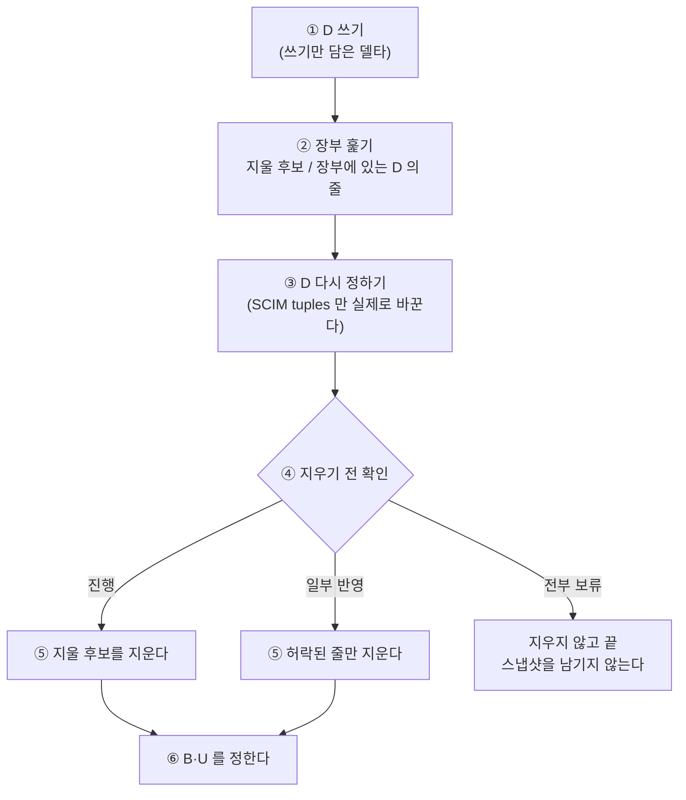
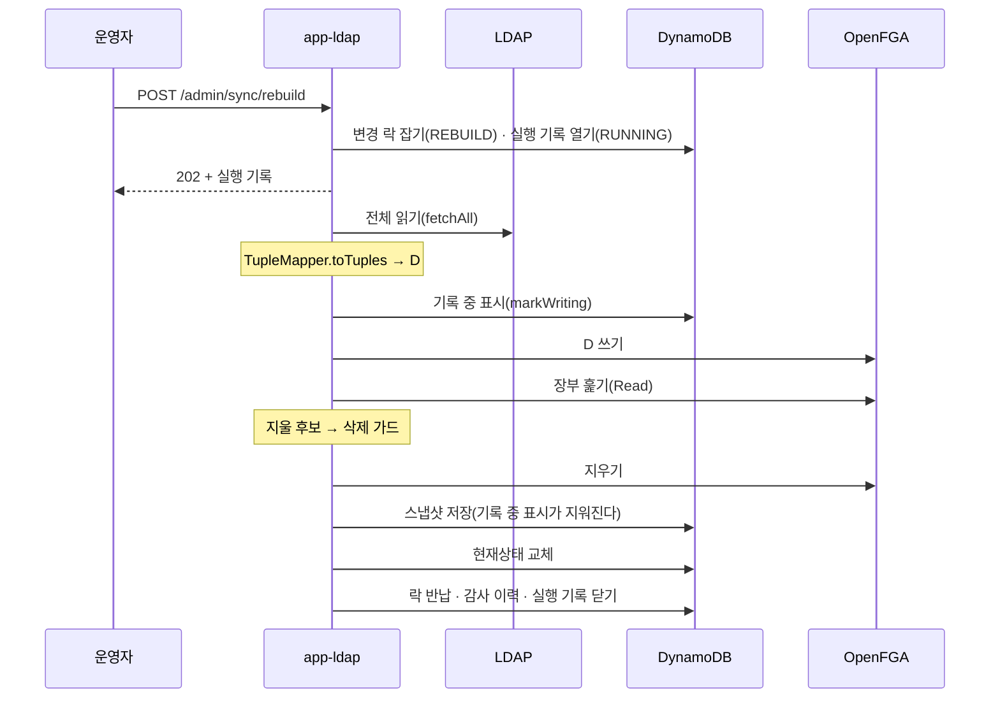
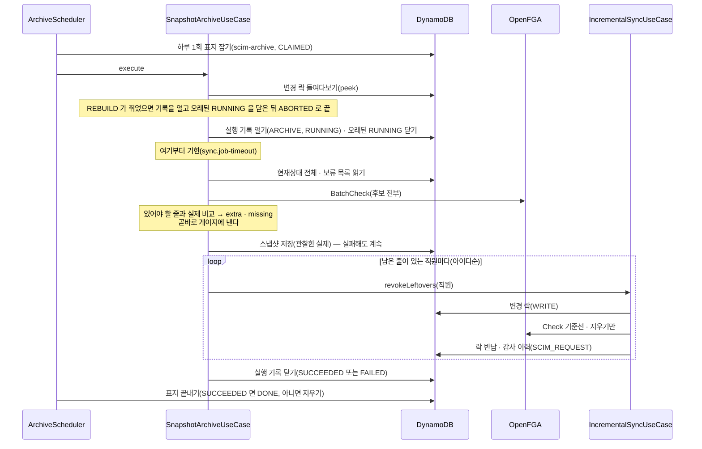

# 재적재·초기화·아카이빙

> 기준 커밋: 5675b3c (ops-readiness, main 에 머지됨). 코드가 바뀌면 이 문서도 함께 고친다.
> 읽기 전에: [용어집](02-용어집.md)의 4~6절, [04 데이터 모델 — 스냅샷 포인터](04-데이터-모델.md#스냅샷-포인터), [05 LDAP 동기화](05-LDAP-동기화.md), [08 동시성과 작업](08-동시성과-작업.md)

이 문서는 장부 전체를 다시 보는 일들을 다룬다. 평소의 [동기화](02-용어집.md#동기화)와 [SCIM 쓰기](02-용어집.md#scim-쓰기)는 바뀐 부분만 반영한다. 아래 일들은 장부나 조직도 전체를 한 번에 본다.

- **[재적재](02-용어집.md#재적재)** — 관리자가 거는 전체 맞추기. app-ldap 과 app-scim 이 각각 하나씩 갖는다.
- **[초기화](02-용어집.md#초기화)** — app-scim 재적재의 `wipe` [모드](02-용어집.md#모드). 장부와 조직도를 모두 지운다.
- **[아카이빙](02-용어집.md#아카이빙)** — app-scim 의 하루 1회 작업. 장부의 실제를 스냅샷으로 남기고 [남은 회수](02-용어집.md#남은-회수)를 지운다.
- **만료 스냅샷 정리** — 두 앱의 하루 1회 작업. 보관 기간이 지난 [튜플 스냅샷](02-용어집.md#튜플-스냅샷)을 지운다.
- **[하루 1회 표지](02-용어집.md#하루-1회-표지)** — 위 하루 1회 작업을 클러스터에서 한 번만 돌리는 장치.

락·기한·서버 종료·[리스 상실](02-용어집.md#리스-상실)처럼 모든 회차에 공통인 것은 [08 동시성과 작업](08-동시성과-작업.md)에 있다. 엔드포인트의 요청·응답 표면은 [09 관리 API](09-관리-API.md)에, 지표와 경보는 [11 운영](11-운영.md)에, 장애별 대응은 [12 장애와 복구](12-장애와-복구.md)에 있다.

## 한눈에

| | LDAP 재적재 | SCIM 재적재 `tuples` | SCIM 초기화 `wipe` | SCIM 아카이빙 | 만료 스냅샷 정리 |
|---|---|---|---|---|---|
| 누가 거나 | `POST /admin/sync/rebuild[?force=true]` | `POST /admin/sync/rebuild[?mode=tuples]` | `POST /admin/sync/rebuild?mode=wipe&confirm=<테이블명>` | `sync.archive-cron`(기본 `0 0 3-8 * * *` — 하루 창 안에서 성공할 때까지 매시) | `sync.purge-cron`(기본 `0 0 4-8 * * *`, 두 앱) |
| 유스케이스 | `RebuildUseCase`(core `usecase`) | `ScimRebuildUseCase` | `ScimRebuildUseCase` | `SnapshotArchiveUseCase` | `TupleSnapshotRepository.purgeExpired` |
| 있어야 할 줄(D) | LDAP 을 다시 읽은 것 | 현재상태 전체 | 없음(D = ∅) | 현재상태 전체(비교용) | — |
| [변경 락](02-용어집.md#변경-락) | 잡는다(용도 `REBUILD`) | 잡는다(`REBUILD`) | 잡는다(`REBUILD`) | 들여다보기만 한다 | 잡지 않는다 |
| [트리거](02-용어집.md#트리거) | `REBUILD`(`force=true` 면 `FORCED_REBUILD`) | `REBUILD` | `RESET` | `ARCHIVE` | 실행 기록 없음 |
| [기한](02-용어집.md#기한) | `sync.job-timeout`(30분) | 같다 | 같다 | 같다 | 없다 |
| [감사 이력](02-용어집.md#감사-이력) 종류 | `REBUILD` | `REBUILD` | `REBUILD` | 남은 회수 지우기만 `SCIM_REQUEST` | 없음 |
| 새 스냅샷 | 남긴다(락 안) | 남긴다(락 반납 뒤) | 남기지 않는다 | 남긴다 | — |
| 현재상태 | [현재상태 교체](02-용어집.md#현재상태-교체) | 건드리지 않는다(보류 목록만 다시 정한다) | 전부 지운다 | 건드리지 않는다 | — |

---

## 1. 장부 맞추기의 몸통

세 재적재와 LDAP 의 일부 동기화 회차는 같은 절차로 장부를 맞춘다. 이것이 [장부 맞추기](02-용어집.md#장부-맞추기)이고, 몸통은 `TupleReconciler.reconcile`(core `usecase`)이다. 이 절을 먼저 이해하면 뒤의 절은 차이만 보면 된다.

### 순서



1. **D 를 쓴다.** [있어야 할 줄](02-용어집.md#있어야-할-줄) 전부를 쓰기만 담은 델타로 `RelationTupleWriter.apply` 에 넘긴다. 이미 있는 줄은 [멱등 옵션](02-용어집.md#멱등-옵션) 때문에 OpenFGA 가 무시한다. D 가 비면 부르지 않는다.
2. **장부를 훑는다.** [장부 훑기](02-용어집.md#장부-훑기)로 장부의 튜플을 하나씩 흘려 보며 D 에 있는 줄(장부에 있는 D 의 줄)과 없는 줄([지울 후보](02-용어집.md#지울-후보))로 가른다. 장부 전체를 메모리에 모으지 않는다 — 드는 것은 D 와 지울 후보뿐이다. 읽은 줄 수도 센다.
3. **D 를 다시 정한다.** 지우기 전에 D 를 바꿀 기회다(`TupleReconciler.DesiredRevision`). LDAP 과 `wipe` 는 바꾸지 않는다(`DesiredRevision.NONE`). SCIM `tuples` 만 GSI 열거에서 빠진 대상을 다시 읽어 바꾼다([열거 보강](#열거-보강)).
4. **지우기 전에 확인한다.** `TupleReconciler.DeleteCheck` 가 다시 정한 D, 지울 후보, 읽은 줄 수를 보고 판정(`DeleteVerdict`)을 낸다([아래](#지우기-전-확인)).
5. **지운다.** 판정이 허락한 줄을 지우기만 담은 델타로 보낸다. [쓰기 배치](02-용어집.md#쓰기-배치)가 하나 끝날 때마다 실제로 지운 줄을 부르는 쪽에 알린다 — 감사 이력이 이것으로 회수를 모은다.
6. **새 스냅샷에 담을 줄을 정한다.** B(장부에 있다고 확실한 줄)와 U([불확실 줄](02-용어집.md#불확실-줄))를 따로 만든다([아래](#새-스냅샷에-담는-줄)).

**쓰기가 먼저인 까닭.** 장부를 비우고 다시 채우면 그동안 모든 `Check` 가 거짓이다. D 를 먼저 다 쓰고 나머지를 지우면 장부가 비는 순간이 없다. 그 사이 생길 권한이 잠깐 늦거나 지워질 권한이 잠깐 남을 뿐, [권한을 묻는 앱](02-용어집.md#권한을-묻는-앱)은 내내 정상으로 답을 받는다. 같은 까닭으로 store 를 지우고 다시 만들지 않는다 — [장부](02-용어집.md#장부) 번호가 바뀌지 않는다([04 — 장부를 찾고 만드는 법](04-데이터-모델.md#장부를-찾고-만드는-법)).

**부르는 쪽의 약속.** D 를 **다 읽은 뒤에만** 부른다. 읽기가 실패했는데 부르면 빈 D 로 장부를 비운다. 세 재적재 모두 읽기가 실패하면 장부에 아무것도 하지 않고 `FAILED` 다.

### 지우기 전 확인

[지우기 전 확인](02-용어집.md#지우기-전-확인)의 판정은 셋이다(`TupleReconciler.DeleteVerdict`).

| 판정 | 만드는 법 | 지우는 것 | 끝 |
|---|---|---|---|
| 진행 | `DeleteVerdict.proceed(stale)` | 지울 후보 전부 | 스냅샷을 남긴다 |
| 일부 반영 | `DeleteVerdict.partial(toDelete, 사유)` | 지울 후보의 일부 | 스냅샷을 남긴다. `Reconciliation.revokedOnly()` 가 참 |
| 전부 보류 | `DeleteVerdict.holdAll(사유)` | 없음 | 스냅샷을 남기지 않는다. `Reconciliation.heldEntirely()` 가 참 |

누가 무엇을 확인하는지는 쓰는 곳마다 다르다.

| 쓰는 곳 | 확인 | 근거 |
|---|---|---|
| LDAP 재적재·장부 맞추기 회차 | [삭제 가드](02-용어집.md#삭제-가드). [기준 수](02-용어집.md#기준-수)는 훑은 줄 수, 이름은 "훑은 장부" | `LedgerAlignment` 의 `가드로_본다` |
| LDAP, `force=true` 또는 트리거 `FORCED` | 하지 않는다(`DeleteCheck.NONE`) | `LedgerAlignment.align` |
| SCIM `tuples` | [빈 조직도 규칙](#빈-조직도-규칙) | `ScimRebuildUseCase.빈_조직도면_멈춘다` |
| SCIM `wipe` | 하지 않는다 | `ScimRebuildUseCase.wipe` |

지우지 않고 남긴 후보는 장부에 그대로 있다. 그래서 새 스냅샷의 B 에 든다. 이미 쓴 D 는 되돌리지 않는다 — 권한을 더하는 쪽이라 해가 없다고 본다.

### 새 스냅샷에 담는 줄

`TupleReconciler.Reconciliation` 이 셈한다.

- **U** = 훑기 전 D 쓰기가 [불확실 실패](02-용어집.md#불확실-실패)했고 훑을 때 장부에 없던 줄 ∪ D 를 다시 정하며 더 쓰다 불확실 실패한 줄 ∪ 지우기가 불확실 실패한 줄.
- **B** = 훑을 때 장부에 있던 (다시 정한) D 의 줄 ∪ 더 써서 반영된 줄 ∪ 지울 후보 가운데 지워지지 않은 줄 − U.

몇 가지 까닭이 있다.

- 훑기 전 쓰기가 불확실 실패했어도 훑을 때 장부에 있었다면 반영된 것이 확실하다 — B 다. 없었다면 클라이언트가 포기한 뒤 서버가 늦게 반영할 수 있다 — U 다.
- D 의 줄을 다시 쓰다 [확정 실패](02-용어집.md#확정-실패)해도 훑을 때 장부에 있었다면 B 에 담는다. 빼면 그 사람이 나중에 조직도에서 빠져도 지울 기준이 없어 권한이 영원히 남는다.
- 거절된 지우기, 보내지 않은 지우기([연속 실패 차단기](02-용어집.md#연속-실패-차단기)), 지우기 전 확인이 보류한 줄은 장부에 그대로 있다는 것을 안다 — B 다.
- 마지막에 B 에서 U 를 빼 둘이 겹치지 않게 한다. `TupleSnapshot` 생성자가 겹침을 거절한다.

### 실패하면

| 어디서 | 무엇이 일어나나 | 스냅샷 |
|---|---|---|
| ① D 쓰기가 일부 실패 | 계속 간다. 확정 실패한 줄이 장부에 없었으면 B 에 들지 않아 다음 반영이 다시 쓴다. 불확실 실패는 U 다 | 남긴다 |
| ① D 쓰기가 차단기로 멈춤 | `TupleWriteAbortedException` 이 그대로 올라가 회차가 `FAILED` 다 | 남기지 않는다 |
| ② 장부 훑기가 끝내 실패 | 오류로 회차가 `FAILED` 다. 지운 것은 없다 | 남기지 않는다 |
| ⑤ 지우기가 일부 실패 | 지운 줄만 빠진다. 결과는 `PARTIAL`(일부 반영 중이었으면 `ABORTED`) | 남긴다 |
| ⑤ 지우기가 차단기로 멈춤 | `Reconciliation.stopped` — 그때까지 지운 것으로 셈한다. 결과는 `FAILED`(일부 반영 중이었으면 보류 사유 뒤에 " / " 와 멈춘 사유). LDAP 은 일부 반영 중이 아니면 현재상태를 교체하므로 메시지 끝에 ` — 현재상태는 디렉터리대로 교체했다` 를 붙인다(`LedgerAlignment`) | 남긴다 |
| 어디서든 기한·서버 종료·리스 상실 | 하던 일이 취소되고 `FAILED`([08](08-동시성과-작업.md)) | 남기지 않는다 |

스냅샷을 남기지 않은 경우의 뒷일은 앱마다 다르다. LDAP 은 [기록 중 표시](02-용어집.md#기록-중-표시)가 남아 다음 동기화가 다시 장부를 맞춘다. SCIM 은 스냅샷을 판단에 쓰지 않으므로 필요하면 재적재를 다시 건다.

---

## 2. LDAP 재적재

### 언제 쓰나

LDAP 을 다시 읽어 장부와 현재상태를 그것에 맞춘다. 직전 스냅샷을 읽지 않는다. 그래서 스냅샷을 믿을 수 없거나 스냅샷이 모르는 줄이 장부에 있을 때 쓴다.

- 동기화가 `FAILED` 이고 메시지가 "… POST /admin/sync/rebuild 로 복구하세요" 로 끝날 때. 기준선 스냅샷을 온전히 읽지 못했다는 뜻이다(`SnapshotIntegrityException`, [04](04-데이터-모델.md#스냅샷-포인터)). 옛 형식 스냅샷도 같다.
- 관리 API 에서 [드리프트](02-용어집.md#드리프트)가 보일 때(`shouldHaveAccess` 와 `openFgaCheck` 가 다르다, [09](09-관리-API.md)). [비교 경로](02-용어집.md#비교-경로)는 장부를 읽지 않으므로, 스냅샷과 장부가 갈린 줄은 다음 동기화가 고치지 못한다.
- 다른 앱이나 사람이 OpenFGA 에 직접 쓰거나 지운 줄을 치울 때.
- 삭제 가드로 `ABORTED` 된 것을 사람이 확인한 뒤 넘길 때(`force=true`). `POST /admin/sync/full?force=true` 로도 넘길 수 있다.

필요 없는 경우도 있다. 지난 회차가 기록 전에 멈춰 기록 중 표시가 남았으면 다음 동기화가 스스로 장부를 맞춘다([05](05-LDAP-동기화.md)).

### 거는 법

`AdminSyncController.rebuild`(app-ldap)가 받는다.

| 요청 | 응답 |
|---|---|
| `POST /admin/sync/rebuild` | 202 와 실행 기록(`RUNNING`) |
| `POST /admin/sync/rebuild?force=true` | 같다. 삭제 가드를 건너뛴다 |
| `mode` 파라미터를 주면 | 400, 사유 "재적재 모드는 하나로 합쳐졌습니다 — mode 없이 POST /admin/sync/rebuild 를 호출하세요 (받은 mode: …)" |
| 다른 동기화·재적재가 락을 쥐고 있으면 | 409, 사유 "다른 동기화·재적재가 진행 중입니다". 재시도하지 않는다 |
| 락 잡기·실행 기록 열기가 일시 장애로 실패하면 | 503 + `Retry-After`. 작업은 시작하지 않았다 |

오류 응답은 RFC 9457 problem details 이고 사유는 `detail` 칸에 실린다([09 — 오류](09-관리-API.md#오류)). 이 문서의 다른 400·409 사유도 같다.

202 응답의 예다(`SyncRunResponse`, admin-api).

```json
{"runId":"6d1f0c3a-9b7e-4c2d-8a5f-1e3b7c9d0a42","source":"LDAP","trigger":"REBUILD",
 "startedAt":"2026-10-25T05:10:00.012Z","finishedAt":null,"status":"RUNNING",
 "writtenCount":0,"deletedCount":0,"failureCount":0,"snapshotId":null,"message":null}
```

결과는 `GET /admin/sync/runs/{runId}` 로 본다.

### 순서

`RebuildUseCase.start` 가 `SyncJobs.startLockedThen` 으로 회차를 띄운다. 락 잡기, 실행 기록 열기, 리스 갱신, 기한, 반납, 기록 닫기는 `SyncJobs` 의 몫이다([08](08-동시성과-작업.md)). 재적재 자신의 일은 `RebuildUseCase.rebuild` 와 `LedgerAlignment.align`(core `usecase`)이다.



1. LDAP 전체를 읽어 [디렉터리 그림](02-용어집.md#디렉터리-그림)을 만든다(`DirectorySnapshotSource.fetchAll`). 읽기 재시도 규칙은 [05](05-LDAP-동기화.md)에 있다. 여기서 실패하면 장부에 아무것도 하지 않는다.
2. `TupleMapper.toTuples` 로 D 를 만든다. 변환 경고는 WARN 로그로 남긴다.
3. 기록 중 표시를 붙인다(`TupleSnapshotRepository.markWriting`). 붙이지 못하면 OpenFGA 에 쓰지 않고 `FAILED` 다.
4. [1절](#1-장부-맞추기의-몸통)의 장부 맞추기를 한다. 지우기 전 확인은 삭제 가드다.
5. 새 스냅샷(B, U)을 저장한다. 포인터를 다시 쓰면서 기록 중 표시가 지워진다. 스냅샷 id 는 `yyyyMMdd'T'HHmmssSSS-LDAP` 이다.
6. 현재상태를 디렉터리 그림으로 교체한다(`DirectoryStateRepository.replaceWith`). 비활성 회수만 반영한 회차는 교체하지 않는다.

여섯 단계가 모두 락 안이다. LDAP 재적재에는 [반납 뒤 할 일](02-용어집.md#반납-뒤-할-일)이 없다.

비용의 어림: 10만 명 규모에서 D 쓰기는 쓰기 배치 약 1,100개, 장부 훑기는 Read 약 1,100번이다([루트 README.md](../../README.md) 의 어림, 재지 않았다).

### 삭제 가드

검색 베이스·필터 실수로 디렉터리의 큰 부분이 빠지면 장부의 많은 줄이 지울 후보가 된다. 삭제 가드가 이것을 막는다. 사람 소속이 하나도 없는 그림(0명 등)은 가드까지 오지 않는다 — LDAP 전략이 데이터 오류로 먼저 멈추고(`FAILED`, 다시 읽지 않는다), `force` 로도 넘기지 못한다([05 — 빈 소속 규칙](05-LDAP-동기화.md#빈-소속-규칙)). 판정은 `DeletionGuard.evaluate`(core `guard`)이고 설정은 `sync.deletion-guard.*`(기본 비율 0.3, `min-baseline` 10)이다([05](05-LDAP-동기화.md)).

재적재의 기준 수는 **훑은 줄 수**다. 훑기는 D 를 쓴 뒤에 하므로 그 수에는 방금 쓴 D 가 들어 있다(옛 장부 ∪ D). 그래서 비교 경로의 가드보다 약하다. 설계 문서의 예: 11만 줄 가운데 40% 가 새 아이디로 바뀌면 44k / 154k ≈ 28.6% 라 통과한다. D = ∅ 인 대표 사고는 가드보다 앞에서 빈 소속 규칙이 막는다.

판정은 세 갈래다.

| 갈래 | 조건 | 지우는 것 | 스냅샷·기록 중 표시 | 현재상태 | 실행 상태 | 메시지 |
|---|---|---|---|---|---|---|
| 통과 | 지울 수 ÷ 훑은 줄 수 ≤ 0.3 | 지울 후보 전부 | 남긴다 · 지워진다 | 교체 | `SUCCEEDED`·`PARTIAL` | 없음(실패가 있으면 실패 건수) |
| [비활성 회수만 반영](02-용어집.md#비활성-회수만-반영) | 전체는 넘지만, 지울 후보 ∩ `TupleMapper.inactiveMemberTuples(그림)` 만으로는 넘지 않는다 | 그 비활성 회수만 | 남긴다 · 지워진다 | 교체하지 않는다 | `ABORTED` | "삭제 가드 발동 — 비활성 회수 N건만 반영하고 나머지 지우기 M건·쓰기 0건은 보류 / 삭제 대상 …" |
| [전부 보류](02-용어집.md#전부-보류) | 떼어 낼 비활성 회수가 없거나 그것도 넘는다 | 없음 | 남기지 않는다 · 남는다 | 교체하지 않는다 | `ABORTED` | "삭제 대상 N건(훑은 장부 M건의 X%)이 임계치 30.0%를 초과했습니다. 강제 실행하려면 force=true 로 재요청하세요" |

- 비활성 회수는 "이번 그림에 여전히 있고 소속도 그대로인데 비활성인 직원의 `direct_member`" 다. 엔트리가 사라지거나 소속이 빠져서 생긴 지우기는 들지 않는다.
- 메시지의 쓰기 수는 늘 0 이다. 재적재는 가드를 보기 전에 D 를 이미 다 썼기 때문이다. 그래서 가드가 걸린 회차에는 조직을 옮긴 직원이 옛 소속(지우기 보류)과 새 소속(이미 씀)을 함께 가질 수 있다.
- 메시지의 N 은 반영하려 한 수다. 실제로 지운 수는 `deletedCount` 다.
- 전부 보류면 실행 기록에 이미 쓴 D 의 수(`writtenCount`)와 실패 수(`failureCount`)를 남긴다(`SyncOutcome.held`). 지운 수는 0 이고 스냅샷은 없다. `sync.tuples.written` 도 그만큼 센다.
- 일부 반영이면 건수는 실제로 나간 것이다. `writtenCount` 는 다시 쓴 D 전체(이미 있던 줄 포함)다.

갈래마다 다음 회차가 다르다.

- 비활성 회수만 반영: 스냅샷이 남아 기록 중 표시가 지워진다. 다음 정각 동기화는 비교 경로에서 남은 지우기로 가드를 다시 본다(기준 수는 그때 |B| + |U|). 반영한 회수는 이미 B 에서 빠졌으므로, 새로 막힌 계정이 없으면 떼어 낼 비활성 줄이 없어 대개 [전부 보류](02-용어집.md#전부-보류)가 된다. 남은 비율이 임계 아래로 내려가면 그대로 반영된다([05 — 삭제 가드](05-LDAP-동기화.md#64-삭제-가드)).
- 전부 보류: 기록 중 표시가 남는다. 다음 정각 동기화는 기준선 상태 "기록 중" 으로 장부를 다시 맞추고 가드에 다시 걸린다. 사람이 `force=true` 로 넘길 때까지 매시 D 전체 쓰기와 장부 훑기가 반복된다.

실행 기록 예 — 비활성 회수만 반영한 재적재다.

```json
{"runId":"6d1f0c3a-9b7e-4c2d-8a5f-1e3b7c9d0a42","source":"LDAP","trigger":"REBUILD",
 "startedAt":"2026-10-25T05:10:00.012Z","finishedAt":"2026-10-25T05:12:31.877Z","status":"ABORTED",
 "writtenCount":152340,"deletedCount":12,"failureCount":0,"snapshotId":"20261025T051231650-LDAP",
 "message":"삭제 가드 발동 — 비활성 회수 12건만 반영하고 나머지 지우기 61003건·쓰기 0건은 보류 / 삭제 대상 61015건(훑은 장부 165000건의 37.0%)이 임계치 30.0%를 초과했습니다. 강제 실행하려면 force=true 로 재요청하세요"}
```

### force

`force=true` 면 지우기 전 확인을 하지 않는다(`DeleteCheck.NONE`). 지울 후보를 전부 지우고 현재상태를 교체한다.

- 가드가 걸린 뒤 사람이 LDAP 응답이 맞는지 확인하고 넘기는 통로다. 확인 없이 쓰면 디렉터리를 잘못 읽은 그림대로 권한이 지워진다. 사람 소속이 하나도 없는 그림은 `force` 로도 넘어가지 않는다(가드보다 앞의 데이터 오류다).
- 실행 기록의 트리거는 `FORCED_REBUILD` 다(`RebuildUseCase.start`). 락 용도는 `REBUILD` 그대로다. 요청 때 WARN 로그 "전체 재적재 요청: force=true" 도 남는다.

### 실행 기록과 감사 이력

- 실행 기록: 소스 `LDAP`, 트리거 `REBUILD`(`force=true` 면 `FORCED_REBUILD`). 끝난 기록은 `SyncMetrics.record` 로도 넘긴다([11](11-운영.md)) — `sync.duration` 의 `trigger` 태그도 그 값이다.
- 감사 이력: [원인](02-용어집.md#원인)은 `(LDAP, REBUILD, runId)` 다. 남는 것은 지운 줄([회수](02-용어집.md#회수))과 현재상태 교체가 바꾼 것이다. 쓴 줄은 [부여](02-용어집.md#부여)로 남기지 않는다 — 멱등 옵션 때문에 원래 있던 줄과 새로 생긴 줄을 가를 수 없다. 자세한 것은 [10 감사 이력](10-감사-이력.md).
- 변경은 끝나는 즉시 회차의 모음에 더해진다. 그래서 도중에 실패한 재적재도 그때까지 지운 줄과 바꾼 현재상태가 이력에 남는다.

### 실패하면

| 어디서 | 실행 상태·메시지 | 장부 | 기록 중 표시 | 다음에 무엇이 고치나 |
|---|---|---|---|---|
| 락을 못 잡음 | 기록 없음, 409 | 그대로 | 그대로 | 잠시 뒤 다시 건다 |
| LDAP 읽기 실패 | `FAILED`, 오류 문구 | 그대로 | 그대로 | 다시 건다 |
| 기록 중 표시 실패 | `FAILED` | 그대로 | — | 다시 건다 |
| D 쓰기가 차단기로 멈춤 | `FAILED` "OpenFGA 쓰기 배치가 3번 연달아 실패해 …" | D 일부만 씀 | 남는다 | 다음 동기화가 장부 맞추기 |
| 장부 훑기 실패 | `FAILED` | D 는 씀, 지우기 없음 | 남는다 | 다음 동기화가 장부 맞추기 |
| 지우기가 차단기로 멈춤 | `FAILED`, 스냅샷 있음. 현재상태를 교체했으면(비활성 회수만 반영 중이 아니면) 메시지 끝에 ` — 현재상태는 디렉터리대로 교체했다` | 일부 지움 | 지워진다 | 다음 동기화의 비교 경로가 남은 지우기를 다시 잡는다 |
| 스냅샷 저장 실패 | `FAILED` | 맞춰짐 | 남는다 | 다음 동기화가 장부 맞추기 |
| 현재상태 교체 실패 | `FAILED`, 스냅샷은 저장됨 | 맞춰짐 | 지워진다 | 다음 동기화가 교체를 다시 한다 |
| 기한(`sync.job-timeout`, 30분)·서버 종료·리스 상실 | `FAILED` "기한 초과 — 30분" 등 | 하던 데까지 | 남는다(저장 전이면) | 다음 동기화가 장부 맞추기 |

멈춤은 되돌리기가 아니다. 이미 나간 쓰기·지우기는 무르지 않는다.

### 장부 번호는 바뀌지 않는다

재적재는 store 를 지우거나 새로 만들지 않는다. 같은 store 에 쓰고 지운다. 권한을 묻는 앱은 store 번호를 바꿀 필요가 없고, 재적재 동안에도 같은 store 에 묻는다. 이 서버가 store 를 지우는 경우는 처음 기동 때 동시에 만든 store 를 하나로 모으는 때뿐이다([04](04-데이터-모델.md#장부를-찾고-만드는-법)).

---

## 3. SCIM 재적재 tuples 모드

### 언제 쓰나

SCIM 에는 다시 읽어 올 원천이 없다. 그래서 [현재상태](02-용어집.md#현재상태)를 진실로 보고, 그것이 요구하는 튜플에 장부를 맞춘다. 조직도는 건드리지 않는다.

- `scim.archive.drift{kind="missing"}` 가 이어질 때 — 현재상태가 요구하는데 장부에 없는 줄이다. 아카이빙은 빠진 줄을 쓰지 않으므로([6절](#남은-회수-지우기)) 이 재적재가 채운다.
- 관리 API 나 `scim.drift.detected` 에서 드리프트가 보일 때.
- 멤버 줄이 없는 고아 튜플, 조직 연결 줄(`child`)의 드리프트, 다른 앱이 직접 쓴 줄을 치울 때. 아카이빙은 이것들을 지우지 않는다.

조직도 자체가 틀렸다면 이 재적재로 고쳐지지 않는다. 틀린 현재상태를 틀린 채로 다시 밀 뿐이다. 그때는 IdP 가 다시 보내게 하거나, 최후 수단으로 [초기화](#4-scim-초기화-wipe-모드) 뒤 전체 재프로비저닝을 한다.

### 거는 법

`AdminSyncController.rebuild`(app-scim)가 받는다.

| 요청 | 응답 |
|---|---|
| `POST /admin/sync/rebuild` 또는 `?mode=tuples` | 202 와 실행 기록(`RUNNING`, 트리거 `REBUILD`) |
| `mode` 가 `tuples`·`wipe` 가 아니면(대소문자 무시) | 400 "알 수 없는 mode 값: …" |
| 락을 못 잡으면(SCIM 쓰기나 다른 재적재가 쥐고 있다) | 409. 문구는 락 예외의 것 그대로다(예: "다른 작업이 변경 락을 쥐고 있습니다(WRITE)"). 재시도하지 않는다 |

SCIM 쓰기는 락을 수 밀리초만 쥐지만, 쓰기가 끊이지 않으면 재적재가 409 를 받을 수 있다. 잠시 뒤 다시 건다.

### 순서

`ScimRebuildUseCase.reloadTuples` 다.

1. 현재상태 전체를 읽는다(`DirectoryStateRepository.loadAll`). 직원·조직 아이디를 GSI1 로 열거하고, 직원은 BatchGet(100개씩, [강한 일관성](02-용어집.md#강한-일관성))으로, 조직은 조직마다 파티션을 읽는다([04 — GSI1](04-데이터-모델.md#gsi1)). 실패하면 장부에 아무것도 하지 않고 `FAILED` 다.
2. `TupleMapper.toTuples` 로 D 와 순환이라 버린 연결(`cutEdges`)을 얻는다.
3. 장부 맞추기를 한다. D 를 쓰고, 훑고, [열거 보강](#열거-보강)으로 D 를 다시 정하고(D′), [빈 조직도 규칙](#빈-조직도-규칙)을 보고, 지운다.
4. [보류 목록](02-용어집.md#보류-목록)을 다시 정한다(`replaceCutEdges`, [아래](#보류-목록을-다시-정한다)).
5. 락을 반납한다.
6. **반납 뒤에** 새 스냅샷(B, U)을 저장한다. 스냅샷 id 는 `…-SCIM` 이다.
7. 감사 이력을 남기고 실행 기록을 닫는다.

1~4 는 락 안이다. 스냅샷 저장은 [반납 뒤 할 일](02-용어집.md#반납-뒤-할-일)이다. 10만 명이면 압축 묶음 열몇 개라 몇 초 걸리는데, SCIM 쓰기는 이 스냅샷을 읽지 않으므로 그동안 쓰기를 막을 까닭이 없다. 반납 뒤 할 일은 기한·서버 종료 경주 밖에서 돈다.

실행 기록의 `writtenCount` 는 다시 쓴 D 전체다. 새로 생긴 줄의 수가 아니다.

### 열거 보강

GSI1 은 최종 일관성이다. 락을 잡기 직전에 커밋된 SCIM 쓰기의 직원·조직이 아직 GSI 에 없을 수 있다. 그대로 두면 그 대상의 튜플이 "D 에 없는 줄" 로 지워진다 — 방금 만든 직원의 권한이 사라진다.

그래서 지우기 전에 D 를 다시 정한다(`ScimRebuildUseCase.열거를_보강한다`).

1. 지울 후보가 가리키는 대상(user 쪽과 object 쪽 모두, `TupleSubjects.of`) 가운데 읽은 조직도에 없는 직원·조직을 고른다.
2. 고를 것이 없으면 아무것도 읽지 않고 D 를 그대로 쓴다 — 평소에는 이 경우다.
3. 빠진 조직을 본 테이블에서 강한 일관성으로 읽는다(`findGroup`, 동시에 8개). 읽은 조직의 직원 멤버 가운데 조직도에 없는 직원도 함께 읽을 목록에 넣는다 — 장부에 아직 줄이 없는 새 멤버다.
4. 빠진 직원을 읽는다(`findUsers`).
5. 읽은 것이 있으면 조직도에 넣고 `TupleMapper.toTuples` 를 다시 불러 D′ 를 만든다. WARN 로그 "GSI 열거에서 빠진 대상을 본 테이블에서 찾아 조직도에 넣었다 — 직원 N명, 조직 M개. 락 직전에 커밋된 쓰기다" 가 남는다.

D′ 가 D 를 대신하는 방법(`TupleReconciler.다시_정한다`):

- D′ 에 새로 든 줄 가운데 장부에 있던 것(지울 후보에 든 것)은 후보에서 빼고 장부에 있는 줄로 옮긴다. 장부에 없던 것은 지금 쓴다. 이 쓰기는 훑은 뒤라 결과를 모르면 U 로 간다.
- D 에 있었지만 D′ 에 없는 줄은, 장부에 있었다면 지울 후보로 넘긴다. 다시 계산한 조직도가 순환이라 연결 하나를 버리는 경우다.
- 이 덕에 장부와 보류 목록이 함께 D′ 를 따른다.

장부에 줄이 없는 새 대상(비활성이거나 어느 조직에도 없는 직원, 멤버 없는 조직)은 지울 후보에 나타나지 않아 보강되지 않는다. 권한이 없으므로 결과는 같다.

### 빈 조직도 규칙

[빈 조직도 규칙](02-용어집.md#빈-조직도-규칙): 다시 정한 있어야 할 줄(D′)이 하나도 없는데 지울 후보가 있으면 하나도 지우지 않는다(`ScimRebuildUseCase.빈_조직도면_멈춘다`).

- 실행 상태는 `FAILED`, 메시지는 "조직도가 비어 있다 — 장부를 비우려면 mode=wipe" 다. LDAP 의 가드처럼 `ABORTED` 가 아니다.
- 스냅샷을 남기지 않고 보류 목록도 그대로 둔다.
- 까닭: 조직도를 잃은 채(테이블을 잘못 가리키는 등) 돌면 장부 전체가 지워진다. 장부를 정말 비우려면 `wipe` 를 쓴다.
- 보는 것은 직원 수가 아니라 D′ 다. 직원이 있어도 모두 비활성이거나 어느 조직에도 없으면 D′ 가 비어 이 규칙에 걸린다. 반대로 D′ 에 한 줄이라도 있으면 걸리지 않는다.
- 비율로 보는 가드는 SCIM 에 없다. D′ 가 한 줄만 남아도 나머지 장부는 모두 지운다.

### 보류 목록을 다시 정한다

재적재는 전체를 정하는 연산이라 보류 목록도 처음부터 다시 정한다. 장부를 맞춘 뒤, 락 안에서, 마지막으로 계산한 매핑(보강했으면 D′ 의 것)의 `cutEdges` 로 목록을 통째로 바꾼다(`DirectoryStateRepository.replaceCutEdges`).

- `toTuples` 는 조직 id 사전순 DFS 로 순환을 닫는 연결을 고른다. SCIM 쓰기 경로는 "먼저 저장된 연결이 이긴다" 로 고른다. 둘이 다를 수 있어, 재적재 뒤에는 어느 연결이 보류될지가 바뀔 수 있다. 바뀐 연결의 `child` 튜플도 D′ 를 따라 쓰이거나 지워진다.
- 전부 보류(빈 조직도)면 목록을 그대로 둔다.

### 실패하면

| 어디서 | 실행 상태·메시지 | 장부 | 보류 목록·스냅샷 |
|---|---|---|---|
| 락을 못 잡음 | 기록 없음, 409 | 그대로 | 그대로 · 없음 |
| 현재상태 읽기 실패 | `FAILED` | 그대로 | 그대로 · 없음 |
| D 쓰기가 차단기로 멈춤 | `FAILED` | D 일부만 씀 | 그대로 · 없음 |
| 열거 보강의 읽기 실패 | `FAILED` | D 는 씀, 지우기 없음 | 그대로 · 없음 |
| 빈 조직도 | `FAILED` "조직도가 비어 있다 — 장부를 비우려면 mode=wipe" | 쓴 것도 지운 것도 없다 | 그대로 · 없음 |
| 지우기가 차단기로 멈춤 | `FAILED`, 스냅샷 있음 | 일부 지움 | 다시 정함 · 남긴다 |
| 보류 목록 쓰기 실패 | `FAILED` | 맞춰짐 | 일부만 바뀌었을 수 있다 · 없음 |
| 스냅샷 저장 실패(반납 뒤) | `FAILED` "장부는 맞췄다 — 스냅샷 저장 실패: …" | 맞춰짐 | 다시 정함 · 없음 |
| 기한·서버 종료·리스 상실 | `FAILED` | 하던 데까지 | 도중이면 그대로 · 없음 |

"장부는 맞췄다 — 스냅샷 저장 실패" 는 튜플은 맞았고 스냅샷만 못 남겼다는 뜻이다. 다시 돌릴 필요가 없다. 다음 재적재나 아카이빙이 새 스냅샷을 남긴다.

반납 뒤 스냅샷을 저장하는 동안 서버가 내려가면 DynamoDB 클라이언트가 닫히며 실패하고 실행 기록은 `RUNNING` 으로 남는다. [죽은 기록 닫기](02-용어집.md#죽은-기록-닫기)가 닫는다 — 다음 재적재가 "비정상 종료로 중단" 으로, 또는 시작한 지 기한 + 10분이 지난 뒤 처음 시작하는 아카이빙이 "비정상 종료로 중단(기한 + 10분 경과)" 으로([08](08-동시성과-작업.md#56-죽은-기록-닫기)).

감사 이력은 원인 `(SCIM, REBUILD, runId)` 로 지운 줄만 남는다. 현재상태를 바꾸지 않으므로 조직도 변경은 없다. 보류 목록의 변화도 이력에 남지 않는다.

---

## 4. SCIM 초기화 wipe 모드

장부를 비운 **뒤** 조직도까지 지운다. **되돌릴 수 없다.** SCIM 배포에서 현재상태는 조직도의 유일한 사본이고, 스냅샷에는 튜플의 식별자만 있어 이름·이메일·계정명·재직 여부를 복원할 수 없다.

### 언제 쓰나

- 조직도 자체가 틀려 IdP 에서 처음부터 다시 프로비저닝하려 할 때.
- 키 모양이 바뀌어 SCIM 테이블을 비워야 할 때(운영 배포 전이라 이관하지 않는다 — 테이블을 다시 만드는 것과 같은 효과).

### 거는 법

```
POST /admin/sync/rebuild?mode=wipe&confirm=organization-scim
```

- `confirm` 은 이 앱의 DynamoDB 테이블명(`dynamodb.table-name`)과 정확히 같아야 한다. 다르거나 없으면 400 이고 아무것도 시작하지 않는다. 사유는 "wipe 는 confirm 에 DynamoDB 테이블명을 그대로 적어야 합니다. 이 작업은 조직도를 전부 지우며 되돌릴 수 없고, 실행 뒤 IdP 콘솔에서 전체 재프로비저닝을 걸어야 복구됩니다" 다.
- 불리언 플래그가 아니라 테이블명을 적게 한 까닭: 관리자가 자기가 무엇을 지우는지 찾아보게 하려는 것이다.
- 확인은 컨트롤러(`AdminSyncController.requireConfirmation`)가 한다. 유스케이스는 값을 받지 않는다.
- 통과하면 202 와 실행 기록(트리거 `RESET`). 락을 못 잡으면 409.

### 순서

`ScimRebuildUseCase.wipe` 다. 모두 락 안이고, 반납 뒤 할 일은 없다.

1. **장부를 비운다.** D = ∅, 지우기 전 확인 없이 장부 맞추기를 한다. 훑은 줄이 전부 지울 후보라 장부의 모든 튜플을 지운다 — 이 서버가 쓰지 않은 줄도 지운다.
2. **한 줄이라도 못 지웠으면 멈춘다.** 지우기 결과에 실패가 하나라도 있으면(확정·불확실 모두, 차단기로 보내지 않은 줄 포함) `FAILED` "장부에서 N줄을 지우지 못해 조직도를 지우지 않았다. 다시 실행하면 남은 줄부터 지운다"(차단기로 멈췄으면 뒤에 " — 멈춘 이유: …")다. 조직도는 그대로다.
3. **조직도를 지운다.** 빈 디렉터리 그림으로 현재상태를 교체한다(`replaceWith(DirectorySnapshot.empty(), …)`). GSI1 로 열거한 조직을 먼저, 직원을 나중에 지운다. 멤버 줄·소속 줄도 함께 지운다.
4. **열거에서 빠진 대상을 지운다**(`ScimRebuildUseCase.남은_대상을_지운다`). 표지판의 주인(`findUniqueOwners`, 두 종류, 강한 일관성)과 1에서 지운 튜플의 대상 가운데 3에서 지우지 않은 것을 본 테이블에서 다시 읽는다. 아직 있으면 조직 전부를 먼저 읽은 뒤 읽은 멤버로 지우고, 그다음 직원을 지운다. 지운 것이 있으면 WARN 로그 "GSI 열거에서 빠져 남아 있던 대상을 지웠다 — …" 가 남는다.
5. **[표지판](02-용어집.md#표지판)을 모두 지운다**(`clearUniqueMarkers`).
6. **보류 목록을 비운다**(`replaceCutEdges(∅)`).
7. WARN 로그 "SCIM 조직도를 전부 비웠다. IdP 콘솔에서 전체 재프로비저닝을 실행해야 복구된다" 를 남기고 `SUCCEEDED` 로 끝난다. 스냅샷은 남기지 않는다.

**순서의 까닭.** 장부를 먼저 비운다. 거꾸로 조직도를 먼저 지우고 장부 청소가 실패하면, 조직도가 사라진 채 낡은 권한만 살아남는다 — 다시 실행할 근거(조직도)도 없다. 장부가 남아 있는 동안 조직도를 남겨 두면 다시 실행할 수 있다.

**4가 표지판보다 먼저인 까닭.** 표지판은 강한 일관성으로 읽혀, 어느 조직에도 없어 장부에 줄이 없는 방금 만든 직원까지 잡는다. 표지판을 먼저 지우면 그 직원 레코드가 남고, IdP 가 같은 `userName` 으로 다시 POST 했을 때 중복이 생긴다. 이렇게 해도 남을 수 있는 것은 `externalId` 없는 빈 조직뿐이다(표지판도 장부 줄도 없다).

### 지우는 것과 남기는 것

| 아이템 | wipe 뒤 |
|---|---|
| 장부의 튜플 | 모두 지운다 |
| 직원 META, 조직 META, 멤버 줄, 소속 줄 | 모두 지운다 |
| 표지판 | 모두 지운다 |
| 보류 목록 | 비운다 |
| 튜플 스냅샷, 스냅샷 포인터 | 남긴다. 포인터는 wipe 전의 마지막 스냅샷을 가리킨 채다 |
| 실행 기록 | 남긴다 |
| 감사 이력 | 남긴다 — 사고 뒤 무슨 일이 있었는지 볼 유일한 기록이다 |
| 책갈피, 하루 1회 표지, 변경 락 | 건드리지 않는다 |

### 실패하면

- 장부를 다 비우지 못했으면 조직도에 손대지 않고 `FAILED` 다. 다시 실행하면 남은 줄부터 지운다.
- 조직도를 지우는 도중(3~6) 실패하면 `FAILED` 다. 장부는 이미 비었고 조직도는 일부만 지워졌다. 다시 실행하면 장부는 빈 채로 훑고 남은 조직도를 마저 지운다.
- 감사 이력은 원인 `(SCIM, REBUILD, runId)` 로 지운 튜플 전부와 지운 직원·조직을 남긴다. 하나 지울 때마다 모음에 더하므로 도중에 실패해도 그때까지 지운 것이 남는다.

### 그 뒤 할 일

**IdP 콘솔에서 전체 재프로비저닝을 걸어야 조직도가 돌아온다**(Okta 의 Force Sync, Entra 의 프로비저닝 다시 시작 — 루트 README.md 가 드는 이름이고, 확인하지 못했다. [재프로비저닝](02-용어집.md#프로비저닝)). 그 절차는 이 API 밖에 있다. 잊거나 실패하면 조직도가 빈 채로 남는다.

직원·조직 id 는 서버가 POST 마다 새로 발급한다([불변 id](02-용어집.md#불변-id)). 다시 프로비저닝한 직원·조직은 새 id 를 받는다. 권한을 묻는 앱이 [employeeId](02-용어집.md#employeeid)를 저장해 두었다면 다시 찾아야 한다.

---

## 5. 재적재 동안의 SCIM 쓰기

SCIM 쓰기와 SCIM 재적재는 같은 변경 락(`LOCK#MUTATION`)을 쓴다. 재적재가 도는 동안 들어온 쓰기는 이렇게 된다.

1. 쓰기는 [서버 안 줄](02-용어집.md#서버-안-줄)에서 차례를 받아 용도 `WRITE` 로 락을 시도한다.
2. 락 아이템의 용도가 `REBUILD` 라 조건이 깨진다. 예외(`LockUnavailableException.잡혀_있다`)에 쥔 쪽의 용도가 실리고 대기는 60초(`긴_작업_대기`)다.
3. 쥔 쪽이 긴 작업이라 다시 시도하지 않는다(`AcquireBackoff.잡는다`). 재적재는 몇 분 걸리므로 3초 안의 재시도가 결과를 바꾸지 못한다.
4. 응답은 **503, `Retry-After: 60`**, 본문 detail "일시적으로 처리할 수 없습니다 — 60초 뒤 다시 보내 주세요" 다(`ScimRouter.toScimError`).

IdP 는 503 을 재시도 신호로 본다. 프로비저닝이 사라지지 않고, 재시도는 재적재가 끝난 뒤의 현재상태 위에서 처리된다.

**쓰기를 막는 까닭.** 장부 훑기 도중 들어온 정당한 줄을 "D 에 없는 줄" 로 잘못 지우지 않으려는 것이다.

막지 않는 것:

- SCIM 조회(GET 목록·단건·`.search`)와 관리 API 조회는 락을 쓰지 않아 그대로 통과한다. 무슨 일이 벌어지는지 들여다보는 것이 그때 가장 필요하다.
- 반대 방향 — SCIM 쓰기가 락을 쥔 순간 재적재를 걸면 재적재가 409 다(재시도 없음).

app-ldap 에는 SCIM 쓰기가 없다. 대신 LDAP 재적재 동안 정각 동기화는 락을 못 잡아 실행 기록 없이 건너뛰고(INFO 로그 "다른 인스턴스가 동기화·재적재 중이라 이번 스케줄을 건너뛴다"), 수동 `POST /admin/sync/full` 은 409 다.

---

## 6. 아카이빙

app-scim 의 하루 1회 작업이다. 세 가지를 한다.

1. 현재상태가 이름 붙일 수 있는 튜플을 `Check` 로 물어 **장부의 실제를 스냅샷으로 남긴다.**
2. 현재상태가 요구하는 것과 실제의 차이를 **[드리프트](02-용어집.md#드리프트) 수로 낸다.**
3. **[남은 회수](02-용어집.md#남은-회수)를 지운다** — 현재상태가 요구하지 않는데 장부에 남은 직원 줄이다.

SCIM 은 push 라 비교용 스냅샷이 필요 없다. 이 스냅샷은 감사와 수동 복구용이다. 실행 기록을 남겨, 하루 창에서 아카이빙이 실패했다면 그 사실이 남게 한다.

### 언제 도나

- `ArchiveScheduler.스냅샷아카이빙`(app-scim)이 `sync.archive-cron`(기본 `0 0 3-8 * * *`)마다 부른다 — 03~08시의 정각마다다. cron 은 JVM 기본 시간대로 해석한다.
- [하루 1회 표지](#8-하루-1회-표지) `scim-archive` 를 잡은 인스턴스만 돈다. 실행 기록이 `SUCCEEDED` 여야 그날 표지가 완료(`DONE`)다. `FAILED` 와 `ABORTED`(재적재 중)는 표지를 풀어 창 안의 다음 정각에 다시 돈다. 성공한 뒤의 정각은 표지를 보고 건너뛴다.
- 스케줄러가 관측(`Observation` "sync.scim.archive")을 만들어 Reactor Context 에 싣는다. 그래서 아카이빙의 로그와, 남은 회수 지우기의 감사 이력 원인 id 가 이 관측의 traceId 를 갖는다.
- 손으로 거는 API 는 없다.

### 순서

`SnapshotArchiveUseCase.execute` 다.



1. **재적재 중인지 본다.** 변경 락을 강한 일관성으로 들여다본다(`MutationLock.peek`). 만료되지 않은 락의 용도가 `REBUILD` 면 이번 시도는 건너뛴다. 실행 기록을 열고, 오래된 `RUNNING` 을 닫고(2번과 같다), 곧바로 `ABORTED` "재적재 중이라 건너뜀" 으로 닫는다. 표지는 풀리므로 다음 정각에 다시 본다. 들여다보기가 실패하면 재적재가 아니라고 보고 진행한다 — 아카이빙을 통째로 잃는 것보다 낫다고 본다. `WRITE` 가 쥐고 있으면 그냥 진행한다.
2. **실행 기록을 열고**(트리거 `ARCHIVE`, `RUNNING`), **오래된 `RUNNING` 을 닫는다** — 시작한 지 `sync.job-timeout` + 10분이 지난 `RUNNING` 을 종류와 상관없이 `FAILED`("비정상 종료로 중단(기한 + 10분 경과)")로 닫는다([죽은 기록 닫기](02-용어집.md#죽은-기록-닫기)). 아카이빙은 락을 잡지 않아 락 작업의 정리에 기대지 못하므로 스스로 본다. 방금 연 자기 기록은 건드리지 않고, 닫다 실패해도 아카이빙은 계속한다.
3. **여기부터 기한이 걸린다.** 3~9 번이 `sync.job-timeout`(기본 30분) 안에 끝나지 않으면 `FAILED`("기한 초과 — 30분")다. 기한이 있어야 하루 1회 표지의 임대(잡은 때 + 기한 + 5분)보다 먼저 끝나 두 인스턴스가 함께 돌지 않는다. **현재상태 전체와 보류 목록을 읽는다**(`loadAll`, `findCutEdges`).
4. **후보를 `Check` 한다.** 후보는 `TupleMapper.candidateTuples(현재상태)` — 멤버십에서 나올 수 있는 모든 튜플이다(활성 여부·순환을 보지 않는다). `RelationTupleChecker.existing` 이 `BatchCheck` 로 50건씩, `HIGHER_CONSISTENCY` 로 묻는다. 성립한 것이 **실제**다.
5. **있어야 할 줄을 정한다.** 보류 목록의 연결 가운데 그 `child` 튜플이 실제로 장부에 없는 것만 "아직 보류" 로 보고, `TupleMapper.toTuples(현재상태, 아직 보류)` 로 계산한다. 목록에 있는데 튜플이 장부에 있는 연결은 쓴 뒤 목록에서 빼기 전에 멈춘 낡은 줄이다. 그대로 빼면 있는 튜플이 "있어선 안 될 것" 으로 세어진다.
6. **차이를 센다.** extra = 실제 − 있어야 할 줄, missing = 있어야 할 줄 − 실제. 하나라도 있으면 WARN 로그 "아카이빙 중 OpenFGA 어긋남 발견: 있어선 안 될 튜플 N건, 빠진 튜플 M건" 이 남는다.
7. **수를 곧바로 게이지로 낸다**([아래](#드리프트-게이지)). 비교한 직후라 관찰 시각이 "비교한 시각" 과 맞고, 이어지는 저장·복구의 실패에 가려지지 않는다. 받는 쪽이 던져도 아카이빙은 계속한다.
8. **스냅샷을 저장한다.** 실제(B 만, U 없음)를 `…-SCIM` id 로 저장한다. 남은 회수를 지우기 **전**의 모습이다. 저장이 실패하면 ERROR 로그 "스냅샷 저장 실패 — 남은 회수 지우기는 이어서 한다" 를 남기고 다음으로 간다.
9. **남은 회수를 지운다**([아래](#남은-회수-지우기)). 저장이 실패했어도 지운다 — 스냅샷은 지우기 전에 본 실제라 순서와 상관없이 같고, 저장 디스크가 말썽이라고 권한 회수를 미룰 까닭이 없다.
10. **실행 기록을 닫는다**([아래](#실행-기록)). 저장이 됐으면 `SUCCEEDED`, 아니면 `FAILED` 다.

`toTuples` 는 경고를 남기려고도 부른다. "조직 '…' 의 직원 '…' 가 스냅샷에 없어 건너뜁니다"(여기서 스냅샷은 디렉터리 그림이다) 같은 WARN 로그는 아카이빙이 매일 보는 유일한 자리다.

비용의 어림: 10만 명이면 BatchCheck 약 2,200번과 10만 줄 스냅샷이다(`DailyOnce` 주석).

### 무엇이 보이고 무엇이 안 보이나

- 후보를 현재상태의 멤버십에서 뽑는다. 멤버십이 사라졌는데 장부에 남은 튜플(고아 튜플), 다른 앱이 직접 쓴 줄은 후보에 없어 보이지 않는다. 현재상태가 이름 붙일 수 있는 범위 안에서 관찰한 실제다. 그런 줄은 [재적재](#3-scim-재적재-tuples-모드)가 치운다.
- 락을 잡지 않으므로 한 시점의 사진이 아니다. 읽는 도중 SCIM 쓰기가 끼면 거짓 드리프트가 나올 수 있다. 남은 회수 지우기는 락 안에서 다시 보므로 이것 때문에 잘못 지우지 않는다.
- `BatchCheck` 가 실패하면 아카이빙을 `FAILED` 로 끝낸다. 현재상태에서 유도한 튜플로 대신하지 않는다 — 그러면 그 스냅샷이 관찰인지 유도인지 가를 수 없다.

### 드리프트 게이지

`ScimSyncMetrics`(app-scim)가 `ArchiveDriftObserver` 로 받아 게이지 셋을 낸다.

| 지표 | 값 |
|---|---|
| `scim.archive.drift{kind="extra"}` | 마지막 아카이빙의 extra — 장부에 있지만 현재상태가 요구하지 않는 줄(`direct_member`·`child` 모두). 끝나지 않은 회수다 |
| `scim.archive.drift{kind="missing"}` | 마지막 아카이빙의 missing — 현재상태가 요구하지만 장부에 없는 줄 |
| `scim.archive.drift.observed` | 이 인스턴스가 마지막으로 값을 낸 시각(epoch 초). 낸 적이 없으면 NaN |

- 쌓는 카운터가 아니라 **마지막 비교의 값**이다. 드리프트가 없어도 0 을 낸다 — 고쳐진 뒤 내려와야 하기 때문이다.
- 값은 **복구 전** 비교 시점의 수다. 한 번 보인 extra 는 대개 그 아카이빙이 이미 지운 것이고, 다음 아카이빙에서 0 으로 내려온다. 이어서 남아 있으면 지우지 못한 회수다.
- 게이지는 인스턴스마다 따로다. 아카이빙은 클러스터에서 한 대만 돌아 그 대만 갱신한다. 그래서 경보는 `observed` 가 최근인 계열만 봐야 한다. 경보 식은 [11 운영](11-운영.md).
- 값을 내는 때는 비교 **직후**, 스냅샷 저장과 남은 회수 지우기 전이다. 그래서 저장이 실패해도 갱신된다. 현재상태 읽기나 `BatchCheck` 가 실패하거나 비교 전에 기한이 끝나면 게이지는 지난 값 그대로이고 `observed` 도 바뀌지 않는다. 재적재 중이라 건너뛴 시도도 같다.
- 남은 회수 지우기는 SCIM 쓰기 경로의 카운터 `scim.drift.detected` 를 올리지 않는다. 같은 줄을 이 게이지가 이미 센다.

### 남은 회수 지우기

extra 가운데 직원 줄(`direct_member`)의 직원마다, 아이디순으로 한 명씩 `IncrementalSyncUseCase.revokeLeftovers(직원 id)` 를 부른다(`SnapshotArchiveUseCase.차례로_지운다`). 동시에 락을 다투지 않게 차례로 한다.

`revokeLeftovers` 는 [SCIM 쓰기](02-용어집.md#scim-쓰기)와 같은 길을 탄다.

1. 서버 안 줄에 서고 변경 락(`WRITE`)을 잡는다. `dynamodb.lock-acquire-timeout`(3초) 안에 못 잡으면 그 직원은 실패다.
2. 락 안에서 직원을 다시 읽는다(`findUser`). 없으면 빈 결과다 — 비교 뒤 그 직원이 지워졌다.
3. 그 직원의 [최소 그림](02-용어집.md#최소-그림)(직원과, 그 직원 한 명만 멤버로 둔 소속 조직들의 이름표)을 만든다. 저장된 직원으로 하는 `upsertUser` 와 같은 후보·[Check 기준선](02-용어집.md#check-기준선)·목표다.
4. 델타 가운데 **지우기만** 반영한다. 쓰기는 버린다. 직원 레코드·소속·표지판은 바꾸지 않는다.
5. OpenFGA 쓰기 직전과 커밋 직전에 리스를 확인한다. 커밋은 현재상태를 바꾸지 않는 빈 커밋이고, 지울 것이 없어도 그 직전 확인은 한다(`IncrementalSyncUseCase.반영하고_커밋한다`). 반납한 뒤 감사 이력을 남긴다.

**왜 빠진 줄은 쓰지 않나.** 비교는 락 밖에서 읽은 현재상태로 했고, 그것은 낡았을 수 있다. 예: 직원 삭제가 OpenFGA 에서는 끝났는데 레코드 삭제 커밋이 실패하면, 레코드는 활성에 소속이 그대로인데 장부에는 줄이 없다. 이 현재상태대로 다시 쓰면 **지운 직원의 권한이 되살아난다.** 낡은 현재상태로 지우는 것은 거부 쪽으로만 틀리므로 안전하다. 빠진 줄은 IdP 재시도, 다음 쓰기, [재적재](#3-scim-재적재-tuples-모드)가 채운다. 그래서 `missing` 경보의 처방은 `mode=tuples` 재적재다.

락 안에서 다시 보므로 비교 뒤 바뀐 것은 Check 가 바로잡는다. 그새 다시 활성이 된 직원이면 지울 것이 없어 바뀌는 것이 없다.

**지우지 않는 것.**

| 줄 | 까닭 |
|---|---|
| 조직 연결 줄(`child`)의 extra | 직원 회수가 아니다. 조직 쓰기 경로의 순환 판단을 함께 끌고 와야 한다. 수로만 낸다 |
| 직원 레코드가 없는 멤버의 `direct_member` | `revokeLeftovers` 가 직원을 찾지 못해 건너뛴다. 재적재 몫이다 |
| 비교 뒤 지워진 직원 | 위와 같다 — 건너뛰고 실패로 세지 않는다 |
| missing 전부 | 위 "왜 빠진 줄은 쓰지 않나" |

**결과의 분류.**

| `revokeLeftovers` 의 결과 | 셈 |
|---|---|
| 빈 결과(직원 없음) | 건너뜀 — 세지 않는다 |
| `fullyApplied` 가 참(바뀐 것이 없어도) | 맞춤 |
| `fullyApplied` 가 거짓(일부 튜플 실패), 또는 오류(락 못 잡음 등) | 실패. WARN 로그 "직원 '…' 의 남은 회수를 지우지 못했다 — 다음 아카이빙이 다시 잡는다" |

한 명이 실패해도 나머지는 이어서 한다. 실패한 직원은 줄이 남아 다음 날 다시 잡힌다. 그래서 IdP 재시도 없이도 회수가 끝나기까지 최대 하루다.

감사 이력은 직원마다 원인 `(SCIM, SCIM_REQUEST, 아카이빙 스케줄러의 traceId)` 로 지운 줄을 남긴다. 그날 아카이빙이 지운 직원들은 모두 같은 원인 id 를 갖는다. 아카이빙 자신의 비교와 스냅샷은 이력을 남기지 않는다([10](10-감사-이력.md)).

### 실행 기록

`SyncJobs` 를 거치지 않는다. 실행 기록 저장소를 직접 부른다(`runs.start`, `runs.finish`). 그래도 기한과 죽은 기록 닫기는 스스로 갖는다(위 2·3번).

| 끝 | 실행 상태 | `writtenCount` | `deletedCount`·`failureCount` | `snapshotId` | 메시지 |
|---|---|---|---|---|---|
| 재적재 중 | `ABORTED` | 0 | 0 | 없음 | "재적재 중이라 건너뜀" |
| 비교·저장까지 마침 | `SUCCEEDED` | 스냅샷에 담은 줄 수 | 남은 회수 지우기가 지운·지우지 못한 줄의 합 | 새 스냅샷 | 남은 줄이 잡힌 직원이 있으면 "어긋난 직원 N명 다시 맞춤(실패 M명)", 없으면 없음 |
| 스냅샷 저장 실패 | `FAILED` | 0 | 위와 같다 — 지우기는 돌았다 | 없음 | "스냅샷 저장 실패 — <원인>", 남은 줄이 잡힌 직원이 있으면 뒤에 " / 어긋난 직원 N명 다시 맞춤(실패 M명)" |
| 현재상태 읽기·`BatchCheck` 실패 | `FAILED` | 0 | 0 | 없음 | 오류 문구 그대로 |
| 기한 초과 | `FAILED` | 0 | 0 | 없음 | "기한 초과 — 30분" |

- `writtenCount` 는 OpenFGA 에 쓴 수가 아니라 관찰해 스냅샷에 담은 줄 수다.
- `deletedCount` 는 직원마다 실제로 지운 줄의 합이다. `failureCount` 는 지우지 못한 줄의 합이다 — 일부만 반영한 직원은 결과가 센 실패 줄을, 오류로 끝난 직원(락을 못 잡음 등)은 결과가 없으므로 그 직원의 남은 `direct_member` 줄 수 전부를 더한다. 지운 줄은 감사 이력에도 남는다.
- N 은 다시 맞추려 한 직원 수다(건너뛴 직원은 빼고). M 은 그 가운데 실패한 수다. 직원 일부가 실패해도 실행 상태는 `SUCCEEDED` 다.
- 예:

```json
{"runId":"2c8e4f1a-7d3b-4e9c-a5f2-6b1d8e0c3f74","source":"SCIM","trigger":"ARCHIVE",
 "startedAt":"2026-10-25T03:00:00.004Z","finishedAt":"2026-10-25T03:02:41.310Z","status":"SUCCEEDED",
 "writtenCount":151872,"deletedCount":5,"failureCount":0,"snapshotId":"20261025T030238102-SCIM",
 "message":"어긋난 직원 3명 다시 맞춤(실패 0명)"}
```

(JVM 시간대가 UTC 라고 둔 예다.)

서버가 아카이빙 도중 죽으면 기록이 `RUNNING` 으로 남는다. 락 작업의 "같은 앱의 남은 기록 닫기" 는 `ARCHIVE` 기록을 일부러 건너뛴다 — 락을 잡지 않는 아카이빙은 그때 도는 중일 수 있다. 대신 시작한 지 기한 + 10분이 지나면, 그 뒤 처음 시작하는 동기화·재적재·아카이빙이 나이로 닫는다. 표지의 임대가 끝난 뒤의 다음 정각 아카이빙이 대개 그 일을 한다.

---

## 7. 만료 스냅샷 정리

### 언제 도나

| 앱 | 스케줄러 | cron | 하루 1회 표지 |
|---|---|---|---|
| app-ldap | `SyncScheduler.만료스냅샷정리` | `sync.purge-cron`(기본 `0 0 4-8 * * *`, `SyncProperties`) | `ldap-purge` |
| app-scim | `ArchiveScheduler.만료스냅샷정리` | `sync.purge-cron`(기본 `0 0 4-8 * * *`, `ScimSyncProperties`) | `scim-purge` |

둘 다 `TupleSnapshotRepository.purgeExpired`(구현 `DynamoDbTupleSnapshotRepository.purgeExpired`)를 부른다. 하루 창(04~08시)의 정각마다 표지를 잡아 보고, 오류 없이 끝나면 그날 표지가 완료다. 기한은 없다. 실행 기록을 남기지 않는다. 끝나면 INFO 로그 "만료 스냅샷 정리 완료: N건", 실패하면 ERROR 로그 "만료 스냅샷 정리에 실패했다" 다. cron 에 `-` 를 주면 꺼진다 — 그러면 스냅샷이 끝없이 쌓인다.

### 무엇을 지우나

1. 스냅샷 포인터를 강한 일관성으로 읽어 최신 스냅샷 id 를 얻는다. 포인터가 없거나 기록 중 표시만 있으면 최신이 없는 것(빈 id)으로 본다. **읽기가 실패하면 정리 전체를 멈춘다** — 최신이 없다고 보고 지우면 비교 기준을 지울 수 있다.
2. GSI1 `SNAPSHOT_INDEX` 를 최신순으로 훑는다. `retainUntil ≤ 지금` 이고 최신이 아닌 스냅샷을 고른다. GSI1 이 `ALL` 프로젝션이라 `retainUntil` 을 다시 읽지 않는다.
3. 고른 스냅샷을 동시에 4개까지 지운다.

보관 기한 `retainUntil` 은 저장한 때 + `dynamodb.snapshot-retention-days`(기본 7일)다([04 — 스냅샷 메타](04-데이터-모델.md#스냅샷-메타)).

### 최신은 왜 남기나

LDAP 은 최신 스냅샷이 다음 동기화의 [기준선](02-용어집.md#기준선)이다. 삭제 가드 중단이나 LDAP 장애가 보관 기간보다 오래 이어지면 새 스냅샷이 생기지 않는다. 그때 기간만 보고 지우면 기준선이 사라진다. 그래서 포인터가 가리키는 스냅샷은 기간과 상관없이 남긴다. SCIM 도 같은 규칙이다 — 포인터는 마지막 아카이빙이나 `tuples` 재적재의 스냅샷을 가리킨다.

같은 까닭으로 스냅샷에는 테이블 TTL 을 쓰지 않는다. TTL 은 아이템마다 붙은 시각만 보고 지워 최신인지 모른다([04 — TTL](04-데이터-모델.md#5-ttl)). 이 정리가 스냅샷을 지우는 유일한 길이다.

### 지우는 순서

스냅샷 하나는 이렇게 지운다(`DynamoDbTupleSnapshotRepository.deleteSnapshot`).

1. `SNAPSHOT#<id>` 파티션을 강한 일관성으로 읽어 META 가 아닌 줄의 정렬키를 모은다.
2. 본문 묶음(`CHUNK#…`)과 불확실 묶음(`UNCERTAIN#…`)을 번호 순서로 **하나씩** DeleteItem 한다.
3. 남은 옛 형식 튜플 줄(`TUPLE#…`)을 BatchWriteItem(25개씩)으로 지운다.
4. 메타를 **마지막에** 지운다.

- 저장 순서(메타 → 본문 → U → 포인터)를 뒤집은 것이다. 메타가 남아 있는 한 다음 정리가 GSI1 로 그 스냅샷을 다시 찾는다. 메타를 먼저 지우면 지우다 실패한 조각을 아무도 찾지 못한다.
- 묶음을 하나씩 지우는 까닭: DeleteItem 도 지우는 아이템 크기만큼 쓰기 용량을 쓴다(묶음 하나가 최대 약 350 WCU). 열몇 개를 BatchWriteItem 에 담으면 한 파티션의 쓰기 한도(초당 1,000)에 걸려 BatchWriteItem 도우미(`BatchRequests`)의 재시도 예산이 모자란다. 하나씩이면 스로틀이 요청 전체의 오류로 와 SDK 재시도가 받는다.
- 저장하다 죽은 반쪽 스냅샷(메타는 있고 포인터는 옛 것)도 기한이 지나면 같은 길로 지워진다.

### 실패하면

스냅샷 하나를 지우다 끝내 실패하면 오류가 정리 전체를 끝낸다. 동시에 지우던 다른 스냅샷도 취소된다. 메타가 남아 있으므로 다음 정리가 남은 것을 이어 지운다. 표지를 풀므로 하루 창 안의 다음 정각이 다시 돈다([8절](#8-하루-1회-표지)).

---

## 8. 하루 1회 표지

하루 1회 작업은 모든 인스턴스의 cron 이 같은 시각에 부른다. 클러스터에서 그날 **한 번 성공할 때까지만** 돌게 하는 것이 하루 1회 표지다(`DailyOnce.run`, core `usecase`).

| 작업 이름 | 앱 | 하는 일 | 성공 판정 |
|---|---|---|---|
| `ldap-purge` | app-ldap | 만료 스냅샷 정리 | 오류 없이 끝나면 |
| `scim-archive` | app-scim | 아카이빙 | 실행 기록이 `SUCCEEDED` 일 때만(`FAILED`·`ABORTED` 는 성공이 아니다) |
| `scim-purge` | app-scim | 만료 스냅샷 정리 | 오류 없이 끝나면 |

표지는 `DAILY#<작업>#<yyyy-MM-dd>` 한 줄이고 칸이 넷이다([04 — 하루 1회 표지](04-데이터-모델.md#하루-1회-표지)).

| 칸 | 값 |
|---|---|
| `state` | `CLAIMED`(잡음) 또는 `DONE`(완료) |
| `owner` | 잡을 때마다 새로 만드는 UUID. 완료·해제의 조건이다 |
| `leaseUntil` | 임대 끝(epoch 초) — 잡은 때 + `sync.job-timeout` + 5분 |
| `expiresAt` | 지금 + 3일. 테이블 TTL 이 지운다 |

1. 앱 시계(`Clock`)의 UTC 날짜를 정하고 owner 를 새로 만든다.
2. **잡는다.** `DailyJobClaims.claim` 이 조건부 PutItem 으로 `state = CLAIMED` 를 쓴다(`DynamoDbDailyJobClaims`). 조건은 `attribute_not_exists(PK) OR (state = CLAIMED AND leaseUntil < 지금)` 이다 — 줄이 없거나, 잡은 인스턴스가 임대 안에 끝내지 못한(죽은) 표지면 잡는다. `DONE` 은 조건에 들지 않으므로 그날 다시 잡지 못한다.
3. 못 잡은 인스턴스는 INFO 로그 "오늘(…) … 은 다른 인스턴스가 이미 했거나 하고 있다 — 건너뛴다" 를 남기고 빈 결과로 끝난다.
4. 잡은 인스턴스가 일을 한다. 끝을 한 번만 정한다.
   - 값이 성공 판정을 통과하면 **완료한다** — owner 를 조건으로 `state = DONE`(`complete`).
   - 성공이 아닌 값, 오류, 빈 끝, 취소면 **푼다** — owner 를 조건으로 표지를 지운다(`release`). INFO 로그 "<작업>(<날짜>) 이 <까닭> — 표지를 풀어 창 안의 다음 시도가 다시 잡는다".
   - 끝낼 때는 잡은 날짜를 그대로 쓴다 — 자정을 넘겨 끝나도 다시 계산하지 않는다.
   - 끝내기의 오류는 WARN 하고 삼킨다. 일의 값·오류는 그대로 낸다.
5. 다음 정각(하루 창 안)이 다시 부른다. `DONE` 이면 건너뛰고, 풀렸거나 임대가 끝났으면 다시 잡는다.

날짜가 키에 들어 있어 다음 날은 새 줄이다.

**owner 를 조건으로 끝내는 까닭.** 표지를 조건 없이 지우면, 임대를 넘겨 늦게 끝난 인스턴스의 해제가 남이 새로 잡은 표지를 지워 그날 일이 한 번 더 돈다. owner 가 다르면 조건이 깨지고 아무것도 하지 않는다(INFO "… 표지가 없거나 다른 인스턴스의 것이라 … — 임대를 넘겨 끝났다").

**임대와 기한.** 아카이빙은 기한(`sync.job-timeout`)에 끝나므로 임대(기한 + 5분)보다 먼저 끝난다 — 살아 있는 인스턴스가 쥔 표지를 남이 다시 잡지 않는다. 정리에는 기한이 없어 임대를 넘길 수 있다. 그래도 둘이 함께 돌면 정확성은 깨지지 않고 비용만 든다 — 정리는 멱등이고, 아카이빙은 스냅샷 하나와 `BatchCheck` 를 더 쓴다(남은 회수 지우기는 락 + Check 기준선이라 멱등이다).

**하루 창.** cron 기본값이 하루 창 안의 매시라서(아카이빙 `0 0 3-8 * * *`, 정리 `0 0 4-8 * * *`) 실패나 인스턴스 죽음이 그날 작업을 잃게 하지 않는다. 창의 마지막 시도까지 실패하면 그날은 잃고 다음 날 창에서 돈다.

### 알려진 한계

- **창은 UTC 자정을 넘지 않아야 한다.** 표지의 날짜는 앱 시계의 UTC 날짜이고, cron 은 JVM 기본 시간대로 해석한다. 창이 UTC 자정을 넘으면 한 창이 두 날로 갈려 하루에 두 번 돌 수 있다. 창이 자정 근처면 인스턴스 사이 시계 차이로 두 대가 서로 다른 날짜를 잡을 수도 있다. 기본 창은 서버가 UTC 든 KST 든 지킨다(KST 03~08시는 전날 UTC 18~23시). 어겨도 정확성은 깨지지 않는다([11 — sync.*](11-운영.md#15-sync)).
- **표지를 끝내는 쓰기가 실패하면** 풀지 못한 표지는 임대가 끝난 뒤 다시 잡히고, 완료로 적지 못한 표지는 임대 뒤 같은 날 한 번 더 돌 수 있다.
- **표지 쓰기 자체가 오류로 끝나면**(조건 실패가 아닌 DynamoDB 오류) 그 인스턴스는 그 시도에서 일을 돌리지 않고 ERROR 로그를 남긴다. 다음 정각이 다시 잡는다.
- 손으로 거는 API 는 없다.
- 잡는 쪽이 매번 바뀔 수 있다. 아카이빙 게이지가 인스턴스마다 따로인 까닭이 이것이다([6절](#드리프트-게이지)).

---

## 더 깊이

- 장부를 버리지 않는 재적재, 요청과 떼어 돌리기: `docs/superpowers/specs/2026-09-29-rebuild-jobs-fixed-store-design.md` §3·§4
- 장부 맞추기의 삭제 가드, 하루 1회 표지, 재적재 중 아카이빙 건너뛰기: `docs/superpowers/specs/2026-09-30-cluster-jobs-baseline-design.md` §4.3·§5
- 반납 뒤 할 일(SCIM 스냅샷 저장): `docs/superpowers/specs/2026-10-02-big-change-lock-design.md` §5
- 재적재가 보류 목록을 다시 정하는 것: `docs/superpowers/specs/2026-10-03-read-cost-org-graph-design.md` §4.6
- 압축 묶음과 하나씩 지우기: `docs/superpowers/specs/2026-10-09-bulk-paths-design.md` §3.3
- GSI 열거 보강: `docs/superpowers/specs/2026-10-13-job-robustness-design.md` §4
- wipe 가 표지판 주인을 다시 읽는 것: `docs/superpowers/specs/2026-10-14-unique-markers-design.md` §5
- 불확실 줄, 가드의 비활성 회수만 반영, 아카이빙의 남은 회수 지우기: `docs/superpowers/specs/2026-10-20-revocation-convergence-design.md` §3.4·§5.4·§6.4
- 하루 1회 표지의 상태·임대, 아카이빙의 기한·순서·건수, `FORCED_REBUILD`, 전부 보류의 건수: `docs/superpowers/specs/2026-10-27-ops-readiness-design.md` §9·§12
