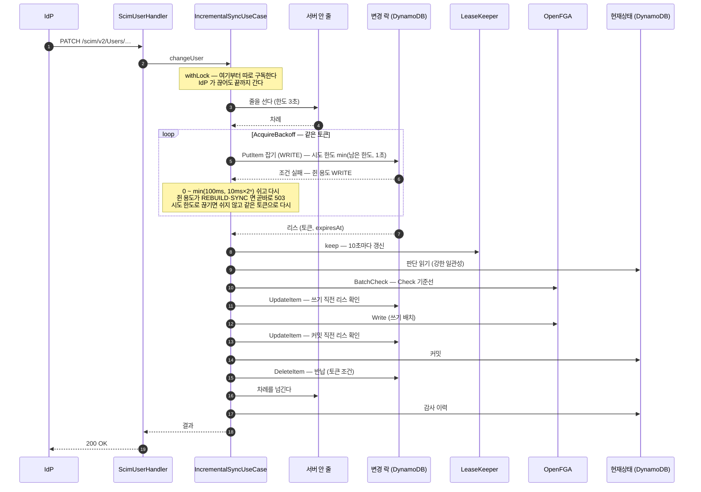
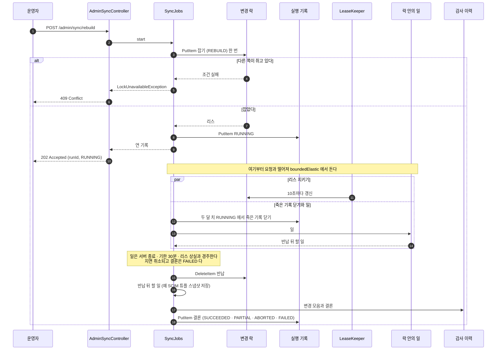

# 동시성과 작업

> 기준 커밋: 44147b3 (ops-readiness, main 에 머지됨). 코드가 바뀌면 이 문서도 함께 고친다.
> 읽기 전에: [용어집 — 동시성](02-용어집.md#7-동시성), [아키텍처 — 리액티브 규약](03-아키텍처.md#7-리액티브-규약), [데이터 모델 — 변경 락](04-데이터-모델.md#변경-락)

이 문서는 일이 겹칠 때 이 서버가 어떻게 줄을 세우는지, 오래 걸리는 일([회차](02-용어집.md#회차))을 어떻게 요청과 떼어 돌리는지를 다룬다. 인스턴스가 하나일 때와 여럿일 때 규칙이 같다. 줄을 세우는 것이 DynamoDB 아이템 하나라서다.

각 일이 안에서 무엇을 읽고 쓰는지는 다른 문서에 있다 — [05 LDAP 동기화](05-LDAP-동기화.md), [06 SCIM](06-SCIM.md), [07 재적재·초기화·아카이빙](07-재적재-초기화-아카이빙.md). 이 문서는 "누가 먼저 하나, 겹치면 무엇이 보이나, 멈추면 무엇이 남나" 만 다룬다. 설정 전체와 지표·경보는 [11 운영](11-운영.md), 장애별 대응은 [12 장애와 복구](12-장애와-복구.md)에 있다.

## 1. 한눈에

줄을 세우는 장치는 셋이고, 서로 따로 논다.

| 장치 | 범위 | 무엇을 줄 세우나 | 코드 |
|---|---|---|---|
| [변경 락](02-용어집.md#변경-락) | 클러스터 전체(테이블 하나) | 장부와 현재상태를 바꾸는 일 | `MutationLock`(core `port`), `DynamoDbMutationLock`(storage-dynamodb) |
| [서버 안 줄](02-용어집.md#서버-안-줄) | 서버 하나(메모리) | 그 서버의 SCIM 쓰기 | `LocalWriteQueue`(core `usecase`) |
| [하루 1회 표지](02-용어집.md#하루-1회-표지) | 클러스터 전체, 날짜마다 | 하루 한 번 작업 | `DailyOnce`(core `usecase`), `DynamoDbDailyJobClaims`(storage-dynamodb) |

일마다 무엇을 잡는지는 아래와 같다.

| 일 | 앱 | 변경 락 | [용도](02-용어집.md#용도) | 못 잡으면 | 쥔 동안 |
|---|---|---|---|---|---|
| LDAP [동기화](02-용어집.md#동기화) — 정기(`sync.cron`) | app-ldap | 한 번 시도 | `SYNC` | 로그 한 줄 남기고 건너뛴다. 실행 기록이 없다 | [리스](02-용어집.md#리스) [갱신](02-용어집.md#갱신), [기한](02-용어집.md#기한) 30분 |
| LDAP 동기화 — 수동(`POST /admin/sync/full`) | app-ldap | 한 번 시도 | `SYNC` | 409 | 같다 |
| LDAP [재적재](02-용어집.md#재적재) | app-ldap | 한 번 시도 | `REBUILD` | 409 | 같다 |
| SCIM 재적재·[초기화](02-용어집.md#초기화) | app-scim | 한 번 시도 | `REBUILD` | 409 | 같다 |
| [SCIM 쓰기](02-용어집.md#scim-쓰기) | app-scim | 서버 안 줄 + 다른 서버와 겨루기, 3초까지. 시도 하나는 `min(남은 한도, 1초)` 에서 끊는다 | `WRITE` | 503 + `Retry-After` | 리스 갱신, 쓰기 직전·커밋 직전 리스 확인. 기한은 없다 |
| [아카이빙](02-용어집.md#아카이빙) | app-scim | 잡지 않는다. 들여다보기만 한다 | — | 쥔 용도가 `REBUILD` 면 그 시도는 `ABORTED` — 하루 1회 표지를 풀어 다음 정각에 다시 본다 | 기한 30분. [남은 회수](02-용어집.md#남은-회수)는 SCIM 쓰기와 같은 길(용도 `WRITE`)로 한 명씩 지운다 |
| 만료 스냅샷 정리(`sync.purge-cron`) | 둘 다 | 잡지 않는다 | — | — | 하루 1회 표지만 본다 |
| 조회 — SCIM `GET`, 관리 API 조회, 실행 기록 목록 | 둘 다 | 잡지 않는다 | — | — | — |

저장하지 않는 속성만 바꾸는 직원 PATCH 도 락을 잡지 않는다([06 SCIM](06-SCIM.md)).

---

## 2. 변경 락

### 2.1 아이템 하나

테이블마다 `LOCK#MUTATION`/`META` 아이템이 하나 있다. 모양은 [04 데이터 모델 — 변경 락](04-데이터-모델.md#변경-락)에 있다. 칸은 넷이다.

- `token` — 이번 점유를 가리키는 UUID. 갱신과 반납의 조건이다.
- `holder` — 인스턴스 id. 기동할 때마다 새 UUID 다(`DynamoDbConfig.mutationLock`). 로그로 "누가 쥐었나" 를 보는 데만 쓰고 배제 판단에는 쓰지 않는다.
- `purpose` — [용도](02-용어집.md#용도). `WRITE`·`REBUILD`·`SYNC`.
- `expiresAt` — 리스 만료(epoch 초). 테이블 TTL 속성과 같은 칸이다.

앱마다 테이블이 달라 락도 앱마다 따로다. app-ldap 의 아이템에는 `SYNC`·`REBUILD` 만, app-scim 의 아이템에는 `WRITE`·`REBUILD` 만 들어간다. 두 앱이 한 테이블을 함께 쓰는 경우는 따지지 않는다([01 개요 — 배포 하나에 커넥터 하나](01-개요.md#배포-하나에-커넥터-하나)).

### 2.2 네 가지 동작

| 동작 | 부르는 곳 | DynamoDB 호출과 조건 | 성공하면 | 조건이 깨지면 | 그 밖의 오류 |
|---|---|---|---|---|---|
| 잡기 `acquire(용도, 토큰, 시도 한도)` | `SyncJobs`(`acquireOnce`), `IncrementalSyncUseCase` | PutItem 으로 네 칸을 통째 쓴다. 조건 `attribute_not_exists(PK) OR expiresAt < :now OR token = :token`. 조건이 깨지면 기존 아이템을 돌려받는다(`ALL_OLD`). 시도 한도가 있으면 이 요청에만 SDK 호출 한도(`apiCallTimeout`)를 건다 | `LockLease(token, expiresAt)` | `LockUnavailableException.잡혀_있다(쥔 용도)` | SDK 호출 한도(시도 한도, 없으면 클라이언트의 60초)로 끊기면 `LockAttemptTimeoutException` — 결과를 모른다. 나머지는 그대로 흘린다 |
| 갱신 `renew` | `LeaseKeeper`, SCIM 쓰기의 리스 확인 | UpdateItem `SET expiresAt = 지금 + TTL`. 조건 `token = :token` | 새 `LockLease` | `LockUnavailableException("변경 락 리스를 잃었습니다")` | 그대로 흘린다 |
| 반납 `release` | 회차의 끝, SCIM 쓰기의 끝, 획득을 포기한 SCIM 쓰기(§4.3) | DeleteItem. 조건 `token = :token` | — | 경고 "변경 락 반납 실패 — 이 토큰의 락 줄이 없다. 리스를 이미 잃었거나(TTL … 이 작업 시간보다 짧을 수 있다) 포기한 획득이 서버에 닿지 않았다" 를 남기고 **성공으로** 끝낸다. 문구가 두 사정을 함께 적는 까닭: 획득을 포기하며 보낸 반납은 그 시도가 서버에 닿지 않았으면 TTL 과 상관없이 이 경고를 낸다 — 스로틀 중의 503 마다 따라 나올 수 있다 | 그대로 흘린다. 부르는 쪽이 삼킨다(§4.3, §4.7, §5.4) |
| 들여다보기 `peek` | 아카이빙만 | GetItem, [강한 일관성](02-용어집.md#강한-일관성) | `expiresAt ≥ 지금` 이면 쥔 용도, 아니면 빈 값 | — | 그대로 흘린다 |

**잡기의 세 조건.** 아무도 없거나, 있어도 만료됐거나, 내 토큰이면 가져간다. 셋째가 중요하다.

- 토큰은 부르는 쪽이 만든다. 회차는 한 번 시도하므로 그때마다 새 토큰이다(`MutationLock.acquireOnce`). SCIM 쓰기는 줄 서기 한 번에 토큰 하나를 만들고, 시도마다 그 토큰으로 `acquire` 를 부른다(§4.3).
- 다시 보내는 일은 두 군데서 생긴다. 하나는 DynamoDB SDK 가 응답을 잃은 요청을 그대로 다시 보내는 것이고, 다른 하나는 SCIM 쓰기가 다른 서버와 겨루거나 시도 한도로 끊긴 뒤 다시 시도하는 것이다(§4.3).
- 첫 PutItem 이 서버에서는 성공했는데 응답만 잃었다고 하자. `token = :token` 조건이 없으면 다시 보낸 요청이 자기 락에 막힌다. 아무도 쓰지 않는 락이 리스가 끝날 때까지(약 30초) 남고, SCIM 배포라면 그동안 모든 SCIM 쓰기가 503 이다.
- 같은 토큰은 자기 락만 맞춘다. 남의 락을 가져가지 않는다.

**쥔 용도.** 조건이 깨지면 DynamoDB 가 돌려준 기존 아이템의 `purpose` 를 읽는다(`DynamoDbMutationLock.쥔_용도`). 돌려받지 못했거나 알 수 없는 값이면 `null` 이고, 흔한 경우인 쓰기 경합(`WRITE`)으로 본다. 쥔 용도가 SCIM 쓰기의 대기 시간을 정한다(§4.4).

**갱신의 조건은 토큰뿐이다.** 만료 시각은 조건에 없다. 그래서 리스가 만료됐어도 아직 아무도 가져가지 않았으면 갱신이 성공한다. 남이 가져갔으면 토큰이 바뀌어 실패한다. 갱신이 성공했다는 것이 곧 "지금 내가 쥐고 있다" 는 증거다.

**[들여다보기](02-용어집.md#들여다보기)는 잡지 않는다.** 아카이빙이 "재적재 중인가" 만 알려고 쓴다. 잡으면 아카이빙이 도는 몇 분 동안 SCIM 쓰기가 모두 503 이 되기 때문이다. 방금 잡힌 락을 놓치면 재적재 도중에 아카이빙이 돌므로 강한 일관성으로 읽는다. 자세한 것은 [07](07-재적재-초기화-아카이빙.md).

### 2.3 TTL 과 시계

- `expiresAt` 은 `지금 + dynamodb.lock-ttl`(기본 30초)을 초 단위로 내림한 값이다. 잡기 조건도 초 단위로 비교한다(`expiresAt < 지금(초)`). 그래서 실제 리스는 30초를 조금 넘고 31초를 넘지 않는다.
- 테이블 TTL 은 만료된 아이템을 늦게 지운다([04 — TTL](04-데이터-모델.md#5-ttl)). 그래서 만료된 락 아이템이 한동안 남아 있을 수 있다. 코드는 TTL 삭제를 기다리지 않고 `expiresAt` 을 직접 비교한다(잡기 조건, 들여다보기).
- 만료는 각 서버의 벽시계로 판단한다. `Clock` 빈은 `Clock.systemUTC()` 다. **서버 시계를 NTP 로 맞춘다는 것이 운영 전제다.**
- 허용되는 시계 차이는 `TTL − 2 × 갱신 주기`, 기본값으로 10초다. 쥔 쪽은 마지막으로 성공한 갱신을 보낸 때부터 20초 안에 멈추고(§3), 리스는 그때부터 30초 뒤에 끝난다. 다른 서버의 시계가 10초 넘게 앞서 있으면, 쥔 쪽이 아직 일하는 동안 그 서버가 락을 가져갈 수 있다.

### 2.4 펜싱이 없다는 것

[펜싱](02-용어집.md#펜싱)(fencing)은 쓰기마다 락의 토큰을 실어 보내, 저장소가 옛 주인의 쓰기를 거절하게 하는 방법이다. 이 서버에는 그것이 없다.

- OpenFGA Write 는 그런 토큰을 받지 않는다.
- 현재상태 커밋(DynamoDB)도 락 토큰을 조건으로 걸지 않는다. 조건 없는 덮어쓰기다.
- 그래서 변경 락은 "누가 시작해도 되나" 만 정한다. 리스를 잃은 줄 모르는 쪽이 보내는 쓰기는 막지 못한다. GC 멈춤, VM 정지, 네트워크 단절이 그런 경우다.

틈은 넷이 좁힌다.

1. **[멈춤 한도](02-용어집.md#멈춤-한도).** [`LeaseKeeper`](#3-리스-지키기--leasekeeper) 가 갱신에 실패하면 리스가 끝나기 10초 전에 일을 멈춘다(평소처럼 프로세스가 돌고 있을 때).
2. **쓰기 직전·커밋 직전 리스 확인(SCIM 쓰기).** OpenFGA 에 쓰기 직전과 DynamoDB 에 커밋하기 직전에 `renew` 를 한 번 부른다. 성공하면 그 순간에는 내가 쥐고 있다(§4.6).
3. **[Check 기준선](02-용어집.md#check-기준선)(SCIM 쓰기).** 다음 요청은 장부의 실제를 `Check` 로 물어 델타를 정한다. 늦게 떨어진 쓰기가 있어도 다음 요청의 기준이 오염되지 않는다.
4. **[기록 중 표시](02-용어집.md#기록-중-표시)(LDAP).** 쓰기 전에 붙이고 스냅샷을 저장하며 지운다. 멈춘 회차가 기록 중 표시를 남기면 다음 동기화가 [장부 맞추기](02-용어집.md#장부-맞추기)를 한다.

그래도 남는 틈이 있다.

- 리스 확인이 성공한 뒤, 그 쓰기가 닿기 전에 프로세스가 리스 남은 시간(약 30초)보다 오래 멈추면, 그 사이 다른 쪽이 락을 잡고 쓴 것 위에 늦은 쓰기가 떨어진다.
- 일을 취소해도 이미 보낸 요청은 서버에서 반영될 수 있다. 반납 뒤에 떨어질 수 있다.

남은 차이를 고치는 길:

- SCIM: IdP 재시도, 같은 대상을 건드리는 다음 쓰기, 하루 아카이빙(남은 회수 — 지우기만), 재적재.
- LDAP: 다음 회차의 비교 경로, 기록 중 표시로 걸리는 장부 맞추기, 재적재.

자세한 장애별 대응은 [12 장애와 복구](12-장애와-복구.md)에 있다.

---

## 3. 리스 지키기 — LeaseKeeper

`LeaseKeeper`(core `usecase`)는 락을 쥔 채 일을 돌리며 리스를 갱신하고, 잃으면 일을 취소한다. 두 곳이 쓴다.

| 쓰는 곳 | 상실 사유(로그·지표에 남는 말) |
|---|---|
| `SyncJobs` — 회차 | "작업 도중 리스 상실" |
| `IncrementalSyncUseCase.잡고_돌린다` — SCIM 쓰기 | "쓰기 도중 리스 상실" |

### 3.1 갱신하는 법

1. `keep(lease, work, 사유)` 가 `Flux.interval(갱신 주기, 갱신 주기)` 을 건다. 갱신 주기는 `dynamodb.lock-renew-interval`(기본 10초)다. 첫 갱신은 일을 시작하고 10초 뒤다. 갱신(다시 시도 포함)이 이어지는 동안 온 tick 은 버린다.
2. 한 번 시도는 주기의 절반(5초) 안에 답해야 한다. 매달린 연결 하나가 한도를 다 쓰지 않게 하려는 것이다.
3. 토큰 조건 실패가 아닌 실패(스로틀·네트워크·SDK 오류·5초 초과)는 쉬며 다시 시도한다. 쉬는 시간은 주기의 1/50 에서 두 배씩 늘어 주기의 1/5 에서 멈춘다 — 기본 200ms, 400ms, 800ms, 1.6초, 2초, 2초… 지터는 없다.
4. **멈춤 한도.** 갱신을 보낼 때마다 "주기 두 번(20초) 뒤에 닿는 마감" 타이머를 건다. 그 시도가 성공하면 그 마감이 새 한도가 된다. 처음 한도는 일을 시작한 때부터 잰다. 한도에 닿으면 "마지막 갱신 성공에서 갱신 주기 두 번이 지났다" 로 멈춘다.
5. 일은 상실 신호와 경주한다(`Mono.firstWithSignal(work, 상실)`). 일이 어떻게 끝나든 tick 과 타이머를 거둔다.

**한도를 보낸 때로 재는 까닭.** 저장소는 만료 시각을 "요청을 보낸 때 + TTL" 로 쓴다(`renew` 가 구독할 때 시계를 읽는다). 답이 온 때로 재면 느린 성공 하나가 TTL 전 여유를 줄인다.

**한도는 단조 시계로 잰다.** 마감은 Reactor 스케줄러의 지연 타이머다. NTP 가 벽시계를 옮겨도 한도가 늘거나 줄지 않는다. 벽시계는 로그에 "한도까지 Nms" 를 보여 주는 데만 쓴다. 이 내성은 멈춤 한도에만 해당한다 — 락의 만료 시각은 여전히 각 서버의 벽시계로 쓰고 판단한다(§2.3).

**늦은 답은 한도를 옮기지 않는다.** 5초에서 끊긴 시도의 답이 뒤늦게 와도 받아들이지 않는다. 두 timeout(시도 5초, 한도)을 모두 지난 성공만 한도를 옮긴다.

### 3.2 갱신 결과별 처리

| 갱신 결과 | 뜻 | 처리 |
|---|---|---|
| 성공 | 아직 내가 쥐고 있다 | 한도를 "이 시도를 보낸 때 + 20초" 로 옮긴다 |
| 토큰 조건 실패(`LockUnavailableException`) | 남이 가져갔다 | 다시 시도하지 않고 곧바로 멈춘다 |
| 그 밖의 실패, 5초 안에 답이 없음 | 모른다 | 한도 안에서 쉬며 다시 시도한다 |
| 한도에 닿음 | 잃었다고 본다 | 멈춘다 |

### 3.3 잃으면

- ERROR 로그 "<사유> — 락 리스를 갱신하지 못했다. 하던 일을 멈춘다".
- `LockObserver.leaseLost(사유)`. app-scim 은 `ScimSyncMetrics` 가 `scim.lock.lease_lost` 를 센다. app-ldap 은 `LockObserver.NOOP` 이라 지표가 없다.
- 일을 취소하고 `LockUnavailableException("작업 도중 락 리스를 잃었습니다")` 로 끝난다. SCIM 쓰기도 같은 문구다. `Retry-After` 는 기본 10초다.
- **취소는 되돌리기가 아니다.** 이미 보낸 OpenFGA·DynamoDB 요청은 거두지 못하고, 서버에서 반영될 수 있다. [연속 실패 차단기](02-용어집.md#연속-실패-차단기)가 멈출 때는 이미 나간 배치의 결과를 기다리지만, 취소(리스 상실·기한·서버 종료)는 기다리지 않는다.

### 3.4 시간표 예

기본값(TTL 30초, 주기 10초)에서 갱신이 스로틀로 계속 실패하는 경우다.

| 시각 | 일어나는 일 | 저장된 `expiresAt` | 멈춤 한도 |
|---|---|---|---|
| 0초 | 락을 잡고 일을 시작한다 | 약 30초 | 20초 |
| 10초 | 갱신을 보내 성공한다 | 약 40초 | 30초 |
| 20초 | 갱신을 보낸다 — 스로틀. 200ms, 400ms … 2초 쉬며 다시 보낸다 | 약 40초 | 30초 |
| 30초 | 한도에 닿아 일을 멈추고 반납을 시도한다 | 약 40초 | — |
| 40초 | 반납이 안 됐어도 이제 다른 쪽이 잡을 수 있다 | — | — |

멈춘 때(30초)와 만료(40초) 사이 10초가 시계 차이와 늦은 응답을 받아 주는 여유다.

SCIM 쓰기의 리스 확인(§4.6)도 `renew` 라 저장된 `expiresAt` 을 미룬다. 그러나 멈춤 한도는 옮기지 않는다 — 보수적인 쪽이다. SCIM 쓰기는 대부분 첫 tick(10초) 전에 끝나 주기 갱신이 한 번도 일어나지 않는다.

---

## 4. SCIM 쓰기의 락

입구는 `IncrementalSyncUseCase.withLock` → `잡고_돌린다` → `잡는다` 다(core `usecase`). SCIM 쓰기 여섯(`createUser`·`changeUser`·`removeUser`·`createGroup`·`changeGroup`·`removeGroup`)과 아카이빙의 `revokeLeftovers` 가 모두 이 길을 탄다. 핸들러가 아니라 유스케이스가 락을 잡으므로 쓰기 경로가 늘어도 빠지지 않는다. 락 안에서 무엇을 판단하고 쓰는지는 [06 SCIM](06-SCIM.md)에 있다.

### 4.1 흐름



### 4.2 서버 안 줄

[서버 안 줄](02-용어집.md#서버-안-줄)(`LocalWriteQueue`)은 `IncrementalSyncUseCase` 하나에 하나, 곧 서버마다 하나다. 메모리에만 있다. 줄의 맨 앞 자리를 [차례](02-용어집.md#차례)라 부른다.

1. `줄을_선다(한도)` 를 부른다. 아무도 차례를 쥐지 않았으면 바로 받고, 쥐었으면 줄 끝에 선다.
2. **차례를 쥔 요청 하나만 DynamoDB 락을 시도한다.** 그래서 락 아이템을 두드리는 것은 서버마다 많아야 하나다.
3. 차례는 그 요청이 끝날 때 다음 요청으로 넘어간다. 끝나는 경우는 셋이다 — 일을 마치고 반납까지 끝냈을 때, 획득에 실패했을 때, 획득 중 오류가 났을 때.
4. 반납이 끝나야 넘기므로, 다음 요청의 첫 시도는 이 서버가 방금 비운 락을 본다. 같은 서버 안에서는 반납과 다음 획득 사이에 빈 시간이 없다.
5. 줄에서 기다리는 동안에는 DynamoDB 를 부르지 않는다. 한도 안에 차례가 오지 않으면 줄에서 빠지고 `LockUnavailableException.잡혀_있다(WRITE)` 로 끝난다 — 503, `Retry-After` 2초다. 앞에 선 것이 이 서버의 SCIM 쓰기이기 때문이다. 새는 것이 없다.

경계에서 일어나는 일:

- 차례를 주는 순간과 시간 초과가 겹치면, 받은 차례를 쓴다.
- 차례를 주는 순간과 취소가 겹치면, 그 차례를 다음 요청에 넘기고 이 요청에는 내지 않는다.
- 줄이 비어 바로 받는 차례도 기다린 요청과 같은 상태(`GRANTED`)로 낸다. 건네받기 전에 취소돼도 차례가 사라지지 않는다.
- `Turn.넘긴다` 는 여러 번 불러도 한 번만 넘긴다. 받는 쪽은 `doFinally` 로도 넘긴다 — 어떻게 끝나든 차례를 쥔 채 사라지지 않는다.

순서는 **서버 안에서만** 지킨다(먼저 온 요청이 먼저). 서버끼리는 순서가 없다. 서버가 재시작하면 줄도 사라진다 — 줄에 서 있던 요청은 연결 오류를 받고, IdP 가 다시 보낸다.

### 4.3 다른 서버와 겨루기

차례를 받으면 `잡는다` 가 남은 한도를 셈한다 — `dynamodb.lock-acquire-timeout`(기본 3초)에서 줄에서 쓴 시간을 뺀 값이다. 한도는 줄에 선 순간부터 잰다. **토큰을 여기서 하나 만든다.** 그다음 `AcquireBackoff.잡는다(시도, 남은 한도)` 가 시도마다 그 토큰으로 `lock.acquire(WRITE, 토큰, 시도 한도)` 를 부른다.

**시도마다 한도를 준다.** 시도 한도는 `min(남은 한도, 1초)` 이고 하한은 200ms 다(`AcquireBackoff.시도_한도`). 다시 시도할 때마다 남은 한도로 새로 셈한다. 저장소(`DynamoDbMutationLock.acquire`)가 이 한도를 그 PutItem 의 SDK 호출 한도로 걸어, **SDK 의 재시도까지 포함해** 그 안에 끊는다.

- 1초로 자르는 까닭: 락을 잡는 PutItem 은 보통 수십 ms 다. 스로틀로 매달린 시도 하나가 남은 한도를 다 쓰면 끊긴 뒤 다시 시도할 여지가 없다. 3초 한도라면 매달린 시도가 와도 두세 번 다시 시도할 수 있다.
- 하한 200ms 의 까닭: 남은 한도가 거의 없어도 수십 ms 인 PutItem 이 끝날 시간은 준다.

**시도의 결과는 셋으로 가른다.**

| 결과 | 판단 | 처리 |
|---|---|---|
| 조건 실패(`LockUnavailableException`), 쥔 용도가 `WRITE` 이거나 모름 | 남이 쥐었다 | n번째(0부터) 재시도 전에 `0 ~ min(100ms, 10ms × 2ⁿ)` 사이 무작위로 쉬고 다시 시도한다(full jitter) |
| 조건 실패, 쥔 용도가 `REBUILD`·`SYNC` | 남이 몇 분 쥔다 | 다시 시도하지 않는다. 3초 안의 재시도가 결과를 바꾸지 못한다 → 503, 60초 |
| 시도 한도로 끊김(`LockAttemptTimeoutException`) | **결과를 모른다.** 서버에서 성공했을 수 있다 | 쉬지 않고 같은 토큰으로 곧바로 다시 시도한다. 획득 조건의 `token = :token` 때문에 서버에서 성공한 획득이면 그대로 다시 얻는다 |
| 그 밖의 오류(SDK 재시도를 다 쓴 스로틀·5xx·네트워크 등) | 응답을 잃었을 수 있다 — 결과를 모르는 시도로 친다 | 다시 시도하지 않는다. `LockUnavailableException("변경 락을 얻는 중 오류가 발생했습니다", 원인)` 으로 감싼다 → 503, 10초 |

| n | 0 | 1 | 2 | 3 | 4 이상 |
|---|---|---|---|---|---|
| 쉬는 시간의 상한 | 10ms | 20ms | 40ms | 80ms | 100ms |

- **한도에 닿으면 멈춘다.** 조건 실패 뒤에는, 지금까지 걸린 시간에 이번 대기를 더해 한도에 닿으면(≥) 시도하지 않고 "변경 락을 얻지 못했습니다" 로 멈춘다. `Retry-After` 는 마지막 실패의 것을 물려받는다 — 쓰기 경합이니 2초다. 끊긴 시도 뒤에는 걸린 시간이 한도에 닿았으면 같은 문구로 멈추고, 쥔 쪽을 모르므로 `Retry-After` 는 기본 10초다.
- **포기할 때 반납을 한 번 보낸다.** 결과를 모르는 시도(끊김, 그 밖의 오류)를 하나라도 남긴 채 포기하면, 그 토큰으로 반납을 한 번 보낸다(`IncrementalSyncUseCase.토큰으로_반납한다`). 그대로 두면 서버에서 잡혔을지 모를 락이 TTL(30초) 동안 모든 쓰기를 막는다. 반납은 토큰만 조건으로 보므로 남의 락을 풀지 않는다. 1초 한도의 최선 노력이고, 실패하면 WARN "결과를 모르는 획득 시도의 토큰으로 반납하지 못했다 …" 를 남기고 TTL 에 맡긴다. 조건 실패만 있었으면 보내지 않는다 — 우리 시도는 잡지 못했다. 503 응답은 이 반납이 끝난 뒤에 나간다.
- 줄에서 한도를 거의 다 썼어도, 차례를 받으면 시도는 한 번 한다(시도 한도는 하한 200ms).
- 경합이 이어지면 서버 하나가 초당 약 15~20번 시도한다 — 설계 문서의 추정이고, 이 문서는 재지 않았다. 락 아이템 하나의 쓰기 한도는 초당 1,000번이다.
- 한도와 대기를 재는 `AcquireBackoff.지금` 은 `Schedulers.parallel().now()` 다. Reactor 는 이것을 `System.currentTimeMillis` 로 준다 — 벽시계다. 줄의 시간 초과는 Reactor 타이머(단조)로 잰다. NTP 가 시계를 크게 옮기는 순간에 획득 중이던 요청은 남은 한도가 늘거나 줄 수 있다.

관리 API 의 `full`·`rebuild` 와 회차는 한 번만 시도하므로(`acquireOnce`) 시도 한도가 없다 — 클라이언트 전체 한도(60초)만 받는다.

지표(app-scim, `ScimSyncMetrics`):

- `scim.lock.wait`(Timer) — 줄에서 기다린 시간과 겨룬 시간을 합쳐, 잡거나 포기하기까지 걸린 시간.
- `scim.lock.contended`(Counter) — 실제로 밀렸을 때만 오른다. 줄 앞에 다른 요청이 있었거나(`Turn.밀렸다`), DynamoDB 가 쥔 쪽을 돌려줬을 때다. DynamoDB 장애나 시도 한도로 끊긴 것은 경합이 아니다.

### 4.4 503 과 기다릴 시간

락 때문에 생기는 실패는 모두 `LockUnavailableException`(core `usecase`)이고, 이것은 [일시 장애](02-용어집.md#일시-장애) `TemporaryFailureException`(core `port`)의 하위 타입이다. `ScimRouter.toScimError`(connector-scim)가 503 과 `Retry-After` 로 옮긴다.

| 언제 | 예외 메시지(로그에만 남는다) | `Retry-After` | DynamoDB 를 부른 횟수 |
|---|---|---|---|
| 서버 안 줄에서 3초 안에 차례가 오지 않았다 | "다른 작업이 변경 락을 쥐고 있습니다(WRITE)" | 2초(`쓰기_경합_대기`) | 0번 |
| 다른 서버의 SCIM 쓰기(또는 용도 모름)가 한도까지 쥐고 있었다 | "변경 락을 얻지 못했습니다" | 2초 | 여러 번(백오프) |
| 재적재(`REBUILD`)·동기화(`SYNC`)가 쥐고 있다 | "다른 작업이 변경 락을 쥐고 있습니다(REBUILD)" | 60초(`긴_작업_대기`) | 1번 |
| 시도 한도로 끊긴 채 한도에 닿았다 | "변경 락을 얻지 못했습니다" | 10초(`기본_대기`) — 쥔 쪽을 모른다 | 여러 번(끊긴 시도마다) + 반납 한 번 |
| 잡는 중 DynamoDB 오류 | "변경 락을 얻는 중 오류가 발생했습니다" | 10초(`기본_대기`) | 한 번(SDK 재시도는 시도 한도 안) + 반납 한 번 |
| 쓰기 직전·커밋 직전 리스 확인에서 토큰 조건 실패 | "변경 락 리스를 잃었습니다" | 10초 | — |
| 리스 확인 중 DynamoDB 오류 | "변경 락 리스를 확인하지 못했습니다" | 10초 | — |
| 쥔 동안 갱신이 실패했다 | "작업 도중 락 리스를 잃었습니다" | 10초 | — |

`Retry-After` 는 정수 초로 올림하고 최소 1초다(`ScimRouter.재시도_초`). 응답 본문에는 우리 문구만 담는다. 쥔 쪽의 용도나 라이브러리 메시지는 인증 없는 엔드포인트로 내보내지 않는다.

```http
HTTP/1.1 503 Service Unavailable
Retry-After: 60
Content-Type: application/scim+json

{"schemas":["urn:ietf:params:scim:api:messages:2.0:Error"],"status":"503","detail":"일시적으로 처리할 수 없습니다 — 60초 뒤 다시 보내 주세요"}
```

**회차와의 비대칭은 일부러다.** SCIM 쓰기는 기계(IdP)가 자주 보내고 밀리초 단위로 짧게 쥐는 락과 경합하므로 잠깐 기다려 보는 편이 IdP 의 재시도를 줄인다. 재적재·동기화는 사람이 걸고 드물며 장부 전체를 훑는 일이라, 뒤에서 조용히 기다리기보다 곧바로 409 로 "다른 일이 돈다" 고 알린다(§5.2).

### 4.5 요청과 떼어 돈다

`withLock` 은 줄 서기부터 이력 쓰기까지를 **자기 구독**으로 돌린다(`.subscribe(…)`). 요청에는 결과를 담을 `Sinks.One` 만 돌려준다.

- 요청의 Reactor Context 를 `contextWrite` 로 이어받는다. 로그가 요청과 같은 traceId 로 묶이고, 감사 이력의 [원인](02-용어집.md#원인) id 도 그 traceId 다.
- IdP 가 연결을 끊으면(요청 구독 취소) `요청이_떠났다` 표시만 켠다. 줄 서기, 잡기, 쓰기, 커밋, 반납은 끝까지 간다. 줄에 서 있던 요청도 차례가 오면(또는 한도까지) 그대로 진행한다.
- 까닭: 끊기는 순간 반납하면, 이미 보낸 OpenFGA 쓰기가 다음 요청의 `Check` 뒤에 떨어져 그 요청의 기준선이 틀린다. 락을 잡는 도중에 끊겨 리스가 새는 일도 없어진다.
- 요청이 떠난 뒤의 결과는 받을 곳이 없어 경고 로그로만 남는다 — "요청이 떠난 뒤 SCIM 쓰기가 실패했다 — IdP 는 이 결과를 받지 못했다", "요청이 떠난 뒤 SCIM 쓰기가 부분 반영으로 끝났다 — 실패한 튜플 N개. IdP 는 이 결과를 받지 못했다". 요청이 남아 있으면 응답과 `ScimRouter` 가 알리므로 이 로그는 남기지 않는다.
- IdP 는 보통 끊긴 요청을 다시 보낸다. 다시 온 요청은 Check 기준선으로 남은 것만 맞춘다.

### 4.6 쓰기 직전·커밋 직전 리스 확인

[리스 확인](02-용어집.md#리스-확인)은 `IncrementalSyncUseCase.반영하고_커밋한다` 의 이 순서로 한다.

- 델타가 있으면: 리스 확인("쓰기 직전 리스 재확인 실패") → OpenFGA 쓰기 → 리스 확인("커밋 직전 리스 재확인 실패") → DynamoDB 커밋.
- 델타가 비어도: 리스 확인("커밋 직전 리스 재확인 실패") → 커밋.

| 항목 | 내용 |
|---|---|
| 확인하는 법 | `renew` 한 번(`리스를_확인한다`). 앱 재시도는 없다. DynamoDB SDK 재시도는 탄다 |
| 성공의 뜻 | 토큰 조건부 쓰기가 성공했다 — 그 순간 내가 쥐고 있다. 덤으로 `expiresAt` 도 미룬다 |
| 실패하면 | `scim.lock.lease_lost`(사유는 위 문구)를 올리고, 그 뒤의 쓰기·커밋을 하지 않는다. `Mono.defer` 로 감싸 두어 확인이 실패하면 쓰기 표현식이 평가되지 않는다. 응답은 503(10초) |
| 바뀐 튜플이 없어도 확인하는 까닭 | 커밋은 조건 없는 덮어쓰기다. 30초 넘게 멈춘 요청이 확인 없이 커밋하면 다른 인스턴스가 저장한 비활성화를 되돌린다 |

같은 확인을 쓰는 자리가 둘 더 있다. 하위 조직 연결을 지운 요청이 끝에서 [보류 목록](02-용어집.md#보류-목록)을 다시 보며 튜플을 쓰기 직전, 그리고 직원 연산이 오류로 끝나 [의도 저장](02-용어집.md#의도-저장)을 하기 직전이다. 리스 확인이 실패한 요청은 [표지판](02-용어집.md#표지판)을 정리하지 않는다 — 남이 락을 쥐었을 수 있어서다. 둘 다 [06 SCIM](06-SCIM.md)에 있다.

### 4.7 끝내는 순서

`잡고_돌린다` 는 요청이 어떻게 끝나든 이 순서를 지킨다.

1. 락 안의 일이 끝난다 — 값, 오류, 리스 상실로 인한 취소 무엇이든. 감사 이력의 시각을 이때 잡는다. 반납 뒤에 잡으면 그 사이 락을 잡고 커밋한 다른 요청보다 늦은 시각이 되어 최신순이 뒤집힌다.
2. **반납한다.** 실패하면(스로틀, 네트워크) WARN "변경 락 반납이 실패했다. 리스가 만료될 때까지 아무도 잡지 못한다" 와 `leaseLost("반납 실패")` 를 남기고 넘어간다. 응답은 바뀌지 않는다 — 일은 끝났다. 그동안 락은 TTL 까지 묶인다.
3. **차례를 넘긴다 — 결과를 내기 전에.** 결과를 낸 뒤에 넘기면, 그 결과를 받은 IdP 가 곧바로 보낸 다음 요청이 아직 넘어가지 않은 차례 뒤에 선다.
4. **감사 이력을 쓴다.** 실패해도 ERROR 로그만 남기고 결과는 그대로다([10 감사 이력](10-감사-이력.md)).
5. 결과를 요청에 낸다. 응답이 나간다.

차례를 받은 뒤 획득이 실패한 요청도 3 → 4 → 5 를 탄다. 모은 변경이 없어 이력은 쓰지 않는다. 줄에서 한도를 넘긴 요청은 차례를 받은 적이 없으므로 3·4 없이 곧바로 503 이다.

### 4.8 처리량

- 변경 락은 클러스터에 하나다. 어느 순간에도 SCIM 쓰기 하나만 쥔다. **쓰기 처리량의 상한은 락을 쥐는 시간의 역수이고, 서버 수와 무관하다.** 서버를 늘리면 줄이 늘 뿐 처리량은 늘지 않는다.
- 쥐는 시간에는 판단 읽기, `BatchCheck`, 리스 확인 두 번, OpenFGA Write, DynamoDB 커밋, 반납이 든다. 같은 서버 안에서는 반납과 다음 획득 사이에 빈 시간이 없고, 서버끼리 넘어갈 때는 백오프 대기(많아야 100ms)만큼 빈다.
- 설계 문서의 추정으로는 쥐는 시간이 약 40ms 라 초당 약 20~30건이고, 동시 요청 40개면 맨 뒤 요청이 약 1.6초 뒤에 차례를 받는다(한도 3초 안). 이 문서는 재지 않았다.
- SCIM 쓰기에는 기한이 없다. 큰 조직 삭제처럼 오래 걸리는 쓰기는 리스를 갱신하며 끝까지 간다. 그동안 다른 SCIM 쓰기는 3초를 겨룬 뒤 503(2초)이고 IdP 가 다시 보낸다.

---

## 5. 회차 — SyncJobs

`SyncJobs`(core `usecase`)는 회차를 변경 락·실행 기록·기한·서버 종료·리스 상실과 함께, 요청과 떼어 돌린다. 앱마다 빈이 하나다(`UseCaseConfig.syncJobs`(app-ldap), `ScimUseCaseConfig.syncJobs`(app-scim), 둘 다 `destroyMethod = "shutdown"`).

### 5.1 무엇이 타나

| 회차 | 진입 | [트리거](02-용어집.md#트리거) | 용도 | 감사 이력 종류 | [반납 뒤 할 일](02-용어집.md#반납-뒤-할-일) |
|---|---|---|---|---|---|
| LDAP 동기화 | `FullSyncUseCase.start` | `SCHEDULED`·`MANUAL`·`FORCED` | `SYNC` | `SYNC`(기록 중 회차는 `LEDGER_ALIGNMENT`) | 결론을 그대로 낸다. 스냅샷 저장과 현재상태 교체는 락 안에서 한다 |
| LDAP 재적재 | `RebuildUseCase.start` | `REBUILD`(`force=true` 면 `FORCED_REBUILD`) | `REBUILD` | `REBUILD` | 같다 |
| SCIM 재적재 `tuples` | `ScimRebuildUseCase.start` | `REBUILD` | `REBUILD` | `REBUILD` | 튜플 스냅샷 저장 |
| SCIM 초기화 `wipe` | 같다 | `RESET` | `REBUILD` | `REBUILD` | 결론을 그대로 낸다 |

아카이빙은 `SyncJobs` 를 타지 않는다. 락을 잡지 않고, 실행 기록을 스스로 열고 닫는다(`SnapshotArchiveUseCase.execute`). 기한(`sync.job-timeout`)과 죽은 기록 닫기의 나이 규칙(§5.6)은 스스로 갖지만, 서버 종료 처리와 리스는 없다([07](07-재적재-초기화-아카이빙.md#6-아카이빙)).

### 5.2 시작 — 락, 실행 기록, 202

1. **락을 한 번 잡는다**(`lock.acquireOnce(용도)` — 새 토큰, 시도 한도 없이 클라이언트 전체 한도만). 다시 시도하지 않는다 — 못 잡았다는 것이 곧 다른 일이 돈다는 뜻이다.
   - 조건 실패 → `LockUnavailableException`. 관리 API 는 409 로 바꾼다. 응답은 problem details 이고 `detail` 이 이유 문구다 — app-ldap 은 "다른 동기화·재적재가 진행 중입니다", app-scim 은 예외 메시지("다른 작업이 변경 락을 쥐고 있습니다(WRITE)" 등)([09 — 오류](09-관리-API.md#오류)). 정기 동기화(`SyncScheduler.전체동기화`, app-ldap)는 INFO "다른 인스턴스가 동기화·재적재 중이라 이번 스케줄을 건너뛴다" 로 끝낸다. 어느 쪽이든 실행 기록은 남지 않는다.
   - 그 밖의 DynamoDB 오류는 409 로 바꾸지 않고 그대로 흘린다. 관리 API 는 예외 처리기가 일시 장애(스로틀·5xx·네트워크·시간 한도)면 503 + `Retry-After`, 아니면 500 으로 답하고, 스케줄러는 "스케줄 동기화를 걸지 못했다" 로그를 남긴다.
2. **실행 기록을 연다**(`runs.start` — `RUNNING` PutItem). 여기서부터 요청과 떨어진 구독이 `boundedElastic` 에서 돈다. 열지 못하면(오류·빈 응답) 락을 반납하고 그 오류를 요청에 낸다 — 관리 API 는 위와 같이 503 이나 500 이다. 작업은 시작하지 않았으므로 다시 걸어도 된다.
3. **연 기록을 요청에 준다.** 관리 API 는 202 와 그 기록을 돌려준다.
4. 회차는 자기 구독으로 계속 돈다. 앞단 프록시가 연결을 끊어도 멈추지 않는다.

```http
POST /admin/sync/rebuild?mode=tuples

HTTP/1.1 202 Accepted
{"runId":"9a7c3e1f-5b2d-4c8e-a6f0-3d1b7e9c2a54","source":"SCIM","trigger":"REBUILD",
 "startedAt":"2026-10-25T05:12:03.481Z","finishedAt":null,"status":"RUNNING",
 "writtenCount":0,"deletedCount":0,"failureCount":0,"snapshotId":null,"message":null}
```

결과는 `GET /admin/sync/runs/{runId}` 로 본다([09 관리 API](09-관리-API.md)).

락을 잡고 실행 기록을 여는 PutItem 하나 사이에는 [갱신](02-용어집.md#갱신)이 없다. 리스를 막 잡아 TTL 이 그대로인 구간이다. 갱신은 그다음의 죽은 기록 닫기(§5.6)와 일을 함께 덮는다.

### 5.3 경주



`SyncJobs.끝까지_돌린다` 가 경주를 건다.

- 일 = `LeaseKeeper.keep(죽은 기록 닫기 → 락 안의 일)`.
- `Mono.firstWithSignal(종료되면, 일)` — 서버 종료 신호를 **먼저** 구독한다. 종료가 이미 시작됐으면 그 자리에서 이겨 일을 구독하지도 않는다.
- `.timeout(sync.job-timeout)` — 기본 30분. 넘으면 "기한 초과 — 30분" 이다(1분 미만이면 "…ms").
- 결과 없이 끝나면 "작업이 결과 없이 끝났다".
- 먼저 신호를 낸 쪽이 이기고 진 쪽은 취소된다. 오류는 모두 `FAILED` 결론이 된다. 메시지는 예외 메시지이고, 없으면 예외 클래스 이름이다.
- 기한이 덮는 구간은 죽은 기록 닫기와 락 안의 일이다. 실행 기록을 여는 PutItem, 반납 뒤 할 일, 감사 이력, 기록 닫기는 기한 밖이다.

### 5.4 끝내는 순서

**먼저 반납하고 그다음 기록한다.** 운영자가 실행 기록에서 "끝남" 을 본 즉시 다시 걸면 받아져야 하기 때문이다.

1. 락 안의 일이 끝난다(값, 오류, 진 경주). 감사 이력의 시각을 이때 잡는다.
2. **반납한다.** 실패하면 WARN "작업을 끝내며 락·가드를 반납하지 못했다" 만 남기고 넘어간다. 락은 TTL 까지 묶인다. 이 실패는 지표로 세지 않는다.
3. **반납 뒤 할 일을 한다.** 락 없이, 기한·서버 종료 경주 밖에서 돈다. 실패하거나 결과 없이 끝나면 `FAILED` 다. 1 이 실패로 끝났으면 일이 내놓으려던 반납 뒤 할 일은 돌지 않는다 — 결론은 그 실패다.
4. **감사 이력을 남긴다**(`RunAudit` 의 변경 모음 + 결론). 빈 모음은 쓰지 않는다. 쓰기가 실패하면 결론의 메시지 앞에 "감사 기록 N건 실패" 가 붙는다([10 감사 이력](10-감사-이력.md)).
5. **실행 기록을 닫는다**(`runs.finish` — 조건 없는 PutItem). 실패하면 ERROR "작업 결과를 기록하지 못했다 — 기록이 RUNNING 으로 남는다".
6. `onFinished` 를 부른다(app-ldap 은 `SyncMetrics.record` 로 `sync.*` 지표를 남긴다).

반납(2)과 기록(5) 사이에는 실행 기록이 아직 `RUNNING` 이다. SCIM 재적재라면 10만 명 규모에서 스냅샷 저장에 몇 초가 든다. 이 틈에 다음 회차가 시작하면 이 기록을 죽은 기록으로 볼 수 있다 — §5.6 의 조건부 닫기가 이것을 다룬다.

기한·서버 종료·리스 상실로 끝난 회차의 결론은 `SyncOutcome.failed` 라 건수가 0 이고 스냅샷 id 가 없다. 이미 나간 쓰기는 감사 이력에 남는다(일이 쓰기가 끝나는 즉시 모음에 더하기 때문이다).

### 5.5 끝나는 모양

| 어떻게 끝났나 | 실행 상태·메시지 | 락 | 다음에 무엇이 고치나 |
|---|---|---|---|
| 일이 끝까지 갔다 | `SUCCEEDED`·`PARTIAL`·`ABORTED` — [05](05-LDAP-동기화.md)·[07](07-재적재-초기화-아카이빙.md) | 반납 | — |
| 일이 오류로 끝났다 | `FAILED` + 오류 메시지 | 반납 | 05·07 |
| 기한을 넘겼다 | `FAILED` "기한 초과 — 30분" | 반납 | LDAP: 기록 중 표시가 남았으면 다음 동기화가 장부 맞추기를 한다. SCIM: 재적재를 다시 건다 |
| 리스를 잃었다 | `FAILED` "작업 도중 락 리스를 잃었습니다" | 반납을 시도한다. 남이 쥐었으면 경고만 | 같다 |
| 서버가 내려갔다 | `FAILED` "서버 종료로 중단" | 반납 | 같다 |
| 반납 뒤 할 일이 실패했다 | `FAILED`. 예: "장부는 맞췄다 — 스냅샷 저장 실패: …" | 이미 반납했다 | 장부는 맞다. 다음 재적재나 아카이빙이 스냅샷을 남긴다 |
| 프로세스가 강제로 죽었다 | `RUNNING` 으로 남는다 | TTL(약 30초)까지 묶인다 | 다음에 락을 잡는 회차의 죽은 기록 닫기 → `FAILED` "비정상 종료로 중단". 또는 기한 + 10분 뒤 처음 시작하는 동기화·재적재·아카이빙 → "비정상 종료로 중단(기한 + 10분 경과)" |
| 기록 닫기가 실패했다 | `RUNNING` 으로 남는다 | 이미 반납했다 | 같다 |

### 5.6 죽은 기록 닫기

[죽은 기록 닫기](02-용어집.md#죽은-기록-닫기)는 `SyncJobs.남은_기록을_닫는다` 와 `StaleRuns.닫는다`(core `usecase`)다. 재시작이 따로 정리하지 않는다 — 기동할 때 도는 정리 코드는 없고, 재시작 뒤 **다음에 시작하는 일**이 이 일을 한다. 닫는 규칙이 둘이다.

| 규칙 | 누가 | 무엇을 닫나 | 사유 |
|---|---|---|---|
| 1. 락을 쥔 회차 | `SyncJobs` 의 회차(동기화·재적재·초기화) | 같은 앱의 원천(`source`)이고 트리거가 `ARCHIVE` 가 아닌 `RUNNING` — **나이와 상관없이** | `비정상 종료로 중단` |
| 2. 나이 | 위 회차와 아카이빙(`SnapshotArchiveUseCase` — 건너뛰는 시도 포함) | 시작한 지 `sync.job-timeout` + 10분(기본 40분)이 지난 `RUNNING` — **종류·`source` 와 상관없이** | `비정상 종료로 중단(기한 + 10분 경과)` |

- **언제.** 회차는 자기 실행 기록을 연 뒤·락 안의 일을 시작하기 전에(갱신이 도는 구간 안이다). 아카이빙은 기록을 연 뒤·기한이 걸리기 전에. 한 기록에 두 규칙이 다 맞으면 1번이 이긴다.
- **무엇을 읽나.** `runs.findRunning()` — 이번 달과 지난달 파티션을 Query 하고 `status = RUNNING` 거름식을 단다(`DynamoDbSyncRunRepository`). Scan 이 아니다. 거름식은 읽은 뒤에 걸러 읽기 용량은 두 파티션 전체만큼이다 — app-ldap 은 매시 회차마다 두 달 치(약 1,500건) 를 읽는다. 아이템이 작아 읽기 용량은 수십 단위다. 최종 일관성이다.
- **1번이 닫아도 되는 까닭.** 락을 쥐었으니 다른 회차는 돌 수 없다. 남은 `RUNNING` 은 죽은 회차다(강제 종료, 정전, 다른 인스턴스의 비정상 종료). SCIM 쓰기는 실행 기록을 만들지 않는다. 아카이빙은 락을 잡지 않아 그때 도는 중일 수 있으므로 1번에서 뺀다.
- **2번이 닫아도 되는 까닭.** 일은 기한을 넘기면 스스로 `FAILED` 로 끝난다. 그 뒤 10분이 지나도 `RUNNING` 이면 죽은 것이다. 10분은 기한이 막 끝난 일이 제 기록을 쓸 틈이다. 락을 잡지 않는 아카이빙의 기록은 이 규칙으로만 닫히고, app-scim 은 아카이빙이 하루 창마다 시작하므로 재적재를 걸지 않아도 닫힌다.
- **방금 연 자기 기록은 건드리지 않는다.**
- **`abandon` 은 조건부다.** `DynamoDbSyncRunRepository.abandon` 은 `FAILED` 기록을 `status = RUNNING` 조건으로 PutItem 한다. 조건이 깨지면 빈 값이다(DEBUG "닫으려 했으나 이미 끝나 있었다 — 반납과 기록 사이의 틈").
- **조건이 필요한 까닭.** 앞 회차가 락을 반납한 뒤·기록을 쓰기 전(§5.4 의 틈)에 다음 회차가 이 기록을 볼 수 있다. 읽기가 최종 일관성이라 방금 끝난 기록도 `RUNNING` 으로 보일 수 있다. 조건이 있으면 어느 쪽이 먼저 닿든 결과가 맞다.
  - 닫기가 먼저 닿으면, 앞 회차의 조건 없는 `finish` 가 그 위에 실제 결과를 덮어쓴다(잠깐 "비정상 종료로 중단" 으로 보일 수 있다).
  - `finish` 가 먼저 닿으면, 닫기의 조건이 깨져 아무 일도 하지 않는다.
  - 나이로 잘못 닫힌 경우(기한을 넘겨 느리게 살아 있던 일)도 그 일의 늦은 `finish` 가 덮어쓴다.
- **실패하면.** 찾기·닫기가 실패해도 경고만 남기고 일은 계속한다. 닫은 기록마다 WARN "[runId] 끝나지 못한 채 남은 실행 기록을 닫았다: <사유>".

남는 한계:

| 한계 | 결과 |
|---|---|
| 두 달 파티션만 본다 | 그보다 앞선 달의 `RUNNING` 은 닫지 않는다 — 실행 기록 보관(기본 30일)의 TTL 이 지운다. 기본 보관이면 대개 해당하지 않는다 |
| app-scim 의 죽은 재적재 | 다음 재적재가 걸리거나, 기한 + 10분이 지난 뒤 아카이빙이 시작할 때까지 `RUNNING` 이다 — 그날 아카이빙이 이미 성공했으면 다음 날 하루 창 |

### 5.7 서버 종료

1. **웹 서버.** Spring Boot 3.5 의 기본값은 `server.shutdown=graceful`, `spring.lifecycle.timeout-per-shutdown-phase=30s` 다. 이 저장소의 설정 파일은 두 값을 바꾸지 않는다. 새 요청을 받지 않고 진행 중인 요청을 기다린다는 것이 프레임워크의 동작이다 — 이 문서는 실행해 확인하지 않았다.
2. **`SyncJobs.shutdown`.** 빈을 닫는 단계에서 불린다. `SyncJobs` 가 실행 기록 저장소를 거쳐 `DynamoDbAsyncClient` 에 기대므로 스프링이 클라이언트(`destroyMethod = "close"`)보다 먼저 닫는다.
   - 종료 신호를 낸다 → 도는 회차가 경주에서 진다 → `FAILED` "서버 종료로 중단" → 반납 → 감사 이력 → 기록.
   - 도는 회차가 모두 끝나기를 최대 10초(`SyncJobs.종료_대기`) 기다린다(`Mono.when(…).block(10초)`). 넘으면 ERROR "서버 종료: PT10S 안에 작업 기록을 마치지 못했다 — 기록이 RUNNING 으로 남을 수 있다". 이력 모음이 크면 넘길 수 있다. 그 기록은 다음 회차가 닫는다.
   - 신호 뒤에 걸린 회차는 락을 잡고 기록을 연 뒤, 일을 시작하지 않고 같은 사유로 끝난다.
3. **DynamoDB 클라이언트를 닫는다.** 이 뒤에 남은 DynamoDB 호출은 실패한다.

SCIM 쓰기와 아카이빙에는 이런 종료 처리가 없다. SCIM 쓰기는 1 의 그레이스풀 종료가 진행 중인 요청을 기다리는 데 기댄다. 그 안에 끝나지 못하면 3 에서 실패하고, 락은 TTL 까지 남고, IdP 가 다시 보낸다. 끊긴 아카이빙의 기록은 `RUNNING` 으로 남았다가 기한 + 10분 뒤 나이 규칙이 닫고, 그날 표지는 임대가 끝난 뒤 다음 정각이 다시 잡는다(§6).

---

## 6. 하루 1회 표지

하루 한 번 작업을 클러스터에서 그날 **한 번 성공할 때까지만** 돌린다. 인스턴스가 셋이면 아카이빙이 세 번 돌고 스냅샷이 셋 쌓이던 것을 막고, 한 번 실패한 작업이 그날을 통째로 잃지 않게 한다.

| 작업 | 앱 | cron(기본 — 하루 창) | 하루 1회 표지 이름 | 성공 판정 |
|---|---|---|---|---|
| 만료 스냅샷 정리 | app-ldap | `sync.purge-cron` `0 0 4-8 * * *` | `ldap-purge` | 오류 없이 끝나면 |
| 아카이빙 | app-scim | `sync.archive-cron` `0 0 3-8 * * *` | `scim-archive` | 실행 기록이 `SUCCEEDED` 일 때만 |
| 만료 스냅샷 정리 | app-scim | `sync.purge-cron` `0 0 4-8 * * *` | `scim-purge` | 오류 없이 끝나면 |

동작(`DailyOnce.run(작업, 일, 성공 판정)`):

1. 앱 `Clock` 의 UTC 날짜를 정하고, owner(새 UUID)와 임대(지금 + `sync.job-timeout` + 5분)를 정한다.
2. `DailyJobClaims.claim(작업, 날짜, owner, 임대)` → `DynamoDbDailyJobClaims` 가 PutItem 한다. 키는 `DAILY#<작업>#<yyyy-MM-dd>`/`META`, 칸은 `state = CLAIMED`·`owner`·`leaseUntil`·`expiresAt`(지금 + 3일)이다. 조건은 `attribute_not_exists(PK) OR (state = CLAIMED AND leaseUntil < :now)` 다([04 — 하루 1회 표지](04-데이터-모델.md#하루-1회-표지)).
3. 성공하면 그 인스턴스만 일을 돈다. 조건이 깨지면 INFO "오늘(2026-10-25) scim-archive 은 다른 인스턴스가 이미 했거나 하고 있다 — 건너뛴다" 를 남기고 빈 결과로 끝난다.
4. 끝을 한 번만 정한다. 값이 성공 판정을 통과하면 owner 조건으로 `state = DONE`(UpdateItem). 성공이 아닌 값·오류·빈 끝·취소면 owner 조건으로 표지를 지운다(DeleteItem) — 창 안의 다음 정각이 다시 잡는다.

성질:

- **변경 락과 따로다.** 다른 아이템이고, 갱신이 없다 — 임대는 처음 정한 그대로다. 하루 1회 표지를 잡은 일이 변경 락을 잡는지는 일마다 다르다 — 만료 스냅샷 정리와 아카이빙 본체는 잡지 않는다(아카이빙의 남은 회수만 직원마다 SCIM 쓰기 길로 잡는다). 정리는 최신 포인터가 가리키는 스냅샷을 지우지 않으므로 동기화와 겹쳐도 기준선을 잃지 않는다.
- **`DONE` 이면 그날은 끝이다.** 잡기 조건에 `DONE` 이 없다. 다음 날은 날짜가 달라 새 키다.
- **실패하면 풀고, 죽으면 임대가 끝난다.** 일이 실패하면 표지를 지워 다음 정각이 잡는다. 잡은 인스턴스가 죽으면 풀 주체가 없으므로 임대가 끝난 `CLAIMED` 를 다음 시도가 잡는다. 아카이빙은 기한(`sync.job-timeout`)에 끝나므로 임대(기한 + 5분)보다 먼저 끝나 — 살아 있는 인스턴스의 표지를 남이 다시 잡지 않는다. 정리는 기한이 없어 임대를 넘길 수 있다(멱등이라 둘이 돌아도 정확성은 깨지지 않는다).
- **owner 로만 끝낸다.** 완료·해제는 `owner = :owner` 조건이다. 임대를 넘겨 늦게 끝난 인스턴스의 해제가 남이 새로 잡은 표지를 지우면 그날 일이 한 번 더 돈다 — 조건이 그것을 막는다. 조건이 깨지면 INFO 만 남긴다.
- **끝내기의 오류는 삼킨다.** WARN 만 남긴다. 풀지 못한 표지는 임대 뒤 다시 잡히고, 완료로 적지 못한 표지는 임대 뒤 같은 날 한 번 더 돌 수 있다.
- **하루 1회 표지를 잡는 PutItem 이 오류면** 그 인스턴스는 그 시도에서 일을 하지 않고 오류 로그를 남긴다. 다음 정각이 다시 잡는다.
- **cron 은 서버의 시간대, 하루 1회 표지 날짜는 UTC 다.** `@Scheduled(cron = …)` 에 시간대를 주지 않아 JVM 기본 시간대로 돈다. 예를 들어 KST 서버의 03:00 은 UTC 로 전날 18:00 이라 하루 1회 표지 날짜가 전날이 된다. 그래서 **하루 창이 UTC 자정을 넘지 않아야** 한 창이 한 날로 묶인다 — 기본 창은 서버가 UTC 든 KST 든 지킨다(KST 03~08시는 UTC 18~23시). 모든 인스턴스의 시간대가 같아야 한다. 시간대가 서로 다르거나 창이 자정을 넘으면 같은 작업이 다른 날짜의 표지로 하루에 두 번 돌 수 있다 — 정확성은 깨지지 않는다(코드에서 도출했다, 시험하지 않았다).

---

## 7. 여러 대에서 — 장면별

### 7.1 같은 cron 을 두 대가 부른다

app-ldap 두 대(A, B)가 정각에 `SyncScheduler.전체동기화` 를 부른다.

1. 두 대 모두 `FullSyncUseCase.start` → `SyncJobs` → PutItem(`SYNC`)을 보낸다.
2. 같은 아이템에 대한 조건부 쓰기는 DynamoDB 가 하나씩 처리한다. 조건이 맞는 것은 하나뿐이다.
3. **이긴 A:** 실행 기록(`SCHEDULED`, `RUNNING`)을 열고 동기화를 한다.
4. **진 B:** 조건 실패에서 쥔 용도 `SYNC` 를 돌려받아 `LockUnavailableException` → INFO "다른 인스턴스가 동기화·재적재 중이라 이번 스케줄을 건너뛴다". 실행 기록도 지표도 없다.
5. 다음 정각에는 다시 먼저 닿는 쪽이 이긴다. 어느 인스턴스가 도는지는 정해져 있지 않다.

같은 때 운영자가 `POST /admin/sync/full` 을 부르면 같은 규칙이다 — 지는 쪽이 관리 API 면 409 다.

두 서버의 시계 차이가 A 의 회차 시간보다 크면, B 의 tick 이 A 가 반납한 뒤에 닿아 같은 정각에 회차가 둘 **차례로** 돌 수 있다. 겹치지는 않는다(코드에서 도출했다).

하루 1회 작업도 두 대가 부르면 하루 1회 표지를 먼저 잡은 쪽만 돈다(§6). 하루 1회 표지는 변경 락과 따로라, 동기화가 도는 중에도 정리·아카이빙이 막히지 않는다.

### 7.2 SCIM 쓰기가 오가는 중에 재적재를 건다

| 시점 | 재적재 | SCIM 쓰기(모든 서버) | 그 밖 |
|---|---|---|---|
| 재적재 요청 | 락을 한 번 시도한다. 그 순간 SCIM 쓰기가 쥐고 있으면 409("다른 작업이 변경 락을 쥐고 있습니다(WRITE)") | 그대로 진행 | — |
| 재적재가 잡았다 | 202, 일을 시작한다 | 차례를 쥔 요청이 한 번 시도 → 쥔 용도 `REBUILD` → 곧바로 503(60초), 차례를 넘긴다. 다음 요청도 같다. 요청마다 PutItem 한 번이다 | SCIM `GET`·관리 조회는 통과. 다른 재적재는 409. 그 시각의 아카이빙 시도는 들여다보고 `ABORTED`("재적재 중이라 건너뜀") — 표지를 풀어 다음 정각에 다시 본다 |
| 락 안의 일이 끝났다 | 반납 → 반납 뒤 할 일(`tuples` 의 스냅샷 저장) | 다시 받아진다. 스냅샷 저장과 겹쳐도 된다 — SCIM 쓰기는 스냅샷을 읽지 않는다 | — |
| 기록 닫음 | 결론 | IdP 는 60초 뒤 다시 보낸다. 재적재가 끝났으면 그 상태 위에서 처리되고, 아직이면 다시 503 이다 | — |

- SCIM 쓰기가 끊임없이 오면 락이 비는 때는 반납과 다음 획득 사이뿐이다. 재적재의 PutItem 이 그 틈에 닿아야 잡히므로 409 를 몇 번 받을 수 있다. 잠시 뒤 다시 건다.
- 재적재 동안 쓰기를 막는 까닭: [장부 훑기](02-용어집.md#장부-훑기)가 도중에 들어온 정당한 줄을 "있어야 할 줄에 없는 줄" 로 지우지 않게 하려는 것이다([07](07-재적재-초기화-아카이빙.md)).

### 7.3 GC 멈춤이 리스를 넘긴다

**SCIM 쓰기.** 서버 1 의 SCIM 쓰기가 락을 쥔 채 40초 멈춘다.

1. 멈춘 동안 리스가 끝난다(마지막 잡기·갱신을 보낸 때부터 약 30초).
2. 서버 2 의 SCIM 쓰기가 잡는다(`expiresAt < 지금`).
3. 서버 1 이 깨어난다. 둘 중 하나가 먼저 일어난다.
   - 밀린 갱신 tick 이 곧바로 돈다. 멈춤 한도가 이미 지났으면 그 자리에서, 아니면 갱신이 토큰 조건(서버 2 의 토큰)에 걸려 리스 상실이 된다 → 일을 취소한다 → 503(10초).
   - 다음 단계가 리스 확인이면 토큰이 서버 2 의 것이라 실패한다 → 쓰지도 커밋하지도 않는다 → 503(10초).
4. 서버 1 의 반납은 토큰 조건이 깨져 경고만 남는다. 서버 2 의 락을 풀지 않는다.
5. 서버 1 의 IdP 는(연결이 남아 있으면) 503 을 받고 다시 보낸다. 다시 온 요청은 Check 기준선으로 맞춘다.

막지 못하는 경우:

- 멈춤이 커밋 직전 확인이 성공한 뒤·커밋이 닿기 전에 걸렸다. 서버 1 의 조건 없는 커밋이 서버 2 의 커밋 뒤에 떨어진다.
- 멈춤이 시작될 때 이미 날아가던 OpenFGA 쓰기는 늦게 반영된다.

남은 차이는 §2.4 의 길이 고친다. app-scim 은 `scim.lock.lease_lost` 로 이 일을 센다.

**회차.** app-ldap 동기화가 락을 쥔 채 멈춘다.

- 평소에는 멈춤 한도가 만료 10초 전에 멈추지만, 프로세스가 통째로 멈추면 타이머도 돌지 못한다. 멈춤이 그 여유보다 길면 리스가 끝난다.
- 그 사이 다른 회차(예: 수동 동기화)가 잡을 수 있다. 그 회차는 죽은 기록 닫기로 멈춘 회차의 기록을 "비정상 종료로 중단" 으로 닫는다.
- 멈춘 회차가 깨어나면 밀린 갱신이 돌아 한도 초과나 토큰 조건 실패로 일을 취소하고, `FAILED` "작업 도중 락 리스를 잃었습니다" 로 자기 기록을 덮어쓴다(`finish` 는 조건이 없다). 일도 함께 깨어나므로, 취소가 닿기 전에 보낸 요청은 반영될 수 있다.
- 멈춘 회차가 기록 중 표시를 붙였고 스냅샷을 저장하지 못했으면, 다음 동기화가 장부 맞추기를 한다. 늦은 쓰기가 다른 회차의 스냅샷 뒤에 떨어진 차이는 재적재가 확실히 고친다([12](12-장애와-복구.md)).

### 7.4 회차 도중 서버가 죽는다

kill -9, 정전, OOM 처럼 종료 처리 없이 죽은 경우다.

| 죽은 일 | 락 | 실행 기록 | 장부·현재상태 | 다음에 무엇이 |
|---|---|---|---|---|
| LDAP 동기화·재적재 | 아이템이 남아 TTL(약 30초)까지 아무도 못 잡는다. 그 사이 수동 요청은 409 | `RUNNING` → 다음 회차(보통 다음 정각)가 "비정상 종료로 중단" 으로 닫는다 | 쓰기를 시작했으면 기록 중 표시가 남는다 | 다음 동기화가 장부 맞추기("기준선 의심(지난 회차가 기록 전에 멈춤) — 장부를 훑어 맞춤") |
| SCIM 재적재·초기화 | `REBUILD` 가 TTL 까지 남는다. 그 사이 SCIM 쓰기는 503(60초) | `RUNNING` → 다음 재적재, 또는 기한 + 10분 뒤 처음 시작하는 아카이빙이 닫는다 | 있어야 할 줄을 일부만 썼거나, 지우기 전일 수 있다 | 재적재를 다시 건다([07](07-재적재-초기화-아카이빙.md)) |
| SCIM 쓰기 | `WRITE` 가 TTL 까지 남는다. 다른 서버의 쓰기는 3초 겨룬 뒤 503(2초) | 없다 | OpenFGA 에 일부만 썼고 커밋이 없을 수 있다. 차지한 표지판이 남을 수 있다(락 TTL 뒤 넘겨받는다, [06](06-SCIM.md)) | IdP 재시도(연결이 끊겨 다시 보낸다), 아카이빙의 남은 회수, 재적재 |
| 아카이빙 | 잡지 않았다 | `RUNNING` → 기한 + 10분 뒤 처음 시작하는 동기화·재적재·아카이빙이 나이로 닫는다 | 스냅샷이 없다 | 표지의 임대(잡은 때 + 35분)가 끝난 뒤 하루 창 안의 다음 정각이 다시 돈다 |
| 반납 뒤 할 일(SCIM 스냅샷 저장) | 이미 반납했다 | `RUNNING` → 다음 재적재, 또는 기한 + 10분 뒤의 아카이빙 시작이 닫는다 | 장부는 맞다 | 스냅샷은 다음 재적재나 아카이빙이 남긴다 |

어느 경우든 메모리에 모으던 감사 이력은 남지 않는다([10 감사 이력](10-감사-이력.md)).

### 7.5 롤링 배포

옛 인스턴스 하나가 SIGTERM 을 받는다.

1. 그레이스풀 종료 — 새 요청을 받지 않고 진행 중인 요청을 기다린다(프레임워크 기본 30초, §5.7).
2. `SyncJobs.shutdown` — 도는 회차를 `FAILED` "서버 종료로 중단" 으로 기록하고 **락을 반납한다**(최대 10초).
3. DynamoDB 클라이언트를 닫는다.

다른 인스턴스가 보는 것:

- 락은 2 에서 반납되므로 강제 종료와 달리 TTL 을 기다리지 않는다. 남은 인스턴스가 곧바로 회차를 잡을 수 있다.
- SCIM 요청은 앞단이 다른 인스턴스로 보낸다. 그쪽 서버 안 줄이 받는다.
- 끊긴 LDAP 동기화는 쓰기를 시작했으면 기록 중 표시를 남긴다 — 다음 정각의 회차가 어느 인스턴스에서 돌든 장부 맞추기를 한다. 끊긴 재적재는 운영자가 다시 건다.
- 새 인스턴스는 새 `holder` 로 뜬다. cron 은 같다. 하루 1회 표지는 날짜 키라, 그날 이미 성공했으면(`DONE`) 재시작해도 다시 돌지 않는다.
- 아카이빙은 `SyncJobs` 밖이라 종료 처리가 없다. 하루 창의 아카이빙 도중 내려가면 기록이 `RUNNING` 으로 남고 표지는 임대 끝까지 잡힌 채다. 임대가 끝난 뒤 창 안의 다음 정각이 다시 돌고, 그 시작이 기한 + 10분이 지난 옛 기록을 닫는다. 창의 끝(08시) 무렵의 배포는 그날 아카이빙을 잃게 할 수 있어 피하는 편이 낫다(코드에서 도출했다).
- 그레이스풀 대기나 10초 종료 대기를 넘긴 일은 강제 종료(§7.4)와 같다.

옛 버전과 새 버전이 잠시 같은 테이블을 함께 쓴다. 락·실행 기록·하루 1회 표지의 모양이 같으면 문제가 없다. 키나 아이템 모양이 바뀌는 배포는 따지지 않는다 — 운영 배포 전이라 그런 경우 테이블을 다시 만든다([01 개요](01-개요.md#일부러-하지-않는-것)).

---

## 8. 시간 한도와 재시도 — 층별

값은 코드와 설정 파일의 기본값이다. "SDK 기본값" 은 이 저장소가 바꾸지 않고, 쓰는 버전(OpenFGA Java SDK 0.9.11, AWS SDK v2 2.28.29)의 jar 상수에서 읽었다.

| 층 | 무엇 | 값 | 어디서 정하나 |
|---|---|---|---|
| LDAP | 접속 한도 | 10초 | `ldap.connect-timeout` → JNDI `com.sun.jndi.ldap.connect.timeout`(`LdapConfig`, connector-ldap) |
| LDAP | 응답 한도 | 150초 | `ldap.read-timeout` → `com.sun.jndi.ldap.read.timeout` |
| LDAP | 읽기 재시도 | 5번. 10초에서 두 배씩 2분까지(10·20·40·80·120초), Reactor 기본 지터 ±50%. 매번 처음부터 다시 읽는다. 다시 읽어도 같은 오류는 재시도하지 않는다 | `ldap.max-retries`·`ldap.retry-min-backoff`·`ldap.retry-max-backoff`(`LdapDirectorySnapshotSource.재시도_규칙`). 자세한 것: [05](05-LDAP-동기화.md) |
| OpenFGA SDK | 재시도 | 3번, 100ms 부터 지수로 늘린다. 429, 501 을 뺀 5xx, 네트워크 오류. 응답의 `Retry-After` 가 있으면 따른다 | SDK 기본값(`FgaConstants.DEFAULT_MAX_RETRY` 3, `DEFAULT_MIN_WAIT_IN_MS` 100ms — SDK 0.9.11 의 `FgaConstants` 를 javap 로 열어 확인했다). `StoreBootstrapper.newClient`(authz-openfga)가 `ClientConfiguration` 에 `apiUrl`(과 storeId)만 준다 |
| OpenFGA SDK | 응답·접속 한도 | 10초·10초 | SDK 기본값(`FgaConstants.DEFAULT_REQUEST_TIMEOUT_IN_MS`·`DEFAULT_CONNECTION_TIMEOUT_IN_MS` — SDK 0.9.11 의 `FgaConstants` 를 javap 로 열어 확인했다) |
| OpenFGA 앱 | 쓰기 배치, 장부 훑기 한 쪽의 재시도 | 3번, 200ms 부터(Reactor `Retry.backoff`, 지터 ±50%). 거절(400)은 다시 보내지 않는다 | `openfga.max-retries`(`OpenFgaErrors.일시_오류만_다시`). 이 값은 SDK 에 넘기지 않는다 — SDK 재시도 위에 겹친다 |
| OpenFGA 앱 | `Check`·`BatchCheck` 재시도 | 없다(SDK 재시도만). 실패하면 그 요청·회차를 실패시킨다 | `OpenFgaRelationTupleChecker` |
| OpenFGA 앱 | 연속 실패 차단기 | 한 줄도 반영 못 한 배치 3번 연달아 | 상수 `OpenFgaRelationTupleWriter.연속_실패_한도` |
| OpenFGA 앱 | 동시 요청 | 4 | `openfga.request-concurrency` |
| DynamoDB SDK | 재시도 | 8번 다시 보낸다(모두 9번). full jitter, 기점 25ms, 상한 20초 | SDK 의 DynamoDB 기본값(`DynamoDbRetryPolicy`). 재시도 정책은 바꾸지 않는다 |
| DynamoDB SDK | HTTP 한도 | 접속 2초, 읽기·쓰기 30초, 연결 얻기 10초, 연결 50개 | SDK 전역 HTTP 기본값(`SdkHttpConfigurationOption`) |
| DynamoDB 앱 | 시도 한 번의 한도 | 10초 — 매달린 연결을 끊는다 | `dynamodb.api-call-attempt-timeout` → `ClientOverrideConfiguration.apiCallAttemptTimeout`(`DynamoDbConfig.dynamoDbAsyncClient`) |
| DynamoDB 앱 | 호출 하나(SDK 재시도 포함)의 한도 | 60초 | `dynamodb.api-call-timeout` → `apiCallTimeout`. 요청마다 더 짧은 한도를 줄 수 있다(락 획득 시도) |
| DynamoDB 앱 | BatchGetItem·BatchWriteItem 의 남은 키 | 첫 요청 포함 5번 보낸다. 사이에 100·200·400·800ms 쉰다. 그래도 남으면 일시 장애 | 상수 `BatchRequests.MAX_ATTEMPTS`·`BASE_DELAY`(storage-dynamodb) |
| 변경 락 | 리스 길이 | 30초 | `dynamodb.lock-ttl`(`DynamoDbProperties`) |
| 변경 락 | SCIM 쓰기 [획득 한도](02-용어집.md#획득-한도) | 3초(줄 + 겨루기) | `dynamodb.lock-acquire-timeout` — SCIM 쓰기에만 쓴다 |
| 변경 락 | SCIM 쓰기 획득 시도 한 번의 한도 | `min(남은 획득 한도, 1초)`, 하한 200ms. 그 PutItem 의 SDK 호출 한도로 건다 | 상수 `AcquireBackoff.시도_상한`·`시도_하한`, `DynamoDbMutationLock.acquire` |
| 변경 락 | SCIM 쓰기 겨루기 간격 | `0 ~ min(100ms, 10ms × 2ⁿ)`. 시도 한도로 끊긴 뒤에는 쉬지 않는다 | 상수 `AcquireBackoff.처음_간격`·`최대_간격` |
| 변경 락 | 획득을 포기할 때의 토큰 반납 | 결과를 모르는 시도가 있었으면 한 번, 1초 한도 | `IncrementalSyncUseCase.토큰으로_반납한다` |
| 변경 락 | 회차 획득 | 한 번. 앱 재시도 없음(SDK 재시도만, 호출 한도 60초) | `SyncJobs`(`acquireOnce`) |
| 변경 락 | 갱신 주기 | 10초 | `dynamodb.lock-renew-interval` — 회차와 SCIM 쓰기 모두 |
| 변경 락 | 갱신 한 번의 한도 | 5초(주기 ÷ 2) | 주기에서 정해진다(`LeaseKeeper`) |
| 변경 락 | 갱신 재시도 쉼 | 200ms → 2초(주기 ÷ 50 → 주기 ÷ 5), 지터 없음 | 같다 |
| 변경 락 | 멈춤 한도 | 20초(주기 × 2), 마지막 성공한 갱신을 보낸 때부터 | 같다 |
| 변경 락 | 쓰기 직전·커밋 직전 리스 확인 | `renew` 한 번, 앱 재시도 없음 | `IncrementalSyncUseCase.리스를_확인한다` |
| SCIM | `Retry-After` | 쓰기 경합 2초, 재적재·동기화 60초, 그 밖 10초 | 상수 `LockUnavailableException.쓰기_경합_대기`·`긴_작업_대기`, `TemporaryFailureException.기본_대기` |
| 회차 | 기한 | 30분 | `sync.job-timeout` — app-ldap `SyncProperties.jobTimeout`, app-scim `ScimSyncProperties.jobTimeout`. app-scim 아카이빙도 이 기한을 쓴다 |
| 회차 | 서버 [종료 대기](02-용어집.md#종료-대기) | 10초 | 상수 `SyncJobs.종료_대기` |
| 회차 | 죽은 기록을 찾는 범위 | 이번 달·지난달 파티션의 `RUNNING` 전부 | `SyncRunRepository.findRunning` |
| 회차 | 죽은 기록의 나이 | 시작한 지 기한 + 10분 | 상수 `StaleRuns.여유` |
| 하루 1회 | 하루 1회 표지 임대 | 잡은 때 + 기한 + 5분 | 상수 `DailyOnce.임대_여유` |
| 하루 1회 | 하루 1회 표지 보관 | 3일 | 상수 `DynamoDbDailyJobClaims.보관` |
| 스프링 | 그레이스풀 종료 | `graceful`, 단계마다 30초 | 프레임워크 기본값(`server.shutdown`, `spring.lifecycle.timeout-per-shutdown-phase`). 설정 파일에 없다 |

층이 겹치는 곳:

- **OpenFGA 쓰기 배치 하나**는 앱이 4번(첫 시도 + 3번) 보내고, 그 하나하나를 SDK 가 4번까지 보낸다. 최악이면 HTTP 요청 16번이고, 요청마다 응답을 10초까지 기다린다. 이것을 끝없이 되풀이하지 않게 하는 것이 연속 실패 차단기와 회차의 기한이다.
- **갱신 한 번**은 SDK 가 9번까지 보낼 수 있지만, `LeaseKeeper` 가 5초에서 끊고 자기 규칙으로 다시 시도한다.
- **SCIM 쓰기의 획득 시도 하나**는 `min(남은 한도, 1초)`(하한 200ms)에서 끊긴다 — SDK 재시도도 이 안에 든다(§4.3). 그래서 획득 전체는 3초를 조금만 넘는다(마지막 시도의 하한 200ms 와 포기할 때의 반납 1초까지).
- **그 밖의 DynamoDB 호출**은 SDK 재시도를 포함해 60초에서 끊긴다. 시도 하나는 10초에서 끊긴다.
- **LDAP 읽기 재시도**의 대기만 약 2~6분(140~345초)이고, 시도마다 응답 대기가 더해진다. 그래도 기한 30분 안이다.
- **SCIM 쓰기에는 기한이 없다.** 리스를 지키는 한 끝까지 간다. 아카이빙은 `sync.job-timeout` 이 기한이다.

---

## 9. 확인하지 못한 것

- 그레이스풀 종료가 요청과 떼어 도는 SCIM 쓰기를 실제로 기다리는지, 스케줄러가 종료 중 어느 시점에 멈추는지. 실행해 보지 않았다.
- OpenFGA SDK 의 기본값(재시도 3번, 최소 대기 100ms, 요청·연결 한도 10초)은 SDK 0.9.11 의 `FgaConstants` 를 javap 로 열어 확인했다. `ClientConfiguration` 의 생성자가 이 상수를 그대로 쓴다. AWS SDK 의 재시도·한도 값도 jar 의 상수와 기본 구성에서 읽었지만, DynamoDB SDK 가 스로틀 오류에 같은 간격(기점 25ms)을 쓰는지는 확인하지 못했다. 이 서버가 쓰는 DynamoDB 비동기 HTTP 클라이언트가 전역 HTTP 기본값을 그대로 쓰는지, 환경 변수(`AWS_RETRY_MODE` 등)가 바꿀 수 있는 재시도 모드가 실제로 무엇으로 정해지는지는 확인하지 못했다.
- 처리량·시도 빈도 수치(초당 20~30건, 초당 15~20번)는 설계 문서의 추정이다.
- DynamoDB 시간 한도의 기본값(10초·60초)이 실제 AWS 의 부하에 맞는지. 규모 시험은 DynamoDB Local 로만 본다.
- 실제 GC 멈춤·시계 차이·DynamoDB 스로틀 아래의 동작은 시험을 돌려 보지 않았다(이 문서를 쓰며 빌드·시험을 돌리지 않았다).

## 더 깊이

배경이 궁금하면 아래 설계 문서를 본다. 본문은 이 문서들 없이 이해되도록 썼다.

- 변경 락의 처음 설계(전역 리스 락, 토큰 조건, 펜싱이 없다는 것): `docs/superpowers/specs/2026-09-01-scim-concurrency-design.md` §4
- SCIM 쓰기의 판단을 모두 락 안으로: `docs/superpowers/specs/2026-09-28-scim-write-lock-design.md`
- 회차를 요청과 떼어 돌리기, 기한, 차단기: `docs/superpowers/specs/2026-09-29-rebuild-jobs-fixed-store-design.md`
- 클러스터 하나의 락, 죽은 기록 닫기, 하루 1회 표지, 들여다보기: `docs/superpowers/specs/2026-09-30-cluster-jobs-baseline-design.md`
- 리스 갱신, 쓰기 직전·커밋 직전 리스 확인, 같은 토큰 재시도, 반납 뒤 할 일: `docs/superpowers/specs/2026-10-02-big-change-lock-design.md`
- 쥔 용도별 대기와 일시 장애 신호: `docs/superpowers/specs/2026-10-05-scim-error-signals-design.md`
- 서버 안 줄과 백오프: `docs/superpowers/specs/2026-10-07-write-paths-design.md` §3
- 갱신의 다시 시도, 멈춤 한도, 시계 차이 허용폭: `docs/superpowers/specs/2026-10-13-job-robustness-design.md`
- 회차가 실패해도 남기는 감사 이력, 종료 대기: `docs/superpowers/specs/2026-10-15-failed-run-audit-design.md`
- DynamoDB 시간 한도와 락 획득 시도 한도, 하루 1회 표지의 상태·임대, 죽은 기록의 나이: `docs/superpowers/specs/2026-10-27-ops-readiness-design.md` §6·§9·§12
