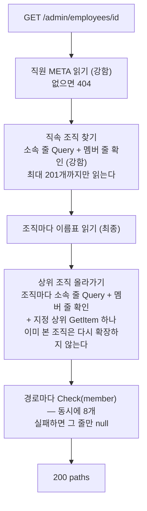
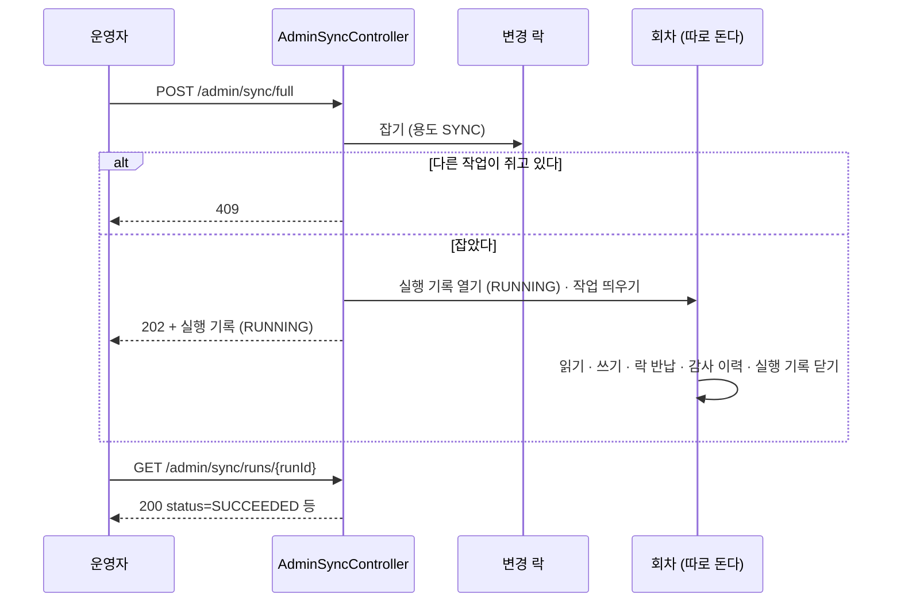

# 관리 API

> 기준 커밋: 79bb08a (lockless-noop-assignment, main 에 머지됨). 코드가 바뀌면 이 문서도 함께 고친다.
> 읽기 전에: [개요](01-개요.md), [용어집](02-용어집.md), [데이터 모델](04-데이터-모델.md)

[관리 API](02-용어집.md#관리-api)는 `/admin/**` 아래의 HTTP 엔드포인트다. 두 앱(app-ldap 8081, app-scim 8082)이 같은 코드를 일부 나눠 쓴다.

- **조회**(직원·조직·감사 이력·[정확 조회](02-용어집.md#정확-조회))는 `admin-api` 모듈이 맡는다. `AdminQueryController`, `AuditHistoryController`, `DirectoryLookupController`(`dev.starryeye.organization.admin`)가 두 앱에 모두 들어간다. 읽기 전용이다.
- **작업 트리거와 실행 기록**(`/admin/sync/**`)은 앱마다 따로다. `AdminSyncController`(app-ldap 은 `dev.starryeye.organization.ldap.app`, app-scim 은 `dev.starryeye.organization.scim.app`)가 [재적재](02-용어집.md#재적재)·동기화를 걸고 [실행 기록](02-용어집.md#실행-기록)을 보여 준다.
- **조직 계층 지정**(`PUT`·`DELETE /admin/organizations/{orgCode}/parent`)은 app-scim 에만 있다. `OrganizationHierarchyController`(`dev.starryeye.organization.scim.app`)가 조직의 [지정 연결](02-용어집.md#지정-연결)을 두고 없앤다. 이 API 에서 조직도를 바꾸는 유일한 경로다([4.4](#44-조직-계층-지정-app-scim)).

쓰는 사람은 둘이다. 운영자는 작업을 걸고 결과·직원·조직·감사 이력을 본다(SCIM 배포의 운영자는 조직의 지정 상위도 건다). [권한을 묻는 앱](02-용어집.md#권한을-묻는-앱)은 로그인한 사용자를 [employeeId](02-용어집.md#employeeid)로, IdP 의 조직 식별자를 [orgCode](02-용어집.md#orgcode)로 바꾸려고 정확 조회 둘을 부른다([8절](#8-로그인을-employeeid-로-바꾸기)).

> **모든 경로가 토큰을 요구한다.** 인가 서버(app-auth)가 발급한 bearer 토큰을 `Authorization: Bearer <토큰>` 으로 싣고, 경로마다 정해진 [범위](02-용어집.md#범위)가 토큰에 있어야 한다 — 조회는 `admin.read`, 걸기는 `admin.sync`, `force=true`·`mode=wipe` 는 `admin.destructive` 도, 정확 조회 둘은 `directory.lookup`(또는 `admin.read`), 조직의 지정 상위는 `admin.hierarchy`. 토큰이 없거나 틀리면 401, 범위가 없으면 403 이다([10절](#10-인증과-범위)). 이 문서의 `curl` 예는 `TOKEN` 에 토큰을 받아 두었다고 본다 — 받는 법은 [11 — 토큰 받기](11-운영.md#92-클라이언트와-토큰-받기).

## 1. 경로 한눈에

| 경로 | 앱 | 하는 일 | 범위 | 성공 | 실패 |
|---|---|---|---|---|---|
| `GET /admin/employees?userName=` `?displayName=` `?externalId=` | 둘 다 | 직원 검색([3.1](#31-검색)) | `admin.read` | 200 한 쪽 | 400 |
| `GET /admin/employees/lookup?userName=` 또는 `?externalId=` | 둘 다 | 직원 정확 조회 — 한 명이어야 200([8.1](#81-직원-정확-조회)) | `directory.lookup` 또는 `admin.read` | 200 한 명 | 400, 404, 409 |
| `GET /admin/employees/{employeeId}` | 둘 다 | 직원 상세 — 소속·상위 조직과 각 줄의 실제 판정([3.2](#32-상세)) | `admin.read` | 200 | 404 |
| `GET /admin/employees/{employeeId}/history` | 둘 다 | 직원의 감사 이력([5절](#5-감사-이력-조회)) | `admin.read` | 200 한 쪽 | 400 |
| `GET /admin/organizations?displayName=` `?externalId=` | 둘 다 | 조직 검색([4.1](#41-검색)) | `admin.read` | 200 한 쪽 | 400 |
| `GET /admin/organizations/lookup?externalId=` | 둘 다 | 조직 정확 조회 — 하나여야 200([8.2](#82-조직-정확-조회)) | `directory.lookup` 또는 `admin.read` | 200 하나 | 400, 404, 409 |
| `GET /admin/organizations/{orgCode}` | 둘 다 | 조직 상세 — 지정 상위(`assignedParentOrgCode`), 상위 계층, 직속 하위 조직, 직속 직원 첫 쪽([4.2](#42-상세)) | `admin.read` | 200 | 404 |
| `GET /admin/organizations/{orgCode}/members` | 둘 다 | 조직의 직속 직원 멤버 목록([4.3](#43-멤버-목록)) | `admin.read` | 200 한 쪽 | 400, 404 |
| `GET /admin/organizations/{orgCode}/history` | 둘 다 | 조직의 감사 이력 | `admin.read` | 200 한 쪽 | 400 |
| `PUT /admin/organizations/{orgCode}/parent` 본문 `{"parentOrgCode": "<상위 orgCode>"}` | app-scim | 조직의 지정 상위를 둔다(이미 있으면 바꾼다)([4.4](#44-조직-계층-지정-app-scim)) | `admin.hierarchy` | 204 | 400, 404, 409, 503 |
| `DELETE /admin/organizations/{orgCode}/parent` | app-scim | 조직의 지정 상위를 없앤다 — 없었으면 아무것도 하지 않는다 | `admin.hierarchy` | 204 | 404, 503 |
| `POST /admin/sync/full[?force=true]` | app-ldap | 동기화를 건다([9.2](#92-app-ldap)) | `admin.sync`. `force=true` 는 `admin.destructive` 도 | 202 실행 기록 | 400, 403, 409 |
| `POST /admin/sync/rebuild[?force=true]` | app-ldap | 재적재를 건다 | 같다 | 202 실행 기록 | 400, 403, 409 |
| `POST /admin/sync/rebuild?mode=tuples\|wipe[&confirm=<테이블명>]` | app-scim | 재적재 또는 [초기화](02-용어집.md#초기화)를 건다([9.3](#93-app-scim)) | `admin.sync`. `mode=wipe` 는 `admin.destructive` 도 | 202 실행 기록 | 400, 403, 409 |
| `GET /admin/sync/runs[?limit=]` | 둘 다 | 최근 실행 기록 목록([9.4](#94-실행-기록-보기)) | `admin.read` | 200 배열 | 400 — `limit` 이 숫자가 아닐 때만(스프링의 파라미터 변환 실패, 코드에서 도출했다). 범위 밖 값은 거절하지 않고 1~100 으로 맞춘다([2절](#요청과-응답)) |
| `GET /admin/sync/runs/{runId}` | 둘 다 | 실행 기록 하나 | `admin.read` | 200 | 404 |

모든 경로가 토큰이 없거나 틀리면 401, 그 경로의 범위가 토큰에 없으면 403, 인가 서버의 키 목록을 받지 못하면 503 + `Retry-After: 10` 이다([10절](#10-인증과-범위)). 저장소의 일시 장애에는 503 + `Retry-After`, 그 밖의 예기치 않은 실패에는 500 으로 답한다([오류](#오류)). 표의 "실패" 칸은 이것들을 빼고 그 경로에 고유한 것만 적었다(`force=true`·`mode=wipe` 의 403 은 고유한 것이라 적었다).

`/admin/**` 아래에서 `GET`·`POST /admin/sync/**`·`PUT`/`DELETE /admin/organizations/*/parent` 가 아닌 요청(예: `POST /admin/employees`, `DELETE /admin/sync/runs/{runId}`)은 보안 규칙 밖이라 토큰이 있으면 403, 없으면 401 이다 — 컨트롤러에 닿지 않는다. `GET` 은 `admin.read` 가 있으면 규칙을 지나므로 없는 경로는 스프링의 404 다.

없는 것이 있다.

- 직원·조직을 고치거나 지우는 경로는 없다. 조직도는 디렉터리가 바꾼다. 하나가 예외다 — app-scim 의 지정 상위([4.4](#44-조직-계층-지정-app-scim))는 운영자가 둔다.
- 한 사람의 권한만 즉시 거두는 경로는 없다. 급하면 `POST /admin/sync/full`(app-ldap)을 건다.
- app-scim 에는 `full` 이 없다. SCIM 은 push 라 "전체를 다시 달라" 고 말할 상대가 없다.

## 2. 공통 규칙

### 요청과 응답

- 본문이 있는 요청은 지정 `PUT` 하나뿐이다(JSON `{"parentOrgCode": "…"}`, [4.4](#44-조직-계층-지정-app-scim)). 나머지는 본문 없는 `GET`·`POST`·`DELETE` 이고 입력은 경로와 쿼리 파라미터다.
- 응답은 JSON 이다. 시각(`Instant`)은 ISO-8601 UTC 문자열이다(예 `2026-10-25T04:00:00.015Z`, 소수 자릿수는 일정하지 않다). 값이 없는 칸은 `null` 로 나온다. 감사 이력 한 줄만 최상위의 `null` 칸을 빼고 낸다(`attributes` 안의 `before`·`after` 는 없는 값이 `null` 이다). 실행 기록의 `requestedBy` 도 없으면 칸을 뺀다.
- 검색·멤버 목록·감사 이력은 한 쪽(page)씩 준다.

  ```json
  { "items": [ ... ], "nextCursor": "..." }
  ```

  `nextCursor` 가 `null` 이면 마지막 쪽이다. 아니면 그 값을 다음 요청의 `cursor` 로 그대로 넘긴다. 마지막 쪽이 정확히 `limit` 줄로 끝나면 `items` 가 빈 쪽이 한 번 더 올 수 있다([6.3](#63-쪽과-빈-마지막-쪽)). 한 건만 찾는 `externalId` 검색은 늘 한 쪽으로 끝난다.
- `limit` 은 기본 20, 1 이상 100 이하다. 벗어나면 400 이다. **`/admin/sync/runs` 만 다르다** — 범위를 벗어난 `limit` 을 400 으로 거절하지 않고 1~100 으로 맞춘다(0 → 1, 1000 → 100).

### 오류

관리 API 의 오류는 **RFC 9457 problem details**(`application/problem+json`)다. 예외 처리기 `AdminExceptionHandler`(admin-api, `@RestControllerAdvice`)가 표지 애너테이션 `@AdminApi` 를 단 여섯 컨트롤러 — `AdminQueryController`, `AuditHistoryController`, `DirectoryLookupController`, 두 앱의 `AdminSyncController`, app-scim 의 `OrganizationHierarchyController` — 에만 걸린다. SCIM 라우터와 actuator 는 건드리지 않는다. 새 관리 컨트롤러를 더하면 `@AdminApi` 를 달아야 같은 오류 응답을 낸다.

본문의 칸은 `type`(`about:blank`), `title`(상태 문구, 예 `Conflict`), `status`, `detail`, `instance`(요청 경로 — 스프링이 채운다)다.

**보안 필터의 거절(401·403·키 목록 503)은 이 처리기를 거치지 않는다.** 요청이 컨트롤러에 닿기 전에 web-security 의 `AuthFailureResponses` 가 같은 모양의 problem details 를 직접 쓴다 — 칸은 `type`·`title`·`status`·`detail` 넷이고 `instance` 가 없다([10.2](#102-거절)). 컨트롤러가 내는 범위 403(`force=true`·`mode=wipe`)은 이 처리기를 거치므로 `instance` 가 있다.

```json
{
  "type": "about:blank",
  "title": "Conflict",
  "status": 409,
  "detail": "다른 동기화·재적재가 진행 중입니다",
  "instance": "/admin/sync/full"
}
```

판정은 아래 표의 **위에서부터**다. 처리기는 예외의 원인 사슬을 따라가며 본다(같은 예외를 두 번 보지 않는다).

| 상태 | 언제 | `detail` |
|---|---|---|
| 컨트롤러가 정한 상태(400·403·404·409, 지정 컨트롤러는 503 도) | 원인 사슬에 `ResponseStatusException` 이 있다 — 컨트롤러가 정한 오류(아래)와, 스프링의 입력 오류(`ServerWebInputException` — 형식이 틀린 파라미터). 두 앱의 `AdminSyncController` 는 락 경합을 409 로 감싸 여기로 온다. 지정 컨트롤러는 락 경합을 `RetryLaterStatusException`(`ResponseStatusException` 의 하위, 503 + `Retry-After`)으로 바꿔 던져 여기로 온다. 그 예외가 든 머리(`ResponseStatusException.getHeaders`)는 응답에 그대로 옮긴다 — 범위 403 의 `WWW-Authenticate` 가 그 예다 | 그 사유. 없으면 상태 문구 |
| 409 | 감싸지 않은 채 원인 사슬에 `LockUnavailableException` 이 있다 — 남이 [변경 락](02-용어집.md#변경-락)을 쥐었다 | 그 예외의 메시지 |
| 503 + `Retry-After`(초) | 분류기(`TemporaryFailureClassifier`, core `port`)가 [일시 장애](02-용어집.md#일시-장애)로 본다 — SCIM 과 같은 분류기다. DynamoDB 의 스로틀·5xx·클라이언트 오류(시간 한도 포함), OpenFGA 의 재시도 가능한 오류, I/O 실패 | `일시 장애 — 잠시 뒤 다시 시도한다`. 예외 문구는 WARN 로그로만 간다 |
| 500 | 그 밖 | `내부 오류` — 예외 문구(저장소·라이브러리 메시지)는 응답에 싣지 않고 ERROR 로그로만 간다 |

- **409 의 사유.** app-ldap 은 `다른 동기화·재적재가 진행 중입니다`, app-scim 은 쥔 쪽의 용도(`다른 작업이 변경 락을 쥐고 있습니다(WRITE)` 등)다. 지정 API 는 예외다 — 락 경합은 409 가 아니라 503 이고, 409 는 순환이 쓴다([4.4](#44-조직-계층-지정-app-scim)).
- **락 경합을 분류기보다 먼저 본다.** `LockUnavailableException` 은 일시 장애의 하위 타입이라 분류기가 503 으로 읽는다. 게다가 두 앱의 `AdminSyncController` 는 락 경합을 원인으로 품은 `ResponseStatusException(409)` 로 감싼다. 그래서 `ResponseStatusException` 이 자기 상태로 먼저 답하고, 감싸지 않은 락 경합도 분류기 앞에서 409 로 거른다.
- **`Retry-After`** 는 정수 초다. 1초보다 짧은 대기도 1 로 올린다. 대개 10초(`TemporaryFailureException.기본_대기`)다.
- **걸기 요청이 503 이나 500 이면 작업은 시작하지 않았다.** 락을 잡는 중의 DynamoDB 오류, 실행 기록을 열지 못한 경우(오류는 분류대로 503·500, 빈 응답은 `IllegalStateException` 이라 500)가 여기다 — 다시 걸어도 된다. 일시 장애로 분류되지 않는 락 저장소 오류도 500 이지만 마찬가지로 시작 전이다.

컨트롤러가 정한 400·403·404·409 는 이렇다.

| 상태 | 언제 |
|---|---|
| 400 | 지정 API(`PUT …/parent`)의 본문이 틀렸다 — `parentOrgCode 가 필요하다`. 순환을 판정하느라 펼친 조직이 1만 개를 넘었다(다시 보내도 같다). 검색 파라미터가 정확히 하나가 아니다. 정확 조회의 파라미터가 맞지 않다(직원은 `userName`·`externalId` 중 정확히 하나, 조직은 `externalId`). `limit` 이 범위 밖이거나 숫자가 아니다(`/admin/sync/runs` 의 `limit` 은 범위를 거절하지 않고 맞춘다). 커서가 깨졌거나 다른 검색의 것이다. `force` 가 불리언으로 읽히지 않는다(스프링은 `true`·`false` 말고도 `yes`·`on`·`1`, `no`·`off`·`0` 을 대소문자 없이 읽는다). app-ldap `rebuild` 에 `mode` 가 왔다. app-scim `rebuild` 의 `mode` 를 모른다, 또는 `wipe` 의 `confirm` 이 테이블명과 다르다 |
| 403 | `force=true`(app-ldap)·`mode=wipe`(app-scim)인데 토큰에 `admin.destructive` 가 없다 — `force=true은 admin.destructive 범위가 필요하다`, `mode=wipe은 admin.destructive 범위가 필요하다`. `WWW-Authenticate: Bearer error="insufficient_scope"` 가 붙는다([10.3](#103-위험한-요청--admindestructive)) |
| 404 | 지정 API 의 조직이 없다 — `조직이 없다: <orgCode>`, 상위 조직이 없다 — `상위 조직이 없다: <parentOrgCode>`. 직원·조직·실행 기록이 없다(상세, 멤버 목록, 실행 기록 하나). 정확 조회가 하나도 찾지 못했다 — `일치하는 직원이 없다`, `일치하는 조직이 없다`. **검색과 감사 이력은 404 가 아니다** — 빈 목록이다 |
| 409 | 락 경합(위, 지정 API 는 제외). 지정이 순환을 닫는다 — `<parentOrgCode> 를 <orgCode> 의 상위로 두면 순환이 된다`. 정확 조회가 여럿을 찾았다 — `<N>명이 일치한다 — externalId 로 찾는다`, `<N>개가 일치한다` |

### 일관성

읽기마다 일관성이 다르다([04 데이터 모델 — 읽기 일관성](04-데이터-모델.md#7-읽기-일관성)). 방금 쓴 것이 안 보이는 경우가 여기서 나온다.

| 경로 | 읽는 것 | 일관성 |
|---|---|---|
| 직원 검색 `userName`·`displayName`, 조직 검색 `displayName` | GSI1·GSI2 | 최종 |
| 직원·조직 검색 `externalId`, 정확 조회의 `externalId` | GSI3 로 후보를 찾고 본 테이블을 다시 읽어 확인 | 후보는 최종, 확인은 [강한 일관성](02-용어집.md#강한-일관성) |
| 직원 정확 조회 `userName` | GSI1(`ALL` 프로젝션)만 — 본 테이블을 다시 읽지 않는다 | 최종 |
| 직원 상세 | 직원 META, 소속 줄·멤버 줄 | 강함 |
| 직원·조직 상세의 상위 조직 이름 | 조직 META 한 줄(`findGroupSummary`) | 최종 |
| 조직 상세·멤버 목록 | 이름표, 멤버 줄, 직원 META | 강함 |
| 감사 이력, 실행 기록 | 각 파티션 Query | 최종 |

## 3. 직원

### 3.1 검색

`GET /admin/employees`

| 파라미터 | 뜻 |
|---|---|
| `userName` | [userName](02-용어집.md#username) 접두사 |
| `displayName` | [displayName](02-용어집.md#displayname) 접두사 |
| `externalId` | [externalId](02-용어집.md#externalid) 정확히 일치 |
| `cursor` | 이전 쪽의 `nextCursor`. 첫 쪽은 생략 |
| `limit` | 한 쪽 크기. 기본 20, 1~100 |

- 앞의 셋 가운데 **정확히 하나**만 준다. 없거나 둘 이상이면 400 이다. 비어 있거나 공백뿐인 값은 없는 것으로 센다.
- 빈 접두사는 전체 열거가 되므로 입구에서 막는다(400). 검색은 접두사만 된다. 부분일치·전문 검색은 없다.
- `externalId` 검색은 `cursor`·`limit` 을 쓰지 않는다. 다만 `limit` 의 범위는 먼저 검사하므로 `limit=0` 이면 400 이다.
- 일치하는 직원이 없어도 200 과 빈 `items` 다.

요청과 응답 예(쪽 크기 1):

```
GET /admin/employees?userName=gd.&limit=1
```

```json
{
  "items": [
    {
      "employeeId": "3f6c1d52-8a0e-4b7d-9c21-5e0f7a4d2b18",
      "userName": "gd.hong",
      "displayName": "홍길동",
      "active": true,
      "externalId": "uid=gd.hong,ou=people,dc=example,dc=com"
    }
  ],
  "nextCursor": "UjFOSk1TOVZVMFZTWDBsT1JFVll8VUVzOlZWTkZVaU16Wmpaak1XUTFNaTA0WVRCbExUUmlOMlF0T1dNeU1TMDFaVEJtTjJFMFpESmlNVGd8VTBzOlRVVlVRUXxSMU5KTVZCTDpWVk5GVWw5SlRrUkZXQXxSMU5KTVZOTDpaMlF1YUc5dVp3"
}
```

한 줄(`UserSummary`)은 `employeeId`, `userName`, `displayName`, `active`, `externalId` 다섯이다. 소속과 이메일은 담지 않는다 — 상세의 일이다. [externalId](02-용어집.md#externalid)는 LDAP 이면 서버가 준 절대 DN 이고, SCIM 이면 IdP 가 보낸 값이라 없을 수 있다(`null`). 검색마다 추가 읽기 없이 싣는다 — `userName` 검색은 GSI1 이 모든 속성을 싣고(`ALL`), `displayName` 검색은 GSI2 프로젝션에 `externalId` 가 들었고, `externalId` 검색은 본 테이블을 다시 읽은 값이다.

| 검색 | 읽는 인덱스 | 정렬 |
|---|---|---|
| `userName` | GSI1 파티션 `USER_INDEX` 에서 `begins_with(GSI1SK, 소문자 접두사)` | `userName` 을 소문자로 바꾼 값 순 |
| `displayName` | GSI2 파티션 `USER_INDEX` 에서 `begins_with(displayNameKey, 소문자 접두사)` | 표시명을 소문자로 바꾼 값 순. `displayName` 이 없는 직원은 이 인덱스에 없어 찾히지 않는다 |
| `externalId` | GSI3 `externalId = 값 AND begins_with(PK, "USER#")` → 본 테이블 META 를 다시 읽어 `externalId` 가 아직 같은 것만 | GSI3 정렬키(`PK`) 순, 곧 직원 id 순 |

### 3.2 상세

`GET /admin/employees/{employeeId}` — 직원 한 명과, 그가 속한 조직·그 상위 조직 전부, 각 조직마다 두 값을 나란히 준다.

- `shouldHaveAccess` — [현재상태](02-용어집.md#현재상태)가 요구하는 값.
- `openFgaCheck` — OpenFGA 에 실제로 `Check(user:<employeeId>, member, group:<orgCode>)` 를 물어 받은 판정.

둘이 다르면 [드리프트](02-용어집.md#드리프트)다. 이 API 는 감지만 하고 고치지 않는다([7절](#7-상세-조회의-읽기와-비용)).

```json
{
  "employeeId": "3f6c1d52-8a0e-4b7d-9c21-5e0f7a4d2b18",
  "userName": "gd.hong",
  "displayName": "홍길동",
  "name": {
    "formatted": null, "familyName": "홍", "givenName": "길동",
    "middleName": null, "honorificPrefix": null, "honorificSuffix": null
  },
  "email": "gd.hong@example.com",
  "active": true,
  "externalId": "uid=gd.hong,ou=people,dc=example,dc=com",
  "paths": [
    { "orgCode": "8e4a2c6f-3d1b-4a9e-b7c5-0f2d6e8a4b13", "displayName": "백엔드팀",
      "via": "direct", "shouldHaveAccess": true, "openFgaCheck": true, "cycle": false },
    { "orgCode": "5d0c7e2a-1b3f-4c8d-9e6a-2f4b8c1d7e90", "displayName": "개발본부",
      "via": "rollup", "shouldHaveAccess": true, "openFgaCheck": true, "cycle": false }
  ],
  "truncated": false
}
```

| 칸 | 뜻 |
|---|---|
| `employeeId`, `userName`, `displayName`, `email`, `active` | 현재상태의 값 그대로 |
| `externalId` | 이미 읽은 직원 META 의 값(추가 읽기 없음). LDAP 은 절대 DN, SCIM 은 IdP 가 보낸 값이고 없으면 `null` |
| `name` | 이름 여섯 칸(RFC 7643 `name`). 없는 칸은 `null`. LDAP 은 `givenName`·`sn` 등에서 읽는다 |
| `paths` | 소속 조직과 그 상위 조직 전부. 어느 조직에도 안 속하면 빈 배열(200 이다) |
| `paths[].via` | `direct` — 직원이 그 조직의 멤버로 직접 올라 있다. `rollup` — 하위 조직 연결을 따라 올라온 상위 조직. 연결은 IdP·LDAP 이 준 것이거나 운영자의 [지정 연결](02-용어집.md#지정-연결)이다 |
| `paths[].shouldHaveAccess` | 현재상태가 요구하는 값. 코드는 모든 줄에 직원의 `active` 를 넣는다 — 활성 직원은 소속과 그 상위 전부의 `member` 여야 하고, 비활성 직원은 어디도 아니어야 한다 |
| `paths[].openFgaCheck` | OpenFGA 의 판정. **Check 호출이 실패하면 `null`** 이다 — 거짓이 아니라 "모른다" 이고, 응답은 그래도 200 이다 |
| `paths[].cycle` | 상위 순회가 지금 밟고 있는 경로 위의 조직에 다시 닿으면 그 조직의 줄에 `true` 를 붙인다 |
| `truncated` | 경로가 200줄 상한(`AdminQueryUseCase.MAX_PATHS`)을 넘어 잘렸다 |

- `paths` 는 직속이 먼저, 상위가 그 뒤다(요청마다 순서가 흔들리지 않게 순서를 지키며 읽는다).
- 같은 상위 조직에 두 갈래로 닿거나, 직원이 조직과 그 상위에 함께 직속이어도 그 조직은 한 줄이다. 이것은 순환이 아니다.
- 직원이 없으면 404 다. 소속 줄이 가리키는 조직의 레코드가 없으면 그 줄은 건너뛰고 WARN 로그를 남긴다.

## 4. 조직

### 4.1 검색

`GET /admin/organizations` — `displayName`(접두사) 또는 `externalId`(정확히 일치) **중 정확히 하나**. 나머지 규칙은 [3.1](#31-검색)과 같다.

- `displayName`: GSI1 파티션 `GROUP_INDEX` 에서 `begins_with(GSI1SK, 소문자 접두사)`. 표시명이 없는 조직은 색인에 불변 id 로 올라 id 접두사로 찾아진다([04](04-데이터-모델.md#조직-meta)).
- `externalId`: GSI3 로 후보를 찾아 이름표를 다시 읽어 확인한다. LDAP 은 [externalId](02-용어집.md#externalid)가 절대 DN 이라 서버가 준 DN 을 `LdapName` 으로 다시 쓴 문자열과 정확히 같아야 한다.

한 줄(`GroupSummary`)은 `orgCode` 와 `displayName` 둘이다.

```json
{ "items": [ { "orgCode": "8e4a2c6f-3d1b-4a9e-b7c5-0f2d6e8a4b13", "displayName": "백엔드팀" } ],
  "nextCursor": null }
```

### 4.2 상세

`GET /admin/organizations/{orgCode}` — 조직 하나와 그 위·아래, 멤버 첫 쪽.

```json
{
  "orgCode": "8e4a2c6f-3d1b-4a9e-b7c5-0f2d6e8a4b13",
  "displayName": "백엔드팀",
  "externalId": "cn=backend,ou=groups,dc=example,dc=com",
  "assignedParentOrgCode": null,
  "ancestors": [ { "orgCode": "5d0c7e2a-1b3f-4c8d-9e6a-2f4b8c1d7e90", "displayName": "개발본부" } ],
  "childOrganizations": [],
  "members": {
    "items": [
      { "employeeId": "3f6c1d52-8a0e-4b7d-9c21-5e0f7a4d2b18", "displayName": "홍길동",
        "active": true, "openFgaCheck": true }
    ],
    "nextCursor": null
  }
}
```

| 칸 | 뜻 |
|---|---|
| `assignedParentOrgCode` | 운영자가 이 조직에 지정한 상위의 `orgCode`([4.4](#44-조직-계층-지정-app-scim)). 지정이 없으면 `null` — 칸은 늘 있다. LDAP 배포는 늘 `null` 이다 |
| `ancestors` | 상위 조직 전부 — IdP·LDAP 이 준 연결과 [지정 연결](02-용어집.md#지정-연결)의 합집합이고 같은 조직은 한 번이다. 최상위면 빈 배열 |
| `childOrganizations` | 직속 [하위 조직](02-용어집.md#하위-조직)만(1단) — 같은 합집합이다 |
| `members` | 직속 직원 멤버의 첫 쪽(20명). 다음 쪽은 `members.nextCursor` 를 `/members?cursor=` 에 넘겨 읽는다 — 같은 커서 범위다 |

- 조직 파티션 전체를 읽지 않는다. 이름표·하위 조직의 멤버 줄·지정 줄·멤버 첫 쪽만 읽으므로 멤버가 10만 명인 조직도 멤버는 쪽 크기만큼만 읽는다.
- 지정 연결이 실제로 롤업을 주는지는 이 응답이 아니라 직원 상세([3.2](#32-상세))의 `paths[].openFgaCheck` 가 말한다. 재적재가 순환 때문에 자른 지정 연결은 그 줄이 `shouldHaveAccess: true`·`openFgaCheck: false` 로 보인다.
- `ancestors`·`childOrganizations` 는 각각 200개 상한이 있다. 이 응답에는 `truncated` 칸이 없어, 넘으면 WARN 로그만 남기고 짧은 목록을 준다.
- 멤버 줄에는 `shouldHaveAccess` 가 없다. 직속 멤버로 이미 걸러진 목록이라 현재상태가 요구하는 값이 곧 `active` 이기 때문이다.

### 4.3 멤버 목록

`GET /admin/organizations/{orgCode}/members?cursor=&limit=` — 조직의 **직속 직원 멤버**만 직원 id 순으로 한 쪽씩 준다. 하위 조직 멤버는 포함하지 않는다. 상위 조직이라고 하위 조직의 직원이 나오지 않는다.

한 줄(`OrgMember`)은 `employeeId`, `displayName`, `active`, `openFgaCheck` 다. `active` 와 `openFgaCheck` 가 다르면 드리프트다(`openFgaCheck` 가 `null` 이면 Check 실패).

- 조직이 없으면 404 다. 커서가 이 조직의 직원 멤버 키가 아니면 400 이다.
- 멤버 줄은 직원 id 만 갖는다. 이름·`active` 는 직원 META 를 한 건씩 읽어 채운다. **멤버 줄은 있는데 직원 레코드가 없으면 그 줄을 건너뛴다**(WARN 로그) — 쪽이 `limit` 보다 짧은데 `nextCursor` 가 있을 수 있다.
- 쪽 하나가 최대 100명이면 직원 읽기 100번과 Check 100번이다([7.3](#73-비용)).

### 4.4 조직 계층 지정 (app-scim)

Entra·Okta 로 붙인 SCIM 배포는 IdP 가 조직을 평평하게만 보내 `child` 튜플이 없다 — 문서대로라면 하위 조직의 직원이 상위 조직의 `member` 가 아니다([06 — 조직 계층은 지정으로](06-SCIM.md#34-조직-계층은-지정으로), [13 — 2.2](13-한계와-알려진-문제.md#22-scim-배포의-조직-계층은-운영자가-지정한다)). 운영자가 조직마다 상위 조직 하나를 정해 계층을 채운다. 그 연결이 [지정 연결](02-용어집.md#지정-연결)이다. 두 경로 모두 `admin.hierarchy` 범위가 필요하다. app-ldap 에는 경로가 없어 범위가 있어도 404 다 — 배포 하나엔 커넥터 하나라 LDAP 의 계층은 디렉터리가 준다.

| 요청 | 결과 |
|---|---|
| `PUT /admin/organizations/{orgCode}/parent` 본문 `{"parentOrgCode": "P"}` | 204. 지정 상위를 P 로 둔다. 이미 다른 상위가 있으면 바꾼다 — 옛 연결 지우기와 새 연결 쓰기가 한 요청이라 중간 상태가 없다 |
| 같은 P 로 다시 PUT | 204. 지정은 그대로고 바뀐 것이 없으면 이력도 없다. 줄이 OpenFGA 에 있으면 [지정의 앞 확인](02-용어집.md#지정의-앞-확인)이 락 없이 끝낸다. 줄이 없으면(어긋남) 락 안에서 쓴다 |
| `DELETE /admin/organizations/{orgCode}/parent` | 204. 지정이 없었으면 아무것도 하지 않고 204 다 — 앞 확인이 락 없이 끝낸다 |
| 본문이 없거나 `parentOrgCode` 가 문자열이 아니거나 공백뿐이다 | 400 `parentOrgCode 가 필요하다` |
| `orgCode` 의 조직이 없다(PUT·DELETE) | 404 `조직이 없다: <orgCode>` |
| `parentOrgCode` 의 조직이 없다 | 404 `상위 조직이 없다: <parentOrgCode>` |
| 순환이다 — P 가 그 조직 자신이거나 그 조직의 하위다. 같은 P 의 지정이 이미 있어도 그 연결이 보류 중이면 같다 | 409 `<parentOrgCode> 를 <orgCode> 의 상위로 두면 순환이 된다`. 아무것도 바꾸지 않는다 |
| 순환을 판정하느라 펼친 조직이 1만 개를 넘었다 | 400 — 다시 보내도 같다 |
| 락을 제때 못 잡았다, 리스를 잃었다, OpenFGA·DynamoDB 가 일시 실패했다, 튜플 일부만 반영됐다 | 503 + `Retry-After`. 일부만 반영됐으면 지정을 저장하지 않고, 503 을 내기 전에 그 요청이 쓴 새 연결 줄을 지운다. 같은 요청을 다시 보내면 남은 줄만 반영한다 |
| 토큰 없음 / `admin.hierarchy` 없음 | 401 / 403([10절](#10-인증과-범위)) |

오류 본문은 이 API 의 다른 오류처럼 problem details 다. 503 의 `detail` 은 락 경합이면 쥔 쪽을 가리키는 사유(`다른 작업이 변경 락을 쥐고 있습니다(WRITE)` 등), 일부 반영이면 `일부 튜플 적용에 실패했다 — 잠시 뒤 다시 보낸다: <orgCode>`, 그 밖의 일시 장애는 `일시 장애 — 잠시 뒤 다시 시도한다` 다. `Retry-After` 는 SCIM 쓰기와 같은 값이다 — 쥔 쪽이 다른 SCIM 쓰기·지정 요청이면 2초, 재적재·동기화면 60초, 그 밖은 10초. **503 이면 같은 요청을 성공할 때까지 다시 보낸다** — 503 은 지정을 저장하지 않았다는 뜻이지 장부가 그대로라는 뜻이 아니다.

- **옛 연결이 지워졌을 수 있다 — 권한이 빠진 쪽이다.** 옛 연결 지우기는 성공하고 새 연결 쓰기가 실패하면, 저장된 지정은 옛 값인데 장부에 옛 연결이 없다. 되살리지는 않는다. 같은 요청을 다시 보내면 새 연결을 쓰고 지정을 저장한다. 다른 값을 걸거나 `DELETE` 해도 그 값으로 맞는다.
- **다른 값을 걸어도 줄이 남지 않는다.** 일부만 반영돼 503 을 낼 때는 그 전에 그 요청이 쓴(또는 결과를 모르는) 새 연결 줄을 "없으면 무시" 로 지운다 — 저장된 옛 지정이 요구하지 않는 [원천 없는 줄](02-용어집.md#원천-없는-줄)이라, 두면 다른 값을 건 뒤 지울 후보에 들지 않는다. 옛 연결 지우기의 결과를 모르는 줄은 저장된 옛 지정이 요구하므로 지우지 않는다. 같은 상위로 다시 건 요청은 지울 줄이 없다.
- **되지우지 못했으면 `scim.writes.unsourced` 가 오른다.** 되지우기가 실패했거나, 줄을 쓴 뒤 저장에서 실패하거나 리스를 잃어 지우는 자리에 닿지 못한 경우다. WARN 이 하위 조직의 id 를 남긴다([11 — app-scim 지표](11-운영.md#33-app-scim)). 이때 다른 값을 걸면 그 줄은 남는다.
- 끝내 안 되면 `mode=tuples` 로 장부를 저장된 지정에 맞춘다([12 — 5.7](12-장애와-복구.md#57-지정-요청이-거절되거나-503-이다)).

**락 경합이 409 가 아니라 503 인 까닭.** `POST /admin/sync/**` 는 락 경합을 409 로 낸다 — 작업을 시작하는 요청이라 "이미 다른 작업이 돈다" 는 뜻이다. 지정은 SCIM 쓰기와 같은 락·Check 기준선·diff·이력을 거치는 **쓰기 요청**이고, 거기서 락 예외는 대기 초과·리스 상실까지 묶은 "잠시 뒤 다시" 다. 409 는 순환(영구 거절)이 쓴다 — 락 경합까지 409 면 스크립트가 고쳐야 할 요청과 다시 보낼 요청을 가르지 못한다. 규칙은 하나다: **쓰기 요청은 503, 작업 시작은 409.** 컨트롤러가 락 예외를 `RetryLaterStatusException` 으로 바꿔 던지는 까닭도 이것이다 — 처리기는 감싸지 않은 락 경합을 409 로 거른다([오류](#오류)).

**무엇이 일어나나.** 요청 하나가 [SCIM 쓰기](02-용어집.md#scim-쓰기)와 같은 길을 간다(`IncrementalSyncUseCase.assignParent`·`clearParent`).

1. 변경 락(용도 `WRITE`)을 잡는다. 존재 확인·순환 판정·쓰기는 모두 락 안이라 사이에 다른 SCIM 쓰기가 끼지 않는다.
2. 대상 조직과 상위 조직의 이름표를 읽는다(없으면 404). 순환을 판정한다 — 새 `child` 줄이 순환을 닫으면 보류하지 않고 409 로 거절한다(IdP 가 보낸 연결은 보류한다).
3. 전·후 그림의 차이만 OpenFGA 에 쓴다. 지정을 바꾸면 옛 줄 지우기와 새 줄 쓰기가 같은 요청이다. IdP 가 보낸 멤버 줄이 같은 쌍을 받치고 있으면 줄은 남는다.
4. 줄을 모두 반영했을 때만 지정 줄(정본·역색인)을 저장하고 감사 이력에 남긴다([04 — 지정 줄](04-데이터-모델.md#지정-줄)). 반영에 실패가 있으면 저장하지 않고, 리스를 확인한 뒤 그 요청이 쓴(또는 결과를 모르는) 새 연결 줄을 지우고 503 이다. 지운 줄은 감사 이력에 회수로 남는다.
5. 지정을 옮기거나 없앴으면 같은 락 안에서 [보류 목록](02-용어집.md#보류-목록)을 다시 본다 — 그 지정이 막던 IdP 연결이 돌아올 수 있다.

**운영자가 쓰는 순서.**

1. 조직도의 원천(HRIS 내보내기 등)에서 (하위, 상위) 쌍을 얻는다. 이 서버는 원천을 읽지 않는다 — 조직도와 IdP 그룹을 짝짓는 것은 운영자의 몫이고, 짝이 틀리면 권한이 틀린다.
2. 각 조직의 `orgCode` 를 찾는다 — [정확 조회](#82-조직-정확-조회) `GET /admin/organizations/lookup?externalId=`(Entra 는 `objectId` 를 `externalId` 로 보낸다 — 매핑을 바꿨다면 그 값), 또는 검색 `GET /admin/organizations?displayName=`(Okta 는 조직에 `externalId` 를 보내지 않는다 — 접두사 검색이라 이름이 더 긴 조직도 함께 나오므로 이름이 정확히 같은 줄을 고른다). 둘 다 `admin.read` 로 부른다.
3. 조직마다 `PUT …/parent` 를 부른다. 뿌리 조직(상위가 없다)은 `DELETE …/parent` 로 지정이 없게 한다.
4. 멱등이라 매일 전체를 다시 걸어도 상태는 바뀐 것만 움직인다. 바뀐 것이 없는 요청은 [지정의 앞 확인](02-용어집.md#지정의-앞-확인)이 전역 쓰기 락 없이 끝낸다 — PUT 은 읽기 셋과 Check 하나, DELETE 는 읽기 둘이다. 빠진 줄이 있으면 락 안에서 고친다. 그래서 먼저 비교할 까닭이 없다. 다만 동시에 많이 보내지 말고 차례로(또는 작은 동시성으로) 보낸다([11 — 9.8](11-운영.md#98-조직-계층-지정-스크립트의-클라이언트), [설계](../superpowers/specs/2026-11-13-lockless-noop-assignment-design.md)). 반영되지 않는 지정(순환 등)은 409 로 드러난다. `mode=wipe` 뒤에는 IdP 재프로비저닝이 끝난 다음 `orgCode` 를 다시 찾아 건다([12 — 8.4](12-장애와-복구.md#84-scim-modewipe--post-adminsyncrebuildmodewipeconfirm테이블명)).

```bash
# 로컬 예 — org-chart(admin.read admin.hierarchy)로 토큰을 받는다. 운영은 운영 설정이 준 클라이언트와 https 주소다([11 — 9.8](11-운영.md#98-조직-계층-지정-스크립트의-클라이언트))
TOKEN=$(curl -s -u org-chart:org-chart-secret -d grant_type=client_credentials http://localhost:9000/oauth2/token | jq -r .access_token)
# 하위(팀)와 상위(본부)의 orgCode — IdP 가 externalId 를 보내면 정확 조회, 아니면 표시명 검색
TEAM=$(curl -s -H "Authorization: Bearer $TOKEN" 'localhost:8082/admin/organizations/lookup?externalId=<팀 그룹의 objectId>' | jq -r .orgCode)
DIV=$(curl -s -G -H "Authorization: Bearer $TOKEN" --data-urlencode 'displayName=개발본부' localhost:8082/admin/organizations | jq -r '.items[0].orgCode')
# 팀의 상위를 본부로 — 204
curl -i -X PUT -H "Authorization: Bearer $TOKEN" -H 'Content-Type: application/json' -d "{\"parentOrgCode\":\"$DIV\"}" "localhost:8082/admin/organizations/$TEAM/parent"
# 지정을 없앤다 — 204
curl -i -X DELETE -H "Authorization: Bearer $TOKEN" "localhost:8082/admin/organizations/$TEAM/parent"
```

- **스크립트 자체는 제공하지 않는다.** 원천이 회사마다 다르다. 일괄 지정(조직도 파일을 한 번에 바꾸기)과 지정 목록 API 도 없다 — 조직마다 PUT 이 멱등이라 반복으로 같은 결과이고, 무엇을 지정했는지는 조직 상세의 `assignedParentOrgCode`([4.2](#42-상세))가 보여 준다.
- **한 조직에 지정 상위는 하나다.** 조직도는 나무다. 상위를 여럿 두는 매트릭스 조직은 지정으로 못 하고, 표준대로 중첩 그룹을 보내는 SCIM 클라이언트로는 표현된다 — 둘은 섞인다([06 — 조직 계층은 지정으로](06-SCIM.md#34-조직-계층은-지정으로)).
- **이력.** 지정 요청은 변경 이력에 원인 `HIERARCHY_REQUEST`, 행위자 `client:<sub>` 로 남는다. 기록은 하위 조직의 이력에 간다 — 속성 `assignedParent`(`before`·`after` 는 상위의 `orgCode`, 없으면 `null`)가 남고 튜플 부여·회수도 함께 남는다. 바뀐 것이 없는 요청은 기록하지 않는다. 지정 요청은 `SyncRun` 도 남기지 않는다 — SCIM 쓰기와 같다([10 — 지정 요청](10-감사-이력.md#지정-요청)).
- **IdP 가 건드리지 못한다.** 지정은 SCIM `GET /Groups` 의 `members` 에 나오지 않고, IdP 의 PUT(멤버 전체 교체)·PATCH 가 바꾸거나 지우지 못한다. IdP 가 조직을 지우면 그 조직이 낀 지정은 함께 지워진다. `mode=wipe` 는 지정을 모두 지우고 `mode=tuples` 는 지정을 그대로 두고 튜플에 싣는다.

## 5. 감사 이력 조회

`GET /admin/employees/{employeeId}/history`, `GET /admin/organizations/{orgCode}/history` — 대상 하나의 [감사 이력](02-용어집.md#감사-이력)을 **최신순**으로 한 쪽씩 준다. `cursor`·`limit` 규칙은 위와 같다. 담기는 것과 빠질 수 있는 것은 [10 감사 이력](10-감사-이력.md)에 있다.

```json
{
  "items": [
    {
      "at": "2026-10-25T04:01:12.290Z",
      "cause": { "source": "LDAP", "kind": "SYNC", "id": "9a7c3e1f-5b2d-4c8e-a6f0-3d1b7e9c2a54", "actor": "system:scheduler" },
      "created": false,
      "deleted": false,
      "attributes": [ { "name": "displayName", "before": "홍길동", "after": "홍길동(개발)" } ],
      "joined": [ "8e4a2c6f-3d1b-4a9e-b7c5-0f2d6e8a4b13" ],
      "left": [],
      "granted": [ "user:3f6c1d52-8a0e-4b7d-9c21-5e0f7a4d2b18 direct_member group:8e4a2c6f-3d1b-4a9e-b7c5-0f2d6e8a4b13" ],
      "revoked": []
    }
  ],
  "nextCursor": null
}
```

- `cause.id` 는 [회차](02-용어집.md#회차)면 `GET /admin/sync/runs/{runId}` 의 `runId`, SCIM 요청이면 그 요청의 traceId 다. 로그에서 같은 traceId 로 찾는다([11 운영](11-운영.md#6-로그와-추적)).
- `cause.actor` 는 변경을 일으킨 [행위자](02-용어집.md#행위자)다 — `client:<sub>`(토큰으로 온 SCIM 요청·관리 API 회차), `system:scheduler`(정기 동기화), `system:archive`(아카이빙의 남은 회수 지우기), 찾지 못했으면 `system:unknown`. 행위자를 남기기 전에 쓴 옛 줄도 `system:unknown` 이다([10 — 원인](10-감사-이력.md#2-원인)).
- `granted`·`revoked` 는 튜플을 `user relation object` 한 줄(공백으로 이음)로 적는다. 저장 형식의 `|` 구분이 아니다.
- 조직 줄에만 `membersAdded`·`membersRemoved`(`{ "count": 숫자, "items": [ { "type": "USER" 또는 "GROUP", "id": "…" } ] }`)가 더 붙는다. 직원 줄에는 이 칸이 없다.
- 기록이 없는 아이디는 404 가 아니라 **빈 목록**이다. 지운 직원·조직의 이력도 보관 기간(`dynamodb.audit-retention-days`, 기본 30일) 동안은 보인다.
- 이 경로의 `nextCursor` 는 쪽이 `limit` 줄로 찼을 때만 준다(DynamoDB 의 이어 읽기 신호가 아니라 코드가 센다). 그래서 마지막 쪽이 정확히 `limit` 줄이면 뒤에 빈 쪽이 하나 온다.
- 한 줄은 조각 여럿으로 저장되어 있을 수 있다. 조각이 모자란 줄은 건너뛴다 — 빠질 수는 있어도 틀린 줄은 주지 않는다([04](04-데이터-모델.md#감사-이력-줄)). 큰 조직이 한 회차에 통째로 바뀐 줄은 응답 하나가 수 MB 일 수 있다.

## 6. 검색의 의미

### 6.1 접두사만, 대소문자 무시

- `begins_with` 뿐이다. 정렬키로는 부분일치가 되지 않는다(Scan 이나 검색엔진이 있어야 하고 이 서버는 두지 않았다). 예: `displayName=홍` 은 "홍" 으로 시작하는 이름을 찾는다.
- 조직 id(`orgCode`)의 접두사 검색은 없다. 정확한 id 를 알면 `/admin/organizations/{orgCode}` 로 바로 읽는다.
- `userName`·직원 `displayName`·조직 `displayName` 검색은 대소문자를 가리지 않는다. 색인의 정렬키가 소문자라(`Keys.indexKey` — `Locale.ROOT` 소문자) 접두사도 소문자로 바꿔 묻는다. 결과의 값은 저장한 그대로다(`displayName=KIM` 이 `Kim Chulsoo` 를 찾는다).
- `externalId` 는 대소문자를 가린다.
- 소문자로 바꾼 접두사가 정렬키 한도(1024바이트)를 넘으면 DynamoDB 를 부르지 않고 빈 쪽을 준다. 한도를 넘는 키의 아이템은 있을 수 없기 때문이다([04](04-데이터-모델.md#6-키-길이-한도)). 길이가 한도를 넘는 `userName` 은 색인에 앞부분만 올라가 이름 전체로는 정확히 찾히지 않는다.

### 6.2 최종 일관성

GSI 는 최종 일관성이다. 직원·조직을 방금 만들거나 이름을 바꿨다면 `userName`·`displayName` 검색에 잠깐 안 나오거나 이전 값이 나올 수 있다. `externalId` 검색은 GSI3 후보를 본 테이블로 다시 확인하므로 낡은 속성을 돌려주지는 않지만, 방금 만든 리소스가 후보에 아직 없으면 안 나온다(보통 1초 미만, [루트 README.md](../../README.md)). 상세·멤버 목록은 본 테이블을 강하게 읽으므로 방금 쓴 값을 본다.

### 6.3 쪽과 빈 마지막 쪽

검색과 멤버 목록은 DynamoDB Query 를 `limit` 으로 끊어 한 쪽을 만든다. DynamoDB 는 `limit` 에 닿아 멈추면 다음 위치(`LastEvaluatedKey`)를 주는데, 그 자리가 정확히 마지막 항목이어도 줄 수 없다. 그래서 `nextCursor` 가 있어도 다음 쪽이 비어 있을 수 있다. 호출하는 쪽은 `nextCursor` 가 `null` 이 될 때까지 따라가고, 빈 쪽을 오류로 보지 않는다.

### 6.4 커서의 형식과 검증

[커서](02-용어집.md#커서)는 불투명 문자열이다. 호출하는 쪽은 해석하지 않고 그대로 되돌려 보낸다. 모양은 다음과 같다(`Cursor`, `storage-dynamodb`).

```
커서 = base64url( base64url(범위) | base64url(키 이름):base64url(키 값) | … )
```

모두 패딩 없는 URL-safe base64 다. 위 3.1 의 예를 풀면 이렇다.

```
범위    GSI1/USER_INDEX
PK      USER#3f6c1d52-8a0e-4b7d-9c21-5e0f7a4d2b18
SK      META
GSI1PK  USER_INDEX
GSI1SK  gd.hong
```

- **범위**가 커서를 발급한 검색을 가린다 — 인덱스와 파티션을 함께 담는다. 직원 `userName` 검색은 `GSI1/USER_INDEX`, 직원 `displayName` 검색은 `GSI2/USER_INDEX`, 조직 검색은 `GSI1/GROUP_INDEX`, 멤버 목록은 `group-members/<orgCode>`, 감사 이력은 `AUDIT/<AUDIT 파티션키>` 다. 인덱스 이름만 담으면 GSI1 의 `USER_INDEX` 와 `GROUP_INDEX` 커서가 서로 통과하기 때문이다.
- 키 이름·값은 DynamoDB `LastEvaluatedKey` 의 문자열 키다. 검색은 본 테이블 키 `PK`·`SK` 와 인덱스 키 둘을 합쳐 넷, 멤버 목록·감사 이력은 `PK`·`SK` 둘이다.

다음은 모두 **400** 이다. DynamoDB 까지 가서 `ValidationException`(500)이 되지 않도록 앞에서 거른다.

| 경우 | 검사하는 곳 |
|---|---|
| base64 가 아니거나, `\|` 로 나눈 토큰이 둘 미만이거나, `이름:값` 이 아니다 | `Cursor.decode` |
| 범위가 이 검색과 다르다 | `Cursor.decode` |
| 검색: 키 집합이 정확히 넷이 아니다, 인덱스 파티션이 다르다, 인덱스 정렬키가 이번 접두사로 시작하지 않는다(검색어를 바꿔 다시 보낸 경우), `PK` 가 `USER#`/`GROUP#` 로 시작하지 않는다, `SK` 가 `META` 가 아니다, 키가 한도(정렬키 1024, 파티션키 2048바이트)를 넘는다 | `DynamoDbDirectorySearchRepository` |
| 멤버 목록: 키 집합이 `PK`·`SK` 둘이 아니다, `PK` 가 이 조직이 아니다, `SK` 가 `MEMBER#USER#` 로 시작하지 않는다, 한도를 넘는다 | 같은 클래스 |
| 감사 이력: 키 집합이 `PK`·`SK` 둘이 아니다, `PK` 가 이 대상이 아니다, `SK` 가 `#0000` 으로 끝나지 않는다, 한도를 넘는다 | `DynamoDbAuditLog` |

커서에 **서명하지 않고 암호화하지도 않는다.** 같은 범위 안의 다른 위치를 가리키도록 고친 커서는 그 위치부터 읽는다. 커서에는 원본 키(직원 id, 계정명 일부 등)가 들어 있어 받은 쪽이 풀어 볼 수 있다. 커서를 받는 쪽은 그 검색 결과도 받는 `admin.read` 의 호출자라 새로 드러나는 것은 없다. `Cursor` 의 주석은 "암호화는 인증 사이클에서 함께 다룬다" 고 적지만 인증 슬라이드는 커서를 바꾸지 않았다.

## 7. 상세 조회의 읽기와 비용

### 7.1 "현재상태 대 실제"

직원·조직 상세와 멤버 목록은 같은 질문에 답한다. "현재상태가 이 직원을 이 조직의 멤버라고 하는데, 장부(OpenFGA)도 그렇게 답하는가." 쓰기 경로의 버그, 일부 실패한 반영, 경합이 남긴 흔적은 현재상태와 장부를 갈라놓을 수 있다([드리프트](02-용어집.md#드리프트)). 이것을 알아채는 상시 장치는 app-scim 에만 있다 — 쓰기 경로의 지표(`scim.drift.detected`)와 하루 1회 아카이빙(`scim.archive.drift`). app-ldap 은 평소 장부를 읽지 않으므로 이 화면이 사람이 직접 보는 확인 수단이고, 다음 동기화·재적재가 장부를 다시 맞춘다.

- 현재상태 쪽 값(`shouldHaveAccess`, 멤버 줄의 `active`)은 DynamoDB 에서 읽는다. 장부 쪽 값(`openFgaCheck`)은 OpenFGA 에 `Check` 를 던져 받는다. 이 서버의 `Check` 는 `HIGHER_CONSISTENCY` 로 OpenFGA 의 캐시를 우회한다.
- 둘이 다르면 호출하는 쪽이 줄을 보고 판단한다. 이 API 는 아무것도 고치지 않는다. 고치는 길은 앱마다 다르다 — app-ldap 은 `POST /admin/sync/rebuild`(또는 다음 정각 동기화), app-scim 은 `POST /admin/sync/rebuild?mode=tuples`([07 재적재·초기화·아카이빙](07-재적재-초기화-아카이빙.md)). 조직도 자체가 틀렸다면 재적재로 고쳐지지 않는다. 현재상태를 진실로 보고 장부를 맞추기 때문이다.
- **일부 반영 중에는 현재상태가 회차 전 그대로다.** 삭제 가드가 걸려 [비활성 회수만 반영](02-용어집.md#비활성-회수만-반영)한 동안, 막힌 직원이 `active: true` 로 보이고 장부는 이미 거둔 상태다. 이때 `openFgaCheck` 가 실제를 보여 준다. 이 경우 `shouldHaveAccess: true` 와 `openFgaCheck: false` 가 갈리는 것은 고장이 아니라 보류 중인 상태다.

### 7.2 직원 상세가 하는 일



1. 직원 META 를 읽는다(`findUser`). 없으면 404.
2. 직원이 직접 속한 조직을 찾는다. 소속 줄을 읽고 조직 쪽 멤버 줄이 정말 있는지 확인한 것만 남긴다([소속 줄](02-용어집.md#소속-줄)). 201개까지만 읽고 200개를 넘으면 `truncated` 를 켠다. 상한을 읽기 개수에도 걸어, 소속이 아주 많은 직원 하나가 읽기를 무제한으로 만들지 못하게 한다.
3. 직속 조직마다 이름표(`orgCode`, `displayName`)를 읽는다. 레코드가 없으면 건너뛴다.
4. 위로 올라간다. 조직마다 "이 조직이 속한 조직"을 같은 방법으로 찾는다 — 소속 줄이 가리키는 상위(IdP·LDAP 이 준 연결)와 그 조직의 [지정 상위](02-용어집.md#지정-연결)(정본 GetItem 하나)의 합집합이고, 같은 쌍은 한 번이다. 너비 우선이고 반복으로 돈다(깊이만큼 스택을 쓰지 않는다).
   - 지금 밟는 경로 위의 조직에 다시 닿으면 순환이다 — 그 조직의 줄에 `cycle: true` 를 붙이고 더 올라가지 않는다.
   - 다른 갈래에서 이미 닿은 조직(다이아몬드)은 순환이 아니다 — 표시하지 않고 다시 확장하지 않는다.
   - 줄이 200개에 닿으면 멈추고 `truncated` 를 켠다.
5. 줄마다 `Check(user:<employeeId>, member, group:<orgCode>)` 를 던진다. 동시에 8개까지, 결과는 줄 순서를 지킨다. 한 줄의 `Check` 가 실패하면 그 줄만 `openFgaCheck: null` 로 두고 WARN 로그를 남긴다. 스트림 전체를 실패시키지 않는다.

### 7.3 비용

| 요청 | `Check` 호출 | DynamoDB 읽기 |
|---|---|---|
| 직원 상세 | 줄 수만큼, 최대 200번(동시 8) | 직원 1 + 도달한 조직마다 [소속 줄 Query 1 + 멤버 줄 확인 GetItem(소속 수만큼) + 지정 상위 GetItem 1] + 이름표 GetItem 1 |
| 조직 상세 | 멤버 첫 쪽 20명 → 20번 | 이름표 1 + 지정 상위 GetItem 1 + 상위 조직 올라가기(최대 200, 조직마다 지정 상위 GetItem 1 포함) + 직속 하위 조직 이름표(최대 200) + 지정 하위 찾기(역색인 Query 1 + 하위마다 정본 확인 GetItem 1, 상한까지) + 멤버 줄 Query 한 쪽 + 직원 META 20 |
| 멤버 목록 | `limit` 만큼, 최대 100번(동시 8) | 멤버 줄 Query 한 쪽 + 직원 META `limit` 건 |
| 검색 | 없음 | 인덱스 Query 한 쪽(`externalId` 는 후보마다 본 테이블 읽기) |

- 상세와 멤버 목록의 `Check` 는 한 줄에 한 번이다(`BatchCheck` 가 아니라 `Check`). 그래서 한 요청이 OpenFGA 를 많게는 수백 번 부른다. 계층 깊이가 보통 4~6단이라 정상 조직도에서는 한 자릿수에서 수십 번이다(코드 주석).
- 이 서버는 `Check` 에 별도 시간 제한을 두지 않는다. OpenFGA SDK 0.9.11 의 기본값 — 요청 10초, 연결 10초, 재시도 3번(최소 대기 100ms) — 을 따른다(SDK 의 `FgaConstants` 로 확인했다). OpenFGA 가 느리면 응답도 그만큼 느리다.
- 캐시를 두지 않는다. 무효화가 새 문제를 만들고, 두 앱이 각자 캐시하면 서로 다른 것을 본다는 이유다(`AdminQueryUseCase` 주석).
- **요청 하나가 읽기를 이만큼 증폭한다.** 상한(200·100)이 있는 것은 이 때문이다. 상한은 호출자를 믿어서가 아니라 호출자가 조종하는 읽기량을 묶으려는 것이다. 이 경로들은 `admin.read` 범위가 있어야 하지만, 그 범위를 가진 클라이언트가 얼마나 자주 부르는지는 제한하지 않는다([13 — 1.6](13-한계와-알려진-문제.md#16-요청-수-제한이-없다)). 권한을 묻는 앱에는 `admin.read` 대신 `directory.lookup` 을 준다 — 정확 조회 둘은 Check 를 부르지 않는다.
- `Check` 는 장부가 아직 준비되지 않았으면(시작 때 OpenFGA 가 닿지 않았던 경우) 준비 — 찾기·만들기·모델 등록 — 부터 한다. 읽기 요청이 장부를 만들 수 있다([04](04-데이터-모델.md#장부를-찾고-만드는-법)).

### 7.4 지표

상세와 멤버 목록은 응답을 만들면서 지표를 올린다(검색은 올리지 않는다). 이름과 경보는 [11 운영](11-운영.md#3-지표)에 있다.

| 지표 | 언제 오르나 |
|---|---|
| `authz_checks_total` | `Check` 결과 한 줄마다(성공·실패 모두). 실패율의 분모 |
| `authz_check_failed` | `openFgaCheck` 가 `null` 인 줄 |
| `authz_drift_detected` | `shouldHaveAccess`(멤버 줄은 `active`)와 `openFgaCheck` 가 다른 줄. 순환 줄은 뺀다 |
| `authz_cycle_divergence` | 차이가 나는데 그 줄에 `cycle: true` 가 붙은 줄 |

순환은 드리프트가 아니다. 저장된 계층에 순환이 있으면 `TupleMapper` 가 연결 하나를 일부러 버리므로 현재상태가 요구하는 값과 장부가 갈린다. 재적재는 같은 연결을 다시 버리므로 이 차이는 재적재로 사라지지 않는다. 그 줄을 `authz_drift_detected` 에 섞으면 재적재의 근거가 되어야 할 신호가 영영 0 으로 돌아오지 않아, 이름을 나눠 세었다. 다만 **`cycle` 은 순회가 되돌아온 조직의 한 줄에만 붙는다.** 같은 순환 때문에 갈린 다른 줄은 구별하지 못해 `authz_drift_detected` 에 들 수 있다(`AdminQueryControllerTest` 의 순환 시험이 이 모양이다 — 갈린 두 줄 가운데 한 줄만 `cycle`). SCIM 이면 버려진 연결은 [보류 목록](02-용어집.md#보류-목록)에 남는다.

## 8. 로그인을 employeeId 로 바꾸기

[권한을 묻는 앱](02-용어집.md#권한을-묻는-앱)은 `Check(user:<employeeId>, member, group:<orgCode>)` 로 묻는다. 로그인한 사용자를 `employeeId` 로, 조직을 `orgCode` 로 바꾸는 일은 앱의 몫이다 — 앱의 로그인과 이 서버의 직원을 자동으로 잇지 않는다. 그 바꾸기를 위해 [정확 조회](02-용어집.md#정확-조회) 둘이 있다(`DirectoryLookupController`(admin-api), `DirectoryLookupUseCase`(core `usecase`)). 결과는 셋뿐이다 — 하나면 200, 없으면 404, 여럿이면 409.

| 앱이 아는 값 | 호출 | 일치 |
|---|---|---|
| 계정명(로그인 이름) | `GET /admin/employees/lookup?userName=<값>` | 대소문자 무시, 전체가 같은 것 |
| IdP 의 사용자 id(SCIM 배포 — Okta 의 사용자 id, Entra 의 `objectId` 를 매핑했다면 그 값) | `GET /admin/employees/lookup?externalId=<값>` | 대소문자 구분, 전체가 같은 것 |
| 절대 DN(LDAP 배포) | `GET /admin/employees/lookup?externalId=<DN>` | 같다 — 서버가 `LdapName` 으로 다시 쓴 표기여야 한다([아래](#ldap-에서-externalid-를-쓸-때)) |
| 조직의 외부 식별자(IdP 가 보낸 조직 `externalId`, LDAP 은 조직의 DN) | `GET /admin/organizations/lookup?externalId=<값>` | 대소문자 구분, 전체가 같은 것 |

범위는 `directory.lookup` 또는 `admin.read` 다. 권한을 묻는 앱에는 `directory.lookup` 만 준다 — 이 범위로는 정확 조회 둘 말고 아무것도 부르지 못한다(검색·상세·이력은 `admin.read`). 로컬 개발 클라이언트 `asking-app` 이 이 범위다([11 — 클라이언트와 토큰 받기](11-운영.md#92-클라이언트와-토큰-받기)).

```bash
curl -G -H "Authorization: Bearer $TOKEN" 'http://localhost:8081/admin/employees/lookup' --data-urlencode 'userName=gd.hong'
curl -G -H "Authorization: Bearer $TOKEN" 'http://localhost:8082/admin/employees/lookup' --data-urlencode 'externalId=00u1abcd2EFGH3ijk4l5'
curl -G -H "Authorization: Bearer $TOKEN" 'http://localhost:8082/admin/organizations/lookup' --data-urlencode 'externalId=backend-team'
```

받은 `employeeId`·`orgCode` 로 OpenFGA 에 직접 묻는다. OpenFGA 가 사전 공유 키를 요구하면 앱도 자기 키를 실어야 한다([11 — OpenFGA 키를 켜는 순서](11-운영.md#95-openfga-키를-켜는-순서)).

### 8.1 직원 정확 조회

`GET /admin/employees/lookup` — `userName` 과 `externalId` 가운데 **정확히 하나**를 준다. 둘 다 주거나 둘 다 없으면 400 `userName·externalId 중 정확히 하나를 지정해야 한다` 다. 비었거나 공백뿐인 값은 없는 것으로 센다.

| 결과 | 응답 |
|---|---|
| 정확히 한 명 | 200, `UserSummary` — `employeeId`, `userName`, `displayName`, `active`, `externalId`(검색의 한 줄과 같은 모양, [3.1](#31-검색)) |
| 없음 | 404 `일치하는 직원이 없다` |
| 둘 이상 | 409 `<N>명이 일치한다 — externalId 로 찾는다`. 직원 목록은 싣지 않는다 — 이 길은 개인 정보를 훑는 길이 아니다 |

```json
{ "employeeId": "3f6c1d52-8a0e-4b7d-9c21-5e0f7a4d2b18", "userName": "gd.hong", "displayName": "홍길동",
  "active": true, "externalId": "uid=gd.hong,ou=people,dc=example,dc=com" }
```

```json
{ "type": "about:blank", "title": "Conflict", "status": 409,
  "detail": "2명이 일치한다 — externalId 로 찾는다", "instance": "/admin/employees/lookup" }
```

- **비활성 직원도 200 이다**(`active: false`). 앱이 `active` 를 본다. 비활성은 어느 조직의 `member` 도 아니므로 `Check` 도 거짓이다.
- **`userName` 길.** GSI1 의 직원 색인(`USER_INDEX`)에서 정렬키가 물은 값의 소문자와 같은 줄을 찾고(`DirectoryQueryRepository.findUsersByUserName`), 저장된 `userName` 을 소문자로 바꾼 값이 물은 값의 소문자와 같은 것만 센다 — 색인은 이름이 빈 직원을 id 로, 1024바이트를 넘는 이름을 잘라 올리므로 다른 직원이 후보에 오를 수 있기 때문이다. 소문자로 1024바이트를 넘는 값은 DynamoDB 를 부르지 않고 404 다. **본 테이블을 다시 읽지 않는다** — 응답은 GSI1 이 실은 값(`ALL` 프로젝션)이라 최종 일관성이다. 방금 바뀐 `active`·`displayName` 이 잠깐 이전 값일 수 있고, 방금 만든 직원은 잠깐 404 일 수 있으며, 방금 이름을 바꾼 직원은 색인이 따라오기 전까지 옛 이름으로도 찾혀 잠깐 409 가 날 수 있다.
- **`externalId` 길.** GSI3 로 후보 id 를 찾고(`findUserIdsByExternalId`) 본 테이블을 강한 일관성으로 다시 읽어 `externalId` 가 아직 같은 것만 센다. 낡은 속성을 돌려주지 않지만, 방금 만든 직원은 GSI3 에 아직 없어 잠깐 404 일 수 있다.
- **읽는 양.** 인덱스 Query 한 번과(`externalId` 길은 후보마다) 본 테이블 GetItem 몇 번이다. 요청마다 전원을 읽지 않고 `Check` 를 부르지 않는다.

### 8.2 조직 정확 조회

`GET /admin/organizations/lookup?externalId=<값>` — `externalId` 가 없거나 비면 400 `externalId 를 지정해야 한다` 다.

| 결과 | 응답 |
|---|---|
| 정확히 하나 | 200, `OrganizationLookup` — `orgCode`, `displayName`, `externalId` |
| 없음 | 404 `일치하는 조직이 없다` |
| 둘 이상 | 409 `<N>개가 일치한다` |

```json
{ "orgCode": "8e4a2c6f-3d1b-4a9e-b7c5-0f2d6e8a4b13", "displayName": "백엔드팀", "externalId": "backend-team" }
```

- GSI3 로 후보를 찾고(`findGroupIdsByExternalId`) 이름표를 강한 일관성으로 다시 읽어 `externalId` 가 같은 것만 센다(`findGroupHeader`). 조직 검색의 `externalId` 와 같은 길이다([4.1](#41-검색)).
- SCIM 은 조직 `externalId` 를 [표지판](02-용어집.md#표지판)으로 유일하게 지키고 LDAP 은 DN 이라 409 는 드물다. `externalId` 없이 만든 SCIM 조직은 이 길로 찾지 못한다.
- **SCIM 배포의 `orgCode` 는 서버가 발급한 UUID 다.** [초기화](02-용어집.md#초기화)(`mode=wipe`) 뒤 IdP 가 다시 프로비저닝하면 기본(`sync.id-from-external-id` 꺼짐)에서는 모든 `orgCode`·`employeeId` 가 새로 발급된다. 켜져 있으면 `externalId` 가 있던 직원·조직은 같은 id 를 다시 받는다. 앱이 저장해 둔 값은 이 조회로 다시 찾는다([12 — `mode=wipe`](12-장애와-복구.md#84-scim-modewipe--post-adminsyncrebuildmodewipeconfirm테이블명)). LDAP 배포의 `orgCode` 는 디렉터리의 불변 id 라 바뀌지 않는다.

### `userName` 으로 찾을 때 알아야 할 것

- **유일성은 배포마다 다르다.**
  - SCIM: `userName` 은 대소문자를 무시하고 유일하다. 표지판이 락 안에서 지키므로 겹치는 쓰기는 409 다. 그래서 정확 조회의 409 는 이름을 바꾼 직후 색인이 따라오기 전에만 날 수 있다. 다만 표지판이 생기기 전에 저장된 직원은 이 보호를 받지 못한다(루트 README.md — 그런 테이블은 비우고 IdP 에서 다시 프로비저닝한다).
  - LDAP: `userName` 은 `ldap.<전략>.user-login-attribute`(기본 `uid`)의 값 그대로다. **코드에 유일성 검사가 없다.** 디렉터리가 같은 값의 엔트리를 둘 허용하면(다른 OU 에 같은 `uid`) 정확 조회가 409 다 — 그때는 `externalId`(DN)로 찾는다. 로그인 속성이 없는 엔트리는 식별 값(UUID)이 `userName` 이 된다.
  - 직원의 `externalId` 는 SCIM 이든 LDAP 이든 겹침을 막지 않는다. 같은 값이면 정확 조회가 409 다.
- **검색과 다르다.** 직원 검색 `GET /admin/employees?userName=` 은 **접두사** 검색이라 `gd.hong` 이 `gd.hong2` 도 돌려주고, 0건·여러 건의 계약이 없다. 로그인 이름을 바꾸는 데는 정확 조회를 쓴다.

### LDAP 에서 `externalId` 를 쓸 때

직원의 `externalId`(DN)는 직원 검색·상세·정확 조회 응답의 `externalId` 칸에 나온다 — 이 서버가 `LdapName` 으로 다시 쓴 표기 그대로다. 앱이 DN 을 디렉터리에서 따로 알아 넣으면 그 표기와 정확히 맞아야 한다(공백·이스케이프·대소문자). 그래서 한 번 `userName` 으로 찾아 응답의 `externalId` 를 저장해 두고, 그 뒤로는 그 값으로 찾는 편이 안전하다.

## 9. 동기화 트리거

### 9.1 요청은 곧바로 답하고 작업은 따로 돈다

`POST /admin/sync/full`, `POST /admin/sync/rebuild` 는 [변경 락](02-용어집.md#변경-락)을 잡고 [실행 기록](02-용어집.md#실행-기록)을 `RUNNING` 으로 연 다음, 작업을 요청과 떼어 띄우고 **202 와 그 기록을 곧바로 준다.** 결과는 `GET /admin/sync/runs/{runId}` 로 본다. 앞단 프록시가 연결을 끊어도 작업은 멈추지 않는다.



- 락을 잡기 전에 두 가지를 본다(그림에는 없다). 보안 필터가 토큰과 `admin.sync` 범위를 보고(없으면 401·403), 컨트롤러가 `force=true`·`mode=wipe` 면 `admin.destructive` 를 본다(없으면 403, [10.3](#103-위험한-요청--admindestructive)). 어느 쪽에서 거절돼도 락도 실행 기록도 만들지 않는다.
- 락을 못 잡으면 곧바로 409 다. 기다리지 않는다. 락은 클러스터 전체에서 하나(앱마다 따로)라, 다른 인스턴스가 동기화·재적재를 하고 있어도 409 다. 운영자가 잠시 뒤 다시 건다.
- 락 저장소(DynamoDB)의 오류는 409 로 옮기지 않는다. 409 는 "락 조건이 깨졌다" 에만 쓴다. 일시 장애로 분류되면 503 + `Retry-After`, 아니면 500 이다([오류](#오류)). 락을 잡은 뒤 실행 기록을 열지 못해도 같다(락은 반납한다). 어느 쪽이든 작업은 시작하지 않았다.
- 202 의 본문은 실행 기록이 막 열린 모습이다: `status: "RUNNING"`, `finishedAt: null`, 세 집계는 0, `snapshotId`·`message` 는 `null`, `requestedBy` 는 건 클라이언트(`client:<sub>`).
- 완료 시각은 알 수 없다. 호출하는 쪽은 `status` 가 `RUNNING` 이 아니게 될 때까지 다시 읽는다. 작업에는 [기한](02-용어집.md#기한)(`sync.job-timeout`, 기본 30분)이 있어 넘기면 `FAILED` 로 닫힌다.
- 강제 종료된 회차는 기록이 `RUNNING` 으로 남았다가 [죽은 기록 닫기](02-용어집.md#죽은-기록-닫기)가 닫는다 — 다음에 락을 잡는 회차가 나이와 상관없이, 또는 동기화·재적재·아카이빙 어느 시작이든 시작한 지 기한 + 10분이 지난 것을. app-scim 은 다음 재적재나 다음 하루 창의 아카이빙이 닫는다([08 동시성과 작업](08-동시성과-작업.md#56-죽은-기록-닫기)).

### 9.2 app-ldap

| 요청 | 하는 일 | 트리거 | 락 용도 | 범위 |
|---|---|---|---|---|
| `POST /admin/sync/full` | LDAP 을 읽어 동기화한다([05 LDAP 동기화](05-LDAP-동기화.md)) | `MANUAL` | `SYNC` | `admin.sync` |
| `POST /admin/sync/full?force=true` | 같되 [삭제 가드](02-용어집.md#삭제-가드)를 건너뛴다. `ABORTED` 뒤 사람이 확인하고 넘기는 통로다 | `FORCED` | `SYNC` | `admin.sync` + `admin.destructive` |
| `POST /admin/sync/rebuild` | 재적재 — LDAP 을 다시 읽어 장부를 맞추고 현재상태를 교체한다 | `REBUILD` | `REBUILD` | `admin.sync` |
| `POST /admin/sync/rebuild?force=true` | 같되 삭제 가드를 건너뛴다 | `FORCED_REBUILD` | `REBUILD` | `admin.sync` + `admin.destructive` |

- `force` 는 스프링이 불리언으로 읽는다 — `true`·`false` 말고도 `yes`·`on`·`1`, `no`·`off`·`0` 을 대소문자 없이 받고, 그 밖의 값은 400 이다. `admin.destructive` 판정도 읽은 값으로 하므로 `force=yes` 도 `force=true` 와 같다. `force` 는 삭제 가드만 넘는다 — 사람 소속이 하나도 없는 디렉터리 그림은 가드보다 먼저 데이터 오류(`FAILED`)로 멈추고 `force` 로도 넘기지 못한다([05 LDAP 동기화](05-LDAP-동기화.md)).
- `force=true` 의 범위는 무엇보다 먼저 본다. `rebuild` 에 `mode` 와 `force=true` 를 함께 보내면 `admin.destructive` 가 없을 때 400 이 아니라 403 이다.
- 재적재는 모드가 하나다. `mode` 파라미터가 오면(빈 값이어도) 400 이다 — 옛 `mode=snapshot`·`mode=store` 를 합쳤다는 안내가 담긴다.
- 정기 동기화(`sync.cron`)도 같은 `FullSyncUseCase.start` 를 건다. 트리거는 `SCHEDULED`, 요청자는 `system:scheduler` 다.
- `full`·`rebuild` 의 완료는 `sync.*` 지표로도 남는다([11 운영](11-운영.md#3-지표)).

```
curl -X POST -H "Authorization: Bearer $TOKEN" 'http://localhost:8081/admin/sync/full'
```

```json
{
  "runId": "9a7c3e1f-5b2d-4c8e-a6f0-3d1b7e9c2a54",
  "source": "LDAP",
  "trigger": "MANUAL",
  "startedAt": "2026-10-25T04:00:00.015Z",
  "finishedAt": null,
  "status": "RUNNING",
  "writtenCount": 0,
  "deletedCount": 0,
  "failureCount": 0,
  "snapshotId": null,
  "message": null,
  "requestedBy": "client:ops"
}
```

### 9.3 app-scim

`POST /admin/sync/rebuild` — 파라미터는 둘이다.

| 파라미터 | 뜻 |
|---|---|
| `mode` | `tuples`(기본) 또는 `wipe`. 대소문자를 가리지 않는다. 모르는 값이면 400 |
| `confirm` | `wipe` 일 때만 쓴다. `dynamodb.table-name` 과 **정확히 같아야** 한다(대소문자 구분) |

| 요청 | 하는 일 | 트리거 | 범위 |
|---|---|---|---|
| `POST /admin/sync/rebuild` 또는 `?mode=tuples` | 현재상태가 요구하는 튜플을 다 쓰고 장부를 훑어 요구하지 않는 줄을 지운다. 조직도는 건드리지 않는다 — [지정 연결](02-용어집.md#지정-연결)도 그대로 두고 튜플에 싣는다 | `REBUILD` | `admin.sync` |
| `POST /admin/sync/rebuild?mode=wipe&confirm=<테이블명>` | 장부를 비운 뒤 조직도(지정 연결 포함)·표지판·보류 목록을 지운다. **되돌릴 수 없다** | `RESET` | `admin.sync` + `admin.destructive` |

- 판정 순서는 `mode` 해석(모르면 400) → `wipe` 면 `admin.destructive`(없으면 403 `mode=wipe은 admin.destructive 범위가 필요하다`) → `confirm`(없거나 다르면 400) → 락이다. 모드를 해석한 값으로 판정하므로 `mode=WIPE` 도 같은 길이다.
- `wipe` 에서 `confirm` 이 없거나 다르면 락을 잡기 전에 400 이다. 불리언 플래그 대신 테이블명을 적게 해, 관리자가 자기가 무엇을 지우는지 찾아보게 만든다. 테이블명은 비밀이 아니라 이것은 실수를 막는 장치다 — 막는 것은 `admin.destructive` 범위다.
- 실행 뒤에는 IdP 콘솔에서 전체 재프로비저닝을 걸어야 조직도가 돌아온다. 그 절차는 이 API 밖에 있다. `mode=wipe` 가 지정 연결을 지웠으므로 **재프로비저닝이 끝난 다음 지정을 다시 건다**([4.4](#44-조직-계층-지정-app-scim)). 자세한 것은 [07 재적재·초기화·아카이빙](07-재적재-초기화-아카이빙.md).
- 재적재가 도는 동안 SCIM 의 변경 요청은 503(`Retry-After: 60`)이다. 이 관리 API 의 조회는 그대로 통과한다([06 SCIM](06-SCIM.md)).
- 재적재끼리 겹치면 두 번째가 409 다.
- `confirm` 은 `tuples` 에서 무시한다.

```
curl -X POST -H "Authorization: Bearer $TOKEN" 'http://localhost:8082/admin/sync/rebuild?mode=tuples'
curl -X POST -H "Authorization: Bearer $TOKEN" 'http://localhost:8082/admin/sync/rebuild?mode=wipe&confirm=organization-scim'   # admin.destructive — 로컬은 ops-break-glass 의 토큰
```

### 9.4 실행 기록 보기

`GET /admin/sync/runs[?limit=20]` — 최근 [실행 기록](02-용어집.md#실행-기록)을 **배열**로 준다(쪽이 아니다). 새 것이 먼저다. `limit` 은 기본 20이고 1~100 으로 맞춘다.

`GET /admin/sync/runs/{runId}` — 하나. 없으면 404 다.

- 둘 다 이번 달과 지난달 파티션만 읽는다. 보관 기간(`dynamodb.syncrun-retention-days`, 기본 30일) 안이어도 그보다 앞선 달의 기록은 찾지 못한다. 404 는 "번호가 틀렸다" 거나 "너무 오래됐다" 다.
- 최종 일관성이다. 방금 닫힌 기록이 아직 `RUNNING` 으로 보일 수 있다.
- app-scim 의 목록에는 재적재·초기화와 하루 1회 [아카이빙](02-용어집.md#아카이빙)(`ARCHIVE`)이 모두 나온다. 아카이빙이 멈췄는지는 `trigger=ARCHIVE` 인 기록을 본다. SCIM 쓰기 요청은 [회차](02-용어집.md#회차)가 아니므로 기록이 없다.

실행 기록 한 건의 칸(`SyncRunResponse`)은 다음과 같다.

| 칸 | 뜻 |
|---|---|
| `runId` | UUID. 감사 이력의 `cause.id` 가 이 값이다 |
| `source` | `LDAP` 또는 `SCIM` |
| `trigger` | [트리거](02-용어집.md#트리거): `SCHEDULED`, `MANUAL`, `FORCED`, `REBUILD`, `FORCED_REBUILD`, `ARCHIVE`, `RESET` |
| `startedAt`, `finishedAt` | 시작·끝 시각. `RUNNING` 이면 `finishedAt` 은 `null` |
| `status` | [실행 상태](02-용어집.md#실행-상태): `RUNNING`, `SUCCEEDED`, `PARTIAL`, `ABORTED`, `FAILED` |
| `writtenCount`, `deletedCount`, `failureCount` | 쓴·지운·실패한 튜플 수. 전부 보류로 끝난 장부 맞추기도 이미 쓴 D 의 수를 남긴다. 아카이빙은 뜻이 다르다 — `writtenCount` 는 스냅샷에 담은 줄 수, `deletedCount`·`failureCount` 는 남은 회수 지우기가 지운·지우지 못한 줄 수다([07](07-재적재-초기화-아카이빙.md#실행-기록)) |
| `snapshotId` | 남긴 튜플 스냅샷 id. 없을 수 있다 |
| `message` | 사유·메모. 변경이 없으면 "변경 없음". 가드가 걸렸거나 실패했으면 그 사유. 차단기로 멈췄지만 현재상태를 디렉터리대로 교체한 회차는 끝에 ` — 현재상태는 디렉터리대로 교체했다` 가 붙는다. 감사 이력을 못 쓴 줄이 있으면 앞에 "감사 기록 N건 실패" 가 붙는다 |
| `requestedBy` | 이 회차를 건 [행위자](02-용어집.md#행위자). 관리 API 로 건 회차는 토큰의 `sub` 로 `client:<sub>`, 정기 동기화는 `system:scheduler`, SCIM 아카이빙은 `system:archive`. 행위자를 남기기 전에 쓴 옛 기록은 이 칸이 아예 없다(`null` 로도 나오지 않는다) |

완료된 기록의 예:

```json
{
  "runId": "9a7c3e1f-5b2d-4c8e-a6f0-3d1b7e9c2a54",
  "source": "LDAP",
  "trigger": "SCHEDULED",
  "startedAt": "2026-10-25T04:00:00.015Z",
  "finishedAt": "2026-10-25T04:01:12.480Z",
  "status": "SUCCEEDED",
  "writtenCount": 3,
  "deletedCount": 1,
  "failureCount": 0,
  "snapshotId": "20261025T040112301-LDAP",
  "message": null,
  "requestedBy": "system:scheduler"
}
```

## 10. 인증과 범위

`/admin/**` 의 모든 요청은 bearer 토큰을 실어야 한다(RFC 6750 — `Authorization: Bearer <토큰>`). 토큰은 인가 서버 app-auth 가 client credentials 로 발급한 JWT 이고, 두 앱이 [리소스 서버](02-용어집.md#리소스-서버)로서 그 자리에서 검증한다 — 서명(`spring.security.oauth2.resourceserver.jwt.jwk-set-uri` 의 [키 목록](02-용어집.md#키-목록)), 발급자(`issuer-uri` 와 토큰의 `iss`), 만료(`exp`). `aud` 는 보지 않는다. 기동 때 인가 서버에 묻지 않고, 키 목록은 첫 토큰을 볼 때 받는다. 같은 포트의 `/scim/v2/**`·actuator 도 같은 보안 체인을 탄다([06 — 인증](06-SCIM.md#25-인증), [11 — 헬스](11-운영.md#4-헬스)). 클라이언트 등록·토큰 받기·키·https 는 [11 — 인증 운영](11-운영.md#9-인증-운영)에 있다.

보안 체인은 web-security 모듈의 `ResourceServerSecurityConfig` 하나를 두 앱이 함께 쓴다. CSRF·세션·요청 저장·로그아웃 끝점을 두지 않는다 — bearer 토큰만 받는 API 라 거절한 요청도 서버에 아무것도 남기지 않는다.

### 10.1 범위

권한은 토큰의 `scope` 클레임에서 범위마다 `SCOPE_<범위>` 로 만든다(스프링 기본). 경로 규칙은 위에서부터 처음 맞는 것이다(`ResourceServerSecurityConfig.리소스_서버_체인`).

| 경로 | 범위 |
|---|---|
| `/scim/v2/**`(발견 포함) | `scim` |
| `GET /admin/employees/lookup`, `GET /admin/organizations/lookup` | `directory.lookup` 또는 `admin.read` |
| 그 밖의 `GET /admin/**` — 검색·상세·멤버 목록·이력·실행 기록 | `admin.read` |
| `POST /admin/sync/**` | `admin.sync`. `force=true`·`mode=wipe` 는 컨트롤러가 `admin.destructive` 를 더 본다([10.3](#103-위험한-요청--admindestructive)) |
| `PUT`·`DELETE /admin/organizations/*/parent` — 조직의 지정 상위(app-scim) | `admin.hierarchy` |
| `/actuator/health`, `/actuator/health/liveness`, `/actuator/health/readiness` | 없음 — 상태만. 세부는 `actuator` 가 있을 때만 |
| 그 밖의 `/actuator/**`(`info`·`metrics`·`prometheus`, 헬스 항목 하나) | `actuator` |
| 나머지 모든 경로·메서드 | 거절 — 토큰이 통과하면 403, 없으면 401 |

- 범위 하나가 다른 범위를 품지 않는다(`Scopes`, web-security). `admin.sync` 만 가진 토큰은 자기가 건 회차의 결과(`GET /admin/sync/runs/{runId}`)도 읽지 못한다 — 운영 도구에는 `admin.read admin.sync` 를 함께 준다(로컬 `ops`). `admin.destructive` 도 `admin.sync` 와 함께 있어야 쓸모가 있다(로컬 `ops-break-glass`).
- **`admin.hierarchy` 는 계층을 바꾸는 범위다.** 하위 조직 전체의 롤업 권한이 생기거나 사라지므로 읽기·동기화와 가른다. 지정할 조직의 `orgCode` 를 찾으려면 `admin.read` 도 필요하다 — 그래서 로컬 `org-chart` 는 `admin.read admin.hierarchy` 다([11 — 9.8](11-운영.md#98-조직-계층-지정-스크립트의-클라이언트)). app-ldap 에는 이 경로가 없어 범위가 있어도 404 다.
- 범위 이름은 정확히 일곱이다 — `scim`, `admin.read`, `admin.sync`, `admin.destructive`, `directory.lookup`, `actuator`, `admin.hierarchy`.

### 10.2 거절

보안 필터의 거절은 컨트롤러와 `AdminExceptionHandler` 를 거치지 않는다. web-security 의 `AuthFailureResponses` 가 그 표면의 오류 형식으로 직접 쓴다 — `/admin/**` 는 problem details(`application/problem+json`, 칸은 `type` `about:blank`·`title`·`status`·`detail`, `instance` 는 없다), `/scim/v2/**` 는 SCIM Error, 그 밖(actuator 등)은 본문이 없다. 토큰 내용과 검증 실패의 세부(만료 시각 등)는 머리·본문 어디에도 싣지 않는다 — 스프링 기본은 `error_description` 에 그것을 싣는데 그 기본을 쓰지 않는다.

| 경우 | 상태 | `WWW-Authenticate` | `detail` |
|---|---|---|---|
| 토큰 없음 | 401 | `Bearer` | `인증이 필요하다` |
| 토큰을 받아들이지 못함 — 서명이 다른 키, 발급자가 다름, 만료, 꼴이 틀림(JWE 꼴 포함) | 401 | `Bearer error="invalid_token"` | `인증이 필요하다` |
| 그 경로의 범위가 없음(규칙 밖의 경로 포함) | 403 | `Bearer error="insufficient_scope"` | `이 요청에 필요한 범위가 없다` |
| `force=true`·`mode=wipe` 에 `admin.destructive` 없음 — 컨트롤러가 본다 | 403 | `Bearer error="insufficient_scope"` | `force=true은 admin.destructive 범위가 필요하다`(`mode=wipe은 admin.destructive 범위가 필요하다`) |
| 인가 서버의 키 목록을 받지 못함 | 503 + `Retry-After: 10` | 없음 | `일시 장애 — 잠시 뒤 다시 시도한다` |

```http
HTTP/1.1 401 Unauthorized
WWW-Authenticate: Bearer
Content-Type: application/problem+json

{"type":"about:blank","title":"Unauthorized","status":401,"detail":"인증이 필요하다"}
```

```http
HTTP/1.1 403 Forbidden
WWW-Authenticate: Bearer error="insufficient_scope"
Content-Type: application/problem+json

{"type":"about:blank","title":"Forbidden","status":403,"detail":"force=true은 admin.destructive 범위가 필요하다","instance":"/admin/sync/full"}
```

- **401 과 503 을 가르는 규칙은 하나다.** 키 목록을 받는 자리(`KeySetClient`, web-security)에서 실패한 것 — 연결 실패(거절·DNS 포함)와 연결 2초 초과, 연결을 포함한 전체 5초 초과, 2xx 가 아닌 상태, 키 목록으로 해석되지 않는 본문 — 만 표지(`KeySetUnavailableException`)를 달고, 그 표지가 원인 사슬에 있을 때만 503 이다. 그 밖에 토큰을 읽다 난 실패는 무엇이든 401 이다. 예외의 종류로 가르지 않는 까닭: 스프링은 토큰을 읽다 난 예상 밖의 예외도 같은 종류로 내므로, 아무나 보낼 수 있는 이상한 토큰이 503 과 "장애" 경보를 꾸며 낼 수 있다.
- **키 목록 장애가 401 이 아니라 503 인 까닭.** 401 `invalid_token` 은 클라이언트에게 멀쩡한 토큰을 버리라는 뜻이다. client credentials 클라이언트는 인가 서버를 거듭 두드리고, IdP 는 거듭된 401 을 자격 문제로 읽어 프로비저닝을 격리할 수 있다. 503 + `Retry-After` 면 클라이언트가 스스로 다시 부른다 — 관리 API 의 일시 장애 규칙과 같다. 서버에는 WARN `키 목록을 받지 못해 503 으로 답한다: …` 가 남는다(스택과 토큰은 남기지 않는다).
- 키 목록은 받아 둔 것을 쓰고 받아 둔 목록에 없는 `kid` 의 토큰을 볼 때만 다시 받는다 — 간격도 횟수 제한도 없이 그 자리에서 다시 받는다(Spring Security 의 `ReactiveRemoteJWKSource`). 그래서 인가 서버가 내려가도 키 목록을 이미 받은 인스턴스는 발급된 토큰을 만료까지 받는다 — 새 토큰을 받지 못할 뿐이다. 키 목록에 닿지 않는 동안 503 은 키 목록을 아직 받지 못한 인스턴스(막 뜬 인스턴스)에 온 토큰, 그리고 **목록에 없는 `kid` 의 토큰이면 무엇이든** 난다 — 새 키의 토큰, 이미 새 목록을 받은 인스턴스에 온 옛 키의 토큰, 아무 `kid` 나 적은 꾸민 토큰. 요청마다 키 목록 요청이 많아야 5초 기다린 뒤다([12 — 인증과 키](12-장애와-복구.md#7-인증과-키), [13 — 1.6](13-한계와-알려진-문제.md#16-요청-수-제한이-없다)).

### 10.3 위험한 요청 — `admin.destructive`

삭제 가드를 건너뛰는 `force=true`(app-ldap `POST /admin/sync/full`·`/rebuild`)와 조직도의 유일한 사본을 지우는 `mode=wipe`(app-scim `POST /admin/sync/rebuild`)는 `admin.sync` 에 더해 `admin.destructive` 가 있어야 한다.

- **필터가 아니라 컨트롤러가 본다.** 컨트롤러가 스프링이 바꾼 값(`boolean force`, 해석한 `ScimRebuildMode`)으로 판정한 뒤 `Callers.요구한다`(web-security)를 부른다. 필터에서 쿼리 문자열을 따로 읽으면 스프링과 다르게 해석해(`force=yes`·`force=1`·`mode=WIPE`) 우회된다. 그래서 쿼리 모양으로 우회하지 못한다.
- **무엇보다 먼저 본다.** 실행 기록을 열거나 락을 잡기 전이고, `wipe` 의 `confirm` 확인보다도 앞이다. 거절되면 회차가 생기지 않는다.
- 403 은 `InsufficientScopeException`(web-security, `ResponseStatusException` 의 하위)이고 `AdminExceptionHandler` 가 problem details 로 바꾼다. 예외가 든 머리 `WWW-Authenticate: Bearer error="insufficient_scope"` 를 응답에 옮기므로 보안 필터의 403 과 같은 머리다.
- 로컬 개발 클라이언트 가운데 이 범위를 가진 것은 `ops-break-glass` 하나다.

### 10.4 행위자

토큰으로 온 요청은 토큰의 `sub`(app-auth 에서는 클라이언트 id)로 [행위자](02-용어집.md#행위자) `client:<sub>` 가 된다. 보안 체인의 인증 필터 뒤에 둔 `ActorWebFilter`(web-security)가 그 값을 요청의 Reactor Context 에 싣고, 회차의 실행 기록(`requestedBy`)과 감사 이력의 원인(`cause.actor`)에 남는다([10 감사 이력 — 원인](10-감사-이력.md#2-원인)). 토큰에 `sub` 가 없거나 비면 싣지 않는다 — 그러면 `system:unknown` 으로 남고 WARN 한 줄이 남는다. 운영자마다 클라이언트를 따로 주면 사람 단위로 남는다.

### 10.5 범위가 열어 주는 것

- `admin.read` 는 조직도를 열어 준다. 직원 이름·이메일·계정명, 소속, 감사 이력의 이전 값이 나간다. `displayName=가` 처럼 짧은 접두사로 쪽을 넘기며 전원을 열거할 수도 있다. 운영자에게만 준다. 권한을 묻는 앱에는 `directory.lookup` 을 준다 — 정확 조회는 한 명·하나만 돌려주고 여럿일 때 수만 센다.
- `admin.hierarchy` 는 조직도의 계층을 쓴다. 토큰이 새면 하위 조직 전체의 상위 조직 권한을 만들거나 지울 수 있다 — 그래서 이 범위는 지정 스크립트의 클라이언트에만 주고 `admin.sync`·`admin.destructive` 와 섞지 않는다. 누가 걸었는지는 이력의 `actor` 로 남는다.
- 읽기 한 번이 OpenFGA 를 수백 번까지 부를 수 있다([7.3](#73-비용)). 요청 수는 제한하지 않는다([13 — 1.6](13-한계와-알려진-문제.md#16-요청-수-제한이-없다)).
- 커서는 서명도 암호화도 하지 않는다([6.4](#64-커서의-형식과-검증)).
- 토큰 하나만 무효로 할 길은 없다 — 무효화는 서명 키 교체다([13 — 1.5](13-한계와-알려진-문제.md#15-토큰-하나만-무효로-할-수-없다)).

## 더 깊이

- 조회 API 와 `externalId` 조회: `docs/superpowers/specs/2026-10-04-immutable-identifiers-design.md` §5, 읽기 경로 비용: `2026-10-06-read-paths-design.md`
- 표시명 검색(GSI2)과 커서 검증: `docs/superpowers/specs/2026-10-08-audit-finish-design.md`
- 감사 이력 조회: `docs/superpowers/specs/2026-10-10-audit-log-design.md` §5
- 요청과 떼어 돌리기(202), 409: `docs/superpowers/specs/2026-09-29-rebuild-jobs-fixed-store-design.md` §4, `2026-09-30-cluster-jobs-baseline-design.md` §3
- 오류 응답(problem details·503·500), 직원 응답의 `externalId`: `docs/superpowers/specs/2026-10-27-ops-readiness-design.md` §10·§11
- 조직 계층 지정(요청·응답, 락 경합 503, 조회, 범위 `admin.hierarchy`): `docs/superpowers/specs/2026-11-04-scim-org-hierarchy-design.md` §3·§7·§8
- 지정 실패의 새 연결 되지우기: `docs/superpowers/specs/2026-11-11-unsourced-grants-design.md` §2 U3·U4
- 범위·401/403 본문·위험 요청·행위자·정확 조회 둘: `docs/superpowers/specs/2026-10-28-auth-design.md` §4·§5·§6(키 목록 장애 503 은 설계 뒤 구현 중 정했다 — 코드 `AuthFailureResponses`·`KeySetClient`). 정확 조회의 출발점인 외부 리뷰 N10: `docs/superpowers/specs/2026-10-19-outsider-review/0-종합.md`
