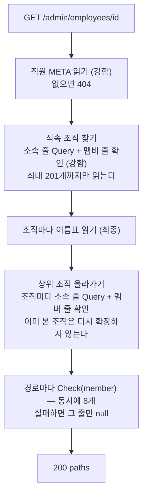
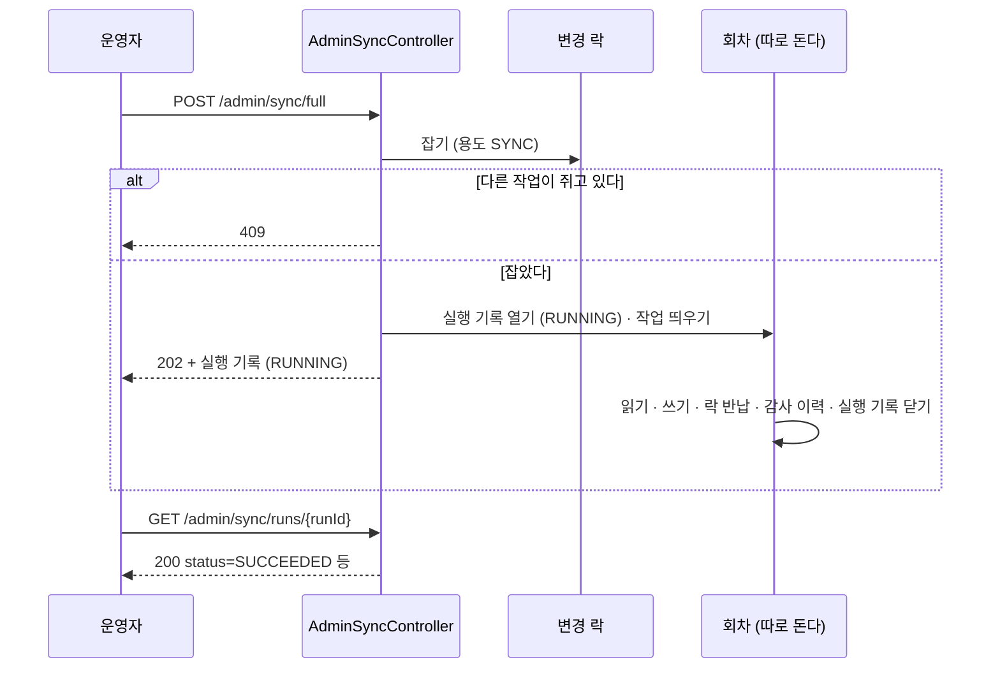

# 관리 API

> 기준 커밋: 5675b3c (ops-readiness, main 에 머지됨). 코드가 바뀌면 이 문서도 함께 고친다.
> 읽기 전에: [개요](01-개요.md), [용어집](02-용어집.md), [데이터 모델](04-데이터-모델.md)

[관리 API](02-용어집.md#관리-api)는 `/admin/**` 아래의 HTTP 엔드포인트다. 두 앱(app-ldap 8081, app-scim 8082)이 같은 코드를 일부 나눠 쓴다.

- **조회**(직원·조직·감사 이력)는 `admin-api` 모듈이 맡는다. `AdminQueryController`, `AuditHistoryController`(`dev.starryeye.organization.admin`)가 두 앱에 모두 들어간다. 읽기 전용이다.
- **작업 트리거와 실행 기록**(`/admin/sync/**`)은 앱마다 따로다. `AdminSyncController`(app-ldap 은 `dev.starryeye.organization.ldap.app`, app-scim 은 `dev.starryeye.organization.scim.app`)가 [재적재](02-용어집.md#재적재)·동기화를 걸고 [실행 기록](02-용어집.md#실행-기록)을 보여 준다.

쓰는 사람은 둘이다. 운영자는 작업을 걸고 결과·직원·조직·감사 이력을 본다. [권한을 묻는 앱](02-용어집.md#권한을-묻는-앱)은 로그인한 사용자를 [employeeId](02-용어집.md#employeeid)로 바꾸려고 직원 검색을 부른다([8절](#8-로그인을-employeeid-로-바꾸기)).

> **인증이 없다.** 이 문서의 모든 경로는 누구나 부를 수 있다. 응답에는 직원의 이름·이메일·계정명과 소속, 감사 이력의 이전 값이 그대로 담긴다. 실제 운영에 넣기 전에 반드시 앞단에서 막아야 한다. 인증은 마지막 슬라이드에서 한다 — [10절](#10-인증이-없다)과 [13 한계와 알려진 문제](13-한계와-알려진-문제.md).

## 1. 경로 한눈에

| 경로 | 앱 | 하는 일 | 성공 | 실패 |
|---|---|---|---|---|
| `GET /admin/employees?userName=` `?displayName=` `?externalId=` | 둘 다 | 직원 검색([3.1](#31-검색)) | 200 한 쪽 | 400 |
| `GET /admin/employees/{employeeId}` | 둘 다 | 직원 상세 — 소속·상위 조직과 각 줄의 실제 판정([3.2](#32-상세)) | 200 | 404 |
| `GET /admin/employees/{employeeId}/history` | 둘 다 | 직원의 감사 이력([5절](#5-감사-이력-조회)) | 200 한 쪽 | 400 |
| `GET /admin/organizations?displayName=` `?externalId=` | 둘 다 | 조직 검색([4.1](#41-검색)) | 200 한 쪽 | 400 |
| `GET /admin/organizations/{orgCode}` | 둘 다 | 조직 상세([4.2](#42-상세)) | 200 | 404 |
| `GET /admin/organizations/{orgCode}/members` | 둘 다 | 조직의 직속 직원 멤버 목록([4.3](#43-멤버-목록)) | 200 한 쪽 | 400, 404 |
| `GET /admin/organizations/{orgCode}/history` | 둘 다 | 조직의 감사 이력 | 200 한 쪽 | 400 |
| `POST /admin/sync/full[?force=true]` | app-ldap | 동기화를 건다([9.2](#92-app-ldap)) | 202 실행 기록 | 400, 409 |
| `POST /admin/sync/rebuild[?force=true]` | app-ldap | 재적재를 건다 | 202 실행 기록 | 400, 409 |
| `POST /admin/sync/rebuild?mode=tuples\|wipe[&confirm=<테이블명>]` | app-scim | 재적재 또는 [초기화](02-용어집.md#초기화)를 건다([9.3](#93-app-scim)) | 202 실행 기록 | 400, 409 |
| `GET /admin/sync/runs[?limit=]` | 둘 다 | 최근 실행 기록 목록([9.4](#94-실행-기록-보기)) | 200 배열 | 400 — `limit` 이 숫자가 아닐 때만(스프링의 파라미터 변환 실패, 코드에서 도출했다). 범위 밖 값은 거절하지 않고 1~100 으로 맞춘다([2절](#요청과-응답)) |
| `GET /admin/sync/runs/{runId}` | 둘 다 | 실행 기록 하나 | 200 | 404 |

모든 경로가 저장소의 일시 장애에는 503 + `Retry-After`, 그 밖의 예기치 않은 실패에는 500 으로 답한다([오류](#오류)). 표의 "실패" 칸은 그 둘을 빼고 적었다.

없는 것이 있다.

- 직원·조직을 고치거나 지우는 경로는 없다. 조직도는 디렉터리가 바꾼다.
- 한 사람의 권한만 즉시 거두는 경로는 없다. 급하면 `POST /admin/sync/full`(app-ldap)을 건다.
- app-scim 에는 `full` 이 없다. SCIM 은 push 라 "전체를 다시 달라" 고 말할 상대가 없다.
- 로그인 이름을 정확히 한 명으로 바꿔 주는 전용 경로는 아직 없다([8절](#8-로그인을-employeeid-로-바꾸기)).

## 2. 공통 규칙

### 요청과 응답

- 본문 없는 `GET`·`POST` 뿐이다. 모든 입력은 경로와 쿼리 파라미터다.
- 응답은 JSON 이다. 시각(`Instant`)은 ISO-8601 UTC 문자열이다(예 `2026-10-25T04:00:00.015Z`, 소수 자릿수는 일정하지 않다). 값이 없는 칸은 `null` 로 나온다. 감사 이력 한 줄만 최상위의 `null` 칸을 빼고 낸다(`attributes` 안의 `before`·`after` 는 없는 값이 `null` 이다).
- 검색·멤버 목록·감사 이력은 한 쪽(page)씩 준다.

  ```json
  { "items": [ ... ], "nextCursor": "..." }
  ```

  `nextCursor` 가 `null` 이면 마지막 쪽이다. 아니면 그 값을 다음 요청의 `cursor` 로 그대로 넘긴다. 마지막 쪽이 정확히 `limit` 줄로 끝나면 `items` 가 빈 쪽이 한 번 더 올 수 있다([6.3](#63-쪽과-빈-마지막-쪽)). 한 건만 찾는 `externalId` 검색은 늘 한 쪽으로 끝난다.
- `limit` 은 기본 20, 1 이상 100 이하다. 벗어나면 400 이다. **`/admin/sync/runs` 만 다르다** — 범위를 벗어난 `limit` 을 400 으로 거절하지 않고 1~100 으로 맞춘다(0 → 1, 1000 → 100).

### 오류

관리 API 의 오류는 **RFC 9457 problem details**(`application/problem+json`)다. 예외 처리기 `AdminExceptionHandler`(admin-api, `@RestControllerAdvice`)가 표지 애너테이션 `@AdminApi` 를 단 네 컨트롤러 — `AdminQueryController`, `AuditHistoryController`, 두 앱의 `AdminSyncController` — 에만 걸린다. SCIM 라우터와 actuator 는 건드리지 않는다. 새 관리 컨트롤러를 더하면 `@AdminApi` 를 달아야 같은 오류 응답을 낸다.

본문의 칸은 `type`(`about:blank`), `title`(상태 문구, 예 `Conflict`), `status`, `detail`, `instance`(요청 경로 — 스프링이 채운다)다.

```json
{
  "type": "about:blank",
  "title": "Conflict",
  "status": 409,
  "detail": "다른 동기화·재적재가 진행 중입니다",
  "instance": "/admin/sync/full"
}
```

판정은 아래 표의 **위에서부터**다. 처리기는 예외의 원인 사슬을 따라가며 본다(같은 예외를 두 번 보지 않는다).

| 상태 | 언제 | `detail` |
|---|---|---|
| 컨트롤러가 정한 상태(400·404·409) | 원인 사슬에 `ResponseStatusException` 이 있다 — 컨트롤러가 정한 오류(아래)와, 스프링의 입력 오류(`ServerWebInputException` — 형식이 틀린 파라미터). 두 앱의 `AdminSyncController` 는 락 경합을 409 로 감싸 여기로 온다 | 그 사유. 없으면 상태 문구 |
| 409 | 감싸지 않은 채 원인 사슬에 `LockUnavailableException` 이 있다 — 남이 [변경 락](02-용어집.md#변경-락)을 쥐었다 | 그 예외의 메시지 |
| 503 + `Retry-After`(초) | 분류기(`TemporaryFailureClassifier`, core `port`)가 [일시 장애](02-용어집.md#일시-장애)로 본다 — SCIM 과 같은 분류기다. DynamoDB 의 스로틀·5xx·클라이언트 오류(시간 한도 포함), OpenFGA 의 재시도 가능한 오류, I/O 실패 | `일시 장애 — 잠시 뒤 다시 시도한다`. 예외 문구는 WARN 로그로만 간다 |
| 500 | 그 밖 | `내부 오류` — 예외 문구는 ERROR 로그로만 간다(인증이 없는 엔드포인트다) |

- **409 의 사유.** app-ldap 은 `다른 동기화·재적재가 진행 중입니다`, app-scim 은 쥔 쪽의 용도(`다른 작업이 변경 락을 쥐고 있습니다(WRITE)` 등)다.
- **락 경합을 분류기보다 먼저 본다.** `LockUnavailableException` 은 일시 장애의 하위 타입이라 분류기가 503 으로 읽는다. 게다가 두 앱의 `AdminSyncController` 는 락 경합을 원인으로 품은 `ResponseStatusException(409)` 로 감싼다. 그래서 `ResponseStatusException` 이 자기 상태로 먼저 답하고, 감싸지 않은 락 경합도 분류기 앞에서 409 로 거른다.
- **`Retry-After`** 는 정수 초다. 1초보다 짧은 대기도 1 로 올린다. 대개 10초(`TemporaryFailureException.기본_대기`)다.
- **걸기 요청이 503 이나 500 이면 작업은 시작하지 않았다.** 락을 잡는 중의 DynamoDB 오류, 실행 기록을 열지 못한 경우(오류는 분류대로 503·500, 빈 응답은 `IllegalStateException` 이라 500)가 여기다 — 다시 걸어도 된다. 일시 장애로 분류되지 않는 락 저장소 오류도 500 이지만 마찬가지로 시작 전이다.

컨트롤러가 정한 400·404 는 이렇다.

| 상태 | 언제 |
|---|---|
| 400 | 검색 파라미터가 정확히 하나가 아니다. `limit` 이 범위 밖이거나 숫자가 아니다(`/admin/sync/runs` 의 `limit` 은 범위를 거절하지 않고 맞춘다). 커서가 깨졌거나 다른 검색의 것이다. `force` 가 불리언이 아니다. app-ldap `rebuild` 에 `mode` 가 왔다. app-scim `rebuild` 의 `mode` 를 모른다, 또는 `wipe` 의 `confirm` 이 테이블명과 다르다 |
| 404 | 직원·조직·실행 기록이 없다(상세, 멤버 목록, 실행 기록 하나). **검색과 감사 이력은 404 가 아니다** — 빈 목록이다 |

### 일관성

읽기마다 일관성이 다르다([04 데이터 모델 — 읽기 일관성](04-데이터-모델.md#7-읽기-일관성)). 방금 쓴 것이 안 보이는 경우가 여기서 나온다.

| 경로 | 읽는 것 | 일관성 |
|---|---|---|
| 직원 검색 `userName`·`displayName`, 조직 검색 `displayName` | GSI1·GSI2 | 최종 |
| 직원·조직 검색 `externalId` | GSI3 로 후보를 찾고 본 테이블을 다시 읽어 확인 | 후보는 최종, 확인은 [강한 일관성](02-용어집.md#강한-일관성) |
| 직원 상세 | 직원 META, 소속 줄·멤버 줄 | 강함 |
| 직원·조직 상세의 상위 조직 이름 | 조직 META 한 줄(`findGroupSummary`) | 최종 |
| 조직 상세·멤버 목록 | 이름표, 멤버 줄, 직원 META | 강함 |
| 감사 이력, 실행 기록 | 각 파티션 Query | 최종 |

## 3. 직원

### 3.1 검색

`GET /admin/employees`

| 파라미터 | 뜻 |
|---|---|
| `userName` | [userName](02-용어집.md#username) 접두사 |
| `displayName` | [displayName](02-용어집.md#displayname) 접두사 |
| `externalId` | [externalId](02-용어집.md#externalid) 정확히 일치 |
| `cursor` | 이전 쪽의 `nextCursor`. 첫 쪽은 생략 |
| `limit` | 한 쪽 크기. 기본 20, 1~100 |

- 앞의 셋 가운데 **정확히 하나**만 준다. 없거나 둘 이상이면 400 이다. 비어 있거나 공백뿐인 값은 없는 것으로 센다.
- 빈 접두사는 전체 열거가 되므로 입구에서 막는다(400). 검색은 접두사만 된다. 부분일치·전문 검색은 없다.
- `externalId` 검색은 `cursor`·`limit` 을 쓰지 않는다. 다만 `limit` 의 범위는 먼저 검사하므로 `limit=0` 이면 400 이다.
- 일치하는 직원이 없어도 200 과 빈 `items` 다.

요청과 응답 예(쪽 크기 1):

```
GET /admin/employees?userName=gd.&limit=1
```

```json
{
  "items": [
    {
      "employeeId": "3f6c1d52-8a0e-4b7d-9c21-5e0f7a4d2b18",
      "userName": "gd.hong",
      "displayName": "홍길동",
      "active": true,
      "externalId": "uid=gd.hong,ou=people,dc=example,dc=com"
    }
  ],
  "nextCursor": "UjFOSk1TOVZVMFZTWDBsT1JFVll8VUVzOlZWTkZVaU16Wmpaak1XUTFNaTA0WVRCbExUUmlOMlF0T1dNeU1TMDFaVEJtTjJFMFpESmlNVGd8VTBzOlRVVlVRUXxSMU5KTVZCTDpWVk5GVWw5SlRrUkZXQXxSMU5KTVZOTDpaMlF1YUc5dVp3"
}
```

한 줄(`UserSummary`)은 `employeeId`, `userName`, `displayName`, `active`, `externalId` 다섯이다. 소속과 이메일은 담지 않는다 — 상세의 일이다. [externalId](02-용어집.md#externalid)는 LDAP 이면 서버가 준 절대 DN 이고, SCIM 이면 IdP 가 보낸 값이라 없을 수 있다(`null`). 검색마다 추가 읽기 없이 싣는다 — `userName` 검색은 GSI1 이 모든 속성을 싣고(`ALL`), `displayName` 검색은 GSI2 프로젝션에 `externalId` 가 들었고, `externalId` 검색은 본 테이블을 다시 읽은 값이다.

| 검색 | 읽는 인덱스 | 정렬 |
|---|---|---|
| `userName` | GSI1 파티션 `USER_INDEX` 에서 `begins_with(GSI1SK, 소문자 접두사)` | `userName` 을 소문자로 바꾼 값 순 |
| `displayName` | GSI2 파티션 `USER_INDEX` 에서 `begins_with(displayNameKey, 소문자 접두사)` | 표시명을 소문자로 바꾼 값 순. `displayName` 이 없는 직원은 이 인덱스에 없어 찾히지 않는다 |
| `externalId` | GSI3 `externalId = 값 AND begins_with(PK, "USER#")` → 본 테이블 META 를 다시 읽어 `externalId` 가 아직 같은 것만 | GSI3 정렬키(`PK`) 순, 곧 직원 id 순 |

### 3.2 상세

`GET /admin/employees/{employeeId}` — 직원 한 명과, 그가 속한 조직·그 상위 조직 전부, 각 조직마다 두 값을 나란히 준다.

- `shouldHaveAccess` — [현재상태](02-용어집.md#현재상태)가 요구하는 값.
- `openFgaCheck` — OpenFGA 에 실제로 `Check(user:<employeeId>, member, group:<orgCode>)` 를 물어 받은 판정.

둘이 다르면 [드리프트](02-용어집.md#드리프트)다. 이 API 는 감지만 하고 고치지 않는다([7절](#7-상세-조회의-읽기와-비용)).

```json
{
  "employeeId": "3f6c1d52-8a0e-4b7d-9c21-5e0f7a4d2b18",
  "userName": "gd.hong",
  "displayName": "홍길동",
  "name": {
    "formatted": null, "familyName": "홍", "givenName": "길동",
    "middleName": null, "honorificPrefix": null, "honorificSuffix": null
  },
  "email": "gd.hong@example.com",
  "active": true,
  "externalId": "uid=gd.hong,ou=people,dc=example,dc=com",
  "paths": [
    { "orgCode": "8e4a2c6f-3d1b-4a9e-b7c5-0f2d6e8a4b13", "displayName": "백엔드팀",
      "via": "direct", "shouldHaveAccess": true, "openFgaCheck": true, "cycle": false },
    { "orgCode": "5d0c7e2a-1b3f-4c8d-9e6a-2f4b8c1d7e90", "displayName": "개발본부",
      "via": "rollup", "shouldHaveAccess": true, "openFgaCheck": true, "cycle": false }
  ],
  "truncated": false
}
```

| 칸 | 뜻 |
|---|---|
| `employeeId`, `userName`, `displayName`, `email`, `active` | 현재상태의 값 그대로 |
| `externalId` | 이미 읽은 직원 META 의 값(추가 읽기 없음). LDAP 은 절대 DN, SCIM 은 IdP 가 보낸 값이고 없으면 `null` |
| `name` | 이름 여섯 칸(RFC 7643 `name`). 없는 칸은 `null`. LDAP 은 `givenName`·`sn` 등에서 읽는다 |
| `paths` | 소속 조직과 그 상위 조직 전부. 어느 조직에도 안 속하면 빈 배열(200 이다) |
| `paths[].via` | `direct` — 직원이 그 조직의 멤버로 직접 올라 있다. `rollup` — 하위 조직을 따라 올라온 상위 조직 |
| `paths[].shouldHaveAccess` | 현재상태가 요구하는 값. 코드는 모든 줄에 직원의 `active` 를 넣는다 — 활성 직원은 소속과 그 상위 전부의 `member` 여야 하고, 비활성 직원은 어디도 아니어야 한다 |
| `paths[].openFgaCheck` | OpenFGA 의 판정. **Check 호출이 실패하면 `null`** 이다 — 거짓이 아니라 "모른다" 이고, 응답은 그래도 200 이다 |
| `paths[].cycle` | 상위 순회가 지금 밟고 있는 경로 위의 조직에 다시 닿으면 그 조직의 줄에 `true` 를 붙인다 |
| `truncated` | 경로가 200줄 상한(`AdminQueryUseCase.MAX_PATHS`)을 넘어 잘렸다 |

- `paths` 는 직속이 먼저, 상위가 그 뒤다(요청마다 순서가 흔들리지 않게 순서를 지키며 읽는다).
- 같은 상위 조직에 두 갈래로 닿거나, 직원이 조직과 그 상위에 함께 직속이어도 그 조직은 한 줄이다. 이것은 순환이 아니다.
- 직원이 없으면 404 다. 소속 줄이 가리키는 조직의 레코드가 없으면 그 줄은 건너뛰고 WARN 로그를 남긴다.

## 4. 조직

### 4.1 검색

`GET /admin/organizations` — `displayName`(접두사) 또는 `externalId`(정확히 일치) **중 정확히 하나**. 나머지 규칙은 [3.1](#31-검색)과 같다.

- `displayName`: GSI1 파티션 `GROUP_INDEX` 에서 `begins_with(GSI1SK, 소문자 접두사)`. 표시명이 없는 조직은 색인에 불변 id 로 올라 id 접두사로 찾아진다([04](04-데이터-모델.md#조직-meta)).
- `externalId`: GSI3 로 후보를 찾아 이름표를 다시 읽어 확인한다. LDAP 은 [externalId](02-용어집.md#externalid)가 절대 DN 이라 서버가 준 DN 을 `LdapName` 으로 다시 쓴 문자열과 정확히 같아야 한다.

한 줄(`GroupSummary`)은 `orgCode` 와 `displayName` 둘이다.

```json
{ "items": [ { "orgCode": "8e4a2c6f-3d1b-4a9e-b7c5-0f2d6e8a4b13", "displayName": "백엔드팀" } ],
  "nextCursor": null }
```

### 4.2 상세

`GET /admin/organizations/{orgCode}` — 조직 하나와 그 위·아래, 멤버 첫 쪽.

```json
{
  "orgCode": "8e4a2c6f-3d1b-4a9e-b7c5-0f2d6e8a4b13",
  "displayName": "백엔드팀",
  "externalId": "cn=backend,ou=groups,dc=example,dc=com",
  "ancestors": [ { "orgCode": "5d0c7e2a-1b3f-4c8d-9e6a-2f4b8c1d7e90", "displayName": "개발본부" } ],
  "childOrganizations": [],
  "members": {
    "items": [
      { "employeeId": "3f6c1d52-8a0e-4b7d-9c21-5e0f7a4d2b18", "displayName": "홍길동",
        "active": true, "openFgaCheck": true }
    ],
    "nextCursor": null
  }
}
```

| 칸 | 뜻 |
|---|---|
| `ancestors` | 상위 조직 전부. 최상위면 빈 배열 |
| `childOrganizations` | 직속 [하위 조직](02-용어집.md#하위-조직)만(1단) |
| `members` | 직속 직원 멤버의 첫 쪽(20명). 다음 쪽은 `members.nextCursor` 를 `/members?cursor=` 에 넘겨 읽는다 — 같은 커서 범위다 |

- 조직 파티션 전체를 읽지 않는다. 이름표·하위 조직의 멤버 줄·멤버 첫 쪽만 읽으므로 멤버가 10만 명인 조직도 멤버는 쪽 크기만큼만 읽는다.
- `ancestors`·`childOrganizations` 는 각각 200개 상한이 있다. 이 응답에는 `truncated` 칸이 없어, 넘으면 WARN 로그만 남기고 짧은 목록을 준다.
- 멤버 줄에는 `shouldHaveAccess` 가 없다. 직속 멤버로 이미 걸러진 목록이라 현재상태가 요구하는 값이 곧 `active` 이기 때문이다.

### 4.3 멤버 목록

`GET /admin/organizations/{orgCode}/members?cursor=&limit=` — 조직의 **직속 직원 멤버**만 직원 id 순으로 한 쪽씩 준다. 하위 조직 멤버는 포함하지 않는다. 상위 조직이라고 하위 조직의 직원이 나오지 않는다.

한 줄(`OrgMember`)은 `employeeId`, `displayName`, `active`, `openFgaCheck` 다. `active` 와 `openFgaCheck` 가 다르면 드리프트다(`openFgaCheck` 가 `null` 이면 Check 실패).

- 조직이 없으면 404 다. 커서가 이 조직의 직원 멤버 키가 아니면 400 이다.
- 멤버 줄은 직원 id 만 갖는다. 이름·`active` 는 직원 META 를 한 건씩 읽어 채운다. **멤버 줄은 있는데 직원 레코드가 없으면 그 줄을 건너뛴다**(WARN 로그) — 쪽이 `limit` 보다 짧은데 `nextCursor` 가 있을 수 있다.
- 쪽 하나가 최대 100명이면 직원 읽기 100번과 Check 100번이다([7.3](#73-비용)).

## 5. 감사 이력 조회

`GET /admin/employees/{employeeId}/history`, `GET /admin/organizations/{orgCode}/history` — 대상 하나의 [감사 이력](02-용어집.md#감사-이력)을 **최신순**으로 한 쪽씩 준다. `cursor`·`limit` 규칙은 위와 같다. 담기는 것과 빠질 수 있는 것은 [10 감사 이력](10-감사-이력.md)에 있다.

```json
{
  "items": [
    {
      "at": "2026-10-25T04:01:12.290Z",
      "cause": { "source": "LDAP", "kind": "SYNC", "id": "9a7c3e1f-5b2d-4c8e-a6f0-3d1b7e9c2a54" },
      "created": false,
      "deleted": false,
      "attributes": [ { "name": "displayName", "before": "홍길동", "after": "홍길동(개발)" } ],
      "joined": [ "8e4a2c6f-3d1b-4a9e-b7c5-0f2d6e8a4b13" ],
      "left": [],
      "granted": [ "user:3f6c1d52-8a0e-4b7d-9c21-5e0f7a4d2b18 direct_member group:8e4a2c6f-3d1b-4a9e-b7c5-0f2d6e8a4b13" ],
      "revoked": []
    }
  ],
  "nextCursor": null
}
```

- `cause.id` 는 [회차](02-용어집.md#회차)면 `GET /admin/sync/runs/{runId}` 의 `runId`, SCIM 요청이면 그 요청의 traceId 다. 로그에서 같은 traceId 로 찾는다([11 운영](11-운영.md#6-로그와-추적)).
- `granted`·`revoked` 는 튜플을 `user relation object` 한 줄(공백으로 이음)로 적는다. 저장 형식의 `|` 구분이 아니다.
- 조직 줄에만 `membersAdded`·`membersRemoved`(`{ "count": 숫자, "items": [ { "type": "USER" 또는 "GROUP", "id": "…" } ] }`)가 더 붙는다. 직원 줄에는 이 칸이 없다.
- 기록이 없는 아이디는 404 가 아니라 **빈 목록**이다. 지운 직원·조직의 이력도 보관 기간(`dynamodb.audit-retention-days`, 기본 30일) 동안은 보인다.
- 이 경로의 `nextCursor` 는 쪽이 `limit` 줄로 찼을 때만 준다(DynamoDB 의 이어 읽기 신호가 아니라 코드가 센다). 그래서 마지막 쪽이 정확히 `limit` 줄이면 뒤에 빈 쪽이 하나 온다.
- 한 줄은 조각 여럿으로 저장되어 있을 수 있다. 조각이 모자란 줄은 건너뛴다 — 빠질 수는 있어도 틀린 줄은 주지 않는다([04](04-데이터-모델.md#감사-이력-줄)). 큰 조직이 한 회차에 통째로 바뀐 줄은 응답 하나가 수 MB 일 수 있다.

## 6. 검색의 의미

### 6.1 접두사만, 대소문자 무시

- `begins_with` 뿐이다. 정렬키로는 부분일치가 되지 않는다(Scan 이나 검색엔진이 있어야 하고 이 서버는 두지 않았다). 예: `displayName=홍` 은 "홍" 으로 시작하는 이름을 찾는다.
- 조직 id(`orgCode`)의 접두사 검색은 없다. 정확한 id 를 알면 `/admin/organizations/{orgCode}` 로 바로 읽는다.
- `userName`·직원 `displayName`·조직 `displayName` 검색은 대소문자를 가리지 않는다. 색인의 정렬키가 소문자라(`Keys.indexKey` — `Locale.ROOT` 소문자) 접두사도 소문자로 바꿔 묻는다. 결과의 값은 저장한 그대로다(`displayName=KIM` 이 `Kim Chulsoo` 를 찾는다).
- `externalId` 는 대소문자를 가린다.
- 소문자로 바꾼 접두사가 정렬키 한도(1024바이트)를 넘으면 DynamoDB 를 부르지 않고 빈 쪽을 준다. 한도를 넘는 키의 아이템은 있을 수 없기 때문이다([04](04-데이터-모델.md#6-키-길이-한도)). 길이가 한도를 넘는 `userName` 은 색인에 앞부분만 올라가 이름 전체로는 정확히 찾히지 않는다.

### 6.2 최종 일관성

GSI 는 최종 일관성이다. 직원·조직을 방금 만들거나 이름을 바꿨다면 `userName`·`displayName` 검색에 잠깐 안 나오거나 이전 값이 나올 수 있다. `externalId` 검색은 GSI3 후보를 본 테이블로 다시 확인하므로 낡은 속성을 돌려주지는 않지만, 방금 만든 리소스가 후보에 아직 없으면 안 나온다(보통 1초 미만, [루트 README.md](../../README.md)). 상세·멤버 목록은 본 테이블을 강하게 읽으므로 방금 쓴 값을 본다.

### 6.3 쪽과 빈 마지막 쪽

검색과 멤버 목록은 DynamoDB Query 를 `limit` 으로 끊어 한 쪽을 만든다. DynamoDB 는 `limit` 에 닿아 멈추면 다음 위치(`LastEvaluatedKey`)를 주는데, 그 자리가 정확히 마지막 항목이어도 줄 수 없다. 그래서 `nextCursor` 가 있어도 다음 쪽이 비어 있을 수 있다. 호출하는 쪽은 `nextCursor` 가 `null` 이 될 때까지 따라가고, 빈 쪽을 오류로 보지 않는다.

### 6.4 커서의 형식과 검증

[커서](02-용어집.md#커서)는 불투명 문자열이다. 호출하는 쪽은 해석하지 않고 그대로 되돌려 보낸다. 모양은 다음과 같다(`Cursor`, `storage-dynamodb`).

```
커서 = base64url( base64url(범위) | base64url(키 이름):base64url(키 값) | … )
```

모두 패딩 없는 URL-safe base64 다. 위 3.1 의 예를 풀면 이렇다.

```
범위    GSI1/USER_INDEX
PK      USER#3f6c1d52-8a0e-4b7d-9c21-5e0f7a4d2b18
SK      META
GSI1PK  USER_INDEX
GSI1SK  gd.hong
```

- **범위**가 커서를 발급한 검색을 가린다 — 인덱스와 파티션을 함께 담는다. 직원 `userName` 검색은 `GSI1/USER_INDEX`, 직원 `displayName` 검색은 `GSI2/USER_INDEX`, 조직 검색은 `GSI1/GROUP_INDEX`, 멤버 목록은 `group-members/<orgCode>`, 감사 이력은 `AUDIT/<AUDIT 파티션키>` 다. 인덱스 이름만 담으면 GSI1 의 `USER_INDEX` 와 `GROUP_INDEX` 커서가 서로 통과하기 때문이다.
- 키 이름·값은 DynamoDB `LastEvaluatedKey` 의 문자열 키다. 검색은 본 테이블 키 `PK`·`SK` 와 인덱스 키 둘을 합쳐 넷, 멤버 목록·감사 이력은 `PK`·`SK` 둘이다.

다음은 모두 **400** 이다. DynamoDB 까지 가서 `ValidationException`(500)이 되지 않도록 앞에서 거른다.

| 경우 | 검사하는 곳 |
|---|---|
| base64 가 아니거나, `\|` 로 나눈 토큰이 둘 미만이거나, `이름:값` 이 아니다 | `Cursor.decode` |
| 범위가 이 검색과 다르다 | `Cursor.decode` |
| 검색: 키 집합이 정확히 넷이 아니다, 인덱스 파티션이 다르다, 인덱스 정렬키가 이번 접두사로 시작하지 않는다(검색어를 바꿔 다시 보낸 경우), `PK` 가 `USER#`/`GROUP#` 로 시작하지 않는다, `SK` 가 `META` 가 아니다, 키가 한도(정렬키 1024, 파티션키 2048바이트)를 넘는다 | `DynamoDbDirectorySearchRepository` |
| 멤버 목록: 키 집합이 `PK`·`SK` 둘이 아니다, `PK` 가 이 조직이 아니다, `SK` 가 `MEMBER#USER#` 로 시작하지 않는다, 한도를 넘는다 | 같은 클래스 |
| 감사 이력: 키 집합이 `PK`·`SK` 둘이 아니다, `PK` 가 이 대상이 아니다, `SK` 가 `#0000` 으로 끝나지 않는다, 한도를 넘는다 | `DynamoDbAuditLog` |

커서에 **서명하지 않는다.** 같은 범위 안의 다른 위치를 가리키도록 고친 커서는 그 위치부터 읽는다. 커서에는 원본 키(직원 id, 계정명 일부 등)가 들어 있어 누구나 풀어 볼 수 있다. 암호화는 인증 슬라이드에서 함께 다룬다(`Cursor` 주석).

## 7. 상세 조회의 읽기와 비용

### 7.1 "현재상태 대 실제"

직원·조직 상세와 멤버 목록은 같은 질문에 답한다. "현재상태가 이 직원을 이 조직의 멤버라고 하는데, 장부(OpenFGA)도 그렇게 답하는가." 쓰기 경로의 버그, 일부 실패한 반영, 경합이 남긴 흔적은 현재상태와 장부를 갈라놓을 수 있다([드리프트](02-용어집.md#드리프트)). 이것을 알아채는 상시 장치는 app-scim 에만 있다 — 쓰기 경로의 지표(`scim.drift.detected`)와 하루 1회 아카이빙(`scim.archive.drift`). app-ldap 은 평소 장부를 읽지 않으므로 이 화면이 사람이 직접 보는 확인 수단이고, 다음 동기화·재적재가 장부를 다시 맞춘다.

- 현재상태 쪽 값(`shouldHaveAccess`, 멤버 줄의 `active`)은 DynamoDB 에서 읽는다. 장부 쪽 값(`openFgaCheck`)은 OpenFGA 에 `Check` 를 던져 받는다. 이 서버의 `Check` 는 `HIGHER_CONSISTENCY` 로 OpenFGA 의 캐시를 우회한다.
- 둘이 다르면 호출하는 쪽이 줄을 보고 판단한다. 이 API 는 아무것도 고치지 않는다. 고치는 길은 앱마다 다르다 — app-ldap 은 `POST /admin/sync/rebuild`(또는 다음 정각 동기화), app-scim 은 `POST /admin/sync/rebuild?mode=tuples`([07 재적재·초기화·아카이빙](07-재적재-초기화-아카이빙.md)). 조직도 자체가 틀렸다면 재적재로 고쳐지지 않는다. 현재상태를 진실로 보고 장부를 맞추기 때문이다.
- **일부 반영 중에는 현재상태가 회차 전 그대로다.** 삭제 가드가 걸려 [비활성 회수만 반영](02-용어집.md#비활성-회수만-반영)한 동안, 막힌 직원이 `active: true` 로 보이고 장부는 이미 거둔 상태다. 이때 `openFgaCheck` 가 실제를 보여 준다. 이 경우 `shouldHaveAccess: true` 와 `openFgaCheck: false` 가 갈리는 것은 고장이 아니라 보류 중인 상태다.

### 7.2 직원 상세가 하는 일



1. 직원 META 를 읽는다(`findUser`). 없으면 404.
2. 직원이 직접 속한 조직을 찾는다. 소속 줄을 읽고 조직 쪽 멤버 줄이 정말 있는지 확인한 것만 남긴다([소속 줄](02-용어집.md#소속-줄)). 201개까지만 읽고 200개를 넘으면 `truncated` 를 켠다. 상한을 읽기 개수에도 걸어, 소속이 아주 많은 직원 하나가 읽기를 무제한으로 만들지 못하게 한다.
3. 직속 조직마다 이름표(`orgCode`, `displayName`)를 읽는다. 레코드가 없으면 건너뛴다.
4. 위로 올라간다. 조직마다 "이 조직이 속한 조직"을 같은 방법으로 찾는다. 너비 우선이고 반복으로 돈다(깊이만큼 스택을 쓰지 않는다).
   - 지금 밟는 경로 위의 조직에 다시 닿으면 순환이다 — 그 조직의 줄에 `cycle: true` 를 붙이고 더 올라가지 않는다.
   - 다른 갈래에서 이미 닿은 조직(다이아몬드)은 순환이 아니다 — 표시하지 않고 다시 확장하지 않는다.
   - 줄이 200개에 닿으면 멈추고 `truncated` 를 켠다.
5. 줄마다 `Check(user:<employeeId>, member, group:<orgCode>)` 를 던진다. 동시에 8개까지, 결과는 줄 순서를 지킨다. 한 줄의 `Check` 가 실패하면 그 줄만 `openFgaCheck: null` 로 두고 WARN 로그를 남긴다. 스트림 전체를 실패시키지 않는다.

### 7.3 비용

| 요청 | `Check` 호출 | DynamoDB 읽기 |
|---|---|---|
| 직원 상세 | 줄 수만큼, 최대 200번(동시 8) | 직원 1 + 도달한 조직마다 [소속 줄 Query 1 + 멤버 줄 확인 GetItem(소속 수만큼)] + 이름표 GetItem 1 |
| 조직 상세 | 멤버 첫 쪽 20명 → 20번 | 이름표 1 + 상위 조직 올라가기(최대 200) + 직속 하위 조직 이름표(최대 200) + 멤버 줄 Query 한 쪽 + 직원 META 20 |
| 멤버 목록 | `limit` 만큼, 최대 100번(동시 8) | 멤버 줄 Query 한 쪽 + 직원 META `limit` 건 |
| 검색 | 없음 | 인덱스 Query 한 쪽(`externalId` 는 후보마다 본 테이블 읽기) |

- 상세와 멤버 목록의 `Check` 는 한 줄에 한 번이다(`BatchCheck` 가 아니라 `Check`). 그래서 한 요청이 OpenFGA 를 많게는 수백 번 부른다. 계층 깊이가 보통 4~6단이라 정상 조직도에서는 한 자릿수에서 수십 번이다(코드 주석).
- 이 서버는 `Check` 에 별도 시간 제한을 두지 않는다. OpenFGA SDK 0.9.11 의 기본값 — 요청 10초, 연결 10초, 재시도 3번(최소 대기 100ms) — 을 따른다(SDK 의 `FgaConstants` 로 확인했다). OpenFGA 가 느리면 응답도 그만큼 느리다.
- 캐시를 두지 않는다. 무효화가 새 문제를 만들고, 두 앱이 각자 캐시하면 서로 다른 것을 본다는 이유다(`AdminQueryUseCase` 주석).
- **인증이 없는 경로가 요청당 읽기를 이만큼 증폭한다.** 상한(200·100)이 있는 것은 이 때문이다. 상한은 호출자를 믿어서가 아니라 익명 호출자가 조종하는 읽기량을 묶으려는 것이다.
- `Check` 는 장부가 아직 준비되지 않았으면(시작 때 OpenFGA 가 닿지 않았던 경우) 준비 — 찾기·만들기·모델 등록 — 부터 한다. 읽기 요청이 장부를 만들 수 있다([04](04-데이터-모델.md#장부를-찾고-만드는-법)).

### 7.4 지표

상세와 멤버 목록은 응답을 만들면서 지표를 올린다(검색은 올리지 않는다). 이름과 경보는 [11 운영](11-운영.md#3-지표)에 있다.

| 지표 | 언제 오르나 |
|---|---|
| `authz_checks_total` | `Check` 결과 한 줄마다(성공·실패 모두). 실패율의 분모 |
| `authz_check_failed` | `openFgaCheck` 가 `null` 인 줄 |
| `authz_drift_detected` | `shouldHaveAccess`(멤버 줄은 `active`)와 `openFgaCheck` 가 다른 줄. 순환 줄은 뺀다 |
| `authz_cycle_divergence` | 차이가 나는데 그 줄에 `cycle: true` 가 붙은 줄 |

순환은 드리프트가 아니다. 저장된 계층에 순환이 있으면 `TupleMapper` 가 연결 하나를 일부러 버리므로 현재상태가 요구하는 값과 장부가 갈린다. 재적재는 같은 연결을 다시 버리므로 이 차이는 재적재로 사라지지 않는다. 그 줄을 `authz_drift_detected` 에 섞으면 재적재의 근거가 되어야 할 신호가 영영 0 으로 돌아오지 않아, 이름을 나눠 세었다. 다만 **`cycle` 은 순회가 되돌아온 조직의 한 줄에만 붙는다.** 같은 순환 때문에 갈린 다른 줄은 구별하지 못해 `authz_drift_detected` 에 들 수 있다(`AdminQueryControllerTest` 의 순환 시험이 이 모양이다 — 갈린 두 줄 가운데 한 줄만 `cycle`). SCIM 이면 버려진 연결은 [보류 목록](02-용어집.md#보류-목록)에 남는다.

## 8. 로그인을 employeeId 로 바꾸기

[권한을 묻는 앱](02-용어집.md#권한을-묻는-앱)은 `Check(user:<employeeId>, member, group:<orgCode>)` 로 묻는다. 로그인한 사용자를 `employeeId` 로 바꾸는 일은 앱의 몫이고, 토큰의 사용자 식별과 자동으로 잇지 않는다. 지금은 직원 검색을 불러 바꾼다.

| 앱이 아는 값 | 호출 | 일치 | 비고 |
|---|---|---|---|
| IdP 의 사용자 id (SCIM 배포) | `GET /admin/employees?externalId=<값>` | 정확히 일치 | SCIM 은 IdP 가 보낸 `externalId`(Okta 의 사용자 id 등). 토큰의 `sub`·`oid` 와 맞출 수 있다 |
| 계정명 | `GET /admin/employees?userName=<값>` | **접두사**, 대소문자 무시 | 더 긴 계정명도 함께 온다. 앱이 `userName` 이 같은 줄을 골라야 한다 |
| 절대 DN (LDAP 배포) | `GET /admin/employees?externalId=<DN>` | 정확히 일치 | 서버가 `LdapName` 으로 다시 쓴 문자열과 같아야 한다. 공백·이스케이프·대소문자가 다르면 안 나온다. 그 문자열은 직원 검색·상세의 `externalId` 칸에 있다 |

```
curl -G 'http://localhost:8082/admin/employees' --data-urlencode 'externalId=00u1abcd2EFGH3ijk4l5'
curl -G 'http://localhost:8081/admin/employees' --data-urlencode 'userName=gd.hong' --data-urlencode 'limit=5'
```

받은 `employeeId` 로 OpenFGA 에 직접 묻는다.

### `userName` 으로 찾을 때 알아야 할 것

- **접두사 검색이라 줄이 여럿 온다.** `userName=gd.hong` 은 `gd.hong2` 도 돌려준다. 정렬이 소문자 `userName` 순이므로 소문자로 같은 이름은 접두사만 같은 이름보다 앞에 온다(정렬 순서에서 따진 것이며, 이 경로를 따로 시험하지는 않았다). 그래도 앱은 응답에서 `userName` 이 로그인 이름과 대소문자 무시로 같은 줄을 직접 골라야 한다.
- **0건도 2건 이상도 계약이 없다.** 코드는 "한 명" 을 보장하지 않는다. 앱은 0건(없는 사람, 또는 GSI 가 아직 못 따라온 새 직원)과 2건 이상(아래)을 오류로 다뤄야 한다.
- **유일성은 배포마다 다르다.**
  - SCIM: `userName` 은 대소문자를 무시하고 유일하다. [표지판](02-용어집.md#표지판)이 락 안에서 지키므로 겹치면 409 다. 다만 표지판이 생기기 전에 저장된 직원은 이 보호를 받지 못한다(루트 README.md — 그런 테이블은 비우고 IdP 에서 다시 프로비저닝한다).
  - LDAP: `userName` 은 `ldap.<전략>.user-login-attribute`(기본 `uid`)의 값 그대로다. **코드에 유일성 검사가 없다.** 디렉터리가 같은 값의 엔트리를 둘 허용하면(다른 OU 에 같은 `uid`) 서로 다른 `employeeId` 의 직원 둘이 같은 `userName` 으로 나온다. 로그인 속성이 없는 엔트리는 식별 값(UUID)이 `userName` 이 된다.
  - 직원의 `externalId` 는 SCIM 이든 LDAP 이든 겹침을 막지 않는다. 같은 값이면 줄이 여럿 온다.
- **`active` 를 본다.** 비활성 직원도 검색에 나온다(`active: false`). 비활성은 어느 조직의 `member` 도 아니므로 `Check` 가 거짓이다.
- **최종 일관성.** 방금 만든 직원은 잠깐 안 나올 수 있다([6.2](#62-최종-일관성)).

### LDAP 에서 `externalId` 를 쓸 때

직원의 `externalId`(DN)는 직원 검색·상세의 `externalId` 칸에 나온다 — 이 서버가 `LdapName` 으로 다시 쓴 표기 그대로다. 앱이 DN 을 디렉터리에서 따로 알아 넣으면 그 표기와 정확히 맞아야 한다(공백·이스케이프·대소문자). 그래서 한 번 `userName` 등으로 찾아 응답의 `externalId` 를 저장해 두고, 그 뒤로는 그 값으로 찾는 편이 안전하다.

### 아직 없는 것

`employeeId` 를 정확히 하나로 돌려주는 전용 경로 — "로그인 이름 → employeeId, 없으면 404, 둘이면 오류" 를 약속하는 정확 일치 API — 는 아직 없다. 인증 슬라이드에서 인증된 호출과 함께 만들 몫으로 정해져 있다(설계 2026-10-20 §14, 외부 리뷰 N10). 그때까지는 위의 검색과 앱 쪽 선택이 대신한다.

## 9. 동기화 트리거

### 9.1 요청은 곧바로 답하고 작업은 따로 돈다

`POST /admin/sync/full`, `POST /admin/sync/rebuild` 는 [변경 락](02-용어집.md#변경-락)을 잡고 [실행 기록](02-용어집.md#실행-기록)을 `RUNNING` 으로 연 다음, 작업을 요청과 떼어 띄우고 **202 와 그 기록을 곧바로 준다.** 결과는 `GET /admin/sync/runs/{runId}` 로 본다. 앞단 프록시가 연결을 끊어도 작업은 멈추지 않는다.



- 락을 못 잡으면 곧바로 409 다. 기다리지 않는다. 락은 클러스터 전체에서 하나(앱마다 따로)라, 다른 인스턴스가 동기화·재적재를 하고 있어도 409 다. 운영자가 잠시 뒤 다시 건다.
- 락 저장소(DynamoDB)의 오류는 409 로 옮기지 않는다. 409 는 "락 조건이 깨졌다" 에만 쓴다. 일시 장애로 분류되면 503 + `Retry-After`, 아니면 500 이다([오류](#오류)). 락을 잡은 뒤 실행 기록을 열지 못해도 같다(락은 반납한다). 어느 쪽이든 작업은 시작하지 않았다.
- 202 의 본문은 실행 기록이 막 열린 모습이다: `status: "RUNNING"`, `finishedAt: null`, 세 집계는 0, `snapshotId`·`message` 는 `null`.
- 완료 시각은 알 수 없다. 호출하는 쪽은 `status` 가 `RUNNING` 이 아니게 될 때까지 다시 읽는다. 작업에는 [기한](02-용어집.md#기한)(`sync.job-timeout`, 기본 30분)이 있어 넘기면 `FAILED` 로 닫힌다.
- 강제 종료된 회차는 기록이 `RUNNING` 으로 남았다가 [죽은 기록 닫기](02-용어집.md#죽은-기록-닫기)가 닫는다 — 다음에 락을 잡는 회차가 나이와 상관없이, 또는 동기화·재적재·아카이빙 어느 시작이든 시작한 지 기한 + 10분이 지난 것을. app-scim 은 다음 재적재나 다음 하루 창의 아카이빙이 닫는다([08 동시성과 작업](08-동시성과-작업.md#56-죽은-기록-닫기)).

### 9.2 app-ldap

| 요청 | 하는 일 | 트리거 | 락 용도 |
|---|---|---|---|
| `POST /admin/sync/full` | LDAP 을 읽어 동기화한다([05 LDAP 동기화](05-LDAP-동기화.md)) | `MANUAL` | `SYNC` |
| `POST /admin/sync/full?force=true` | 같되 [삭제 가드](02-용어집.md#삭제-가드)를 건너뛴다. `ABORTED` 뒤 사람이 확인하고 넘기는 통로다 | `FORCED` | `SYNC` |
| `POST /admin/sync/rebuild` | 재적재 — LDAP 을 다시 읽어 장부를 맞추고 현재상태를 교체한다 | `REBUILD` | `REBUILD` |
| `POST /admin/sync/rebuild?force=true` | 같되 삭제 가드를 건너뛴다 | `FORCED_REBUILD` | `REBUILD` |

- `force` 는 `true`/`false` 다. 그 밖의 값은 400 이다. `force` 는 삭제 가드만 넘는다 — 사람 소속이 하나도 없는 디렉터리 그림은 가드보다 먼저 데이터 오류(`FAILED`)로 멈추고 `force` 로도 넘기지 못한다([05 LDAP 동기화](05-LDAP-동기화.md)).
- 재적재는 모드가 하나다. `mode` 파라미터가 오면(빈 값이어도) 400 이다 — 옛 `mode=snapshot`·`mode=store` 를 합쳤다는 안내가 담긴다.
- 정기 동기화(`sync.cron`)도 같은 `FullSyncUseCase.start` 를 건다. 트리거만 `SCHEDULED` 다.
- `full`·`rebuild` 의 완료는 `sync.*` 지표로도 남는다([11 운영](11-운영.md#3-지표)).

```
curl -X POST 'http://localhost:8081/admin/sync/full'
```

```json
{
  "runId": "9a7c3e1f-5b2d-4c8e-a6f0-3d1b7e9c2a54",
  "source": "LDAP",
  "trigger": "MANUAL",
  "startedAt": "2026-10-25T04:00:00.015Z",
  "finishedAt": null,
  "status": "RUNNING",
  "writtenCount": 0,
  "deletedCount": 0,
  "failureCount": 0,
  "snapshotId": null,
  "message": null
}
```

### 9.3 app-scim

`POST /admin/sync/rebuild` — 파라미터는 둘이다.

| 파라미터 | 뜻 |
|---|---|
| `mode` | `tuples`(기본) 또는 `wipe`. 대소문자를 가리지 않는다. 모르는 값이면 400 |
| `confirm` | `wipe` 일 때만 쓴다. `dynamodb.table-name` 과 **정확히 같아야** 한다(대소문자 구분) |

| 요청 | 하는 일 | 트리거 |
|---|---|---|
| `POST /admin/sync/rebuild` 또는 `?mode=tuples` | 현재상태가 요구하는 튜플을 다 쓰고 장부를 훑어 요구하지 않는 줄을 지운다. 조직도는 건드리지 않는다 | `REBUILD` |
| `POST /admin/sync/rebuild?mode=wipe&confirm=<테이블명>` | 장부를 비운 뒤 조직도·표지판·보류 목록을 지운다. **되돌릴 수 없다** | `RESET` |

- `wipe` 에서 `confirm` 이 없거나 다르면 락을 잡기 전에 400 이다. 불리언 플래그 대신 테이블명을 적게 해, 관리자가 자기가 무엇을 지우는지 찾아보게 만든다.
- 실행 뒤에는 IdP 콘솔에서 전체 재프로비저닝을 걸어야 조직도가 돌아온다. 그 절차는 이 API 밖에 있다. 자세한 것은 [07 재적재·초기화·아카이빙](07-재적재-초기화-아카이빙.md).
- 재적재가 도는 동안 SCIM 의 변경 요청은 503(`Retry-After: 60`)이다. 이 관리 API 의 조회는 그대로 통과한다([06 SCIM](06-SCIM.md)).
- 재적재끼리 겹치면 두 번째가 409 다.
- `confirm` 은 `tuples` 에서 무시한다.

```
curl -X POST 'http://localhost:8082/admin/sync/rebuild?mode=tuples'
curl -X POST 'http://localhost:8082/admin/sync/rebuild?mode=wipe&confirm=organization-scim'
```

### 9.4 실행 기록 보기

`GET /admin/sync/runs[?limit=20]` — 최근 [실행 기록](02-용어집.md#실행-기록)을 **배열**로 준다(쪽이 아니다). 새 것이 먼저다. `limit` 은 기본 20이고 1~100 으로 맞춘다.

`GET /admin/sync/runs/{runId}` — 하나. 없으면 404 다.

- 둘 다 이번 달과 지난달 파티션만 읽는다. 보관 기간(`dynamodb.syncrun-retention-days`, 기본 30일) 안이어도 그보다 앞선 달의 기록은 찾지 못한다. 404 는 "번호가 틀렸다" 거나 "너무 오래됐다" 다.
- 최종 일관성이다. 방금 닫힌 기록이 아직 `RUNNING` 으로 보일 수 있다.
- app-scim 의 목록에는 재적재·초기화와 하루 1회 [아카이빙](02-용어집.md#아카이빙)(`ARCHIVE`)이 모두 나온다. 아카이빙이 멈췄는지는 `trigger=ARCHIVE` 인 기록을 본다. SCIM 쓰기 요청은 [회차](02-용어집.md#회차)가 아니므로 기록이 없다.

실행 기록 한 건의 칸(`SyncRunResponse`)은 다음과 같다.

| 칸 | 뜻 |
|---|---|
| `runId` | UUID. 감사 이력의 `cause.id` 가 이 값이다 |
| `source` | `LDAP` 또는 `SCIM` |
| `trigger` | [트리거](02-용어집.md#트리거): `SCHEDULED`, `MANUAL`, `FORCED`, `REBUILD`, `FORCED_REBUILD`, `ARCHIVE`, `RESET` |
| `startedAt`, `finishedAt` | 시작·끝 시각. `RUNNING` 이면 `finishedAt` 은 `null` |
| `status` | [실행 상태](02-용어집.md#실행-상태): `RUNNING`, `SUCCEEDED`, `PARTIAL`, `ABORTED`, `FAILED` |
| `writtenCount`, `deletedCount`, `failureCount` | 쓴·지운·실패한 튜플 수. 전부 보류로 끝난 장부 맞추기도 이미 쓴 D 의 수를 남긴다. 아카이빙은 뜻이 다르다 — `writtenCount` 는 스냅샷에 담은 줄 수, `deletedCount`·`failureCount` 는 남은 회수 지우기가 지운·지우지 못한 줄 수다([07](07-재적재-초기화-아카이빙.md#실행-기록)) |
| `snapshotId` | 남긴 튜플 스냅샷 id. 없을 수 있다 |
| `message` | 사유·메모. 변경이 없으면 "변경 없음". 가드가 걸렸거나 실패했으면 그 사유. 차단기로 멈췄지만 현재상태를 디렉터리대로 교체한 회차는 끝에 ` — 현재상태는 디렉터리대로 교체했다` 가 붙는다. 감사 이력을 못 쓴 줄이 있으면 앞에 "감사 기록 N건 실패" 가 붙는다 |

완료된 기록의 예:

```json
{
  "runId": "9a7c3e1f-5b2d-4c8e-a6f0-3d1b7e9c2a54",
  "source": "LDAP",
  "trigger": "SCHEDULED",
  "startedAt": "2026-10-25T04:00:00.015Z",
  "finishedAt": "2026-10-25T04:01:12.480Z",
  "status": "SUCCEEDED",
  "writtenCount": 3,
  "deletedCount": 1,
  "failureCount": 0,
  "snapshotId": "20261025T040112301-LDAP",
  "message": null
}
```

## 10. 인증이 없다

`/admin/**` 에는 인증도 권한 검사도 없다. 같은 포트의 `/scim/v2/**` 와 `/actuator/**` 도 그렇다. 이 문서의 모든 경로를 누구나 부를 수 있다.

- 읽기 경로는 조직도를 열어 준다. 직원 이름·이메일·계정명, 소속, 감사 이력의 이전 값이 나간다. `displayName=가` 처럼 짧은 접두사로 쪽을 넘기며 전원을 열거할 수도 있다.
- 쓰기 경로(`POST /admin/sync/**`)는 장부 전체를 다시 맞춘다. `mode=wipe` 는 `confirm` 으로 테이블명을 알아야 하지만 그것은 실수를 막는 장치이지 인증이 아니다.
- 읽기 한 번이 OpenFGA 를 수백 번까지 부를 수 있다([7.3](#73-비용)).
- 커서는 서명도 암호화도 하지 않는다([6.4](#64-커서의-형식과-검증)).
- 감사 [행위자](02-용어집.md#행위자)(누가 걸었나)도 남지 않는다.

운영에 넣기 전에 앞단(게이트웨이, 사설망, 프록시의 인증)에서 `/admin/**`·`/scim/v2/**`·`/actuator/**` 를 막아야 한다. 인증, 감사 행위자, 로그인 → employeeId 정확 일치 API 는 마지막 슬라이드의 몫이다. 상세는 [13 한계와 알려진 문제](13-한계와-알려진-문제.md).

## 더 깊이

- 조회 API 와 `externalId` 조회: `docs/superpowers/specs/2026-10-04-immutable-identifiers-design.md` §5, 읽기 경로 비용: `2026-10-06-read-paths-design.md`
- 표시명 검색(GSI2)과 커서 검증: `docs/superpowers/specs/2026-10-08-audit-finish-design.md`
- 감사 이력 조회: `docs/superpowers/specs/2026-10-10-audit-log-design.md` §5
- 요청과 떼어 돌리기(202), 409: `docs/superpowers/specs/2026-09-29-rebuild-jobs-fixed-store-design.md` §4, `2026-09-30-cluster-jobs-baseline-design.md` §3
- 오류 응답(problem details·503·500), 직원 응답의 `externalId`: `docs/superpowers/specs/2026-10-27-ops-readiness-design.md` §10·§11
- 인증 슬라이드로 미룬 것: `docs/superpowers/specs/2026-10-20-revocation-convergence-design.md` §14, 외부 리뷰 N10: `docs/superpowers/specs/2026-10-19-outsider-review/0-종합.md`
