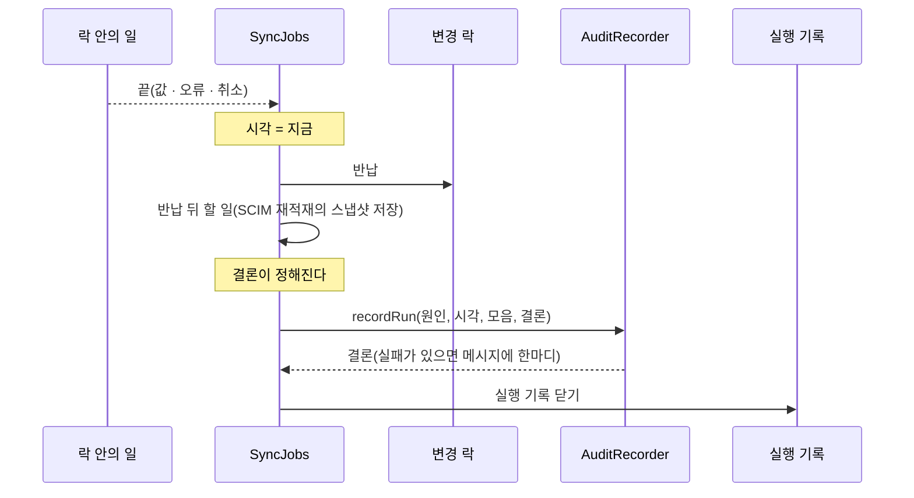

# 감사 이력

> 기준 커밋: 5675b3c (ops-readiness, main 에 머지됨). 코드가 바뀌면 이 문서도 함께 고친다.
> 읽기 전에: [용어집 — 감사 이력](02-용어집.md#감사-이력), [04 데이터 모델 — 감사 이력 줄](04-데이터-모델.md#감사-이력-줄), [08 동시성과 작업](08-동시성과-작업.md)

[감사 이력](02-용어집.md#감사-이력)은 직원·조직마다 "언제, 무엇 때문에, 무엇이 바뀌었나" 를 남긴 기록이다.

[실행 기록](02-용어집.md#실행-기록)과 무엇이 다른가.

- 실행 기록은 [회차](02-용어집.md#회차) 하나의 결론이다. "몇 줄 쓰고 몇 줄 지웠나" 까지만 안다. 누구의 줄인지 모른다.
- 감사 이력은 [대상](02-용어집.md#대상)(직원 하나, 조직 하나)별 기록이다. 이 사람이 어느 조직에 들어가고 나갔는지, 어떤 튜플을 얻고 잃었는지, 속성이 무엇에서 무엇으로 바뀌었는지를 남긴다.
- [SCIM 쓰기](02-용어집.md#scim-쓰기)는 회차가 아니라 실행 기록이 없다. SCIM 요청 하나가 무엇을 바꿨는지 남는 곳은 감사 이력(과 로그)뿐이다.

## 한눈에

| 무엇 | 값 |
|---|---|
| 한 줄 | 대상 하나 × 사건 하나 |
| 사건 | 회차 하나(LDAP 동기화·재적재, SCIM 재적재·초기화), 또는 SCIM 요청 하나 |
| 시각 | 락 안의 일이 끝난 때 |
| 쓰는 때 | 락을 반납한 뒤 |
| 실패하면 | 일을 실패시키지 않는다. ERROR 로그, 지표 `audit.write.failures`, 회차면 메시지 앞에 "감사 기록 N건 실패" |
| 저장 | DynamoDB `AUDIT#USER#<id>`·`AUDIT#GROUP#<id>` 파티션([04](04-데이터-모델.md#감사-이력-줄)) |
| 보관 | `dynamodb.audit-retention-days`(기본 30일) 뒤 테이블 TTL 이 지운다 |
| 조회 | `GET /admin/employees/{employeeId}/history`, `GET /admin/organizations/{orgCode}/history` |
| 코드 | core `audit`(`AuditChanges`, `RunAudit`, `AuditRecorder`, `AuditEntry`, `AuditCause`, `AuditKind`), 포트 `AuditLog`, `DynamoDbAuditLog`(storage-dynamodb), `AuditHistoryController`(admin-api) |

---

## 1. 한 줄의 모양

### 칸

한 줄은 `AuditEntry`(core `audit`)다.

| 칸 | 뜻 |
|---|---|
| `subject` | 대상. 직원은 `MemberRef.user(id)`, 조직은 `MemberRef.group(id)` |
| `created` | 이 사건에서 생겼다 |
| `deleted` | 이 사건에서 지워졌다 |
| `attributes` | 바뀐 속성만, `{name, before, after}`. 없던 값은 `null` 이다 |
| `joined` | 이 대상이 들어간 조직 id |
| `left` | 이 대상이 나간 조직 id |
| `membersAdded` | 조직 줄만 — 이 조직에 들어온 멤버(직원·하위 조직) |
| `membersRemoved` | 조직 줄만 — 이 조직에서 나간 멤버 |
| `granted` | [부여](02-용어집.md#부여) — 이 대상이 user 쪽인 튜플 가운데 사건이 실제로 쓴 것 |
| `revoked` | [회수](02-용어집.md#회수) — 같은 것 가운데 사건이 실제로 지운 것 |

여기에 [원인](02-용어집.md#원인)과 시각이 붙어 저장된다([2절](#2-원인)).

### 속성

직원은 아래 순서로 본다. 조직은 `externalId`·`displayName` 둘뿐이다(`AuditChanges` 의 `속성_순서`).

`externalId`, `userName`, `displayName`, `email`, `active`, `name.formatted`, `name.familyName`, `name.givenName`, `name.middleName`, `name.honorificPrefix`, `name.honorificSuffix`

- 값은 모두 문자열이다. `active` 는 `"true"`·`"false"` 다.
- 빈 문자열은 없는 값으로 본다. 저장소가 빈 값을 저장하지 않아, 그렇지 않으면 저장 전후 값이 늘 달라 보인다.
- 직원이 생기면 있는 속성이 모두 `before: null` 로, 지워지면 모두 `after: null` 로 나온다.

### 튜플은 누구의 줄인가

튜플은 **user 쪽이 대상**이다(`TupleSubjects.userSide`).

- `user:kim direct_member group:DEV` 는 kim 의 줄이다. DEV 의 줄이 아니다.
- `group:TEAM child group:HQ` 는 TEAM(하위 조직)의 줄이다.

그래서 직원이 조직에 들어가면 조직 줄에는 `membersAdded` 가, 직원 줄에는 `joined` 와 `granted` 가 나온다.

### 사건 하나 안에서 모으는 규칙

사건 하나의 변경은 `AuditChanges`(core `audit`)가 대상별로 모은다.

- 조직의 멤버가 바뀌면 조직 줄의 `membersAdded`·`membersRemoved` 와 멤버 줄의 `joined`·`left` 를 함께 적는다.
- 한 대상의 이전·이후가 여러 번 오면 **처음의 이전과 마지막의 이후**를 비교한다. `created`·`deleted`·`attributes` 가 이것으로 정해진다.
- 조직의 이름표(`externalId`·`displayName`)가 이전과 이후에 같으면 멤버 변화만 적고 이름표는 비교하지 않는다. 현재상태 교체는 조직의 멤버만 빼는 결과를 그 조직의 삭제보다 먼저 알릴 수 있는데, 그 결과의 이름표로 비교하면 삭제 줄의 이름표가 사라지기 때문이다.
- 남길 것이 하나도 없는 줄은 만들지 않는다(`AuditEntry.isEmpty`). 같은 조직도로 다시 동기화하면 쓰기가 0번이다.
- 한 사건의 줄은 대상이 처음 나온 순서로 넘기고, 모두 **같은 시각**을 갖는다.
- 여러 스레드가 동시에 더할 수 있어 메서드마다 잠근다.

### 예

SCIM `PATCH /scim/v2/Groups/<백엔드팀>` 이 홍길동을 멤버로 넣으면 두 줄이 생긴다.

| 대상 | 칸 |
|---|---|
| 조직 백엔드팀 | `membersAdded`: `USER#<홍길동>` |
| 직원 홍길동 | `joined`: `<백엔드팀>`, `granted`: `user:<홍길동> direct_member group:<백엔드팀>` |

---

## 2. 원인

원인은 `AuditCause(source, kind, id)`(core `audit`)다. 사건의 종류(`AuditKind`)와, 그 사건으로 거슬러 갈 열쇠(`id`)를 담는다.

| 사건 | `source` | `kind` | `id` |
|---|---|---|---|
| LDAP [동기화](02-용어집.md#동기화) — [비교 경로](02-용어집.md#비교-경로) | `LDAP` | `SYNC` | 실행 기록의 `runId` |
| LDAP 동기화 — 기준선 없음 | `LDAP` | `SYNC` | `runId` |
| LDAP 동기화 — 기록 중([장부 맞추기](02-용어집.md#장부-맞추기)) | `LDAP` | `LEDGER_ALIGNMENT` | `runId` |
| LDAP [재적재](02-용어집.md#재적재) | `LDAP` | `REBUILD`(`force=true` 여도 같다 — 실행 기록의 트리거만 `FORCED_REBUILD` 다) | `runId` |
| SCIM 재적재 `tuples` | `SCIM` | `REBUILD` | `runId` |
| SCIM [초기화](02-용어집.md#초기화) `wipe` | `SCIM` | `REBUILD` | `runId`(트리거는 `RESET`) |
| SCIM 쓰기 요청 하나 | `SCIM` | `SCIM_REQUEST` | 요청의 traceId(16진수 32자) |
| 아카이빙의 [남은 회수](02-용어집.md#남은-회수) 지우기 | `SCIM` | `SCIM_REQUEST` | 아카이빙 스케줄러의 traceId |

- 회차의 종류는 회차를 띄울 때 정한다(`SyncJobs.startLockedThen` 의 `kind`). LDAP 동기화는 `SYNC` 로 시작하고, 기준선 상태가 "기록 중" 이면 `FullSyncUseCase.훑어_맞춘다` 가 `RunAudit.kind(LEDGER_ALIGNMENT)` 로 바꾼다. 기준선이 아예 없는 회차는 `SYNC` 그대로다.
- traceId 는 요청의 Reactor Context 에서 읽는다(`TraceIds`, app-scim 의 `ScimUseCaseConfig.traceIds`). 로그의 traceId 와 같은 값이다. 모르면(추적이 꺼졌거나 읽다 던지면) 임의 UUID 를 쓴다(`AuditCause.scimRequest`). 정렬키가 원인 id 를 담으므로 비워 둘 수 없고, 같은 대상에 같은 밀리초로 온 두 요청이 한 줄을 덮어쓰면 안 되기 때문이다.
- 거슬러 가는 법: `runId` 면 `GET /admin/sync/runs/{runId}` 로 그 회차의 결론을, traceId 면 로그에서 그 요청의 줄을 찾는다.
- 아카이빙의 남은 회수 지우기는 스케줄러가 Reactor Context 에 실은 관측의 traceId 를 쓴다. 그날 아카이빙이 지운 직원들의 줄은 모두 같은 원인 id 다. 아카이빙의 실행 기록 `runId` 는 원인이 아니다.

---

## 3. 무엇을 언제 남기나

변경은 **일어나는 즉시** 그 사건의 모음에 더한다.

- 튜플: OpenFGA [쓰기 배치](02-용어집.md#쓰기-배치) 하나가 끝날 때마다 실제로 쓰고 지운 줄을 더한다(`RelationTupleWriter.apply` 의 콜백 → `AuditChanges.tuples`·`revoked`).
- 조직도: 직원·조직 하나의 저장·삭제가 끝날 때마다 더한다(`DirectoryChanges.Listener` → `AuditChanges.directoryListener`). SCIM 쓰기는 각 커밋 자리가 커밋에 성공한 뒤 더한다.

그래서 사건이 도중에 실패해도 그때까지 실제로 한 변경은 모음에 들어 있다([실패한 회차·요청](#실패한-회차요청)).

### LDAP 회차

회차의 모음은 `SyncJobs` 가 연다(`RunAudit`). 길마다 남는 것이 다르다.

| 길 | `kind` | 부여 | 회수 | 조직도 변경 |
|---|---|---|---|---|
| 비교 경로, 델타 있음 | `SYNC` | 쓴 줄 | 지운 줄 | [현재상태 교체](02-용어집.md#현재상태-교체)가 바꾼 것 |
| 비교 경로, 델타 없음("변경 없음") | `SYNC` | — | — | 교체가 바꾼 것(튜플과 무관한 속성 변경 등) |
| 비교 경로, 차단기로 멈춤 | `SYNC` | 그때까지 쓴 줄 | 그때까지 지운 줄 | 교체가 바꾼 것 |
| 비교 경로, [비활성 회수만 반영](02-용어집.md#비활성-회수만-반영) | `SYNC` | — | 지운 비활성 회수 | 없음(교체를 보류한다) |
| 비교 경로, [전부 보류](02-용어집.md#전부-보류) | `SYNC` | — | — | 없음 |
| 기준선 없음(장부 맞추기) | `SYNC` | **쓴 줄 전부** | 지운 줄 | 교체가 바꾼 것(일부 반영이면 없음) |
| 기록 중(장부 맞추기) | `LEDGER_ALIGNMENT` | 남기지 않는다 | 지운 줄 | 교체가 바꾼 것(일부 반영이면 없음) |
| 재적재 | `REBUILD` | 남기지 않는다 | 지운 줄 | 교체가 바꾼 것(일부 반영이면 없음) |

**장부 맞추기와 재적재는 쓴 줄을 부여로 남기지 않는다.** D 전체를 [멱등 옵션](02-용어집.md#멱등-옵션)으로 다시 쓰므로, OpenFGA 의 성공 응답만으로는 원래 있던 줄과 새로 생긴 줄을 가를 수 없다. 남기면 재적재마다 D 전체가 부여로 찍힌다. `LedgerAlignment.align` 과 `ScimRebuildUseCase.reloadTuples` 는 쓰기 콜백을 넘기지 않는다.

**기준선 없는 회차만 예외다.** 첫 회차(또는 새 테이블)의 적재는 처음 생긴 권한의 이력이다. 이것을 잃지 않으려고 쓴 줄도 쓰기 배치마다 부여로 남긴다(`LedgerAlignment.align` 의 `쓴_줄도_남긴다`). 그래서 테이블만 새로 만들고 store 에 줄이 이미 있었다면, 그 줄도 부여로 남는다.

### SCIM 쓰기

요청 하나가 사건 하나다(`IncrementalSyncUseCase.withLock`).

- 부여·회수: 쓰기 배치마다 실제로 쓰고 지운 줄.
- 조직도: 직원 생성·변경·삭제, 조직 이름표의 생성·변경·삭제, 멤버 넣고 빼기. 커밋 자리가 커밋에 성공한 뒤에만 더한다.
- 직원의 `active` 처럼 OpenFGA 단계가 오류로 끝나도 저장하는 의도는, 저장에 성공하면 그 변경도 남는다([06](06-SCIM.md)).
- 락을 잡지 못한 요청은 모은 것이 없어 아무것도 쓰지 않는다.

### SCIM 재적재와 초기화

| 모드 | 부여 | 회수 | 조직도 변경 |
|---|---|---|---|
| `tuples` | 남기지 않는다(위와 같은 까닭) | 지운 줄 | 없음 — 현재상태를 바꾸지 않는다 |
| `wipe` | — | 지운 줄 전부 | 지운 직원·조직 전부. 직원 줄은 `deleted` 와 `left`, 조직 줄은 `deleted` 와 `membersRemoved` |

`wipe` 는 감사 이력을 지우지 않는다. 이력이 직원·조직 파티션과 따로라 조직도를 지워도 남는다. 사고 뒤 무슨 일이 있었는지 볼 유일한 기록이기 때문이다([07](07-재적재-초기화-아카이빙.md#4-scim-초기화-wipe-모드)).

### 아카이빙

아카이빙 자신의 비교와 스냅샷은 이력을 남기지 않는다. 현재상태를 바꾸지 않기 때문이다.

남은 회수 지우기만 남는다. 직원마다 `IncrementalSyncUseCase.revokeLeftovers` 가 SCIM 쓰기와 같은 길(락·리스·Check 기준선)로 지우고, 그 요청의 사건으로 지운 줄을 `revoked` 에 남긴다. 원인은 `SCIM_REQUEST` 와 아카이빙 스케줄러의 traceId 다([07](07-재적재-초기화-아카이빙.md#남은-회수-지우기)).

### 실패한 회차·요청

회차·요청이 실패하거나 멈춰도 그때까지 실제로 한 변경을 그 회차·요청을 원인으로 남긴다.

- 회차: `SyncJobs` 는 락 안의 일이 값·오류·취소(기한, 서버 종료, [리스 상실](02-용어집.md#리스-상실)) 무엇으로 끝나든 모음을 남긴다. 회차가 어떻게 끝났는지(`FAILED` 등)는 그 `runId` 의 실행 기록에 있다.
- SCIM 요청: 값·오류·빈 끝 무엇이든 남긴다. 503 으로 끝난 요청도 그때까지 OpenFGA 에 쓴 줄이 남는다.
- 실패한 회차의 실행 기록은 건수가 0 이다(`SyncOutcome.failed`). 실제로 무엇이 쓰이고 지워졌는지는 감사 이력에서 본다.

### 남기지 않는 것

| 남지 않는 것 | 까닭 |
|---|---|
| 장부 맞추기·재적재(LDAP, SCIM `tuples`)가 쓴 줄 | 멱등 옵션 때문에 원래 있던 줄과 가를 수 없다. 기준선 없는 첫 회차만 예외 |
| [불확실 실패](02-용어집.md#불확실-실패)한 쓰기 배치의 줄 | 반영됐는지 모른다. 반영됐어도 빠진다 |
| 아카이빙의 비교·스냅샷 | 현재상태를 바꾸지 않는다 |
| [보류 목록](02-용어집.md#보류-목록)과 [표지판](02-용어집.md#표지판)의 변화 | 모으는 칸이 없다 |
| SCIM 조회, 관리 API 조회 | 바꾸는 것이 없다 |
| 락을 못 잡아 시작하지 않은 회차·요청 | 한 것이 없다 |

반대로, **원래 없던 줄이 `revoked` 에 나올 수 있다.** 멱등 옵션 때문에 없는 줄을 지워도 성공으로 온다. "지운 줄" 은 "지우라고 보내 성공한 줄" 이다.

- SCIM 의 조직 멤버 빼기와 조직 삭제는 줄을 `Check` 없이 지운다. 비활성 직원처럼 원래 줄이 없던 멤버도 회수로 나온다.
- LDAP 비교 경로가 [불확실 줄](02-용어집.md#불확실-줄)(U)을 지울 때도, 그 줄이 실제로는 없었을 수 있다.

---

## 4. 시각과 쓰는 때

### 시각은 락 안에서 잡는다

사건의 시각은 **락 안의 일이 끝난 때**다(`AuditRecorder.now`). 값으로 끝났든 오류·취소로 끝났든, 락을 반납하기 전이다.

- 회차: `SyncJobs.끝까지_돌린다` 가 락 안의 일이 신호를 낸 직후 잡는다.
- SCIM 요청: `IncrementalSyncUseCase.withLock` 이 일의 성공·오류·취소 때 한 번 잡는다.

**까닭.** 쓰는 순간에 찍으면 반납 뒤의 일(SCIM 재적재의 스냅샷 저장, 10만 줄 만들기)만큼 늦어진다. 그 사이 락을 잡고 커밋한 SCIM 쓰기가 더 이른 시각을 받아 최신순 이력이 뒤집힌다. 락 안에서 잡으면 시각의 순서가 락을 쥔 순서와 같다.

### 쓰는 것은 반납 뒤다



- 회차: 락 안의 일 → 반납 → [반납 뒤 할 일](02-용어집.md#반납-뒤-할-일) → 감사 이력 → 실행 기록 닫기 순이다(`SyncJobs.끝까지_돌린다`). 반납을 먼저 하는 까닭은 운영자가 "끝남" 을 본 즉시 다시 걸면 받아져야 하고, 그동안 다른 쓰기를 막지 않으려는 것이다.
- SCIM 요청: 락 안의 일 → 반납 → 서버 안 줄의 다음 차례에 넘기기 → 감사 이력 → 응답 순이다(`IncrementalSyncUseCase.잡고_돌린다`). IdP 의 다음 요청이 이 요청의 이력 쓰기를 기다리지 않는다.

뒤따르는 일:

- 이력을 쓰는 동안 회차의 실행 기록은 `RUNNING` 이다. 큰 회차는 이 시간이 길다 — 설계 문서에 적힌 규모 시험(`AuditLogScaleTest`)은 직원 10만 명 초기 적재의 줄 100,101개에 약 10초였다.
- 서버 종료는 도는 회차를 최대 10초 기다린다(`SyncJobs.shutdown`). 큰 모음이면 그 안에 이력을 다 쓰지 못해 일부만 남고, 실행 기록은 `RUNNING` 으로 남았다가 다음에 락을 잡는 회차(app-scim 은 다음 재적재)가 [죽은 기록 닫기](02-용어집.md#죽은-기록-닫기)로 "비정상 종료로 중단" 으로 닫는다([08](08-동시성과-작업.md#56-죽은-기록-닫기)).

---

## 5. 쓰기가 실패하면

이력 쓰기는 **일을 실패시키지 않는다**(`AuditRecorder`). 변경은 이미 일어났다. 일을 실패시켜도 재시도(IdP 의 다시 보내기, 다음 회차)가 그 변경을 다시 만들지 못한다 — 다음 회차에는 바꿀 것이 없다. 그래서 크게 알리기만 한다.

1. `DynamoDbAuditLog.write` 가 줄을 조각 아이템으로 바꿔 BatchWriteItem 요청 하나에 25개씩 담아 보낸다. 처리되지 않은 아이템은 도우미(`BatchRequests`)가 5번까지 다시 보낸다. 요청은 동시에 8개까지 간다.
2. BatchWriteItem 요청 하나가 끝내 실패하면 그 요청의 아이템 수를 세고 **나머지 요청은 계속 보낸다.**
3. `AuditRecorder.record` 는 쓰지 못한 수를 돌려받는다. 저장소가 통째로 오류로 끝나면 남기려던 줄 수 전부를 센다. 어느 쪽이든 오류로 끝나지 않는다.
4. 빠진 것이 있으면 셋이 남는다.
   - ERROR 로그 "감사 기록 N줄을 쓰지 못했다 — 원인 <source>/<kind>/<id>".
   - 지표 `audit.write.failures`(카운터, 빠진 수만큼 오른다). 두 앱 모두 `AuditRecorder` 빈이 이 카운터에 잇는다.
   - 회차면 실행 기록 메시지 앞에 "감사 기록 N건 실패" 가 붙는다(`AuditRecorder.recordRun`, `SyncOutcome.withNote`). 실행 상태와 건수는 그대로다.
5. SCIM 요청이면 응답은 그대로다. 로그와 지표만 남는다.

메시지 예 — "기록 중" 회차에서 이력 3건이 빠졌다.

```
감사 기록 3건 실패 / 기준선 의심(지난 회차가 기록 전에 멈춤) — 장부를 훑어 맞춤
```

알아 둘 것:

- 요청 실패로 센 수는 줄이 아니라 **아이템(조각)** 이다. 조각이 여럿인 큰 줄이 빠지면 많게 센다.
- 빠진 줄을 나중에 다시 쓰는 장치는 없다.
- 지표 알림이 던져도 빠진 수는 그대로 돌려준다. 이력 단계에서 예기치 않은 오류가 나도 ERROR 로그만 남기고 회차의 결론은 그대로다.

---

## 6. 저장 모양

아이템의 칸 전체는 [04 데이터 모델 — 감사 이력 줄](04-데이터-모델.md#감사-이력-줄)에 있다. 여기서는 동작에 필요한 것만 적는다.

| 키 | 값 |
|---|---|
| PK | `AUDIT#USER#<직원 id>` 또는 `AUDIT#GROUP#<조직 id>`(`Keys.auditPk`) |
| SK | `<시각>#<원인 id>#<조각 번호>`(`Keys.auditSk`). 시각은 `Keys.sortableTimestamp`(밀리초 3자리 고정), 조각 번호는 네 자리(`0000`~`9999`) |

- **대상의 파티션이 직원·조직 파티션과 따로다.** 직원·조직을 지워도, `wipe` 해도 이력은 남는다. GSI 키 속성이 없어 직원·조직 열거에 섞이지 않는다.
- **역순 Query 가 곧 최신순이다.** 같은 밀리초의 두 사건은 원인 id 의 역순으로 놓인다.
- **[조각](02-용어집.md#조각).** 한 줄의 목록(`joined`, `left`, `membersAdded`, `membersRemoved`, `granted`, `revoked`)의 값이 어림 300,000바이트(`PART_BUDGET`)를 넘으면 한 줄을 조각 여럿으로 나눈다(`DynamoDbAuditLog` 의 `아이템들`). 아이템 한도 400KB 안에 머물게 하려는 것이라, 300~400KB 사이의 줄도 조각이 된다.
  - 목록 값을 이 순서로 앞 조각부터 채운다. 조각 하나에 담는 목록 값의 어림은 300,000바이트다 — 값마다 UTF-8 바이트 + 4 로 센다(`DynamoDbAuditLog.PART_BUDGET`). 속성 이름·머리 몫을 남긴 값이다.
  - 머리(`created`, `deleted`, `attributes`)는 0번 조각에만 싣는다.
  - 모든 조각이 시각·원인(`at`, `source`, `kind`, `causeId`), 조각 번호·전체 조각 수(`part`, `parts`), `expiresAt` 을 갖는다.
  - 조각이 하나여도 SK 끝에 `#0000` 이 붙는다. 읽기가 늘 같은 규칙으로 합친다.
  - 규모: 10만 명 조직 하나가 한 회차에 통째로 바뀌면(초기 적재, `wipe`) 그 조직 줄은 조각 6개다(설계 문서에 적힌 `AuditLogScaleTest` 결과).
- **값의 모양.** 튜플은 `<user>|<relation>|<object>`, 멤버는 `USER#<id>`·`GROUP#<id>` 다. 응답에서는 다른 모양으로 바꿔 보여 준다([7절](#7-조회-api)).
- **보관.** `expiresAt` = 사건의 시각 + `dynamodb.audit-retention-days`(기본 30일), epoch 초. 테이블 TTL 이 지운다.
  - TTL 은 늦게 지운다. 기한이 막 지난 줄이 며칠 보일 수 있다.
  - 지운 직원·조직의 이력도 그동안 보인다.
  - 보관을 늘리려면 `dynamodb.syncrun-retention-days` 도 함께 늘린다 — 원인 회차로 거슬러 갈 실행 기록이 먼저 사라지면 안 된다. 다만 실행 기록 읽기는 이번 달과 지난달 파티션만 보므로, 30일보다 길게 늘려도 그 이전 회차는 관리 API 로 찾지 못한다([04 — TTL](04-데이터-모델.md#5-ttl)).

---

## 7. 조회 API

`AuditHistoryController`(admin-api)다. admin-api 라 두 앱 모두에 있다.

### 엔드포인트

| 요청 | 대상 |
|---|---|
| `GET /admin/employees/{employeeId}/history` | 직원 `MemberRef.user(employeeId)` |
| `GET /admin/organizations/{orgCode}/history` | 조직 `MemberRef.group(orgCode)` |

| 파라미터 | 기본 | 규칙 |
|---|---|---|
| `limit` | 20 | 1~100. 벗어나면 400(사유 "limit 은 1 이상 100 이하여야 한다: N") |
| `cursor` | 없음 | 앞 쪽 응답의 `nextCursor` 를 그대로 넘긴다 |

### 동작

`DynamoDbAuditLog.history` 가 읽는다.

1. 대상의 PK 가 [키 한도](02-용어집.md#키-한도)(2048바이트)를 넘으면 DynamoDB 를 부르지 않고 빈 쪽을 준다. 그런 키의 이력은 있을 수 없다.
2. [커서](02-용어집.md#커서)가 있으면 푼다. 커서는 이 대상의 범위(`AUDIT/` + PK)로 발급한 것이어야 한다. 시작 키는 `PK`·`SK` 두 칸뿐이어야 하고, PK 가 이 대상의 것이고, SK 가 `#0000` 으로 끝나고, 정렬키 한도(1024바이트) 안이어야 한다. 하나라도 어긋나면 400 이다 — 범위만 맞춘 위조 커서가 다른 파티션을 가리키거나 DynamoDB `ValidationException`(500)을 내지 않게 한다.
3. 대상 파티션을 역순으로 Query 한다. 최종 일관성 읽기다 — 방금 쓴 줄이 잠깐 안 보일 수 있다. Query 에 Limit 을 두지 않아 한 번에 DynamoDB 한 쪽(최대 1MB)을 읽고, `LastEvaluatedKey` 를 따라간다.
4. 역순이라 한 줄의 조각은 번호가 큰 것부터 오고 0번이 마지막이다. 0번 조각에서 끊어 조각들을 합친다.
5. 0번 조각의 `parts` 와 모인 조각 수가 다르면 그 줄을 버린다(WARN 로그 "조각이 모자란 감사 기록을 건너뛴다"). 쓰다 일부만 남은 줄이다. 앞 줄의 남은 조각이 섞여 오면(첫 조각을 잃은 줄) 그것도 버린다. **빠질 수는 있어도 틀린 줄은 돌려주지 않는다.**
6. `limit` 줄까지 모은다. 모은 줄이 `limit` 과 같으면 마지막 줄의 0번 조각 키로 `nextCursor` 를 만든다. 아니면 `nextCursor` 는 `null` 이다.

- 기록이 없는 아이디는 404 가 아니라 빈 목록(200)이다. 지운 직원·조직도 보관 기간 동안은 이력이 보인다.
- 쪽이 `limit` 줄로 꼭 차면 커서를 주므로 마지막 쪽 뒤에 빈 쪽이 하나 올 수 있다.
- 다음 쪽 커서는 늘 한 줄의 0번 조각을 가리킨다. 쪽 경계가 조각 사이에 걸리지 않는다.

### 응답

`Page<AuditHistoryItem>` 이다 — `items` 와 `nextCursor`.

| 필드 | 모양 |
|---|---|
| `at` | 사건의 시각. `Instant.toString()` 그대로라 소수 자릿수가 일정하지 않다 |
| `cause` | `{source, kind, id}` |
| `created`, `deleted` | 불리언. 늘 있다 |
| `attributes` | `[{name, before, after}]`. 바뀐 것이 없으면 빈 목록 |
| `joined`, `left` | 조직 id 목록 |
| `granted`, `revoked` | 튜플 문자열 목록. `user:<id> direct_member group:<id>` 처럼 **공백**으로 잇는다(저장은 `\|`) |
| `membersAdded`, `membersRemoved` | **조직 줄에만** 있다 — `{count, items: [{type, id}]}`. 직원 줄에는 필드 자체가 없다 |

직원 이력 예 — 위 줄은 SCIM 으로 비활성이 된 요청, 아래 줄은 조직에 들어간 요청이다.

```
GET /admin/employees/3f6c1d52-8a0e-4b7d-9c21-5e0f7a4d2b18/history?limit=2
```

```json
{
  "items": [
    {
      "at": "2026-10-25T04:01:12.290Z",
      "cause": { "source": "SCIM", "kind": "SCIM_REQUEST", "id": "4bf92f3577b34da6a3ce929d0e0e4736" },
      "created": false,
      "deleted": false,
      "attributes": [ { "name": "active", "before": "true", "after": "false" } ],
      "joined": [],
      "left": [],
      "granted": [],
      "revoked": [ "user:3f6c1d52-8a0e-4b7d-9c21-5e0f7a4d2b18 direct_member group:8e4a2c6f-3d1b-4a9e-b7c5-0f2d6e8a4b13" ]
    },
    {
      "at": "2026-10-24T09:15:03.118Z",
      "cause": { "source": "SCIM", "kind": "SCIM_REQUEST", "id": "0af7651916cd43dd8448eb211c80319c" },
      "created": false,
      "deleted": false,
      "attributes": [],
      "joined": [ "8e4a2c6f-3d1b-4a9e-b7c5-0f2d6e8a4b13" ],
      "left": [],
      "granted": [ "user:3f6c1d52-8a0e-4b7d-9c21-5e0f7a4d2b18 direct_member group:8e4a2c6f-3d1b-4a9e-b7c5-0f2d6e8a4b13" ],
      "revoked": []
    }
  ],
  "nextCursor": "<불투명 문자열>"
}
```

조직 이력의 한 줄 예 — 같은 날 백엔드팀에 홍길동이 들어온 요청이다.

```json
{
  "at": "2026-10-24T09:15:03.118Z",
  "cause": { "source": "SCIM", "kind": "SCIM_REQUEST", "id": "0af7651916cd43dd8448eb211c80319c" },
  "created": false,
  "deleted": false,
  "attributes": [],
  "joined": [],
  "left": [],
  "granted": [],
  "revoked": [],
  "membersAdded": { "count": 1, "items": [ { "type": "USER", "id": "3f6c1d52-8a0e-4b7d-9c21-5e0f7a4d2b18" } ] },
  "membersRemoved": { "count": 0, "items": [] }
}
```

조직 줄의 `granted`·`revoked` 는 그 조직이 user 쪽인 `child` 튜플(이 조직이 하위 조직으로 들어가고 나간 것)이다. 직원의 `direct_member` 는 직원 줄에 있다.

10만 명 조직이 한 회차에 통째로 바뀐 줄(초기 적재, `wipe`)은 응답 하나가 수 MB 다. `limit` 을 작게 잡는다.

**인증이 없다.** 이력에는 이전 값(이름·이메일 등)이 그대로 담긴다. 다른 관리 API 처럼 앞단에서 보호해야 한다([01 개요](01-개요.md)).

---

## 8. 알려진 한계

| 한계 | 내용 |
|---|---|
| [행위자](02-용어집.md#행위자)가 없다 | 원인은 "어느 회차·요청" 까지만 말한다. 누가 재적재를 걸었는지, 어느 IdP 계정이 보냈는지는 없다. 인증이 아직 없어 알 길이 없다 — 인증 작업의 몫으로 남겼다. 관리자가 건 재적재는 요청 로그의 traceId 로 실행 기록 `runId` 와 이을 수 있을 뿐이다(회차가 요청의 Reactor Context 를 이어받는다) |
| 변조 방지 저장소가 아니다 | 같은 DynamoDB 테이블의 보통 아이템이다. 테이블에 쓸 수 있는 누구나 고치고 지울 수 있다. 서명·해시 사슬, 외부(SIEM) 내보내기가 없다. TTL 로 30일 뒤 사라진다 |
| 재적재의 부여가 없다 | 장부 맞추기·재적재가 쓴 줄은 남지 않는다([3절](#남기지-않는-것)). 재적재가 빠진 권한을 되살려도 이력에는 부여가 보이지 않는다 |
| 원래 없던 줄도 회수로 나온다 | 멱등 옵션 때문이다([3절](#남기지-않는-것)) |
| 빠질 수 있다 | 쓰기 실패(위 [5절](#5-쓰기가-실패하면)). 서버 프로세스가 회차·요청 도중 죽으면 메모리의 모음이 사라진다. 서버 종료가 10초 안에 이력을 다 쓰지 못하면 일부만 남는다. 불확실 실패한 배치, 쓰다 만 직원·조직 하나의 저장, 400 거절로 쪼개 보내는 도중 취소된 배치, 같은 단계에서 다른 변경이 실패해 취소된 쓰기도 빠질 수 있다 |
| 회차의 모든 줄은 시각이 하나다 | 회차 안의 순서는 알 수 없다 — 락 안의 일이 끝난 때 하나다 |
| 보관이 실행 기록에 묶인다 | 30일. 늘려도 실행 기록 조회는 두 달만 본다([6절](#6-저장-모양)) |
| 대상별 조회만 있다 | 사건별(이 `runId` 가 바꾼 모든 것), 기간별 조회가 없다 |

---

## 더 깊이

- 감사 이력의 처음 설계(한 줄의 모양, 조각, 조회, 실패 처리): `docs/superpowers/specs/2026-10-10-audit-log-design.md`
- 실패한 회차·요청도 남기기, `SyncJobs` 가 모음을 여는 것, 끝날 때마다 알리기: `docs/superpowers/specs/2026-10-15-failed-run-audit-design.md`
- 기준선 없는 회차가 부여를 남기는 것, 아카이빙의 남은 회수 지우기: `docs/superpowers/specs/2026-10-20-revocation-convergence-design.md` §4·§6.4
