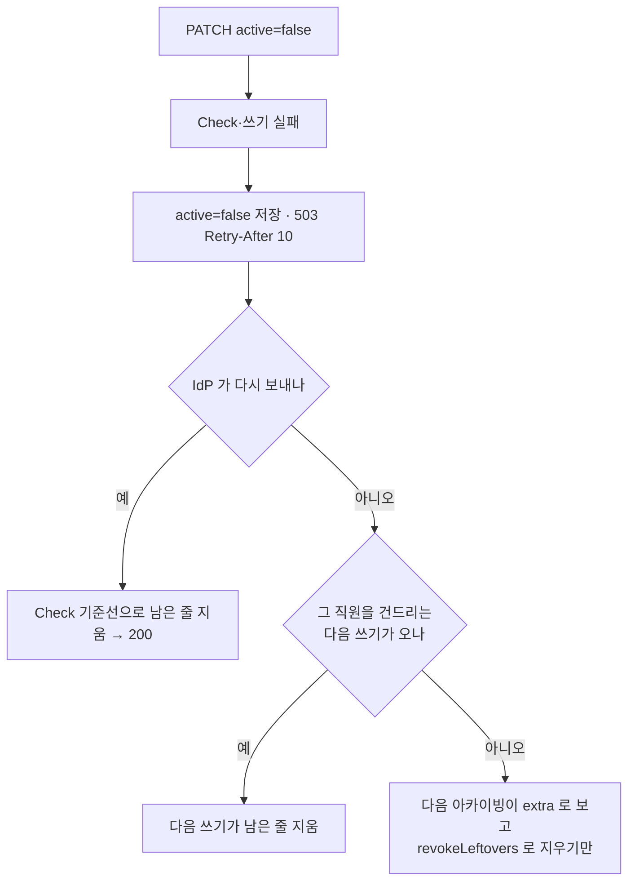

# 장애와 복구

> 기준 커밋: 5675b3c (ops-readiness, main 에 머지됨). 코드가 바뀌면 이 문서도 함께 고친다.
> 읽기 전에: [용어집](02-용어집.md), [아키텍처](03-아키텍처.md), [데이터 모델](04-데이터-모델.md). 동작의 세부는 [05 LDAP 동기화](05-LDAP-동기화.md), [06 SCIM](06-SCIM.md), [07 재적재·초기화·아카이빙](07-재적재-초기화-아카이빙.md), [08 동시성과 작업](08-동시성과-작업.md)에 있다.

이 문서는 장애를 하나씩 놓고 본다. 05~11 이 기능별로 쓴 내용을 장애의 눈으로 다시 엮은 것이다. 장애마다 다섯 가지를 적는다.

- **저절로** — 이 서버가 사람 없이 하는 일(코드로 확인한 것).
- **남는 상태** — OpenFGA [장부](02-용어집.md#장부), DynamoDB, [실행 기록](02-용어집.md#실행-기록), 응답에 무엇이 남는가.
- **[수렴](02-용어집.md#수렴)** — 무엇이, 얼마나 빨리 다시 맞추는가.
- **보이는 것** — 지표, 로그, 실행 상태, 헬스 체크.
- **할 일** — 운영자가 할 일. 없으면 "없음" 이라 적는다.

끝의 [8. 증상에서 할 일로](#8-증상에서-할-일로)는 경보나 증상에서 거꾸로 찾는 표다.

---

## 1. 먼저 알아 둘 것

### 1.1 스스로 맞추는 장치

장애 대부분은 사람이 손대지 않아도 아래 장치들이 맞춘다. 장애별 절은 이 장치가 그 장애에서 어떻게 움직이는지를 적는다.

| 장치 | 앱 | 무엇을 막나 | 코드 |
|---|---|---|---|
| 실제로 반영한 것만 [기준선](02-용어집.md#기준선)(B)에 넣고, 결과를 모르는 줄은 [불확실 줄](02-용어집.md#불확실-줄)(U)에 따로 적는다 | app-ldap | 실패한 쓰기를 다음 회차가 저절로 다시 잡는다. 재시도 큐가 없다 | `FullSyncUseCase.스냅샷을_저장한다` |
| [기록 중 표시](02-용어집.md#기록-중-표시) | app-ldap | OpenFGA 에 쓴 뒤 기록하기 전에 멈춘 회차를 다음 회차가 [장부 맞추기](02-용어집.md#장부-맞추기)로 다시 맞춘다 | `TupleSnapshotRepository.markWriting`·`baselineState` |
| [Check 기준선](02-용어집.md#check-기준선) | app-scim | IdP 가 같은 요청을 다시 보내면 장부의 실제를 물어 남은 줄만 반영한다 | `IncrementalSyncUseCase.diffAndApply` |
| 요청한 `active` 를 저장하고([의도 저장](02-용어집.md#의도-저장)), 하루 [아카이빙](02-용어집.md#아카이빙)이 [남은 회수](02-용어집.md#남은-회수)를 지운다 | app-scim | IdP 가 다시 보내지 않아도 회수가 끝난다 | `IncrementalSyncUseCase` 의 `오류여도_의도를_저장한다`, `SnapshotArchiveUseCase` |
| 회차의 반납·기록 규칙 | 두 앱 | 회차는 [기한](02-용어집.md#기한)·서버 종료·[리스 상실](02-용어집.md#리스-상실)과 경주하고, 어떻게 끝나든 락을 먼저 풀고 기록한다. 죽은 회차의 `RUNNING` 기록은 다음에 락을 잡는 회차가 닫고, 시작한 지 기한 + 10분이 지난 것은 동기화·재적재·아카이빙 어느 시작이든 종류와 상관없이 닫는다([죽은 기록 닫기](02-용어집.md#죽은-기록-닫기)) | `SyncJobs`·`StaleRuns`(core `usecase`) |
| 하루 1회 표지의 해제 | 두 앱 | 하루 1회 작업이 성공하지 못하면 표지를 풀어 하루 창 안의 다음 정각이 다시 돈다. 잡은 인스턴스가 죽으면 임대가 끝난 뒤 다시 잡힌다([하루 1회 표지](02-용어집.md#하루-1회-표지)) | `DailyOnce`(core `usecase`) |
| 기동 검사 | 두 앱 | 없는 테이블·store, 다른 모양의 테이블, 꺼진 보호, 틀린 LDAP 설정으로 뜨지 않는다 — 엉뚱한 저장소에 조용히 붙지 않는다([3.6](#36-기동이-멈췄다--테이블이-없거나-모양보호가-다르다)) | `TableInitializer`, `OpenFgaStoreInitializer`, `LdapConfig` |
| [삭제 가드](02-용어집.md#삭제-가드) | app-ldap | 디렉터리를 잘못 읽은 회차가 장부를 통째로 지우지 못하게 한다 | `DeletionGuard`(core `guard`) |

### 1.2 다시 보내는 층

외부 호출은 실패하면 여러 층에서 다시 보낸다. 이 층을 다 쓰고도 실패해야 아래 장애 절의 "실패" 가 된다.

| 호출 | 누가 다시 보내나 | 횟수와 간격 | 다 쓰면 |
|---|---|---|---|
| OpenFGA Write([쓰기 배치](02-용어집.md#쓰기-배치) 하나) | `OpenFgaErrors.일시_오류만_다시`(authz-openfga) | `openfga.max-retries`(기본 3)번, 200ms 부터 늘려 간다(Reactor 기본 지터). 거절(400)은 다시 보내지 않고 반씩 쪼갠다 | [불확실 실패](02-용어집.md#불확실-실패). 거절은 한 줄까지 좁혀 [확정 실패](02-용어집.md#확정-실패) |
| OpenFGA Read([장부 훑기](02-용어집.md#장부-훑기)의 한 페이지) | 같은 규칙 | 실패한 페이지만 다시 읽는다 | 회차가 오류로 끝난다 |
| OpenFGA Check·BatchCheck | 앱은 다시 보내지 않는다 | — | SCIM 은 503, 아카이빙은 `FAILED`, 관리 API 는 `openFgaCheck` 칸이 `null` |
| OpenFGA SDK 자신 | `StoreBootstrapper.newClient` 가 `apiUrl`·`storeId` 만 정하고 나머지는 SDK 0.9.11 기본값이다 | 기본값: 재시도 3번, 최소 대기 100ms, 요청 시간 초과 10초, 연결 시간 초과 10초(SDK 의 `FgaConstants`) | SDK 가 어떤 오류에 스스로 다시 보내는지는 확인하지 않았다 |
| DynamoDB 단건 호출 | AWS SDK v2 기본 재시도 | 재시도 정책은 SDK 기본값 그대로다. 시도 한 번은 10초(`dynamodb.api-call-attempt-timeout`), 재시도를 포함한 호출 하나는 60초(`dynamodb.api-call-timeout`)에서 끊는다(`DynamoDbConfig`) | 오류. 시간 한도로 끊긴 것(`ApiCallTimeoutException`)도 일시 장애로 분류된다 |
| DynamoDB [일괄 요청](02-용어집.md#일괄-요청)(BatchGet·BatchWrite) | `BatchRequests`(storage-dynamodb) | 처리 못 한 키를 첫 요청 포함 5번까지, 100ms 부터 두 배씩 | 실패 |
| LDAP 읽기 | `LdapDirectorySnapshotSource.재시도_규칙`(connector-ldap) | `ldap.max-retries`(기본 5)번, `ldap.retry-min-backoff`(10초)에서 두 배씩 `ldap.retry-max-backoff`(2분)까지. 대기만 약 2~6분. 매번 처음부터 다시 읽는다. "다시 읽어도 같은 실패"는 다시 읽지 않는다 | 회차 `FAILED` |
| 락 [갱신](02-용어집.md#갱신) | `LeaseKeeper`(core `usecase`) | 시도마다 갱신 주기의 절반(5초)에서 끊고, 200ms 에서 2초까지 쉬며 다시 시도한다. 마지막으로 성공한 갱신을 보낸 때부터 주기 두 번(20초) 안이어야 한다 | 리스 상실 |
| SCIM 쓰기의 락 잡기 | `LocalWriteQueue`·`AcquireBackoff` | [서버 안 줄](02-용어집.md#서버-안-줄)에서 차례를 받고, 다른 서버와는 10ms 에서 100ms 까지 full jitter 로 겨룬다. 합쳐 `dynamodb.lock-acquire-timeout`(3초). 시도 하나는 `min(남은 한도, 1초)`(하한 200ms)에서 끊고, 끊긴 시도는 결과를 모르므로 같은 토큰으로 곧바로 다시 시도한다 | 503. 결과를 모르는 시도를 남겼으면 그 토큰으로 반납을 한 번 보낸다 |

### 1.3 무엇이 언제 맞추나

| 남은 것 | 맞추는 것 | 언제 |
|---|---|---|
| LDAP — 확정 실패한 쓰기·지우기 | 다음 회차의 [비교 경로](02-용어집.md#비교-경로)(쓸 줄 = D − B) | 다음 정각(`sync.cron` 기본 `0 0 * * * *`) |
| LDAP — 불확실 줄 | 다음 회차(U ∩ D 는 쓰고 U − D 는 지운다) | 다음 정각 |
| LDAP — 기록 중 표시가 남은 회차 | 다음 회차의 장부 맞추기 | 다음 정각 |
| LDAP — 장부에만 있는 줄(직접 써 넣은 줄, 펜싱 틈의 늦은 쓰기) | [재적재](02-용어집.md#재적재). 비교 경로는 장부를 읽지 않는다 | 사람이 걸 때 |
| SCIM — 실패해 503 을 받은 요청 | IdP 의 재시도(Check 기준선) | IdP 에 달렸다 |
| SCIM — 끝나지 않은 회수(직원 레코드가 있는 `direct_member` 의 [드리프트](02-용어집.md#드리프트) extra) | 그 직원을 건드리는 다음 SCIM 쓰기, 또는 하루 아카이빙 | 늦어도 다음 아카이빙(`sync.archive-cron` 기본 `0 0 3-8 * * *` — 하루 창 안에서 성공할 때까지 매시, 서버 시간대) |
| SCIM — 빠진 줄(missing), `child` 의 드리프트, 멤버 줄 없는 줄 | `POST /admin/sync/rebuild?mode=tuples` | 사람이 걸 때 |

### 1.4 어디를 보나

- **실행 기록** — `GET /admin/sync/runs`, `GET /admin/sync/runs/{runId}`. [실행 상태](02-용어집.md#실행-상태)와 `message` 가 원인을 말한다. 메시지의 한국어 문구로 코드를 `grep` 하면 그 문구를 만드는 자리가 나온다.
- **지표** — `/actuator/prometheus`. 이 문서는 Micrometer 이름(`sync.last.success`)으로 적고, [루트 README.md](../../README.md) 에 경보 식이 있는 것은 Prometheus 이름(`sync_last_success`)도 함께 적는다. 지표 전체와 경보 예는 [11 운영](11-운영.md).
- **로그** — 회차의 로그는 같은 traceId 로 묶인다([03 아키텍처](03-아키텍처.md)).
- **헬스 체크** — `/actuator/health`. `dynamoDb` 는 매번 `describeTable` 을 부르고, app-ldap 의 `ldap` 은 바인드한다. `openFga` 는 기억한 store 번호를 `GetStore` 로 실제로 묻는다(아직 해석 전이면 이름으로 찾기만 한다) — OpenFGA 가 멈추거나 store 가 지워지면 DOWN 이다. 프로브(`/actuator/health/liveness`·`readiness`)는 외부 의존을 보지 않는다([11 — 헬스](11-운영.md#4-헬스)).
- **기동 로그** — 설정 실수는 기동 오류로 멈춘다([3.6](#36-기동이-멈췄다--테이블이-없거나-모양보호가-다르다)). PITR 복원본은 WARN 한 줄을 남기고 뜬다([3.7](#37-pitr-로-복원했다)).

---

## 2. OpenFGA

### 2.1 1분쯤 멈춤

**app-ldap**

- **저절로.**
  - 그 1분에 회차가 없으면 아무 일도 없다. LDAP 은 이 서버가 읽어 오는 쪽이라 OpenFGA 가 멈춘 동안 쌓이는 요청이 없다.
  - 회차가 OpenFGA 를 부르지 않는 경우도 있다. [델타](02-용어집.md#델타)가 비면 비교 경로는 OpenFGA 를 부르지 않고 [현재상태 교체](02-용어집.md#현재상태-교체)만 해 `SUCCEEDED`("변경 없음")다.
  - 부르면, 배치마다 1.2 의 재시도를 거친 뒤 불확실 실패가 된다. 한 줄도 반영하지 못한 배치가 3번 연달아 나오면 [연속 실패 차단기](02-용어집.md#연속-실패-차단기)가 남은 배치를 보내지 않는다. 이미 나간 배치(동시 4개까지)는 결과를 기다려 센다.
- **남는 상태.**
  - 비교 경로에서 멈추면 그때까지의 결과로 새 스냅샷을 저장한다. 나갔는데 결과를 모르는 줄은 U, 보내지 않은 줄은 확정 실패라 B 에 들지 않는다. 저장이 포인터를 다시 쓰므로 기록 중 표시가 지워진다. 현재상태도 디렉터리 그림대로 교체한다. 실행 상태는 `FAILED`, 메시지는 "OpenFGA 쓰기 배치가 3번 연달아 실패해 남은 N개 배치를 보내지 않고 멈췄다 — 마지막 오류: … — 현재상태는 디렉터리대로 교체했다" 다. 끝의 한마디는 현재상태를 실제로 교체한 차단기 회차에만 붙는다.
  - 장부 맞추기 경로(기준선 없음·기록 중·재적재)의 첫 쓰기(D 쓰기)에서 멈추면 스냅샷을 남기지 않는다. 기록 중 표시가 남는다.
- **수렴.** 다음 정각 회차. 비교 경로였으면 다음 회차의 델타가 보내지 않은 줄과 U 를 다시 잡는다. 장부 맞추기였으면 다음 회차가 다시 장부 맞추기를 한다.
- **보이는 것.** 실행 기록 `FAILED`, 지표 `sync.duration{status=FAILED}`, `sync.tuples.failed`, ERROR 로그 "배치 N건 적용 실패". 한 번의 실패로는 `sync.last.success` 경보(2.5시간)가 울리지 않는다.
- **할 일.** 없음. 다음 정각을 기다리기 싫으면 OpenFGA 가 돌아온 뒤 `POST /admin/sync/full`.

**app-scim**

- **저절로.** [SCIM 쓰기](02-용어집.md#scim-쓰기)는 Check(BatchCheck)로 기준선을 만든다. 그것이 실패하면 현재상태로 대신하지 않고 요청을 실패시킨다. SDK 예외는 `OpenFgaTemporaryFailures`(SDK 의 `isRetryable` — 429 와, 501 을 뺀 5xx)나 원인 사슬의 I/O 실패로 [일시 장애](02-용어집.md#일시-장애)가 되어 503 `Retry-After: 10` 이다.
  - 직원 PATCH·PUT 은 그래도 요청한 값(`active` 포함)을 저장하고, 직원 DELETE 는 직원을 비활성으로 저장한다. 저장 직전에 리스를 다시 확인하고, 확인이 실패하면 저장하지 않는다.
  - 조직 연산은 아무것도 저장하지 않는다.
  - 직원 POST 는 레코드를 만들지 않는다(만들면 재시도 POST 가 409 로 막힌다).
- **남는 상태.** 장부는 그대로다. 직원 META 에는 요청한 `active` 가 있다.
- **수렴.** IdP 의 재시도. 다시 보내지 않으면 회수는 그 직원을 건드리는 다음 쓰기나 다음 아카이빙이 끝낸다([5.1](#51-비활성화가-openfga-에서-실패)).
- **보이는 것.** 503 응답과 WARN 로그 "SCIM 요청이 일시 장애로 실패했다 — 503, Retry-After 10초". 관리 API 의 `openFgaCheck` 가 `null` 이고 `authz_check_failed` 가 오른다.
- **할 일.** 없음. IdP 프로비저닝 로그에서 실패가 다시 보내졌는지 본다.

### 2.2 1시간쯤 멈춤

- **app-ldap.** 그동안의 정각 회차가 모두 2.1 처럼 `FAILED` 다. 매 회차 디렉터리 전체는 여전히 읽는다. 장부에 쓰지 못하므로 퇴사자 회수도 멈춘다.
  - 수렴: OpenFGA 가 돌아온 뒤 첫 정각 회차. 회수 지연은 "멈춘 시간 + 다음 정각까지 + 회차 시간" 이다.
  - 보이는 것: 두 회차를 연달아 거르면 `time() - max(sync_last_success{source="LDAP"}) > 2.5 * 3600` 경보가 울린다.
  - 할 일: OpenFGA 를 복구한다. 돌아온 뒤 `POST /admin/sync/full` 로 기다림을 줄일 수 있다.
- **app-scim.** 그동안 모든 SCIM 쓰기가 503 이다. 직원의 `active` 는 저장되고, 조직 변경은 저장되지 않는다. SCIM 조회(GET)는 DynamoDB 만 읽으므로 통과하고, 관리 API 는 `openFgaCheck` 칸만 비운 채 답한다.
  - IdP 가 503 을 어떻게 다시 보내는지는 IdP 마다 다르다. 루트 README.md 는 Entra 가 개별 오류를 다음 주기에 다시 보낸다고 문서화했고, Okta 의 5xx 동작은 문서에 없다고 적는다.
  - 그 사이 하루 창(03~08시)의 아카이빙 시도는 BatchCheck 가 실패해 `FAILED` 다. [하루 1회 표지](02-용어집.md#하루-1회-표지)를 풀므로 다음 정각에 다시 돈다. 창 내내 멈춰 있으면 그날 아카이빙을 잃는다([6.6](#66-하루-1회-작업이-하루-1회-표지를-잡고-실패)).
  - 할 일: 복구 뒤 IdP 프로비저닝 로그를 본다. 조직 멤버 변경처럼 현재상태에 저장되지 않은 변경은 IdP 만 다시 보낼 수 있다. `mode=tuples` 재적재는 현재상태에 있는 것(예: 저장된 `active`)만 장부에 맞춘다.

### 2.3 느림

- SDK 의 요청 시간 초과(10초) 안이면 느린 성공이다. 넘으면 실패로 바뀌고 1.2 의 재시도를 탄다.
- **app-ldap.** 회차가 길어진다. 평소 회차는 델타만 쓰므로 덜 느끼지만, 장부 맞추기는 D 전체를 쓰고 장부를 처음부터 훑는다(10만 명 규모에서 쓰기 배치 약 1,100개, Read 약 1,100번 — 코드 주석의 추정).
  - 대략 걸리는 시간은 "배치 수 ÷ `openfga.request-concurrency`(4) × 응답 시간" 이다. 이것이 `sync.job-timeout`(기본 30분)을 넘으면 남은 일을 멈추고 `FAILED`("기한 초과 — 30분")다.
  - 기한으로 멈추면 스냅샷이 없어 기록 중 표시가 남는다. 다음 회차도 장부 맞추기를 처음부터 한다. 느림이 이어지면 매 정각 같은 기한 초과를 되풀이할 수 있다(코드로 따진 추정이고 재지 않았다).
  - 할 일: OpenFGA 가 버거우면 `openfga.request-concurrency` 를 낮춘다. 장부 맞추기가 기한에 걸리면 `sync.job-timeout` 을 늘린다.
- **app-scim.** SCIM 쓰기 하나가 [변경 락](02-용어집.md#변경-락)을 쥐는 시간이 늘어 줄이 길어진다. 3초 안에 차례를 받지 못한 요청은 503 `Retry-After: 2` 다.
  - 보이는 것: `scim.lock.wait` 의 꼬리가 길어지고 `scim.lock.contended` 가 오른다. 관리 API 직원 상세는 경로마다 Check 라 느려진다.
  - 할 일: OpenFGA 를 본다. 이 서버 쪽에서 줄일 수 있는 것은 동시 요청 수뿐이다.

### 2.4 한 줄을 영구히 거절함(400)

- **저절로.** 거절된 배치를 대상(직원·하위 조직) 경계로 반씩 쪼개 다시 보내 나쁜 줄 하나까지 좁힌다(`OpenFgaRelationTupleWriter.쪼개며_보낸다`). 나머지 줄은 반영된다. 나쁜 줄은 확정 실패다.
  - [앞 단계 실패 규칙](02-용어집.md#앞-단계-실패-규칙)이 함께 걸린다. 그 줄이 앞 [쓰기 단계](02-용어집.md#쓰기-단계)(조직 지우기, 직원)에 있으면 뒤 단계의 쓰기를 보내지 않는다. 지우기는 보낸다. 첫 적재라면 하위 조직 연결(`child`) 쓰기 전부, 곧 롤업 전체가 막힌다.
  - 인가 모델이 통째로 없으면 모든 줄이 거절되어 세 배치 뒤 차단기가 선다(`FAILED`).
- **남는 상태.** app-ldap 은 실행 상태가 `PARTIAL` 이다. 거절된 줄은 B 에 들지 않으므로 매 회차 다시 보내고 다시 거절된다. 데이터를 고칠 때까지 매 회차 `PARTIAL` 이다. app-scim 은 그 요청이 503 이라 IdP 가 같은 요청을 되풀이한다(루트 README.md 가 알려진 한계로 적는다).
- **보이는 것.**
  - WARN "OpenFGA 가 한 줄을 거절했다 — 실패로 남긴다: <튜플> (<OpenFGA 메시지>)".
  - 뒤 단계를 막았으면 WARN "OpenFGA 쓰기: <단계> 단계에서 실패한 줄이 있어 뒤 단계의 쓰기 N줄을 보내지 않았다 — 지우기는 보냈다. 다음 동기화가 다시 정한다".
  - 지표 `sync.tuples.failed` 가 회차마다 오른다.
  - **`sync.last.success` 는 `PARTIAL` 도 성공으로 센다.** 회수는 계속 나가기 때문이다. 그래서 이 장애로는 그 경보가 울리지 않는다. `PARTIAL` 이 이어지는지는 따로 본다.
- **원인 예.** OpenFGA 튜플 `user` 칸에는 길이 한도가 있다([04 — 튜플 칸의 길이](04-데이터-모델.md#튜플-칸의-길이)). LDAP 의 식별 값은 길이를 보지 않으므로 긴 식별 속성을 쓰면 여기에 걸린다. SCIM 은 넣는 멤버 아이디를 500바이트로 미리 막는다([04 데이터 모델](04-데이터-모델.md#6-키-길이-한도)).
- **할 일.** 로그의 튜플로 원인 엔트리를 찾아 디렉터리나 설정(식별 속성)을 고친다. 고치면 다음 회차가 저절로 맞춘다.

### 2.5 커밋했는데 응답을 잃음(불확실)

OpenFGA 가 쓰기를 반영하고 응답만 잃었을 수 있는 경우다. 재시도를 다 쓴 일시 오류는 모두 이렇게 본다. [멱등 옵션](02-용어집.md#멱등-옵션) 덕에 같은 줄을 다시 보내도 안전하다.

- **app-ldap 비교 경로.** 새 스냅샷을 이렇게 만든다(R 은 이번 회차의 결과).
  - U_new = (U − (R 의 쓴 줄 ∪ 지운 줄)) ∪ R 의 불확실 줄
  - B_new = ((B − R 의 지운 줄) ∪ R 의 쓴 줄) − U_new
  - 다음 회차는 U 의 줄이 D 에 있으면 쓰고, 없으면 지운다. OpenFGA Read 를 쓰지 않는다.
- **app-ldap 장부 맞추기.** 셋이 U 에 든다 — 훑기 전 D 쓰기가 결과를 모른 채 실패했고 훑을 때 장부에 없던 줄, 훑은 뒤 더 쓰다 결과를 모른 줄, 지우기가 결과를 모른 줄. 훑을 때 있던 줄은 훑기가 실제를 알려 주었으니 B 다(`TupleReconciler.Reconciliation`).
- 실행 상태는 `PARTIAL`(차단기가 서면 `FAILED`)이다. [감사 이력](02-용어집.md#감사-이력)에는 불확실 줄을 [부여](02-용어집.md#부여)·[회수](02-용어집.md#회수)로 남기지 않는다. 반영됐는지 모르기 때문이다.
- **app-scim.** 결과에 실패가 담겨 503 이다. 조직 멤버는 "실제로 반영된 만큼만" 현재상태에 남긴다. 그래서 OpenFGA 가 사실 반영했다면 튜플은 있는데 [멤버 줄](02-용어집.md#멤버-줄)은 없다.
  - IdP 가 다시 보내면 Check 기준선이 그 튜플을 보고 멤버 줄만 커밋한다.
  - 다시 보내지 않으면 그 튜플은 멤버 줄 없는 줄로 남는다. 이런 줄이 **[고아 튜플](02-용어집.md#고아-튜플)**이다 — 장부에는 있는데 현재상태의 어떤 멤버십에도 이어지지 않는 튜플이다. 아카이빙은 후보를 현재상태의 멤버십에서 뽑으므로 고아 튜플을 보지 못한다. `mode=tuples` 재적재만 지운다.
- **할 일.** app-ldap 은 없음. app-scim 은 IdP 의 재시도를 확인하고, 의심되면 `mode=tuples`.
- 이 경우는 실제 OpenFGA 로 재현하지 않았다. 시험은 가짜 writer 로 불확실 실패를 만든다(설계 2026-10-20 §10).

### 2.6 store 이름이 틀렸거나, 같은 이름의 store 가 둘

`StoreBootstrapper.resolveStore`(authz-openfga)는 `openfga.store-name` 으로 store 를 찾는다. 없으면 `openfga.create-store` 가 켜져 있을 때만 **만든다** — 클래스 기본값과 `prod` 는 `false`, 로컬 yml 은 `true` 다. 한 번 해석한 번호는 프로세스가 끝날 때까지 기억한다. 헬스는 그 번호를 `GetStore` 로 묻는다.

- **이름이 틀렸다(오타, 바뀐 설정) — 생성이 꺼져 있을 때(운영).**
  - 저절로: 기동이 멈춘다 — `OpenFGA store <이름> 이 없다 — 처음 설치라면 openfga.create-store=true 로 한 번 띄운다`. 시작 때 OpenFGA 에 닿지 못해 확인하지 못했으면 일단 뜨고, 첫 해석에서 같은 문구의 오류로 그 요청·회차가 실패한다. 이 오류는 일시 장애가 아니다 — SCIM 은 500, app-ldap 회차는 `FAILED` 다.
  - 남는 상태: 아무것도 쓰지 않는다. 헬스 `openFga` 는 DOWN(`store 가 없다(지워졌거나 아직 만들지 않았다)`)이다.
  - 할 일: 이름을 바로잡고 다시 띄운다. 처음 설치라 정말 없는 것이면 `openfga.create-store=true` 로 한 번 띄운다.
- **이름이 틀렸다 — 생성이 켜져 있을 때(로컬 yml).**
  - 저절로: 새 store 를 만들고 인가 모델을 등록한 뒤 거기에 쓴다. 남는 흔적은 INFO 로그 "OpenFGA store '<이름>' 을 생성한다" 한 줄이다.
  - 남는 상태: [권한을 묻는 앱](02-용어집.md#권한을-묻는-앱)은 옛 store 번호를 계속 본다. 그 store 는 이제 갱신되지 않아 회수도 멈춘다. app-ldap 비교 경로는 델타만 새 store 에 쓰므로 새 store 도 불완전하다.
  - 보이는 것: 헬스는 UP 이다(store 가 있으니까). 관리 API 가 새 store 에 Check 하므로 `openFgaCheck` 가 대부분 `false` 가 되어 `authz_drift_detected` 가 크게 오른다. app-scim 은 다음 아카이빙에서 `scim.archive.drift` 이 크게 오른다.
  - 할 일: 이름을 바로잡고 **재시작**한다(기억한 번호를 바꿀 길이 재시작뿐이다). 그 뒤 바른 store 에 app-ldap 은 `POST /admin/sync/rebuild`, app-scim 은 `mode=tuples` 를 건다. 그 사이 B 가 앞서 나갔으므로 비교 경로는 바른 store 에 빠진 델타를 다시 보내지 않는다. 잘못 만든 store 는 사람이 지운다 — 이 서버는 지우지 않는다.
- **같은 이름이 둘이다.**
  - 저절로: 찾기 단계에서 멈춘다 — "OpenFGA 에 이름이 '<이름>' 인 store 가 N개 있다. 이름 유일성이 깨진 상태이므로 임의로 하나를 고르는 대신 멈춘다. 수동으로 정리해야 한다."
  - 이미 번호를 기억한 프로세스는 그 번호를 계속 쓴다. 기억하지 않은 프로세스(재시작한 것)는 모든 쓰기·Check·훑기가 실패한다. app-ldap 회차는 `FAILED` 다. app-scim 은 이 오류가 일시 장애가 아니라서 **500** 이다(직원 연산은 그래도 `active` 를 저장한다). 헬스 `openFga` 는 번호를 기억하지 않은 프로세스에서 DOWN 이다.
  - 할 일: 권한을 묻는 앱이 쓰는 store 가 어느 것인지 확인하고 다른 하나를 지운다.
- **store 가 지워졌다.**
  - 보이는 것: 헬스 `openFga` 가 DOWN(`store 가 없다(지워졌거나 아직 만들지 않았다)`)이다 — `GetStore` 가 404 를 받는다.
  - 프로세스가 기억한 번호로 가는 쓰기·Check 가 어떤 오류로 끝나는지는 확인하지 않았다.
  - 할 일: 재시작하면 생성이 꺼진 배포는 기동이 멈춘다(위 첫 경우). `openfga.create-store=true` 로 한 번 띄워 새 store 를 만들고, 재적재로 채운다 — app-ldap 은 `POST /admin/sync/rebuild`, app-scim 은 `mode=tuples`. 새 store 는 비었고, app-ldap 비교 경로는 델타만 쓰므로 저절로 채워지지 않는다. 새 store 는 번호가 다르므로 권한을 묻는 앱도 그 번호를 다시 찾아야 한다.

---

## 3. DynamoDB

### 3.1 스로틀링

- **저절로.** AWS SDK 의 기본 재시도가 먼저 받는다. 재시도가 이어져도 호출 하나는 60초(`dynamodb.api-call-timeout`)에서 끊긴다. [일괄 요청](02-용어집.md#일괄-요청)은 처리 못 한 키를 5번까지 다시 보낸다. 스냅샷 [묶음](02-용어집.md#묶음)은 하나씩 PutItem 으로 보내므로, 스로틀이 요청 하나의 오류로 와 SDK 재시도가 받는다([04 데이터 모델](04-데이터-모델.md#스냅샷-포인터)). 그래도 남으면 그 호출이 실패한다.
- **어디서 실패했느냐에 따라 다르다.**

| 실패한 호출 | 결과 |
|---|---|
| 락 갱신 | `LeaseKeeper` 가 20초 안에서 다시 시도한다. 못 하면 리스 상실 — app-ldap 회차 `FAILED`("작업 도중 락 리스를 잃었습니다"), SCIM 쓰기 503 과 `scim.lock.lease_lost` |
| LDAP 스냅샷 저장·현재상태 교체 | [3.3](#33-openfga-는-됐는데-dynamodb-커밋이-실패) |
| SCIM 쓰기의 읽기·커밋 | `DynamoDbTemporaryFailures` 가 스로틀을 일시 장애로 보아 503 `Retry-After: 10` |
| SCIM 쓰기의 락 잡기 | 시도 하나가 `min(남은 한도, 1초)` 에서 끊기고 같은 토큰으로 다시 시도한다. 3초 안에 못 잡으면 503 `Retry-After: 10`, 결과를 모르는 시도를 남겼으면 그 토큰으로 반납을 한 번 보낸다([08](08-동시성과-작업.md#43-다른-서버와-겨루기)) |
| 관리 API(조회, 동기화·재적재 걸기) | 같은 분류기로 503 `Retry-After: 10`, `detail` 은 `일시 장애 — 잠시 뒤 다시 시도한다`([09 — 오류](09-관리-API.md#오류)) |
| 감사 이력 쓰기 | 회차·요청은 실패하지 않는다. 회차 메시지 앞에 "감사 기록 N건 실패" 가 붙고 `audit.write.failures` 가 오른다. 그 줄은 되살릴 길이 없다 |

- **쏠림.** 직원·조직 META 는 GSI1 의 고정 파티션(`USER_INDEX`·`GROUP_INDEX`)에 실린다. 바뀐 것만 써서 줄였지만 첫 적재와 큰 개편은 한 파티션으로 몰린다([04 데이터 모델](04-데이터-모델.md#gsi1)). 실제 AWS 에서의 스로틀 수치는 재지 않았다([13 한계](13-한계와-알려진-문제.md)).
- **할 일.** 한 번이면 없음 — app-ldap 은 다음 정각이, app-scim 은 IdP 재시도가 맞춘다. 되풀이되면 로그의 예외로 어느 호출인지 보고 테이블 쪽을 본다.

### 3.2 쓸 수 없음

- **app-ldap.**
  - 락 잡기가 실패하면 스케줄러는 ERROR "스케줄 동기화를 걸지 못했다" 만 남기고 실행 기록도 없다. `POST /admin/sync/full` 은 409 가 아니다 — 409 는 남이 락을 쥔 경우뿐이다. 일시 장애로 분류되는 오류(스로틀·5xx·네트워크·시간 한도)면 503 `Retry-After: 10`, 그 밖은 500(`내부 오류`)이다([09 — 오류](09-관리-API.md#오류)). 락을 잡은 뒤 실행 기록을 열지 못해도 같다(락은 반납한다). 어느 쪽이든 작업은 시작하지 않았으므로 다시 걸어도 된다.
  - 회차 도중이면 갱신이 실패해 리스 상실로 멈춘다. 실행 기록을 닫는 쓰기도 실패하면 기록이 `RUNNING` 으로 남는다(ERROR "작업 결과를 기록하지 못했다 — 기록이 RUNNING 으로 남는다", [6.5](#65-running-으로-남은-기록)).
  - 기록 중 표시를 붙이는 쓰기가 실패하면 OpenFGA 에 쓰지 않는다. 기록 중 표시 없이 쓰기 시작하는 일은 없다.
  - `sync.last.success` 는 실행 기록을 읽지 못해 값이 없다(NaN). `absent(max(sync_last_success{source="LDAP"}) > 0)` 경보가 90분 뒤 울린다.
- **app-scim.**
  - SCIM 쓰기는 락 잡기의 오류를 `LockUnavailableException` 으로 감싸 503 `Retry-After: 10` 이다.
  - SCIM 조회와 관리 API 는 SDK 예외가 일시 장애로 분류되면 503 이다.
  - 하루 1회 표지를 잡지 못하면 그 시도는 돌지 않는다(오류 로그). 하루 창 안의 다음 정각이 다시 잡는다.
- **헬스.** `dynamoDb` 가 DOWN 이다.
- **수렴.** 돌아온 뒤 app-ldap 은 다음 정각, app-scim 은 IdP 재시도. 남은 `RUNNING` 은 [죽은 기록 닫기](02-용어집.md#죽은-기록-닫기)가 닫는다([6.5](#65-running-으로-남은-기록)).
- **할 일.** DynamoDB 를 복구한다. app-ldap 은 돌아온 뒤 `POST /admin/sync/full` 로 앞당길 수 있다.

### 3.3 OpenFGA 는 됐는데 DynamoDB 커밋이 실패

**app-ldap.** 회차의 순서는 OpenFGA 쓰기 → 스냅샷 저장(메타 → 본문 묶음 → 불확실 묶음 → 포인터) → 현재상태 교체다. 어디서 실패했느냐로 갈린다.

| 실패한 곳 | 남는 상태 | 다음 회차 |
|---|---|---|
| 스냅샷 저장(포인터 전) | 포인터를 다시 쓰지 못해 기록 중 표시가 남는다. 쓰다 만 메타·묶음이 남는다 | 기준선 상태 "기록 중" → 장부 맞추기로 수렴. 쓰다 만 아이템은 보관 기한 뒤 정리 작업이 지운다 |
| 현재상태 교체 | 장부와 스냅샷은 맞고, 현재상태만 회차 전(일부만 바뀜)이다 | 비교 경로. 델타가 비면 OpenFGA 를 부르지 않고 현재상태 교체만 다시 해 수렴한다 |

실행 상태는 둘 다 `FAILED` 다. 교체가 같은 자리에서 늘 실패하면(예: 긴 DN) 매 회차 `FAILED` 다([4.7](#47-긴-값)). 그때까지 실제로 한 변경은 감사 이력에 남는다.

**app-scim.** SCIM 쓰기가 OpenFGA 에 반영한 뒤 DynamoDB 커밋(직원 저장, 멤버 줄·[소속 줄](02-용어집.md#소속-줄) 쓰기)이 실패한 경우다.

- 응답은 503(DynamoDB 일시 장애) 또는 500 이다. 직원 연산은 커밋에 닿은 뒤의 오류라 `active` 를 따로 다시 저장하지 않는다.
- 남는 상태: 장부는 바뀌었고 현재상태는 옛 값이다.
- IdP 가 다시 보내면 Check 기준선이 장부의 실제를 보고 남은 것만 반영한 뒤 커밋한다. 수렴한다.
- **다시 보내지 않으면 위험한 모양이 둘 있다.**
  - **직원 삭제.** 튜플은 다 지웠는데 `deleteUser` 커밋이 실패하면, 레코드가 활성에 소속 그대로 남고 장부에는 줄이 없다. 아카이빙은 이것을 missing 으로 세기만 하고 다시 쓰지 않는다 — 낡은 현재상태로 쓰면 지운 직원의 권한이 되살아나기 때문이다. **이때 `mode=tuples` 를 그냥 걸면 지운 직원에게 권한을 다시 준다.**
  - **멤버 넣기.** 튜플은 썼는데 멤버 줄 커밋이 실패하면 고아 튜플이 된다(2.5). 아카이빙이 보지 못하고, `mode=tuples` 는 IdP 의 의도와 반대로 그 줄을 지운다. IdP 의 재시도가 맞는 처방이다.
- **할 일.** IdP 프로비저닝 로그에서 그 요청이 다시 보내졌는지 본다. missing 경보가 울리면 그 직원이 IdP 에서 지운 사람인지 먼저 확인한다(IdP 콘솔, 감사 이력). 지운 사람이면 `mode=tuples` 를 걸지 않는다. 남은 레코드를 지우는 관리 API 는 없다 — IdP 쪽에서 그 직원의 DELETE 를 다시 보내게 하는 것이 길이다(IdP 마다 방법이 다르고 확인하지 않았다).

### 3.4 테이블을 다시 만들었거나 이름이 틀렸다 — store 에는 줄이 있는 채로

- **기동.** 이름이 틀렸으면 그 이름의 테이블이 없다. `dynamodb.create-table-on-startup` 이 꺼져 있으면(클래스 기본값·`prod`) 기동이 멈춘다([3.6](#36-기동이-멈췄다--테이블이-없거나-모양보호가-다르다)) — 오타로는 아래 일이 생기지 않는다. 아래는 생성이 켜져 있을 때(로컬 yml)나, 테이블을 정말로 새로 만들었을 때의 일이다.
- **app-ldap.** 스냅샷 포인터가 없으니 [기준선 상태](02-용어집.md#기준선-상태)가 "없음" 이다.
  - 저절로: 첫 회차가 장부 맞추기를 한다. D 를 다 쓰고 장부를 훑어 D 밖의 줄을 지운다. 메시지 앞머리는 "기준선 없음(첫 회차 또는 새 테이블) — 장부를 훑어 맞춤" 이다. 지울 줄이 훑은 장부의 30% 를 넘으면 삭제 가드가 건다([4.4](#44-큰-개편이-삭제-가드를-건드림)).
  - 결과: LDAP 이 진실이므로 장부는 LDAP 에 맞게 돌아온다. 잃는 것은 옛 테이블에 있는 실행 기록·감사 이력·스냅샷을 이 앱이 더 보지 못한다는 것이다. 첫 회차는 store 에 이미 있던 줄도 부여로 감사 이력에 남긴다(이미 있던 줄과 새로 쓴 줄을 가를 수 없다).
  - 할 일: 의도한 새 테이블이면 없음(가드가 걸리면 확인 뒤 `force=true`). 이름이 틀렸으면 고치고 재시작한다.
- **app-scim.** 현재상태가 조직도의 유일한 사본인데, 새 테이블은 빈 조직도다.
  - IdP 가 아는 `id` 로 오는 PATCH·PUT·DELETE 는 404 다. IdP 가 404 를 보고 다시 만들면 새 UUID 가 발급되어 직원·조직 id 가 갈라진다. 권한을 묻는 앱이 저장한 [employeeId](02-용어집.md#employeeid)·[orgCode](02-용어집.md#orgcode)가 낡는다.
  - 장부의 옛 id 튜플은 그대로 남아 권한을 계속 준다. 지울 주체가 없다.
  - 아카이빙은 후보를 빈 현재상태에서 뽑으므로 드리프트가 0 으로 보인다(눈을 잃는다).
  - `mode=tuples` 는 안전장치로 멈춘다 — `FAILED`("조직도가 비어 있다 — 장부를 비우려면 mode=wipe").
  - 할 일: 이름이 틀렸으면 고치고 재시작한다. 옛 테이블이 살아 있으면 그대로 돌아온다. 다만 새 테이블에 들어간 변경은 옛 테이블로 옮겨지지 않으므로 그 기간의 변경은 IdP 가 다시 보내야 한다. 테이블을 정말 잃었으면 PITR 로 복원한다([3.7](#37-pitr-로-복원했다)) — `prod` 는 삭제 보호와 PITR 이 켜져 있어야 뜬다. PITR 도 없으면 남은 길은 `mode=wipe` 뒤 IdP 전체 재프로비저닝이고, 모든 id 가 바뀐다([13 — SCIM id 의 내구성](13-한계와-알려진-문제.md#21-scim-id-의-내구성)).

### 3.5 스냅샷 무결성 오류

app-ldap 비교 경로만 해당한다. app-scim 은 어떤 판단에도 스냅샷을 읽지 않는다.

- **저절로.** 기준선을 읽다가 검사가 하나라도 어긋나면 빈 기준선으로 넘어가지 않고 `SnapshotIntegrityException`(core `port`)으로 멈춘다. 기록 중 표시를 붙이기 전, OpenFGA 에 쓰기 전이다. 검사 항목은 [04 데이터 모델](04-데이터-모델.md#스냅샷-포인터)에 있다. 메시지는 셋 중 하나다.
  - "스냅샷 <id> 를 온전히 읽지 못했습니다(<사정>) — POST /admin/sync/rebuild 로 복구하세요"
  - "기준선 스냅샷 <id> 의 메타가 없습니다 — POST /admin/sync/rebuild 로 복구하세요"
  - "스냅샷 포인터는 기준선이 있다고 하는데 최신 스냅샷을 읽지 못했습니다 — POST /admin/sync/rebuild 로 복구하세요"
- **남는 상태.** 아무것도 바뀌지 않는다. 매 정각 같은 `FAILED` 다.
- **수렴.** 저절로는 안 된다.
- **보이는 것.** 실행 기록, 두 회차 뒤 `sync.last.success` 경보.
- **할 일.** `POST /admin/sync/rebuild`. 재적재는 스냅샷을 읽지 않고 장부를 훑어 맞춘 뒤 새 스냅샷과 포인터를 남긴다. 가드가 걸리면 확인 뒤 `force=true`. 옛 형식 스냅샷("메타에 묶음 수가 없다 — 옛 형식")도 같다.

### 3.6 기동이 멈췄다 — 테이블이 없거나 모양·보호가 다르다

`TableInitializer`(storage-dynamodb)가 기동 때 테이블을 늘 확인한다([11 — 테이블](11-운영.md#22-테이블)). 아래 오류로 멈추면 앱이 뜨지 않는다. 아무것도 쓰지 않았으므로 남는 상태가 없다.

| 기동 오류 | 뜻 | 할 일 |
|---|---|---|
| `dynamodb.table-name 이 비어 있다 — 설정에 테이블 이름을 적는다` | 키가 없다. 이름의 기본값이 없다 | 설정에 이름을 적는다 |
| `DynamoDB 테이블 <name> 이 없다 — 처음 설치라면 dynamodb.create-table-on-startup=true 로 한 번 띄우거나 미리 만든다` | 이름이 틀렸거나 처음 설치다. 생성이 꺼져 있다 | 이름부터 본다. 처음 설치면 `create-table-on-startup=true` 로 한 번 띄우거나(`require-protection` 이면 삭제 보호·PITR 까지 켠다) 미리 만든다 |
| `테이블 '<name>' 의 모양이 이 버전과 다르다 — <다른 점> — 테이블을 다시 만들어야 한다` | 옛 버전이 만든 테이블이거나, 손으로 만든 테이블이 다르다 — GSI1·2·3 의 유무와 키, GSI2 프로젝션(`INCLUDE` — `userName`·`displayName`·`active`·`externalId`), `expiresAt` TTL | 운영 배포 전이라 옛 테이블은 이관하지 않는다 — 테이블을 다시 만든다. 다시 만든 뒤의 일은 [3.4](#34-테이블을-다시-만들었거나-이름이-틀렸다--store-에는-줄이-있는-채로)다. 다른 점이 TTL 하나뿐이면 `expiresAt` 에 TTL 을 켜도 통과한다(검사가 `ENABLING` 도 받는다) |
| `테이블 '<name>' 의 보호가 꺼져 있다: 삭제 보호, PITR — 콘솔·CLI 로 켠 뒤 다시 띄운다` | `require-protection`(`prod`)인데 꺼진 것이 있다. 꺼진 것만 적힌다 | 콘솔·CLI 로 켠 뒤 다시 띄운다. 있는 테이블의 보호는 앱이 켜 주지 않는다 |
| `테이블은 만들었으나 PITR 을 켜지 못했다 — 콘솔·CLI 로 켠 뒤 다시 띄운다` | 막 만든 테이블이 2분 안에 PITR 을 받지 않았거나, 권한(`UpdateContinuousBackups`) 등 다른 이유로 실패했다(원인은 예외에 있다) | PITR 을 켜고 다시 띄운다. 테이블은 이미 만들어졌다 |

장부와 LDAP 설정의 기동 오류는 [2.6](#26-store-이름이-틀렸거나-같은-이름의-store-가-둘)과 [11 — app-ldap 설정](11-운영.md#14-app-ldap--ldap)에 있다.

### 3.7 PITR 로 복원했다

DynamoDB 테이블을 PITR 로 복원해 그 이름으로 띄운 경우다. 장부(OpenFGA)는 함께 되돌아가지 않는다.

- **저절로.** 기동 때 테이블 설명에 `restoreSummary` 가 있으면 WARN 을 한 번 남기고 뜬다: `PITR 로 복원한 테이블이다 — 장부보다 낡은 기준선일 수 있어 재적재를 권한다(SCIM 은 mode=tuples)`. **자동으로 재적재하지 않는다** — 그러면 "기준선을 믿을 수 없는 회차" 가 넓어져 [장부 훑기](02-용어집.md#장부-훑기)를 쓰는 길이 늘어난다. 모양·보호 검사는 다른 테이블과 같다(복원한 테이블에도 삭제 보호·PITR 을 켜야 `prod` 로 뜬다).
- **남는 상태.** 테이블은 복원 시점의 현재상태·스냅샷·실행 기록·감사 이력을 갖고, 장부는 그 뒤의 변경까지 담고 있다(코드에서 따진 것이고 시험하지 않았다).
  - app-ldap: 기준선(스냅샷)이 복원 시점 것이다. 다음 회차의 비교 경로는 그 기준선과 디렉터리를 비교한다. 복원 시점 뒤에 부여했다가 그 뒤 디렉터리에서 사라진 줄은 기준선에도 디렉터리에도 없어 지우지 않는다 — 장부에만 있는 줄로 남는다.
  - app-scim: 현재상태(조직도)가 복원 시점으로 돌아간다. 그 뒤 IdP 가 보낸 변경은 현재상태에 없다. 그 뒤 POST 로 발급한 id 는 테이블에 없어, IdP 가 그 id 로 보내는 요청은 404 다([3.4](#34-테이블을-다시-만들었거나-이름이-틀렸다--store-에는-줄이-있는-채로)와 같은 모양이고, 그 사이 만든 것만 해당한다). 복원 시점 뒤에 지우거나 비활성화한 직원은 복원본에 활성으로 남아 있다.
- **할 일.**
  - app-ldap: `POST /admin/sync/rebuild`. LDAP 이 진실이므로 장부와 기준선이 디렉터리에 맞게 돌아온다.
  - app-scim: 복원 시점 뒤의 변경을 IdP 가 다시 보내게 한다(방법은 IdP 마다 다르고 확인하지 못했다). 그다음 `POST /admin/sync/rebuild?mode=tuples` 로 장부를 현재상태에 맞춘다. **순서를 지킨다** — 먼저 `mode=tuples` 를 걸면, 복원본에 활성으로 남은 직원(복원 시점 뒤에 지운 사람)에게 권한을 다시 준다(3.3 의 직원 삭제와 같은 위험).

---

## 4. LDAP / AD

### 4.1 닿지 않음, 도메인 컨트롤러 재부팅

- **저절로.** 읽기가 실패하면 처음부터 다시 읽는다. 5번, 10초에서 2분까지 늘려 기다리고, 대기만 합쳐 약 2~6분이다(지터 때문에 달라진다). 시도마다 연결 대기 `ldap.connect-timeout`(10초 — 바인드 응답도 이것이 끊는다)과 응답 대기 `ldap.read-timeout`(150초)이 더해진다. 도메인 컨트롤러(DC) 재부팅을 버티려는 창이다.
- **남는 상태.** 그 안에 돌아오면 그 회차는 평소처럼 끝난다. 아니면 `FAILED` 이고 메시지는 마지막 오류 원문이다. 읽기를 끝내기 전이라 장부·현재상태·스냅샷을 건드리지 않고 기록 중 표시도 붙이지 않는다.
- **수렴.** 다음 정각.
- **보이는 것.** WARN "LDAP 읽기 실패, 재시도 N회차", 실행 기록 `FAILED`, 헬스 `ldap` DOWN, 두 회차 연속이면 `sync.last.success` 경보.
- **다시 읽지 않는 실패.** 인증 실패(49 — 비밀번호 오류·잠긴 서비스 계정), 권한 없음(50) 등은 곧바로 `FAILED` 다([4.2](#42-검색-베이스필터가-틀림-0건)). 헬스 프로브는 인증 실패를 받으면 30분 동안 바인드하지 않는다 — 서비스 계정이 잠기지 않게 하려는 것이다.
- **할 일.** 디렉터리를 복구하고 `POST /admin/sync/full`. `ldap.url` 은 주소 하나라 그 DC 가 오래 내려가면 다른 DC 로 넘어가지 않는다([13 한계](13-한계와-알려진-문제.md)).

### 4.2 검색 베이스·필터가 틀림, 0건

| 원인 | 일어나는 일 | 실행 상태 |
|---|---|---|
| 검색 베이스 오타(결과 코드 32) | 다시 읽지 않고 실패한다 | `FAILED`, 아무것도 안 바뀐다 |
| 필터 문법 오류 | JNDI 가 보내기 전에 거절하고 다시 읽지 않는다 | `FAILED` |
| 엔트리는 받았는데 식별 속성이 하나도 없음 | "<검색> 검색이 엔트리 N건을 받았지만 하나도 남지 않았다(식별 속성 '<이름>') — …" | `FAILED`, 다시 읽지 않는다 |
| groupOfNames 에서 조직과 `member` 값은 있는데 사람으로 하나도 대조되지 않음(직원 검색만 0건이거나 DN 형태가 어긋남) | `MemberMatchingFailedException`(`UnmatchedMemberGuard`) — DN 형태가 어긋났는지 확인하라는 메시지. AD 기본 그룹(RID) 소속은 이 셈에서 뺀다 | `FAILED` |
| **사람 소속이 하나도 없는 [디렉터리 그림](02-용어집.md#디렉터리-그림)** — 직원·조직 검색이 둘 다 0건, 조직 검색만 0건, 조직은 있는데 `member` 값이 0개, DIT 에서 부모 조직을 찾은 직원이 0명 | 데이터 오류(`EmptyMembershipGuard`, 두 전략 공통): "디렉터리 그림에 사람 소속이 하나도 없다(사용자 N명, 조직 M개, <세부>) — 비어 있는 검색의 베이스·필터를 확인하라". 세부는 groupOfNames 면 `member` 값 수, DIT 면 부모 조직을 찾지 못했다는 힌트다. 다시 읽지 않고, `force` 로도 넘기지 못한다. 첫 적재든 아니든, 가드를 끈 배포든 같다 | `FAILED`, 아무것도 안 바뀐다 |
| 옛 설정 이름(`user-object-class` 등) | Spring 이 모르는 설정을 조용히 무시해 기본 필터가 쓰인다 | 위 0건이거나, 일부만 읽힘 |
| 일부만 빠짐 | 막지 않는다. 기준선이 있으면 30% 를 넘는 빠짐만 가드가 잡는다 | 30% 이하면 그대로 반영된다 |

- **0건은 가드까지 가지 않는다.** 사람 소속이 하나도 없는 그림은 [삭제 가드](02-용어집.md#삭제-가드)보다 먼저 데이터 오류로 멈춘다 — 장부 맞추기(장부 훑기)까지 가지 않고, [기준 수](02-용어집.md#기준-수)가 `sync.deletion-guard.min-baseline`(10) 미만이거나 가드를 끈 배포에서도, 첫 적재에서도 같다. 동기화와 재적재가 같은 읽기(`fetchAll`)를 타므로 둘 다 같다.
- **일부만 빠진 그림은 이 규칙에 걸리지 않는다.** 사람 소속이 하나라도 있으면 통과한다. 기준선이 있으면 30% 를 넘는 빠짐만 가드가 잡는다. 기준 수가 `min-baseline` 미만이거나 가드를 끈 배포는 그대로 지운다. 첫 적재의 일부 누락은 막지 않는다([13 한계](13-한계와-알려진-문제.md#37-첫-적재의-일부-누락은-막지-않는다)).
- **할 일.** 설정을 고치고 `POST /admin/sync/full`. 빈 그림의 `FAILED` 는 `force` 로 넘어가지 않는다. **가드가 걸렸다고 `force=true` 로 넘기지 않는다**([7.1](#71-forcetrue)).

### 4.3 덜 읽음 — 범위 속성, 페이징 컨트롤 없음, referral 만

| 경우 | 저절로 | 실행 상태 | 할 일 |
|---|---|---|---|
| AD 범위 속성(`member;range=…`)을 끝까지 읽지 못함 | `IncompleteAttributeReadException` — 읽은 만큼으로 넘어가지 않는다. 이 예외는 "다시 읽어도 같은 실패" 목록에 없어 다시 읽는다 | 다 쓰면 `FAILED`. 아무것도 쓰지 않는다 | 서버·네트워크를 본다. 다음 정각이 다시 읽는다 |
| 페이징 응답 컨트롤이 없음(RFC 2696) | 받은 목록이 전부인지 알 수 없어 데이터 오류로 멈춘다. 다시 읽지 않는다 | `FAILED` | 그런 서버·프록시면 `ldap.page-size=0` 으로 페이징을 끈다 |
| referral 만 받고 엔트리가 0 | 검색 베이스 자체가 다른 이름 공간을 가리킨다고 보고 데이터 오류로 멈춘다 | `FAILED` | 검색 베이스를 이 DC 의 도메인 안으로 좁힌다 |
| referral 이 섞임(엔트리도 받음) | 검색마다 경고 한 줄을 남기고 계속한다. 그 부분의 직원은 이번 회차에 없는 것과 같다 | 빠짐이 30% 를 넘으면 가드, 아니면 그 직원들의 권한이 **지워진다** | 경고를 보면 검색 베이스를 한 도메인 안, 위임되지 않은 서브트리로 좁힌다 |

range·referral 동작은 임베디드 서버로만 시험했고 실제 AD 에서는 확인하지 못했다.

### 4.4 큰 개편이 삭제 가드를 건드림

판정 순서(`DeletionGuard.evaluate`):

1. 지울 줄 전체 ÷ 기준 수가 0.3 이하면 그대로 진행한다.
2. 넘으면 그 가운데 [비활성](02-용어집.md#비활성)으로 생긴 지우기(`TupleMapper.inactiveMemberTuples` 와 겹치는 줄)만 떼어 같은 기준 수로 다시 본다. 통과하면 그것만 반영한다 — [비활성 회수만 반영](02-용어집.md#비활성-회수만-반영).
3. 아니면 전부 보류한다.

| 경로 | 판정 | 남는 상태 |
|---|---|---|
| 비교 경로 | 비활성 회수만 반영 | 기록 중 표시 → 그 지우기만 → 스냅샷 저장(기록 중 표시가 지워진다). 부여, 나머지 지우기, 현재상태 교체는 보류한다 |
| 비교 경로 | 전부 보류 | 기록 중 표시를 붙이기 전이라 장부·스냅샷·현재상태 모두 그대로다 |
| 장부 맞추기(기준선 없음·기록 중·재적재) | 비활성 회수만 반영 | D 는 가드를 보기 전에 이미 다 썼다. 그 지우기만 하고 스냅샷을 남긴다. 현재상태는 그대로다 |
| 장부 맞추기 | 전부 보류 | D 는 이미 썼고 지우지 않는다. 실행 기록의 `writtenCount`·`failureCount` 는 그 쓰기대로 남고 `sync.tuples.written` 도 센다. 스냅샷이 없어 기록 중 표시가 남는다 — 다음 회차도 장부 맞추기다(매 정각 D 전체 쓰기와 훑기). 그동안 이동자는 옛·새 소속을 함께 갖는다 |

- **실행 상태와 메시지.** 모두 `ABORTED` 다.
  - 전부 보류: "삭제 대상 N건(기준 스냅샷 M건의 X%)이 임계치 30.0%를 초과했습니다. 강제 실행하려면 force=true 로 재요청하세요". 장부 맞추기면 기준 이름이 "훑은 장부" 다.
  - 비활성 회수만: "삭제 가드 발동 — 비활성 회수 N건만 반영하고 나머지 지우기 M건·쓰기 K건은 보류" 뒤에 " / " 와 위 문구.
- **수렴.** 저절로는 안 된다. 전부 보류였으면 다음 회차도 같은 판정이다. 비활성 회수만 반영했으면 다음 회차는 남은 지우기로 가드를 다시 보고, 반영한 회수는 이미 B 에서 빠졌으니 대개 전부 보류가 된다(새로 막힌 계정이 있으면 그 회수만 다시 나간다. 남은 비율이 임계 아래로 내려가면 그대로 반영된다 — [05 — 삭제 가드](05-LDAP-동기화.md#64-삭제-가드)). 그동안 입사·이동·엔트리가 사라진 퇴사는 멈추고, 디렉터리가 막은 계정의 회수만 나간다.
- **보이는 것.** `sync.guard.aborted` 가 오르고, `sync.last.success` 가 오르지 않아 2.5시간 경보가 울린다. 현재상태가 회차 전 그대로라 관리 API 의 `active` 에는 막힌 직원이 활성으로 보인다. 실제 판정은 `openFgaCheck` 가 보여 준다.
- **할 일.** 개편이 진짜인지 확인한다 — 메시지의 수가 디렉터리에서 사라진 엔트리 수와 맞는지, 관리 API 직원 상세로 표본을 본다. 무엇이 지워질지 목록으로 보여 주는 API 는 없다. 맞으면 `POST /admin/sync/full?force=true`. 디렉터리를 잘못 읽은 것이면 4.2·4.3 으로 간다.

### 4.5 시계가 틀어져 대량 비활성

- `accountExpires` 판정은 앱 시계(`Clock`)로 한다(`AccountStatus`, connector-ldap). 앱 시계가 앞으로 크게 가면 만료 시각이 지난 것으로 읽히는 계정이 한꺼번에 비활성이 된다.
- **저절로 — 비활성 회수는 가드가 덜 막는다.**
  - 지울 줄 전체가 30% 이하면 그대로 반영된다(`SUCCEEDED`).
  - 전체가 넘어도 비활성 부분이 30% 이하면 그 회수는 반영된다(`ABORTED` 지만 회수는 나간다).
  - 비활성 부분도 넘으면 전부 보류다.
  - 그래서 조금 틀어진 시계가 만든 잘못된 회수는 막지 못한다.
- **수렴.** 시계를 바로잡으면 다음 회차가 다시 부여한다. 쓰기에는 가드가 없다. 그동안 권한이 없다.
- 시계는 락 만료(각 서버의 벽시계로 판단), 하루 1회 표지의 날짜, 기록 시각에도 쓰인다. 서버끼리의 차이는 `dynamodb.lock-ttl` − 2×`lock-renew-interval`(기본 10초)보다 작아야 한다.
- **할 일.** NTP 를 고치고 `POST /admin/sync/full`. 잘못 회수된 사람은 감사 이력(`attributes` 의 `active`, `revoked`)으로 찾는다.

### 4.6 서비스 계정이 계정 상태 속성을 못 읽음 — 전원 활성

- 계정 상태 속성이 없으면 막히지 않은 것으로 읽는다. 동기화 계정이 `userAccountControl`·`accountExpires`(OpenLDAP 이면 `pwdAccountLockedTime`)를 읽지 못하게 되면 막힌 계정이 모두 활성으로 읽힌다.
- **저절로.** 다음 회차가 그 직원들의 `direct_member` 를 다시 쓴다. 부여 쪽에는 가드가 없어 그대로 나간다. **퇴사·정지자의 권한이 돌아온다.** 실행 상태는 `SUCCEEDED` 다.
- **보이는 것.** 오류가 없다. `sync.tuples.written` 이 튀고, 감사 이력에 `active` false→true 와 `granted` 가 한꺼번에 남는다(원인 종류 `SYNC`). 루트 README.md 에 이것을 잡는 경보 예는 없다.
- **수렴.** 읽기 권한을 되돌리면 다음 회차가 다시 지운다. 지울 줄이 기준 수의 30% 이하면 그대로 나간다. 넘으면, 그 지우기가 모두 비활성 회수라도 비활성 부분이 곧 전체라 전부 보류다 — 확인한 뒤 `force=true` 로 넘긴다.
- **할 일.** 서비스 계정의 읽기 권한을 되돌리고 `POST /admin/sync/full`.

### 4.7 긴 값

- **긴 조직 표시명(`description` 기본).** 색인 정렬키만 1024바이트로 잘라 저장한다(`Keys.indexKeyForWrite`). 회차는 평소대로다. 그 조직은 이름으로 정확히 찾히지 않을 뿐, 목록·짧은 접두사 검색에는 나온다([04 데이터 모델](04-데이터-모델.md#6-키-길이-한도)).
- **긴 DN·식별 값.** `externalId`(DN, GSI3 파티션키)나 `USER#<id>` 가 2048바이트를 넘으면 그 아이템 쓰기를 DynamoDB 가 거절한다. 현재상태 교체가 실패해 `FAILED` 다. 스냅샷은 먼저 저장됐으므로 다음 회차는 델타가 비어 현재상태 교체만 다시 하고, 같은 자리에서 또 실패한다 — **매 회차 `FAILED`**. 장부는 맞다. 식별 값이 OpenFGA `user` 칸(512바이트)을 넘으면 2.4 다.
- **보이는 것.** 실행 기록의 DynamoDB 오류, `sync.last.success` 경보, 관리 API 의 현재상태가 멈춘다.
- **할 일.** 그 엔트리를 찾아 DN 을 줄이거나 검색 범위 밖에 둔다. LDAP 값의 길이는 쓰기 전에 보지 않으므로 미리 막는 장치가 없다.

---

## 5. SCIM / IdP

### 5.1 비활성화가 OpenFGA 에서 실패

`active=false` 를 담은 PATCH·PUT 이 Check 나 쓰기에서 실패한 경우다.

- **저절로.** 요청한 `active=false` 를 저장한다. 결과에 실패가 담겨 오든, Check·쓰기가 오류로 끝나든, 차단기가 서든 같다. 저장하지 않는 경우는 락을 못 잡았거나 리스를 잃었을 때뿐이다(다른 인스턴스의 저장을 덮을 수 있어서다). 응답은 503 `Retry-After: 10`, `detail` 은 "일부 튜플 적용에 실패했습니다 — 잠시 뒤 다시 보내 주세요: <id>" 또는 "일시적으로 처리할 수 없습니다 — 10초 뒤 다시 보내 주세요" 다.
- **남는 상태.** 직원 META 는 `active=false` 이고 장부에는 그 직원의 `direct_member` 가 일부 또는 전부 남는다 — 드리프트 extra 다.
- **수렴.**
  - IdP 가 다시 보내면 Check 기준선이 남은 줄만 지우고 200 이다.
  - 대상을 다시 읽고(GET) 차이만 보내는 IdP 는 이미 `false` 인 것을 보고 다시 보내지 않을 수 있다. Entra 가 그렇게 동작한다고 알려졌지만 확인하지 않았다.
  - 그러면 그 직원을 건드리는 다음 SCIM 쓰기가 지운다. 그것도 없으면 다음 아카이빙이 extra 를 보고 그 직원마다 락 안에서 **지우기만** 한다(`IncrementalSyncUseCase.revokeLeftovers`). 늦어도 하루다.
- **보이는 것.** 503 로그. 아카이빙 실행 기록(`trigger=ARCHIVE`)의 메시지 "어긋난 직원 N명 다시 맞춤(실패 M명)". `scim.archive.drift` 가 하루 보였다가 다음 아카이빙에 0 으로 내려온다. 이틀 연달아 보이면 루트 README.md 의 경보 식이 울린다. 복구가 지운 줄은 감사 이력에 `revoked` 로, 원인 종류 `SCIM_REQUEST`(id 는 아카이빙 스케줄러의 traceId)로 남는다.
- **할 일.** 보통 없음. 하루를 기다릴 수 없으면 `mode=tuples`(도는 동안 SCIM 쓰기가 503 `Retry-After: 60`).
- **직원 DELETE 가 실패해도 같은 모양이다.** 레코드와 지우지 못한 소속을 남기고 직원을 비활성으로 저장한 뒤 503 이다. 재시도 DELETE 가 남은 줄과 레코드를 지운다. 오지 않으면 비활성 레코드로 남고(`userName` [표지판](02-용어집.md#표지판)도 쥔 채) 아카이빙이 줄을 지운다.

### 5.2 재활성화가 실패

- **저절로.** `active=true` 를 저장하고 503 이다. 줄이 빠진다 — 드리프트 missing.
- **수렴.** IdP 가 다시 보내면 쓴다. GET 으로 차이를 보는 IdP 는 이미 `true` 를 보고 다시 보내지 않을 수 있다. 아카이빙은 **빠진 줄을 쓰지 않는다**(3.3 의 직원 삭제처럼 낡은 현재상태일 수 있어서다). 그 직원을 건드리는 다음 쓰기가 오면 그때 쓰인다.
- **보이는 것.** `scim.archive.drift` 이 이틀 연달아 보이면 경보가 울린다(루트 README.md 의 식: 32시간 안에 비교한 인스턴스만, `for: 36h`).
- **할 일.** 빠진 줄이 IdP 에서 지운 직원의 것이 아닌지 먼저 확인한다(3.3). 아니면 `POST /admin/sync/rebuild?mode=tuples`.

### 5.3 `active` 없는 PUT

- **규칙.** `active` 가 없으면 활성이다(`ScimMapper.toDirectoryUser` 의 `active == null || active`). PATCH 의 `remove active` 도 활성이다. POST·PUT·PATCH 가 같은 규칙이다.
- **일어나는 일.** 비활성 직원에게 `active` 를 싣지 않은 PUT 이 오면 다시 활성이 된다. 그 직원의 소속에 `direct_member` 를 다시 쓴다(부여). 정상 처리라 오류도 경보도 없다.
- **보이는 것.** 감사 이력의 `attributes`(`active` false→true), `granted`, 원인 종류 `SCIM_REQUEST`.
- **할 일.** IdP 매핑이 PUT 에 `active` 를 늘 싣게 한다. 루트 README.md 는 지금 쓰는 IdP(Entra·Okta)가 비활성화를 `active=false` 로 명시해 보낸다고 적는다. 규칙 자체는 받아들인 결정이다([13 한계](13-한계와-알려진-문제.md)).

### 5.4 Entra 에 `aadOptscim062020` 이 없다

- **일어나는 일.** 이 옵션이 없으면 Entra 는 멤버 하나를 `{"op":"Remove","path":"members","value":[{"value":"…"}]}` 로 뺀다. RFC 7644 로 읽으면 "멤버 전원 삭제" 에 정의되지 않은 칸이 붙은 것이라, 추측하지 않고 400 `invalidValue` 로 거절한다. 요청 하나의 연산은 모두 반영되거나 모두 거절되므로 같은 요청의 add 도 반영되지 않는다.
- **남는 상태.** 멤버 줄과 튜플이 그대로다. 빠졌어야 할 사람(이동자의 옛 조직 등)이 권한을 계속 갖는다. 현재상태도 그 멤버를 갖고 있으므로 드리프트가 아니다 — 아카이빙도 재적재도 고치지 못한다.
- **보이는 것.** Entra 프로비저닝 로그의 실패. 이 원인만 세는 지표는 없다.
- **할 일.** SCIM 테넌트 URL 끝에 `?aadOptscim062020` 을 붙인다. 그 뒤 빠지지 않은 멤버 변경을 Entra 가 다시 보내야 한다(프로비저닝 재시작 등 — Entra 가 그때 무엇을 다시 보내는지는 확인하지 못했다). RFC 에 없는 커스텀 확장 path 도 400 이라 같은 요청의 비활성화까지 막는다 — 옵션을 켜거나 매핑에서 뺀다.

### 5.5 5xx 뒤 IdP 가 POST 를 다시 보냄 — 고아 튜플

두 경우가 다르다.

- **실패한 POST /Groups(멤버를 실은).**
  - 저절로: 튜플이 하나라도 실패하면 새 조직의 레코드를 만들지 않는다. 만들어 두면 상위 조직의 `child` 를 영원히 다시 쓰지 못하기 때문이다. 조직 `externalId` 의 표지판은 정리되어 놓인다. 응답은 503 이다.
  - 남는 상태: 첫 id(X)로 이미 쓴 튜플은 장부에 남는다. IdP 의 재시도는 새 POST 라 새 UUID(Y)가 발급되고, Y 로 다시 쓴다. X 의 튜플은 고아 튜플이 된다. X 는 어떤 현재상태·응답에도 없어 권한을 묻는 앱이 물을 일이 없으므로 권한이 새지는 않는다.
  - 수렴: 아카이빙은 보지 못한다(후보가 현재상태에서 나온다). `mode=tuples` 재적재만 지운다.
  - 직원 POST 는 쓸 튜플이 없어(새 UUID 를 가리키는 조직이 아직 없다) 해당하지 않는다.
- **성공했는데 응답만 잃은 POST.**
  - 직원: 재시도는 같은 `userName` 이라 409 `uniqueness` 다.
  - `externalId` 가 있는 조직: 409.
  - `externalId` 가 없는 조직: 막을 신호가 없어 같은 이름의 빈 조직이 하나 더 생긴다.
  - IdP 가 409 를 받고 기존 리소스를 찾아 잇는지는 확인하지 못했다.
- **할 일.** 고아 튜플은 가끔 `mode=tuples` 로 치운다. 중복 조직은 관리 API `GET /admin/organizations?displayName=…` 로 같은 이름 조직을 찾아(접두사 검색이라 더 긴 이름도 나온다) 조직 상세로 멤버 없는 쪽을 가려 IdP 에서 정리한다. IdP 가 조직 `externalId` 를 보낼 수 있으면 매핑한다 — 그러면 재시도가 409 로 막힌다.

### 5.6 멤버 빼기 일부 실패

- **저절로.** 조직 PATCH·PUT 의 멤버 빼기가 일부 실패하면, 지우지 못한 멤버의 멤버 줄을 남기고 503 이다. 줄을 지워 버리면 PUT 의 재시도가 뺄 멤버를 알 수 없다 — 뺄 멤버를 "저장된 멤버 − 요청 멤버" 로 계산하기 때문이다.
- **수렴.** IdP 의 재시도에만 기댄다. 다시 보내지 않으면 현재상태도 장부도 그 멤버를 가진 채라 드리프트가 아니고, 아카이빙이 고치지 않는다. 이동자가 옛 조직의 권한을 계속 갖는다.
- **할 일.** IdP 프로비저닝 로그에서 실패한 그룹 변경을 찾아 다시 보내게 한다. 알려진 한계다([13 한계](13-한계와-알려진-문제.md)).

---

## 6. 프로세스와 클러스터

### 6.1 회차 도중 강제 종료(kill -9, 정전)

- **app-ldap.**
  - 남는 상태: 실행 기록 `RUNNING`. 락은 갱신이 멈춰 리스(30초)가 끝나면 풀린다. 쓰기를 시작했다면 기록 중 표시가 남는다. 회차가 모은 감사 이력은 쓰기 전이라 남지 않는다.
  - 수렴: 다음 정각 회차가 락을 잡으며 남은 `RUNNING` 을 `FAILED`("비정상 종료로 중단")로 닫고, 기록 중 표시를 보고 장부 맞추기를 한다(메시지 앞머리 "기준선 의심(지난 회차가 기록 전에 멈춤) — 장부를 훑어 맞춤", 감사 이력 종류 `LEDGER_ALIGNMENT`).
  - 할 일: 없음. 기다리기 싫으면 `POST /admin/sync/full`.
- **app-scim 재적재.** app-scim 은 기록 중 표시를 쓰지 않는다. 장부가 반쯤 맞은 채로 남는다. 그 기록은 다음 재적재가 걸리거나, 기한 + 10분이 지난 뒤의 다음 아카이빙 시작(하루 창)이 닫을 때까지 `RUNNING` 이다([6.5](#65-running-으로-남은-기록)). 할 일: `mode=tuples` 를 다시 건다 — 그 회차가 남은 `RUNNING` 도 닫는다.
- **SCIM 쓰기.** 연결이 끊긴 IdP 가 다시 보내면 Check 기준선이 맞춘다. 락은 30초 뒤 풀리고 그 사이 다른 쓰기는 503 이다. 서버 안 줄에 서 있던 요청은 연결이 끊긴다. 차지해 두고 저장하지 못한 표지판은, 같은 직원·조직의 재시도면 곧바로 통과하고 남의 것이면 `dynamodb.lock-ttl`(30초)이 지난 뒤 넘겨받는다.
- **아카이빙.** 기록이 `RUNNING` 으로 남는다. 잡은 표지는 풀 주체가 없으므로 임대(잡은 때 + 기한 30분 + 5분)가 끝난 뒤의 시도 — 하루 창 안의 다음 정각 — 가 다시 잡아 아카이빙한다([6.6](#66-하루-1회-작업이-하루-1회-표지를-잡고-실패)). 그 아카이빙이 시작하며 기한 + 10분이 지난 죽은 기록을 `FAILED`("비정상 종료로 중단(기한 + 10분 경과)")로 닫는다([6.5](#65-running-으로-남은-기록)).

### 6.2 회차 도중 정상 종료

- **저절로.** `SyncJobs.shutdown` 이 도는 회차를 멈추고 최대 10초 기다린다. 순서는 일 취소 → 반납 → 감사 이력 → `FAILED`("서버 종료로 중단")다. 종료가 시작된 뒤 걸린 회차는 일을 시작하지 않고 같은 사유로 끝난다.
- 10초 안에 기록까지 마치지 못하면(감사 이력이 크거나, [반납 뒤 할 일](02-용어집.md#반납-뒤-할-일)인 SCIM 재적재의 스냅샷 저장 중이면) ERROR "서버 종료: 10초 안에 작업 기록을 마치지 못했다 — 기록이 RUNNING 으로 남을 수 있다" 를 남기고, 6.1 처럼 다음 락 작업이 닫는다.
- app-ldap 이 쓰기를 시작했다면 기록 중 표시가 남아 다음 회차가 장부 맞추기를 한다.
- SCIM 쓰기는 끝을 기다리지 않는다. 락은 TTL 뒤 풀리고, 장부와 현재상태가 어긋난 것은 IdP 재시도나 같은 대상의 다음 쓰기가 고친다.
- **할 일.** 배포는 정각 회차·하루 창(03~08시)의 아카이빙·재적재가 도는 시각을 피하는 편이 낫다. 그 밖은 없음.

### 6.3 리스 상실(GC 정지 등)

- **저절로.** `LeaseKeeper` 가 일을 취소한다. 남이 가져갔으면(토큰 조건 실패) 곧바로, 일시 오류면 마지막 성공 갱신을 보낸 때부터 20초 안에 성공하지 못할 때다. TTL(30초)보다 먼저 멈추게 한 것이다.
- **남는 상태.**
  - app-ldap 회차: `FAILED`("작업 도중 락 리스를 잃었습니다"). 기록 중 표시가 남아 다음 회차가 장부 맞추기를 한다.
  - SCIM 쓰기: 503. 이때는 `active` 도 저장하지 않는다. SCIM 재적재: `FAILED`.
- **[펜싱](02-용어집.md#펜싱) 틈.** 프로세스 전체가 30초 넘게 멈추면(긴 GC 정지) 갱신도 함께 멈춘다. 깨어난 뒤, 이미 보낸 요청이나 리스 확인과 커밋 사이의 쓰기가 남이 락을 잡은 뒤에 떨어질 수 있다. OpenFGA 에 펜싱 토큰(오래된 락 주인의 쓰기를 거절하게 하는 번호)이 없어 막지 못한다([08 동시성과 작업](08-동시성과-작업.md)).
  - SCIM 쓰기는 OpenFGA 쓰기 직전과 커밋 직전에 리스를 다시 확인해 틈을 좁혔다.
  - app-ldap 회차는 쓰기 직전에 다시 확인하지 않는다.
  - 늦게 떨어진 쓰기는 장부에만 있는 줄이 되어 비교 경로가 보지 못한다. 재적재만 지운다.
- **보이는 것.**
  - app-scim: `scim.lock.lease_lost`. 반납이 실패한 경우는 응답에 흔적이 없고 이 지표로만 보인다.
  - app-ldap: 지표가 없다(`LockObserver.NOOP`). ERROR 로그 "작업 도중 리스 상실 — 락 리스를 갱신하지 못했다. 하던 일을 멈춘다" 와 실행 기록 메시지로 본다.
- **할 일.** `scim.lock.lease_lost` 가 오르면 GC·네트워크·DynamoDB 지연을 보고 `mode=tuples`. app-ldap 은 다음 회차가 장부를 훑으므로 대개 맞춰진다. 그 회차의 훑기보다 늦게 떨어진 쓰기가 걱정되면 `POST /admin/sync/rebuild`.

### 6.4 두 대 이상

- **저절로.**
  - 변경 락 하나로 클러스터에서 한 번에 하나만 돈다. 정각에 여러 대가 같이 불러도 한 대만 돌고, 나머지는 INFO "다른 인스턴스가 동기화·재적재 중이라 이번 스케줄을 건너뛴다" 를 남긴다.
  - 관리 API 는 409 다. 응답은 problem details 이고 `detail` 이 사유다 — app-ldap 은 `다른 동기화·재적재가 진행 중입니다`, app-scim 은 쥔 쪽의 용도(`다른 작업이 변경 락을 쥐고 있습니다(WRITE)` 등)([09 — 오류](09-관리-API.md#오류)).
  - 하루 작업은 하루 1회 표지를 먼저 잡은 한 대만 돈다. 그 대가 실패하면 표지를 풀어 다음 정각에 어느 대든 다시 잡는다.
  - 빈 OpenFGA 에 여러 대가 처음 떠도 store 는 하나로 모인다(`StoreBootstrapper.convergeAfterCreate`).
- **지표를 읽는 법.**
  - `sync.last.success` 는 실행 기록에서 읽으므로 모든 대가 같은 값이다(`max` 로 모은다).
  - `scim.archive.drift` 는 아카이빙을 돈 한 대만 갱신한다. 다른 대는 낡은 값을 쥔다. 그래서 경보는 `scim.archive.drift.observed`(마지막으로 비교한 시각)가 최근인 계열만 본다.
  - `scim.lock.*` 는 대마다 따로다.
- **전제.**
  - 서버 시계 차이가 `lock-ttl` − 2×`lock-renew-interval`(기본 10초)보다 작아야 한다. 넘으면 남의 락을 가져갈 수 있다.
  - 모든 대의 `dynamodb.table-name`·`openfga.store-name` 이 같아야 한다. 다르면 2.6·3.4 가 된다.
  - 하루 1회 표지의 날짜는 앱 시계의 UTC 날짜다. 하루 창이 UTC 자정을 넘으면 한 창이 두 날로 갈려, 또 창이 자정 근처면 시계 차이로 두 대가 다른 날짜를 잡아 하루에 두 번 돌 수 있다. 기본 창(KST 03~08시 = 전날 UTC 18~23시)은 해당하지 않는다. 모든 대를 같은 시간대로 띄운다 — cron 은 서버 시간대로 돈다.

### 6.5 RUNNING 으로 남은 기록

- **생기는 경우.** 강제 종료, 종료 대기(10초) 초과, 실행 기록을 닫는 쓰기의 실패(DynamoDB), 반납 뒤 할 일 도중의 종료, 아카이빙 도중의 강제 종료.
- **닫는 것.** [죽은 기록 닫기](02-용어집.md#죽은-기록-닫기)의 두 규칙이다(`SyncJobs` 의 `남은_기록을_닫는다`, `StaleRuns`).
  1. 락을 잡은 회차는 일을 시작하기 전에, 같은 앱(`source`)의 `ARCHIVE` 가 아닌 `RUNNING` 을 나이와 상관없이 `FAILED`("비정상 종료로 중단")로 닫는다. 락을 쥐었으니 그것들은 죽은 작업이다.
  2. 동기화·재적재·아카이빙 어느 것이든 시작할 때, 시작한 지 `sync.job-timeout` + 10분(기본 40분)이 지난 `RUNNING` 을 종류·`source` 와 상관없이 `FAILED`("비정상 종료로 중단(기한 + 10분 경과)")로 닫는다. 작업은 기한을 넘기면 스스로 끝나므로 그 뒤에도 `RUNNING` 이면 죽은 것이다. 락을 잡지 않는 아카이빙의 기록은 이 규칙으로만 닫힌다.
  - 살펴보는 범위는 이번 달·지난달 파티션의 `RUNNING` 전부다(`SyncRunRepository.findRunning`, [04 데이터 모델](04-데이터-모델.md#실행-기록)). 자기 기록은 빼고, 닫기는 조건 `status = RUNNING` 을 단다.
- **앱마다 언제 닫히나.** app-ldap 은 다음 정각. app-scim 은 다음 재적재, 또는 기한 + 10분이 지난 뒤 처음 시작하는 아카이빙(하루 창 — 그날 이미 성공했으면 다음 날 창)이다.
- **오해하기 쉬운 것.** 반납 뒤 감사 이력을 쓰는 동안에도 기록은 아직 `RUNNING` 이다. 그 사이 다음 회차가 그것을 "비정상 종료로 중단" 으로 닫아도, 원래 회차가 끝나며 실제 결과로 덮어쓴다 — 닫기는 조건부이고 끝내기는 통째 PutItem 이다. 나이로 잘못 닫힌 경우(기한을 넘겨 느리게 살아 있던 작업)도 같다.
- **할 일.** 대개 없음. 오래 `RUNNING` 이던 SCIM 재적재는 결과를 모르는 것이니 `mode=tuples` 를 다시 건다.

### 6.6 하루 1회 작업이 하루 1회 표지를 잡고 실패

- **저절로.** `DailyOnce.run`(core)은 하루 1회 표지를 잡고(`CLAIMED`) 일을 한다. 성공하면 표지를 `DONE` 으로 바꾸고, 성공이 아니면(오류·빈 끝·취소, 아카이빙의 `FAILED`·`ABORTED`) owner 를 조건으로 표지를 지운다. **하루 창 안의 다음 정각 시도가 다시 잡는다.** 잡은 인스턴스가 죽으면 풀 주체가 없으므로 임대(잡은 때 + `sync.job-timeout` + 5분)가 끝난 뒤의 시도가 다시 잡는다. 표지는 사흘 뒤 TTL 이 지운다.

| 작업 | 실패하면 |
|---|---|
| `scim-archive` | 실행 기록 `FAILED`(메시지는 오류 원문, 기한이면 "기한 초과 — 30분"). 비교 전에 실패했으면 드리프트 게이지와 관찰 시각이 그대로다. 다음 정각에 다시 돈다 |
| `ldap-purge`·`scim-purge` | ERROR "만료 스냅샷 정리에 실패했다". 실행 기록은 없다. 다음 정각에 다시 돈다 |
| 표지 잡기 자체(DynamoDB 장애) | 그 시도는 돌지 않는다. 다음 정각이 다시 잡는다 |
| 창의 마지막 시도(08:00)까지 실패 | 그날 작업을 잃는다 — 아카이빙이면 남은 회수를 하루 더 지우지 못한다. 다음 날 창에서 다시 돈다 |
| 표지를 끝내는 쓰기(완료·해제)의 실패 | WARN 만 남긴다. 풀지 못했으면 임대가 끝난 뒤 다시 잡히고, 완료로 적지 못했으면 임대 뒤 같은 날 한 번 더 돌 수 있다(정리는 멱등, 아카이빙은 스냅샷 하나를 더 쓴다) |

- **보이는 것.** INFO "<작업>(<날짜>) 이 <까닭> — 표지를 풀어 창 안의 다음 시도가 다시 잡는다". 아카이빙이 그날 끝내 성공하지 못하면 `time() - max(scim_archive_drift_observed) > 32 * 3600`(`for: 1h`) 경보. 재시작 뒤 한 번도 비교하지 않았으면 `absent(max(scim_archive_drift_observed) > 0)`(`for: 36h`).
- **할 일.** 원인을 고친다. 창 안이면 다음 정각을 기다린다. 아카이빙을 손으로 거는 API 는 없다. 그날 회수를 앞당겨야 하면 `mode=tuples` — 지우기까지 하고 스냅샷도 남긴다.

---

## 7. 운영자 조치

### 7.1 `force=true`

| 요청 | 트리거 | 건너뛰는 것 | 건너뛰지 않는 것 |
|---|---|---|---|
| `POST /admin/sync/full?force=true`(app-ldap) | `FORCED` | 삭제 가드 — 비교 경로, 기준선 없음·기록 중 회차의 장부 맞추기 | 변경 락, 기한, 연속 실패 차단기, 앞 단계 실패 규칙, LDAP 읽기 검사(0명 남음·페이징·referral·사람 소속이 하나도 없는 그림), 스냅샷 무결성 검사 |
| `POST /admin/sync/rebuild?force=true`(app-ldap) | `FORCED_REBUILD`(락 [용도](02-용어집.md#용도)는 `REBUILD` 그대로) | 삭제 가드 | 위와 같다 |

- app-scim 에는 `force` 가 없다. 가드도 없다.
- **쓸 때.** 가드가 걸린 이유를 확인했을 때다 — 정상적인 큰 개편, 이름 기반 id 의 대규모 개명, 불변 id 로 옮긴 뒤 첫 동기화, 테이블만 새로 만든 첫 회차가 store 의 옛 줄을 지울 때.
- **틀린 때.** 디렉터리를 잘못 읽은 회차(4.2·4.3), 시계 오류(4.5), 계정 상태를 못 읽는 회차(4.6), 설정을 막 바꾼 직후다. `force` 는 그 잘못된 그림대로 권한을 지운다. 원인을 고치면 다음 회차가 다시 쓰지만(부여에는 가드가 없다) 그동안은 권한이 없다.
- 무엇이 지워질지 미리 보는 기능이 없다. `force` 를 걸었다는 사실은 트리거로 남지만 누가 걸었는지는 남지 않는다 — 인증이 없고 감사 이력에 행위자 칸이 없다([13 한계](13-한계와-알려진-문제.md)).

### 7.2 LDAP 재적재 — `POST /admin/sync/rebuild`

- **하는 일.** LDAP 을 다시 읽고(읽기가 실패하면 장부에 아무것도 하지 않는다), 장부 맞추기를 한다(삭제 가드 포함, 기준 수는 훑은 줄 수). 새 스냅샷·포인터를 남기고 현재상태를 교체한다. 스냅샷을 읽지 않는다. 트리거 `REBUILD`(`force=true` 면 `FORCED_REBUILD`), 락 용도 `REBUILD`. 자세한 것은 [07 재적재·초기화·아카이빙](07-재적재-초기화-아카이빙.md).
- **쓸 때.** 스냅샷 무결성 오류(3.5), 장부에만 있는 줄(직접 써 넣은 줄, 펜싱 틈 의심, 6.3), store 를 새로 채워야 할 때(2.6), PITR 로 복원한 테이블(3.7), 관리 API 에서 드리프트가 보일 때.
- **안 써도 될 때.** OpenFGA·DynamoDB·LDAP 의 일시 장애 뒤, 강제 종료·서버 종료 뒤. 다음 회차가 기록 중 표시나 U 로 맞춘다.
- **틀린 때.**
  - LDAP 이 지금 잘못 읽힐 때 — 같은 읽기를 쓰므로 고쳐지지 않고 가드에 걸린다.
  - OpenFGA 가 불안할 때 — D 전체(10만 명이면 약 1,100 배치)와 훑기(약 1,100번)를 하므로 차단기나 기한에 걸리기 쉽다.
- 도는 동안 정각 동기화는 건너뛰고, 겹치는 요청은 409 다. 쓴 줄은 감사 이력에 부여로 남지 않고 지운 줄만 남는다.

### 7.3 SCIM `mode=tuples` — `POST /admin/sync/rebuild?mode=tuples`

- **하는 일.** 현재상태 전체로 D 를 만들어 쓴다 → 장부를 훑는다 → GSI 열거에서 빠진 대상을 본 테이블에서 보강한다 → 지운다 → [보류 목록](02-용어집.md#보류-목록)을 처음부터 다시 정한다 → 락을 반납한다 → 스냅샷을 저장한다.
- 도는 동안 SCIM 쓰기는 503 `Retry-After: 60` 이고, 조회는 통과한다. 그 시각의 아카이빙 시도는 건너뛰고(`ABORTED` "재적재 중이라 건너뜀") 하루 창 안의 다음 정각에 다시 본다.
- **쓸 때.**
  - extra 경보가 이틀 이어질 때 — `child` 의 드리프트와 레코드 없는 직원의 줄은 아카이빙이 지우지 못한다.
  - missing 경보가 울릴 때 — 확인한 뒤에만(아래).
  - 고아 튜플을 치울 때, `scim.lock.lease_lost` 뒤, 실패한 재적재 뒤.
- **틀린 때.**
  - **현재상태가 낡거나 틀렸을 때.** 현재상태를 진실로 밀어붙인다. 직원 삭제 커밋이 실패해 남은 레코드(3.3)가 있으면 지운 직원에게 권한을 다시 준다.
  - 조직도가 비었을 때 — 안전장치가 `FAILED`("조직도가 비어 있다 — 장부를 비우려면 mode=wipe")로 멈춘다. 테이블 이름부터 본다(3.4).
  - 조직도 자체가 틀렸을 때 — 고치지 못한다. IdP 가 다시 보내야 한다.
  - IdP 가 대량 프로비저닝 중일 때 — 그동안 모든 쓰기가 503 이다.
- 결과가 `FAILED`("장부는 맞췄다 — 스냅샷 저장 실패: …")면 장부는 이미 맞다. 다시 걸 필요가 없다. 다음 재적재나 아카이빙이 스냅샷을 남긴다.

### 7.4 SCIM `mode=wipe` — `POST /admin/sync/rebuild?mode=wipe&confirm=<테이블명>`

- **하는 일.** [초기화](02-용어집.md#초기화)다. 장부를 먼저 비운다. 한 줄이라도 지우지 못하면 조직도를 건드리지 않고 `FAILED`("장부에서 N줄을 지우지 못해 조직도를 지우지 않았다. 다시 실행하면 남은 줄부터 지운다…")다. 다 비우면 조직도·표지판·보류 목록을 지운다. 스냅샷·실행 기록·감사 이력은 남긴다. `confirm` 이 테이블명과 다르면 400 이다. 트리거는 `RESET` 이다.
- **결과.** 장부가 비는 순간부터 IdP 재프로비저닝이 끝날 때까지 모든 권한이 없다. 재프로비저닝하면 직원·조직 id 가 모두 새로 발급된다. 권한을 묻는 앱은 employeeId·orgCode 를 다시 찾아야 한다.
- **쓸 때.** id 체계를 갈아엎을 때(예: 불변 id 로 옮길 때), 조직도가 회복할 수 없게 틀렸을 때, 테이블을 잃었을 때의 마지막 수단.
- **틀린 때.** 드리프트를 고치려 할 때(`mode=tuples` 로 충분하다), 테이블 이름이 틀렸을 때(이름부터 고친다), IdP 재프로비저닝을 바로 걸 수 없을 때.

### 7.5 조치 한눈에

| 조치 | 앱 | 쓰는 때 | 쓰면 안 되는 때 | 도는 동안 |
|---|---|---|---|---|
| 기다리기 | 두 앱 | 일시 장애 뒤 — 다음 정각·IdP 재시도·다음 아카이빙이 맞춘다 | 가드 `ABORTED`, 무결성 오류처럼 저절로 안 풀리는 것 | — |
| `POST /admin/sync/full` | app-ldap | 다음 정각을 앞당길 때 | — | 정각 동기화를 건너뛴다 |
| `full?force=true` | app-ldap | 가드 원인을 확인한 뒤 | 디렉터리 오독·시계·속성 권한 문제 | 같다 |
| `rebuild[?force=true]` | app-ldap | 무결성 오류, 장부에만 있는 줄, store 다시 채우기 | 디렉터리 오독, OpenFGA 불안 | 같다 |
| `mode=tuples` | app-scim | 이틀 넘는 extra, 확인한 missing, 고아 튜플 | 현재상태가 낡았거나 비었을 때 | SCIM 쓰기 503(60초) |
| `mode=wipe` | app-scim | id 체계 교체, 마지막 수단 | 드리프트 고치기 | 끝난 뒤 재프로비저닝까지 권한 없음 |

---

## 8. 증상에서 할 일로

| 증상·경보 | 가능한 원인 | 할 일 |
|---|---|---|
| `time() - max(sync_last_success{source="LDAP"}) > 2.5 * 3600` | 정각 회차가 두 번 넘게 `FAILED`·`ABORTED` | `GET /admin/sync/runs` 에서 실행 상태와 메시지로 아래 줄을 찾는다 |
| `absent(max(sync_last_success{source="LDAP"}) > 0)` | 실행 기록을 읽지 못함(DynamoDB), 처음 뜬 직후, 성공 회차가 보관 기간 안에 없음 | [3.2](#32-쓸-수-없음), 실행 기록 |
| `FAILED` "OpenFGA 쓰기 배치가 3번 연달아 실패해 …" | OpenFGA 멈춤, 인가 모델 없음 | [2.1](#21-1분쯤-멈춤)·[2.2](#22-1시간쯤-멈춤) |
| `FAILED` "기한 초과 — 30분" | OpenFGA·LDAP 이 느림, 큰 장부 맞추기 | [2.3](#23-느림) — `openfga.request-concurrency`, `sync.job-timeout` |
| `FAILED` "스냅샷 … 를 온전히 읽지 못했습니다…"·"… 메타가 없습니다…" | 스냅샷이 깨졌거나 옛 형식 | [3.5](#35-스냅샷-무결성-오류) — `POST /admin/sync/rebuild` |
| `FAILED` 에 LDAP 오류, WARN "LDAP 읽기 실패, 재시도 N회차" | 디렉터리 장애·설정 | [4.1](#41-닿지-않음-도메인-컨트롤러-재부팅)~[4.3](#43-덜-읽음--범위-속성-페이징-컨트롤-없음-referral-만) |
| `FAILED` "디렉터리 그림에 사람 소속이 하나도 없다(…)" | 검색 베이스·필터가 틀려 그림이 비었다 | [4.2](#42-검색-베이스필터가-틀림-0건) — `force` 로 넘어가지 않는다 |
| `FAILED` "작업 도중 락 리스를 잃었습니다" | DynamoDB 스로틀·장애, 긴 GC 정지 | [6.3](#63-리스-상실gc-정지-등) |
| `FAILED` "서버 종료로 중단"·"비정상 종료로 중단" | 배포, 강제 종료 | 없음 — 다음 회차가 맞춘다([6.1](#61-회차-도중-강제-종료kill--9-정전)) |
| 매 회차 `FAILED`, DynamoDB 의 키 크기 오류 | 긴 DN·식별 값 | [4.7](#47-긴-값) |
| `ABORTED` "삭제 대상 … 임계치 30.0%를 초과했습니다…", `sync.guard.aborted` | 큰 개편, 또는 디렉터리 오독 | [4.4](#44-큰-개편이-삭제-가드를-건드림) 확인 → `force=true`, 또는 [4.2](#42-검색-베이스필터가-틀림-0건) |
| `ABORTED` "삭제 가드 발동 — 비활성 회수 N건만 반영하고 …" | 같다. 회수만 나가는 중 | 같다 |
| 매 회차 `PARTIAL`, `sync.tuples.failed` 가 꾸준히 오름 | 영구히 거절되는 줄 | [2.4](#24-한-줄을-영구히-거절함400) |
| 메시지 앞머리 "기준선 의심(지난 회차가 기록 전에 멈춤) …" | 지난 회차가 쓴 뒤 기록 전에 멈췄다 | 없음 — 정상 복구다 |
| 메시지 앞머리 "기준선 없음(첫 회차 또는 새 테이블) …" | 첫 회차, 새 테이블, 테이블 이름 변경 | 의도한 것인지 확인([3.4](#34-테이블을-다시-만들었거나-이름이-틀렸다--store-에는-줄이-있는-채로)) |
| 오류 없이 `sync.tuples.written` 급증, 감사 이력에 `active` false→true 다수 | 계정 상태 속성을 못 읽음, 시계 | [4.6](#46-서비스-계정이-계정-상태-속성을-못-읽음--전원-활성)·[4.5](#45-시계가-틀어져-대량-비활성) |
| `scim_archive_drift{kind="extra"}` 이틀 연달아 | 아카이빙이 지우지 못하는 줄(`child`, 레코드 없는 직원), 지우기 실패 | `mode=tuples`([7.3](#73-scim-modetuples--post-adminsyncrebuildmodetuples)) |
| `scim_archive_drift{kind="missing"}` 이틀 연달아 | 재활성화 실패, 커밋이 실패한 직원 삭제 | 지운 직원인지 확인 → `mode=tuples`([5.2](#52-재활성화가-실패), [3.3](#33-openfga-는-됐는데-dynamodb-커밋이-실패)) |
| `scim_archive_drift_observed` 가 32시간 넘게 낡음, 또는 없음 | 하루 창의 아카이빙 시도가 모두 실패(OpenFGA·DynamoDB 장애, 창 내내 재적재), 스케줄을 껐다 | [6.6](#66-하루-1회-작업이-하루-1회-표지를-잡고-실패) |
| `scim_revocations_total` 이 한 시간에 크게 오름 | IdP 의 잘못된 매핑이나 대량 퇴사, 또는 의도한 대량 회수 | IdP 프로비저닝 로그와 변경 이력으로 의도한 회수인지 본다. 막는 장치는 없다([11 — 경보 예](11-운영.md#36-경보-예)) |
| `scim.lock.lease_lost` > 0 | 반납 실패, 스로틀, GC 정지 | [6.3](#63-리스-상실gc-정지-등) — `mode=tuples` |
| `scim.lock.wait` 꼬리, 503 `Retry-After: 2` 증가, `scim.lock.contended` | OpenFGA 느림, 쓰기 처리량 상한 | [2.3](#23-느림), [13 한계](13-한계와-알려진-문제.md) |
| SCIM 503 `Retry-After: 60` | 재적재가 락을 쥐었다 | 끝나기를 기다린다 |
| SCIM 503 `Retry-After: 10` 이 이어짐 | OpenFGA·DynamoDB 장애, 부분 실패, 리스 상실 | 2·3 절 |
| SCIM 500 | 버그, 또는 일시 장애로 분류되지 않는 오류(같은 이름 store 둘 등) | ERROR 로그 "SCIM 요청 처리 중 예기치 않은 오류", [2.6](#26-store-이름이-틀렸거나-같은-이름의-store-가-둘) |
| Entra 프로비저닝 로그의 400 `invalidValue`(멤버 Remove) | `aadOptscim062020` 없음 | [5.4](#54-entra-에-aadoptscim062020-이-없다) |
| `scim.drift.detected` 가 오름 | SCIM 쓰기 경로가 지나가며 본 드리프트 | 아카이빙 게이지와 함께 본다. 이어지면 `mode=tuples` |
| 관리 API `openFgaCheck` 가 `null`, `authz_check_failed` | OpenFGA 장애 | [2.1](#21-1분쯤-멈춤) |
| `authz_drift_detected` 가 크게 오름 | store 이름이 틀림(생성이 켜진 배포), 드리프트 | [2.6](#26-store-이름이-틀렸거나-같은-이름의-store-가-둘), 재적재 |
| 관리 API 503 `Retry-After: 10`(`일시 장애 — 잠시 뒤 다시 시도한다`) | DynamoDB·OpenFGA 일시 장애 | [3.2](#32-쓸-수-없음) — 걸기 요청이었으면 작업은 시작하지 않았다. 잠시 뒤 다시 건다 |
| 관리 API 500(`내부 오류`) | 버그, 또는 일시 장애로 분류되지 않는 오류 | ERROR 로그 "관리 API 요청 처리 중 예기치 않은 오류" 의 예외 |
| `audit.write.failures`, 메시지 "감사 기록 N건 실패" | 감사 이력 쓰기 실패(DynamoDB) | 그 줄은 빠졌다. 되살릴 길이 없다 — 원인만 고친다 |
| 헬스 `dynamoDb`·`ldap` DOWN | 해당 시스템 장애 | 3.2·4.1 |
| 헬스 `openFga` DOWN, `store 가 없다(지워졌거나 아직 만들지 않았다)` | store 가 지워졌거나 이름이 틀렸다 | [2.6](#26-store-이름이-틀렸거나-같은-이름의-store-가-둘) |
| 기동이 멈춘다 — 테이블 없음·모양·보호, store 없음, LDAP 설정 | 설정 실수, 처음 설치, 옛 테이블 | [3.6](#36-기동이-멈췄다--테이블이-없거나-모양보호가-다르다) |
| WARN "PITR 로 복원한 테이블이다 …" | 복원한 테이블로 띄웠다 | [3.7](#37-pitr-로-복원했다) |
| 실행 기록이 오래 `RUNNING` | 강제 종료 등 | [6.5](#65-running-으로-남은-기록) |
| 아카이빙 `ABORTED` "재적재 중이라 건너뜀" | 그 시각에 재적재가 돌았다 | 없음. 하루 창 안의 다음 정각에 다시 돈다 |
| `mode=tuples` 가 `FAILED` "조직도가 비어 있다 — 장부를 비우려면 mode=wipe" | 테이블 이름이 틀렸거나 테이블을 잃었다 | [3.4](#34-테이블을-다시-만들었거나-이름이-틀렸다--store-에는-줄이-있는-채로) |

---

## 더 깊이

본문은 이 문서들 없이 이해되도록 썼다. 배경이 궁금하면 본다.

- 불확실 줄, 기준선 없음, 가드의 비활성 회수, SCIM 의 의도 저장과 아카이빙 복구: `docs/superpowers/specs/2026-10-20-revocation-convergence-design.md`
- 요청과 떼어 돌리기, 기한, 차단기, 재적재: `docs/superpowers/specs/2026-09-29-rebuild-jobs-fixed-store-design.md`
- 변경 락, 하루 1회 표지, 기록 중 표시: `docs/superpowers/specs/2026-09-30-cluster-jobs-baseline-design.md`
- 리스 갱신, 반납 뒤 할 일: `docs/superpowers/specs/2026-10-02-big-change-lock-design.md`, `2026-10-13-job-robustness-design.md`
- SCIM 오류 신호(503·500 의 구분): `docs/superpowers/specs/2026-10-05-scim-error-signals-design.md`
- 기동 검사·PITR·하루 1회 표지의 해제·죽은 기록의 나이·관리 API 의 503: `docs/superpowers/specs/2026-10-27-ops-readiness-design.md`
- LDAP 읽기 실패의 종류: `docs/superpowers/specs/2026-10-05-ldap-read-design.md`
- SCIM 동시성과 고아 튜플: `docs/superpowers/specs/2026-09-01-scim-concurrency-design.md` §4.7·§5.4
