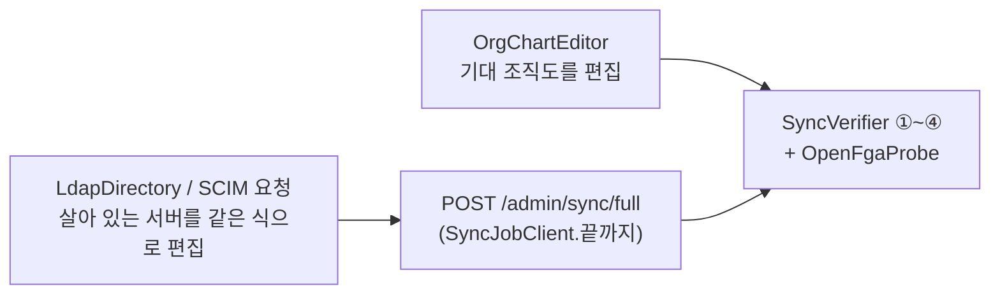
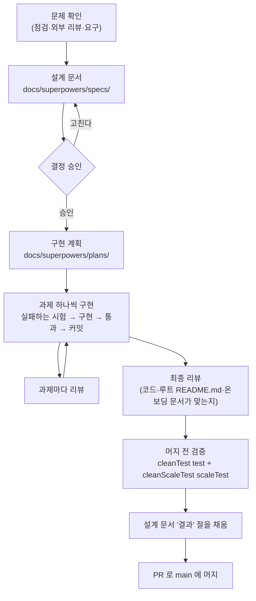

# 개발 가이드

> 기준 커밋: 5675b3c (ops-readiness, main 에 머지됨). 코드가 바뀌면 이 문서도 함께 고친다.
> 읽기 전에: [개요](01-개요.md), [용어집](02-용어집.md), [아키텍처](03-아키텍처.md)

이 문서는 저장소를 받아 빌드하고, 시험하고, 로컬에서 띄우고, 코드를 고치는 방법을 모았다. 마지막 절은 이 저장소에서 일이 어떤 순서로 진행되는지(슬라이드)와, 그 일이 끝날 때 무엇을 함께 고쳐야 하는지를 적는다.

시스템이 무엇을 하는지는 [01 개요](01-개요.md), 코드가 어떻게 나뉘는지는 [03 아키텍처](03-아키텍처.md), 이미 내린 결정과 까닭은 [15 결정 색인](15-결정-색인.md)에 있다.

## 1. 준비물

| 무엇 | 요구 | 어디서 정하나 |
|---|---|---|
| JDK | **17**. Gradle toolchain 이 `languageVersion = 17` 을 요구한다. `settings.gradle` 에 toolchain 자동 내려받기 플러그인이 없으므로 JDK 17 이 로컬에 설치돼 있어야 한다 | 루트 `build.gradle`, `settings.gradle` |
| Gradle | 래퍼가 8.11.1 을 내려받는다. 따로 설치하지 않고 `./gradlew` 를 쓴다 | `gradle/wrapper/gradle-wrapper.properties` |
| Docker | 시험이 Testcontainers(1.20.4)로 OpenFGA·DynamoDB Local 컨테이너를 띄운다. 로컬 실행도 `docker compose` 를 쓴다. 데몬이 떠 있어야 한다 | `gradle/libs.versions.toml`, `docker-compose.yml` |
| 컨테이너 이미지 | 처음 돌릴 때 내려받는다: `openfga/openfga:v1.10.2`, `amazon/dynamodb-local:2.5.3`. 로컬 실행에는 OpenLDAP(`bitnamilegacy/openldap:2.6.10-debian-12-r4`)도 쓴다 | `Containers`(core testFixtures), `docker-compose.yml` |
| Lombok | IDE 에서 어노테이션 처리를 켠다. `@Slf4j`·`@RequiredArgsConstructor` 가 가장 많고 `@Getter`·`@Setter`·`@With`·`@Builder` 도 쓴다 | 루트 `build.gradle` |
| Python 3 | SCIM 요청을 재생하는 `docker/scim/replay.py` 에만 쓴다. 표준 라이브러리만 쓴다 | `docker/scim/replay.py` |
| 문자 인코딩 | UTF-8 이 기본인 환경. 빌드 파일에 인코딩 설정이 없다([03 아키텍처 §8](03-아키텍처.md#8-한국어-식별자)) | — |

OpenFGA 서버는 v1.10.0 이상이어야 한다. 멱등 옵션(`on_duplicate`·`on_missing`, [멱등 옵션](02-용어집.md#멱등-옵션))이 그 버전부터 있기 때문이다. 시험과 `docker-compose.yml` 은 v1.10.2 를 쓴다.

**Docker 가 필요한 모듈과 아닌 모듈.** 시험 코드에서 Testcontainers 를 쓰는 곳을 세어 본 결과다.

| Docker 필요 | Docker 불필요 |
|---|---|
| `storage-dynamodb`, `authz-openfga`, `app-ldap`, `app-scim` | `core`, `connector-ldap`, `connector-scim`, `admin-api` |

Docker 가 없어도 뒤의 네 모듈 시험은 돌릴 수 있다. 로직을 고치는 중이면 이 모듈들(특히 `:core:test`)만 자주 돌린다.

**Docker API 버전.** Testcontainers 가 내장한 docker-java 는 Docker 데몬에 API 버전 1.32 를 요청하는데, 최신 Docker Engine 은 이를 거절해 컨테이너 기동이 막힌다. 그래서 루트 `build.gradle` 이 모든 `Test` 작업(`test`·`scaleTest`)에 시스템 속성 `api.version` 을 준다. 기본값은 `1.44` 이고 환경변수 `DOCKER_API_VERSION` 으로 덮어쓴다.

## 2. 빌드와 시험 명령

### 2.1 명령

| 하고 싶은 일 | 명령 | 비고 |
|---|---|---|
| 평소 시험 전부 | `./gradlew test` | 규모 시험(`@ScaleTest`)은 뺀다. 약 5분 |
| 규모 시험 전부 | `./gradlew scaleTest` | 규모 시험만 돈다. 약 17분 |
| 캐시를 무시하고 다시 | `./gradlew cleanTest test`, `./gradlew cleanScaleTest scaleTest` | 아래 "UP-TO-DATE 함정" |
| 한 모듈 | `./gradlew :core:test`, `./gradlew :app-scim:scaleTest` | 모든 모듈에 `test`·`scaleTest` 가 있다 |
| 한 클래스 | `./gradlew :core:test --tests '*FullSyncUseCaseTest'` | |
| 한 메서드 | `./gradlew :core:test --tests 'dev.starryeye.organization.core.usecase.FullSyncUseCaseTest.최초_동기화는_전체를_생성한다'` | 메서드 이름이 한국어라 따옴표로 감싼다 |
| 규모 시험 하나 | `./gradlew :app-scim:scaleTest --tests '*ScimListingScaleTest'` | |
| 컴파일만 | `./gradlew :app-ldap:compileTestJava :app-scim:compileTestJava` | 시험 코드까지 컴파일된다 |
| 전체 빌드 | `./gradlew build` | `test` 를 포함하고 `scaleTest` 는 포함하지 않는다 |
| 앱 띄우기 | `./gradlew :app-ldap:bootRun`, `./gradlew :app-scim:bootRun` | [4. 로컬에서 돌려 보기](#4-로컬에서-돌려-보기) |
| 시드 만들기 | `./gradlew :connector-ldap:generateScaleSeed`, `./gradlew :connector-scim:generateScimSeed` | [4.3](#43-규모-시드) |

시험 결과는 콘솔에 `passed`·`skipped`·`failed` 가 한 줄씩 나오고(루트 `build.gradle` 의 `testLogging`), 상세 보고서는 모듈의 `build/reports/tests/test/`(규모 시험은 `build/reports/tests/scaleTest/`)에 생긴다.

### 2.2 걸리는 시간

설계 문서에 남은 마지막 머지 전 검증 값이다(커밋 6f149f6, [회수 수렴 설계 §13.1](../superpowers/specs/2026-10-20-revocation-convergence-design.md)). 머신에 따라 다르다.

| | 개수 | 시간 |
|---|---|---|
| `./gradlew cleanTest test` | 1,923개 | 4분 59초 |
| `./gradlew cleanScaleTest scaleTest` | 89개 | 17분 |

시간이 이 정도 나오는지가 "정말 돌았다"는 신호이기도 하다(아래 UP-TO-DATE 함정).

[루트 README.md](../../README.md) 의 시험 절과 루트 `build.gradle` 의 주석은 규모 시험이 "약 9분" 걸린다고 적는다. 마지막 기록(17분)보다 낡은 값이다. 이 묶음은 17분을 따른다.

### 2.3 시험을 둘로 나눈 까닭

- 규모 시험은 클래스마다 약 5천 명 시험용 조직도(또는 10만 명 데이터)와 컨테이너를 새로 띄운다. 클래스가 20개이고 전체 시간의 대부분을 차지한다. 같이 돌리면 평소 확인이 17분을 더 기다려야 한다.
- 구분은 JUnit 태그로 한다. 규모 시험 클래스에 `@ScaleTest`(core testFixtures, 내용은 `@Tag("scale")`)를 붙이면 `test` 가 `excludeTags 'scale'` 로 건너뛰고 `scaleTest` 가 `includeTags 'scale'` 로 그것만 돈다. 태그 문자열은 `ScaleTest` 한 곳과 루트 `build.gradle` 의 두 곳이 같아야 한다.
- `scaleTest` 는 **모든 모듈에 등록**한다. 규모 시험이 있는 모듈에만 두면, 다른 모듈에 규모 시험이 새로 생겼을 때 `test` 에서는 빠지는데 돌려 줄 작업이 없어 아무도 안 돌리게 된다.
- `check`·`build` 에는 일부러 걸지 않았다. 기본 빌드를 빠르게 두려는 것이다.
- CI 가 아직 없다. 그래서 **브랜치를 머지하기 전에 `test` 와 `scaleTest` 를 둘 다 돌린다**는 약속이 규모 시험이 도는 유일한 자리다([6.5](#65-머지-전)).
- Gradle 8 은 태그로 걸러 시험이 하나도 없어도 실패하지 않는다. Gradle 9 로 올릴 때 `scaleTest` 가 빈 모듈에서 실패하는지 다시 볼 것(루트 `build.gradle` 의 주석).

### 2.4 지켜야 할 것

1. **Gradle 은 한 번에 하나만 돌린다.** 두 실행이 같은 모듈의 `build/` 디렉터리(시험 결과 파일, test-fixtures jar)를 함께 쓰고, 시험이 Docker 컨테이너와 호스트 포트도 함께 쓴다. 이 프로젝트의 작업 기록에는 과거에 일어난 일이 둘 있다.
   - 빌드 둘이 동시에 돌며 test-fixtures jar 를 읽지 못해 가짜 실패 29건이 났다.
   - 백그라운드로 도는 시험이 끝나기 전에 `cleanTest` 를 걸어, 앞 실행의 결과 파일을 지워 앞 실행이 가짜로 실패했다.
   - 백그라운드로 돌렸다면 끝났다는 신호(작업 완료 알림)를 받은 뒤에 다음 Gradle 을 시작한다. 프로세스 목록에서 사라졌다는 것은 기준이 아니다. 테스트 JVM 이 종료 훅을 도는 중에도 Gradle 은 끝나지 않은 것이다.
   - Testcontainers 는 호스트 포트를 무작위로 받으므로 포트 번호가 겹쳐 실패하는 구조는 아니다. 그래도 컨테이너를 띄우는 시험끼리 Docker 와 CPU 를 나눠 쓰면 시간에 기댄 시험이 흔들릴 수 있다(추정이다. 확인한 것은 위 둘이다).
2. **UP-TO-DATE 함정.** 입력이 바뀌지 않은 시험 작업은 Gradle 이 건너뛴다. 다른 곳에서 이미 돌린 모듈이 있으면 `./gradlew test` 가 30초 만에 초록으로 끝나는데, 그것은 아무것도 돌지 않은 것이다. 머지 전 검증에는 `cleanTest`·`cleanScaleTest` 를 앞에 붙인다.
3. **긴 스위트는 한 곳에서만 돌린다** — 사람이 직접 하거나 [메인 세션](02-용어집.md#메인-세션)이 한다. [서브에이전트](02-용어집.md#서브에이전트)에는 `:core:test`, `:connector-ldap:test`, `:authz-openfga:test` 같은 빠른 모듈 시험만 맡긴다.
4. 새 시험을 만들면 먼저 그 클래스만 돌려 본다(2.1). 모듈 전체나 전체 스위트는 그 뒤에 한다.

## 3. 시험의 구조

### 3.1 여섯 층

| 층 | 모듈 | 무엇으로 | Docker | 대표 클래스 |
|---|---|---|---|---|
| 단위 | `core` | **가짜(fake) 포트**. 도메인·튜플 변환·유스케이스를 고립시켜 본다 | 아니오 | `FullSyncUseCaseTest`, `IncrementalSyncUseCaseTest`, `TupleMapperTest`, `SyncJobsTest` |
| LDAP 읽기 | `connector-ldap` | **임베디드 LDAP**(UnboundID in-memory) | 아니오 | `GroupOfNamesStrategyTest`, `DitStrategyTest`, `LdapDirectorySnapshotSourceTest` |
| HTTP 계층 | `connector-scim`, `admin-api` | `WebTestClient` + core 의 가짜 포트 | 아니오 | `ScimUserHandlerTest`, `ScimGroupHandlerTest`, `AdminQueryControllerTest` |
| 어댑터 | `storage-dynamodb`, `authz-openfga` | **실제 DynamoDB Local·OpenFGA 컨테이너**(Testcontainers) | 예 | `DynamoDbTupleSnapshotRepositoryTest`, `OpenFgaRelationTupleWriterTest` |
| 끝단(end-to-end) | `app-ldap`, `app-scim` | `@SpringBootTest` 로 앱 전체 + 컨테이너 둘(+ LDAP 은 임베디드 서버)을 띄우고 **HTTP 로만** 구동한다 | 예 | `LdapSyncEndToEndTest`, `ScimEndToEndTest`, `LdapRevocationConvergenceEndToEndTest` |
| 규모 | `storage-dynamodb`, `app-ldap`, `app-scim` | 끝단과 같되 `@ScaleTest`. 5천 명 시험용 조직도 또는 10만 명 | 예 | [3.6](#36-규모-시험) |

층마다 맡은 일이 다르다.

- 단위 시험은 로직을 가장 촘촘히 본다. 실제 로직이 거의 전부 `core` 에 있기 때문이다.
- 어댑터 시험은 "이 포트의 약속을 실제 저장소가 지키는가"를 본다. DynamoDB 키 모양, 조건부 쓰기, 일관성, OpenFGA 의 쓰기 단계·거절 쪼개기·차단기가 여기서 확인된다.
- 끝단 시험은 **결선**을 본다. 모듈 시험이 모두 통과해도 빈이 잘못 이어졌으면 아무것도 돌지 않는다. 그래서 끝단 시험은 관리 API(`POST /admin/sync/full` 등)와 SCIM 엔드포인트로만 구동하고, 결과를 OpenFGA `Check` 와 DynamoDB 로 확인한다.
- Mockito 는 거의 쓰지 않는다(시험 소스 234개 파일 가운데 네 파일). 포트를 흉내 내야 하면 손으로 쓴 가짜를 쓴다.

### 3.2 가짜(fake)

가짜는 `core` 의 testFixtures(`core/src/testFixtures/.../core/fake`)에 있다. 다른 모듈의 시험도 `testFixtures(project(':core'))` 로 가져다 쓴다. 실제 어댑터와 **같은 약속**을 지키되 메모리에서 돌고, 실패·지연·부분 반영을 시험이 켜고 끌 수 있는 손잡이를 단다.

| 가짜 | 흉내 내는 포트 | 손잡이와 기록 |
|---|---|---|
| `FakeTupleWriter` | `RelationTupleWriter` | `stored`(가짜 [장부](02-용어집.md#장부) — 쓰면 들어가고 지우면 빠진다), `written`·`deleted`·`appliedDeltas`(기록). **`failFor(조건)`** — 그 줄은 [확정 실패](02-용어집.md#확정-실패)("테스트용 실패"). **`lostResponseFor(조건)`** — 서버는 반영했는데 응답을 잃은 것: `stored` 에는 실제로 반영하되 결과에는 [불확실 실패](02-용어집.md#불확실-실패)("테스트용 응답 유실")로 넣는다. `failFor` 와 겹치면 `failFor` 가 이긴다. **`abortWhen(조건)`** — 그 [델타](02-용어집.md#델타)는 평소처럼 적용한 뒤 [연속 실패 차단기](02-용어집.md#연속-실패-차단기)가 선 것처럼 `TupleWriteAbortedException` 으로 끝낸다(`partial` 이 적용된 결과). `delay`(응답 지연), `onApply(훅)`(적용 도중 상태 들여다보기) |
| `FakeTupleScanner` | `RelationTupleScanner` | `FakeTupleWriter.stored` 를 그대로 흘린다([장부 훑기](02-용어집.md#장부-훑기)). `scanCount`, `failWith(예외)` |
| `FakeTupleChecker` | `RelationTupleChecker` | `allowed` 에 넣은 튜플만 `true`. `checked`(물어본 기록), `failFor(조건)`, `delayBy(함수)`, `maxInFlight`(동시에 열린 Check 의 최대 수 — 직렬인지 병렬인지 본다). `existing` 은 직렬로 `check` 를 부른다 |
| `FakeSnapshotRepository` | `TupleSnapshotRepository` | `saved`, `writing`([기록 중 표시](02-용어집.md#기록-중-표시) — `markWriting` 이 켜고 `save` 가 끈다. 시험이 켜 "지난 회차가 기록 전에 멈춤"을 흉내 낸다), `purgeCalls`, `failFindLatest`·`failSave`·`failMarkWriting`. `baselineState()` 는 `WRITING`/`NONE`/`PRESENT` 를 준다([기준선 상태](02-용어집.md#기준선-상태)) |
| `FakeStateRepository` | `DirectoryStateRepository` | 메모리 맵 `users`·`groups`, 읽기 호출 기록(`findGroupCalls`·`findUsersCalls`… — 읽기 횟수를 단언한다), `쓴순서`(쓰기 순서), `cutEdges`([보류 목록](02-용어집.md#보류-목록)), `uniqueMarkers`([표지판](02-용어집.md#표지판)), `failLoadAll`, `failReplaceWithAfter`(전체 교체가 N건 뒤 끊김), `failReleaseUnique`·`failReplaceCutEdges`·`failClearUniqueMarkers` |
| `FakeQueryRepository` | `DirectoryQueryRepository` | `FakeStateRepository` 의 맵을 읽는다. `userName`·조직명 대소문자 무시·소문자 순 정렬, `calls`, `times`(생성·변경 시각) |
| `FakeSearchRepository` | `DirectorySearchRepository` | 접두사 검색·커서 페이징, `failWith`, `missingGroups`(멤버십은 있는데 조직 레코드가 사라진 상태), `findGroupSummaryCalls` |
| `FakeMutationLock` | `MutationLock` | 프로세스 안 [변경 락](02-용어집.md#변경-락). `acquired`·`released`·`renewed`·`renewAttempted`, `failAcquire`, `failRenew`(리스 상실), `transientRenewFailures`(스로틀 같은 일시 오류 N번), `failRelease`, `isHeld()`. 이미 쥐고 있으면 쥔 쪽의 [용도](02-용어집.md#용도)로 `LockUnavailableException.잡혀_있다` 를 낸다 |
| `FakeSyncRunRepository` | `SyncRunRepository` | `finished`, `seed(기록)`(지난 프로세스가 남긴 RUNNING 흉내), `failStart`, **`awaitFinished(runId)`**(최대 10초 기다린다 — 회차는 요청과 떼어 돌기 때문에 시험이 이것으로 결과를 받는다). `abandon` 은 RUNNING 일 때만 닫는 조건부 쓰기를 흉내 낸다 |
| `FakeSnapshotSource` | `DirectorySnapshotSource` | `willReturn(디렉터리 그림)`, `willFail(예외)`, `fetchCount` |
| `FakeAuditLog` | `AuditLog` | `events`, `failWith`, `missingLines`(쓰기마다 빠졌다고 답할 줄 수), `onWrite`(쓰는 순간 훅 — 그때 락을 쥐었는지 본다), `entriesOf`·`lastOf` |
| `FakeDailyJobClaims` | `DailyJobClaims` | 같은 작업·날짜의 첫 `claim` 만 `true` |
| `FakePageBookmarkRepository` | `PageBookmarkRepository` | 만료 없는 메모리 [책갈피](02-용어집.md#책갈피). `saved` |

규칙:

- **포트를 바꾸면 가짜도 바꾸고, 가짜의 시험도 함께 고친다.** 가짜 자체의 시험이 있다: `FakeTupleWriterTest`, `FakeSnapshotRepositoryTest`, `FakeMutationLockTest`, `FakeSearchRepositoryTest`.
- 가짜는 **실제와 같은 약속**을 지킨다. 예를 들어 `FakeMutationLock` 은 실제 락처럼 쥔 쪽의 용도로 기다릴 시간이 정해지는 오류를 낸다. 가짜가 실제보다 관대하면 단위 시험은 통과하고 운영에서만 깨진다.
- 가짜가 흉내 내지 않는 것도 있다. `FakeTupleWriter` 는 [쓰기 단계](02-용어집.md#쓰기-단계)·400 쪼개기·차단기의 셈을 하지 않는다. 그것은 `OpenFgaRelationTupleWriter*Test`(authz-openfga)가 보고, 가짜는 "그런 결과가 왔을 때 유스케이스가 어떻게 하나"를 보는 손잡이만 준다.
- `FakeStateRepository` 의 읽기 호출 기록은 비용 회귀를 잡는 장치다. "10만 명 조직에서 직원 GetItem 이 0번이다" 같은 약속을 기록의 개수로 단언한다.

### 3.3 시험용 조직도와 검증 하네스

규모 시험과 끝단 시험은 같은 부품 위에 선다. 모두 `core` testFixtures 의 `fixture` 패키지에 있다.

> 이 절의 "[시험용 조직도](02-용어집.md#시험용-조직도)"는 `OrgChart` 를 가리킨다. 용어집의 [조직도](02-용어집.md#조직도)(디렉터리의 내용)와 달리, 직원·조직·소속을 담은 시험 입력이자 **정답**인 값이다. 검증 부품들은 [하네스](02-용어집.md#하네스)라 부른다.

| 부품 | 하는 일 |
|---|---|
| `OrgChartFixture.오천명()` | 결정적인(난수 없는) 약 5천 명 시험용 조직도. 부문마다 깊이가 달라 롤업 체인이 3~6층으로 흩어진다. 중간 조직이 직속 직원과 하위 조직을 함께 갖는다. 1,600명이 직속인 큰 조직 하나(Active Directory 범위 검색을 밟으려는 것) — `Landmarks` 의 자바독은 "직속 500명" 이라 적지만 낡은 값이다, 빈 조직 5개, 겸직 직원이 있다 |
| `OrgChart`, `Landmarks`, `Membership` | 시험용 조직도 한 벌, 시나리오가 잡을 이름 붙은 손잡이(깊이별 대표 직원, 옮길 팀, 지울 실 등), 소속 한 줄. `OrgChart` 는 편집으로 **사라진 소속**도 기억한다 — 하네스가 "지웠어야 할 권한이 남았는가"를 물으려면 필요하다 |
| `OrgChartEditor` | 시험용 조직도를 편집해 새 `OrgChart` 를 만든다(직원 삭제·이동, 조직 이동·삭제, 겸직 추가·해제, 비활성화…). 커넥터 쪽에 같은 편집을 가하는 짝이 있다: LDAP 은 `LdapDirectory`(connector-ldap testFixtures), SCIM 은 `ScimRequestRenderer`(connector-scim testFixtures)가 만드는 요청이다 |
| `ChartExpectation` | 시험용 조직도가 OpenFGA 에 **요구하는 것** — 있어야 할 튜플과, 물어볼 후보(없어야 함을 확인할 것). **운영의 `TupleMapper` 를 쓰지 않고 시험용 조직도만 보고 계산한다.** 합치지 말 것: 운영이 틀리면 정답도 같이 틀려 통과한다. 둘이 같은 규칙을 따른다는 사실은 `ChartExpectationAgreementTest` 한 곳에서만 확인한다 |
| `SyncVerifier` | 매 단계 끝의 공통 검증 넷: ① 현재상태가 기대와 같은가 ② 기대 튜플이 모두 성립하는가(양성) ③ 후보에서 기대를 뺀 튜플이 모두 성립하지 않는가(음성) ④ 조상 체인이 모두 `member` 이고 자손·형제 가지는 아닌가(롤업). **③이 가장 중요하다** — "있어야 할 것이 있다"만 보면 퇴사자 권한이 남은 것을 영원히 못 잡는다. 포트에만 의존해 LDAP·SCIM 양쪽 시험이 같은 잣대를 쓴다 |
| `RollupSampling` | ④의 표본. 기본은 대표 6명 + 24명(`기본값()`), `전수()` 는 전 직원이라 비싸다. 정렬은 처음 시험용 조직도의 id 로 한다(SCIM 이 id 를 새로 발급해도 표본이 실행마다 같다) |
| `OpenFgaProbe`(authz-openfga testFixtures) | 우리 어댑터를 거치지 않고 **OpenFGA SDK 로 직접** 묻고 쓰고 지운다. 어댑터에 결함이 있으면 하네스는 그 결함에 같이 속는다. 같은 사실을 서로 다른 경로로 두 번 물어 답이 갈리면, 갈렸다는 것 자체가 결함이다. 열거 API 는 여기서도 쓰지 않는다 |
| `ScaleVerification`(authz-openfga testFixtures) | `하네스로_검증한다` 와 `두_경로로_검증한다`(하네스 + 프로브). 하네스 쪽은 최대 10분까지 기다린다 |
| `SyncJobClient`(admin-api testFixtures) | `끝까지(client, uri)` — `POST` 로 걸고(202 와 RUNNING 기록을 확인) 끝날 때까지 `GET /admin/sync/runs/{runId}` 를 200ms 간격으로 본다(최대 20분, Awaitility). 끝난 기록의 본문을 돌려줘 뒤에 `jsonPath` 단언을 잇는다 |
| `ScimIdBook`, `ScimRequestRenderer`(connector-scim testFixtures) | 서버가 발급한 id 와 시험용 조직도의 id 를 번역한다. 시험용 조직도를 SCIM 요청 열로 바꾼다. SCIM 은 IdP 가 받은 `id` 로만 참조할 수 있으므로 멤버를 늦게 보내던 시나리오는 Entra 의 순서(빈 조직 → 직원 → 멤버 PATCH)로 다시 썼다 |
| `LdifRenderer`, `DitLdifRenderer`(connector-ldap testFixtures) | 시험용 조직도를 groupOfNames·DIT 의 LDIF 로 바꾼다. DIT 는 겸직을 표현하지 못하므로 먼저 겸직을 푼다 |
| 호출 계수기 | `DynamoDbReadCounter`·`TupleCheckCounter`(app-scim 시험), `GetCounter`·`WriteCounter`(storage-dynamodb 시험). 읽은 아이템 수·Check 횟수·쓰기 횟수를 센다 |

시나리오 하나는 이런 모양이다.



두 편집을 나란히 부르고, 앱을 한 번 돌린 뒤, 하네스가 둘이 만난다고 말하는지 본다. 한쪽만 손으로 맞추면 검증이 실패했을 때 구현이 틀렸는지 기대값이 틀렸는지 알 수 없다.

### 3.4 Testcontainers

컨테이너 정의는 `Containers`(core testFixtures) **하나**다. 새 컨테이너 정의를 만들지 말고 `Containers.openFga()`·`Containers.dynamoDb()` 를 쓴다. 규모 시험은 `ScaleContainers`(authz-openfga testFixtures)가 같은 것을 한 번 감싸고, 컨테이너 주소를 스프링 설정(`openfga.api-url`, `dynamodb.endpoint`)으로 등록하는 `주소를_등록한다` 를 준다.

| 약속 | 까닭 |
|---|---|
| 호출마다 **새 인스턴스**를 만들고, 클래스마다 `@Container static final` 필드에 담는다. 클래스끼리 공유하지 않는다 | DynamoDB 테이블 이름과 OpenFGA store 이름이 시험 설정에 고정이라, 공유하면 한 클래스가 남긴 상태가 다음 클래스의 기준선이 된다 |
| 대기 조건이 "그 서비스만 주는 응답"을 확인한다: OpenFGA 는 `/healthz` 가 200 이고 본문에 `SERVING`, DynamoDB 는 `/` 가 400 이고 본문에 `MissingAuthenticationToken` | 아래 "포트가 겹쳐도" |
| 가짜가 답하면 컨테이너를 새로 띄워 새 포트를 받는다. 한 번 시도는 30초(`시작_대기`), 최대 3번(`시작_시도`) | 같음 |
| 어댑터 시험의 부모 클래스는 컨테이너를 `static` 필드 하나로 들고 있고(그 클래스를 상속한 시험이 쓴다), 대신 시험마다 상태를 새로 만든다: `DynamoDbTestSupport` 는 시험마다 테이블(`organization-test`)을 지우고 다시 만들고, `OpenFgaTestSupport` 는 시험마다 무작위 store 이름(`test-<UUID>`)을 쓴다 | 컨테이너 기동이 느려 한 클래스 안의 시험들이 컨테이너를 나눠 쓰되, 시험끼리는 간섭하지 않게 |

**포트가 겹쳐도 엉뚱한 곳과 통신하지 않는다.** macOS 에서는 같은 포트 번호를 "127.0.0.1 전용" 리스너(IntelliJ 같은 개발 도구가 여럿 연다)와 "모든 주소" 리스너가 함께 쓸 수 있고, `localhost` 로 가는 연결은 전용 쪽이 받는다. Docker Desktop 은 호스트 포트를 리눅스 VM 안에서 골라 macOS 쪽 사용 여부를 모른다. 그래서 컨테이너가 받은 포트가 IntelliJ 의 포트와 같으면 시험이 엉뚱한 응답(본문 없는 404, DynamoDB 자리에 HTTP 999)을 받고 간헐적으로 실패했다. 막는 장치는 셋이다.

1. 컨테이너 대기 조건이 서비스 고유의 응답을 확인한다(위). 그 확인을 `ContainersSquatterTest`(storage-dynamodb)가 일부러 가짜를 먼저 띄워 시험한다.
2. 테스트 서버는 `127.0.0.1` 에만 연다(`application-test.yml` 의 `server.address`). 운영체제가 이미 쓰는 번호를 주지 않는다.
3. 임베디드 LDAP 도 `127.0.0.1` 에만 뜬다([3.5](#35-임베디드-ldap)).

### 3.5 임베디드 LDAP

`connector-ldap` 의 시험과 두 앱의 끝단 시험은 UnboundID in-memory 서버를 쓴다. 도커 없이 밀리초 단위로 뜬다. 실제 OpenLDAP 으로 확인하는 일은 `docker-compose` 가 맡는다([4.2](#42-app-ldap-과-openldap)).

- **리스너는 `EmbeddedLdapListener`(connector-ldap testFixtures)로 만든다.** 127.0.0.1 의 빈 포트(포트 0)에 뜨고, 접속 주소도 `ldap://127.0.0.1:<포트>` 다(`localhost` 가 아니다).
- **까닭.** 모든 주소(`*`)에 뜨면 macOS 가 같은 포트 번호를 127.0.0.1 전용 리스너와 함께 쓰게 두고, 127.0.0.1 연결은 전용 쪽이 받는다. 바인드 요청이 엉뚱한 프로세스로 가 `LDAP connection has been closed` 로 끊기던 간헐 실패가 있었다. 127.0.0.1 에 뜨면 이미 쓰이는 포트에는 뜨지 못하므로 포트 0 이면 운영체제가 겹치지 않는 포트를 고른다. `EmbeddedLdapListenerTest` 가 남의 포트를 몰래 함께 쓰지 않는지 본다.
- **`EmbeddedLdapSupport`**(connector-ldap 시험의 부모 클래스, 28개 클래스가 쓴다)는 서버를 `@BeforeEach` 마다 새로 띄우고 각 시험이 `ldif()` 로 자기 조직도를 준다. `maxSizeLimit()` 으로 서버측 엔트리 상한을 걸 수 있다(실제 디렉터리는 상한을 두고 `SIZE_LIMIT_EXCEEDED` 를 붙여 답한다. 상한이 없는 서버로는 조용한 잘림을 재현할 수 없다). `서버설정을_고친다` 는 요청을 엿보는 인터셉터를 다는 자리다.
- **운영과 같은 설정으로 만든다.** 템플릿은 운영(`LdapConfig`)과 같은 도우미로 접속·읽기 제한(`타임아웃_환경`)과 `ignoreSizeLimitExceededException` 을 건다. 따로 적으면 운영과 검증이 표류한다. 읽기 제한을 같이 걸지 않았을 때는 응답이 오지 않는 읽기 하나가 전체 `test` 를 1시간 붙잡은 적이 있다.
- 이름 기반 id(groupOfNames 직원 `uid`·조직 `cn`, DIT 조직 `ou`)가 필요한 시험은 `이름기반()` 설정을 쓴다. 운영 기본값은 불변 id(`entryUUID`)다. 앱 끝단 시험의 `application-test.yml` 도 이름 기반으로 둔다. 불변 id 자체는 `ImmutableIdentifierTest`(connector-ldap), `LdapImmutableIdEndToEndTest`·`LdapDitImmutableIdEndToEndTest`·`LdapEntryUuidScaleTest`(app-ldap)가 본다.
- **한계.** 임베디드 서버는 Active Directory 가 아니다. 범위 검색(`member;range=…`)·`objectGUID`·기본 그룹 같은 AD 고유 동작은 서버 응답 모양을 흉내 낸 시험으로 본다. **실제 AD 에서 돌려 본 적은 없다.** 실제 IdP(Entra·Okta)와 연동해 본 적도 없다. 인증이 없어 붙일 수 없기 때문이다.

### 3.6 규모 시험

`@ScaleTest` 가 붙은 클래스는 20개다.

| 모듈 | 클래스 | 데이터 |
|---|---|---|
| `app-ldap` (8) | `LdapScaleScenarioTest`, `DitScaleSyncTest`, `LdapDeletionGuardScaleTest`, `LdapInterruptedSyncScaleTest`, `LdapPagingScaleTest`, `LdapScaleSyncCostTest`, `LdapEntryUuidScaleTest`, `AdminQueryScaleTest` | 모두 `OrgChartFixture.오천명()` |
| `app-scim` (9) | `ScimScaleScenarioTest`, `ScimScaleSyncCostTest`, `ScimProvisioningOrderScaleTest`, `ScimRebuildLockScaleTest`, `ScimLimitsAndRecoveryScaleTest`, `ScimWriteContentionScaleTest` | 5천 명(`ScimWriteContentionScaleTest` 는 직원 400명) |
| | `ScimListingScaleTest`, `ScimLargeGroupReadScaleTest`, `ScimGroupMemberPatchScaleTest` | **10만 명**(`전체 = 100_000`) — 5천 명 시험용 조직도에 직원을 더하거나 저장소에 직접 심는다 |
| `storage-dynamodb` (3) | `ReplaceWithScaleTest`, `BulkPathScaleTest`, `AuditLogScaleTest` | **10만 명** 저장소 수준 |

원칙:

- **실제 운영 규모는 10만 명 이상이다.** 5천 명 시험이 통과했다는 것으로 운영 규모를 판단하지 않는다. 그래서 요청마다 전원을 읽는 설계를 의심하고, 비용이 규모에 따라 커지는 곳은 위 10만 명 클래스로 잰다. 앱 전체를 거치는 시험이 5천 명인 까닭은 시간이다. 10만 명은 저장소·유스케이스 수준에서 잰다(`BulkPathScaleTest` 가 "앱 규모 시험은 5천 명이라 10만 명의 요청 수와 …" 를 이유로 적는다).
- **시간으로 단언하지 않고 센다.** DynamoDB Local 은 AWS 와 속도가 달라 시간으로는 아무것도 증명하지 못한다. 규모 시험은 읽은 아이템 수·GetItem/BatchGet 횟수·Check 횟수·쓰기 횟수를 계수기로 단언하고, 걸린 시간은 기록만 한다(`ScimLargeGroupReadScaleTest`: 응답에 `Content-Length` 가 없고 멤버 100,000개가 모두 실리는지를 단언).
- 규모 시험은 클래스 안에서 `@TestMethodOrder(OrderAnnotation)` 로 순서에 기댄다. 첫 시험이 데이터를 심고 뒤 시험이 그 위에서 잰다.
- 시나리오 이름 `L12`·`S16` 같은 번호는 **규모 시험의 시나리오 번호**(LDAP 17건·SCIM 19건에서 출발)다. 설계 문서와 주석에 나오는 `C1`·`M14`·`S20`·`P3` 같은 번호는 **전체 점검(2026-09-28)의 발견 번호**라 다른 것이다. 둘 다 `S` 로 시작하니 헷갈리기 쉽다.

### 3.7 이름과 모양

- 시험 클래스는 `…Test`, 끝단은 `…EndToEndTest`, 규모는 `…ScaleTest`(또는 `…ScaleScenarioTest`)다.
- 메서드 이름은 **한국어 문장을 `_` 로 이은 것**이다: `최초_동기화는_전체를_생성한다`. 이름만 읽어도 무엇을 확인하는지 알아야 한다.
- 모든 시험에 `@DisplayName("…")` 으로 한국어 문장을 단다. 메서드 이름보다 길어도 된다: "변경이 없으면 OpenFGA를 호출하지 않고 새 스냅샷도 만들지 않는다".
- 본문은 `// given`, `// when`, `// then` 으로 나눈다. 단언은 AssertJ(`assertThat`)다. 리액티브 체인은 가상 시간이 필요하면 `StepVerifier.withVirtualTime`, 아니면 `.block()` 으로 받는다 — 시험 코드에서는 `.block()` 을 써도 된다.
- 고정 시각은 `Clock.fixed(…)` 를 주입한다.

```java
@Test
@DisplayName("최초 동기화는 읽어온 전체를 생성 대상으로 삼아 OpenFGA에 반영한다")
void 최초_동기화는_전체를_생성한다() {
    // given
    source.willReturn(조직도(Set.of("kim", "lee"), "DEV002"));

    // when
    var run = 동기화한다(SyncTrigger.SCHEDULED);

    // then
    assertThat(run.status()).isEqualTo(SyncStatus.SUCCEEDED);
    assertThat(writer.appliedDeltas.get(0).toWrite()).containsExactlyInAnyOrder(
            RelationTuple.directMember("kim", "DEV002"),
            RelationTuple.directMember("lee", "DEV002"));
}
```

- 끝단 시험의 뼈대(`LdapSyncEndToEndTest`): `@Testcontainers`, `@ActiveProfiles("test")`, `@SpringBootTest(webEnvironment = RANDOM_PORT)`, 클래스마다 `@Container static final` 컨테이너 둘, `@DynamicPropertySource` 로 컨테이너 주소(와 임베디드 LDAP 주소)를 주입한다.
- `application-test.yml`(app-ldap·app-scim 각각의 `src/test/resources`)이 시험의 기본 설정이다.
  - `server.address: 127.0.0.1`
  - 스케줄러를 끈다. app-ldap 은 `sync.cron: "-"`·`sync.purge-cron: "-"`, app-scim 은 `sync.archive-cron: "-"`·`sync.purge-cron: "-"`. cron 값 `-` 는 그 스케줄을 끈다.
  - `ldap.retry-min-backoff: 10ms`, `retry-max-backoff: 50ms`(app-ldap)
  - 테이블·store 이름은 `organization-e2e`·`organization-scim-e2e`. `dynamodb.create-table-on-startup: true` 를 적는다(클래스 기본값은 `false`). `openfga.create-store` 는 앱 `application.yml` 의 `true` 를 그대로 쓴다
  - 두 앱 모두 헬스의 `show-details: always`(운영 기본값은 `when-authorized` — 시험은 인증 없이 컴포넌트별 상태를 본다)

### 3.8 알려진 함정

| 함정 | 증상 | 처방 |
|---|---|---|
| **UP-TO-DATE** | `./gradlew test` 가 30초에 초록 | `cleanTest test`, `cleanScaleTest scaleTest` ([2.4](#24-지켜야-할-것)) |
| **Gradle 동시 실행** | 설명할 수 없는 가짜 실패, 결과 파일 오류 | 한 번에 하나 |
| **LDAP 재시도 대기가 길다** | 재시도를 타는 시험이 분 단위로 늘어진다 | 운영 기본값은 최대 5번, 10초에서 두 배씩 2분까지다(대기 합 약 2~6분, 지터 때문에 달라진다). 재시도 경로를 타는 시험은 `retryMinBackoff`·`retryMaxBackoff` 를 10~50ms 로 줄인다. 앱 끝단은 `application-test.yml` 이 하고, `connector-ldap` 시험은 시험마다 `LdapProperties` 에 직접 준다 |
| **응답이 오지 않는 LDAP 읽기** | 시험 하나가 끝없이 붙잡는다 | `EmbeddedLdapSupport` 가 운영과 같은 접속·읽기 제한을 건다. 새 LDAP 시험 부모를 만들 때도 같은 도우미를 쓴다 |
| **127.0.0.1 전용 리스너와 포트 겹침**(macOS) | `LDAP connection has been closed`, 본문 없는 404, DynamoDB 의 HTTP 999 | [3.4](#34-testcontainers)·[3.5](#35-임베디드-ldap) |
| **시간에 기댄 시험: 가상 시간과 0ms 대기** | 가끔만 실패한다 | 락 획득 백오프는 full jitter 라 첫 대기가 0ms 일 수 있다(난수 < 0.1 이면 `(long)(10ms × 난수)` 가 0). 가상 시간 스케줄러는 0ms 예약을 그 자리에서 돌려, 시험 본문이 남의 리스를 반납하기 전에 둘째 시도가 나간다. 시험이 "남이 놓는 순간"을 대기 시간과 무관하게 첫 시도 직후에 두도록 고쳤다(`IncrementalSyncLocalQueueTest`의 `세는_락`). 300번 되풀이에 41번 실패하던 것이 0번이 됐다. 운영 코드는 그대로다 — 0ms 는 정상 값이다 |
| **시간에 기댄 시험: 주기의 배수** | 가끔만 실패한다 | `LeaseKeeperTest`: 일의 길이 300ms 가 갱신 주기 50ms 의 배수라 마지막 틱이 완료와 겹쳤다. 일의 길이를 주기의 배수가 아닌 275ms 로 하고, 갱신을 멈추는 `doFinally` 가 `block()` 이 돌아온 뒤에 돌 수 있으므로 멈출 틈(`Thread.sleep(100)`)을 준 뒤에 센다 |
| **벽시계 단언** | 컨테이너가 느린 날 실패 | 시간 임계치를 단언하지 않는다. 카운터(`FakeMutationLock.renewAttempted` 등)나 가상 시간을 쓴다. 락 대기 500ms 가 기준선 적재 6,476건 전체에 걸려 플레이크가 확정적이던 `ScimRebuildLockScaleTest` 의 사례가 있다 |
| **가상 시간 정리** | 다음 시험이 가상 시계에서 돈다 | `VirtualTimeScheduler.getOrSet()` 을 쓴 시험은 `@AfterEach` 에서 `VirtualTimeScheduler.reset()` |
| **수정 전에 실패하는지 확인하지 않은 시험** | 시험이 아무것도 못 잡는다 | 새 시험은 고치기 전 코드에서 **실패하는 것**을 확인한다. 방어를 일부러 끄고 돌려 그 시험이 잡는지 보는 변이 확인도 한다 |
| **시험 JVM 힙** | — | 이 저장소의 빌드 파일에는 힙 설정(`maxHeapSize`)이 없고 `gradle.properties` 도 없다. 시험 JVM 의 힙이 어떻게 잡히는지는 확인하지 못했다. 10만 명 시험에서 메모리 오류가 나면 이 설정부터 본다 |
| **AD·IdP 와 실제 연동은 없다** | 규격 대조는 문서로만 했다 | [13 §4.5 실제 AD](13-한계와-알려진-문제.md#45-실제-ad-로-확인하지-못한-동작), [13 §2.10 IdP](13-한계와-알려진-문제.md#210-idp-마다-다른-동작은-확인하지-못했다) |
| **DynamoDB Local 과 PITR·삭제 보호** | PITR 시험이 `UnknownOperation` 으로 실패한다, 테이블 지우기가 거절된다 | DynamoDB Local 2.5.3 은 삭제 보호를 지키지만 PITR API(`UpdateContinuousBackups`·`DescribeContinuousBackups`)는 거절한다. PITR 갈래는 가짜 클라이언트(`ContinuousBackupsStubClient`, `TableProtectionTest`)로 시험한다. 테이블을 지우는 도우미(`DynamoDbTestSupport.dropTableIfExists`)는 삭제 보호를 먼저 끈다 |
| **DynamoDB 시간 한도** | 규모 시험의 DynamoDB 호출이 시간 한도로 끊긴다 | 클라이언트의 시도 10초·호출 60초(`dynamodb.api-call-*`)는 운영 기본값이다. 규모 시험의 Local 이 부하 아래에서 그보다 느리면 시험 yml 만 늘리고 설계 문서의 결과 절에 적는다 |
| **새 관리 컨트롤러** | 오류가 problem details 가 아니라 스프링 기본 오류 응답이다 | 관리 API 예외 처리기는 `@AdminApi` 를 단 컨트롤러에만 걸린다. 새 관리 컨트롤러에 그 표지를 단다([09 — 오류](09-관리-API.md#오류)) |

## 4. 로컬에서 돌려 보기

### 4.1 인프라 띄우기

```bash
docker compose up -d                              # OpenFGA + DynamoDB Local + OpenLDAP (app-ldap 용)
docker compose up -d openfga dynamodb-local       # app-scim 용 (LDAP 이 필요 없다)
```

| 서비스 | 이미지 | 주소 | 비고 |
|---|---|---|---|
| OpenFGA | `openfga/openfga:v1.10.2` | http://localhost:8080 (플레이그라운드 http://localhost:3000) | `OPENFGA_DATASTORE_ENGINE: memory` — 컨테이너를 내리면 장부가 사라진다 |
| DynamoDB Local | `amazon/dynamodb-local:2.5.3` | http://localhost:8000 | `-inMemory -sharedDb` — 컨테이너를 내리면 테이블이 사라진다 |
| OpenLDAP | `bitnamilegacy/openldap:2.6.10-debian-12-r4` | ldap://localhost:1389 | 사람이 직접 훑어 보는 용도(자동 시험은 임베디드 서버를 쓴다). 베이스 `dc=example,dc=com`, 관리자 `cn=admin,dc=example,dc=com` / `adminpassword` |
| app-ldap | — | http://localhost:8081 | |
| app-scim | — | http://localhost:8082 | |

- `bitnami/openldap` 이미지는 무료 배포가 중단돼 `bitnamilegacy` 의 마지막 빌드를 쓴다. 보안 패치가 더 나오지 않는다. 이 이미지가 사라지면 LDIF 시딩을 지원하는 다른 OpenLDAP 이미지로 바꾼다(`docker-compose.yml` 의 주석).
- 앱 설정의 기본값이 위 주소와 같다(`application.yml`): `openfga.api-url: http://localhost:8080`, `dynamodb.endpoint: http://localhost:8000`, `ldap.url: ldap://localhost:1389`. 설정에 `dynamodb.endpoint` 가 있으면 어댑터가 임의의 정적 자격 증명(`local`/`local`)을 쓴다. 없으면 AWS 기본 자격 증명 체인이다.
- 앱이 뜰 때 DynamoDB 테이블(`dynamodb.create-table-on-startup: true`)과 OpenFGA store(`openfga.create-store: true`)·인가 모델이 자동으로 준비된다 — 로컬 `application.yml` 만 켠다. 클래스 기본값과 `prod` 는 둘 다 끄고, 없으면 기동을 멈춘다([11 — 순서와 실패](11-운영.md#21-순서와-실패)).
- 옛 버전이 만든 로컬 테이블은 모양 검사(GSI 키·GSI2 프로젝션·TTL)에 걸려 앱이 뜨지 않을 수 있다. 메모리 DynamoDB 라 `docker compose down` 뒤 다시 띄우면 된다.
- 같은 내용을 운영 쪽에서 본 것은 [11 운영 §8](11-운영.md#8-로컬-실행)이다.
- 인프라는 메모리라 `docker compose down` 하면 다 사라진다. 이 저장소는 운영 배포 전이라 사라져도 상관없다([6.7](#67-운영-배포-전-데이터는-초기화해도-된다)).

### 4.2 app-ldap 과 OpenLDAP

```bash
docker compose up -d
./gradlew :app-ldap:bootRun                       # 8081
curl -XPOST localhost:8081/admin/sync/full        # 202 와 실행 기록(runId)
curl localhost:8081/admin/sync/runs/<runId>       # 끝났는지, 결과는
curl 'localhost:8081/admin/employees?userName=kim'   # employeeId 를 얻는다
curl localhost:8081/admin/employees/<employeeId>  # paths[].openFgaCheck 가 true 인지
```

- **첫 동기화는 "기준선 없음" 길을 탄다.** 새 테이블에는 스냅샷 포인터가 없어 첫 회차가 장부를 훑어 맞춘다([장부 맞추기](02-용어집.md#장부-맞추기)). 실행 기록의 `message` 가 `기준선 없음(첫 회차 또는 새 테이블) — 장부를 훑어 맞춤` 으로 나오는 것은 정상이다. 두 번째 회차부터 [비교 경로](02-용어집.md#비교-경로)다([05 — 길 고르기](05-LDAP-동기화.md#5-길-고르기--기준선-상태)).

- 기본 시드는 `docker/ldap/small/seed.ldif` 다(손으로 훑기 좋은 규모). OpenLDAP 컨테이너가 `LDAP_CUSTOM_LDIF_DIR=/ldifs` 로 먹는다. 이 파일에는 groupOfNames 트리(`ou=people`·`ou=groups` 아래 직원 `kim`·`lee`·`park`, 그룹 `DEV001`·`DEV002`)와 DIT 트리(`ou=company` 아래 OU)가 함께 있다. 앱의 기본 전략은 `group-of-names` 이고, DIT 로 바꾸려면 `ldap.strategy=dit` 를 준다(루트 기본값 `ou=company` 가 이 시드와 맞는다).
- 시드를 바꾸려면 `docker-compose.yml` 의 `LDAP_SEED_DIR` 환경변수를 준다(기본 `./docker/ldap/small`). 이 컨테이너에는 데이터 볼륨이 없어 컨테이너가 새로 만들어질 때마다 시드를 먹는다. 시드를 바꿔 다시 띄울 때는 먼저 `docker compose down` 으로 내린다.
- app-ldap 의 정기 동기화는 `sync.cron` 기본값(`SyncProperties`, `0 0 * * * *`)으로 매시 정각이다. 로컬에서는 `POST /admin/sync/full` 로 바로 건다.
- 상세 응답 형식과 엔드포인트 표는 [09 관리 API](09-관리-API.md), 동기화가 하는 일은 [05 LDAP 동기화](05-LDAP-동기화.md)다.

### 4.3 규모 시드

시드를 만드는 법은 루트 README.md 에 없다. 이 절이 유일한 안내다. 규모 시드는 **생성물**이라 저장소에 올리지 않는다(`.gitignore` 의 `docker/ldap/scale-*/`, `docker/scim/*.ndjson`). 필요하면 만든다.

```bash
./gradlew :connector-ldap:generateScaleSeed
# → docker/ldap/scale-groupofnames/scale.ldif   (groupOfNames, 시험용 조직도 약 5천 명)
# → docker/ldap/scale-dit/scale.ldif            (DIT — 겸직을 풀어 단일 소속으로)

LDAP_SEED_DIR=./docker/ldap/scale-groupofnames docker compose up -d
./gradlew :app-ldap:bootRun
curl -XPOST localhost:8081/admin/sync/full
```

- 이 작업(`generateScaleSeed`)은 `OrgChartFixture.오천명()` 을 LDIF 로 렌더링하는 `ScaleSeedWriter`(connector-ldap testFixtures)를 실행한다. 출력 위치는 `docker/ldap` 이다.
- DIT 시드는 `LDAP_SEED_DIR=./docker/ldap/scale-dit` 로 띄우고 앱의 `ldap.strategy=dit` 로 바꾼다(`docker-compose.yml` 의 주석). 이 시드의 루트 OU 는 `ou=CORP` 라 기본값 `ldap.dit.root-dn: ou=company` 와 다르므로 `ldap.dit.root-dn` 도 맞춰야 할 것이다. 이 조합을 실제로 띄워 확인하지는 않았다(시드 파일의 첫 엔트리와 설정 기본값에서 읽었다).
- OpenLDAP 은 시드 디렉터리의 LDIF 를 **전부** 먹으므로 전략마다 디렉터리를 나눠 두었다(같은 dn 충돌 방지).

### 4.4 app-scim 과 IdP 역할

SCIM 은 우리가 받는 쪽이라 누군가 밖에서 요청을 보내야 한다. 시험은 시험 코드가 IdP 역할을 하고, 사람이 만져 볼 때는 `replay.py` 가 한다.

```bash
./gradlew :connector-scim:generateScimSeed        # docker/scim/initial-sync.ndjson (요청 6,476건)
docker compose up -d openfga dynamodb-local
./gradlew :app-scim:bootRun                       # 8082
python3 docker/scim/replay.py                     # 기본 대상 http://localhost:8082, 다른 주소는 첫 인자
```

- `initial-sync.ndjson` 은 한 줄이 요청 하나다(`method`·`path`·`body`·`설명`·`차트아이디`). 시험용 조직도의 최초 싱크를 `ScimRequestRenderer.최초싱크` 가 만든 것이다.
- 서버가 `id` 를 발급하므로, 스크립트가 생성 요청의 응답 `id` 를 `차트아이디` 에 묶어 두고 뒤 요청의 경로·`members[].value` 를 바꿔 보낸다. **순차로** 보낸다 — 실제 IdP 가 그렇고, 동시에 쏘면 재려던 것 대신 동시성 처리를 재게 된다.
- 마지막에 건수·시간·실패 수를 찍고, 201 이 아닌 응답이 있으면 종료 코드가 1 이다.
- `initial-sync.ndjson` 은 생성물이라 저장소에 올리지 않는다. 작업 폴더에 남은 파일이 낡았을 수 있으니, 요청 모양이나 시험용 조직도를 바꿨다면 다시 만든다.
- 확인: `curl 'localhost:8082/scim/v2/Users?filter=userName%20eq%20%22biz.u0%22'`, `curl 'localhost:8082/admin/employees?userName=biz.u0'`([09 관리 API](09-관리-API.md)). SCIM 쪽 동작은 [06 SCIM](06-SCIM.md).

### 4.5 SCIM 요청 하나씩 — 직원 만들기부터 Check 까지

IdP 대신 손으로 요청을 보내, 직원 하나가 조직에 들어가 OpenFGA 에서 권한이 생기는 데까지 따라간다. **아래 요청·응답의 모양은 코드(`ScimRouter`, `ScimUserHandler`, `ScimGroupHandler`, `AdminQueryController`, `EmployeeDetail`)에서 옮긴 것이고, 실제로 돌려 보지는 않았다.** `<U>`·`<G>` 는 서버가 발급하는 UUID 이고 시각(`…`)은 실행마다 다르다.

준비는 4.4 와 같다 — `docker compose up -d openfga dynamodb-local` 뒤 `./gradlew :app-scim:bootRun`(8082). 빈 테이블에서 시작한다고 하자.

**① 직원을 만든다** — `POST /scim/v2/Users`.

```bash
curl -i -X POST localhost:8082/scim/v2/Users \
  -H 'Content-Type: application/scim+json' \
  -d '{"schemas":["urn:ietf:params:scim:schemas:core:2.0:User"],
       "userName":"gd.hong","displayName":"홍길동","active":true}'
```

```http
HTTP/1.1 201 Created
Location: /scim/v2/Users/<U>
Content-Type: application/scim+json

{"schemas":["urn:ietf:params:scim:schemas:core:2.0:User"],
 "id":"<U>","userName":"gd.hong","displayName":"홍길동","emails":[],"active":true,
 "meta":{"resourceType":"User","created":"…","lastModified":"…","location":"/scim/v2/Users/<U>"}}
```

- `<U>` 는 서버가 발급한 id 다. 다음 요청에 쓴다. 본문에 `id` 를 넣어도 무시한다.
- `externalId`·`name` 은 보내지 않았으므로 응답에 칸이 없다. 이메일이 없으면 `emails` 는 `[]` 다.
- 아직 어느 조직에도 없으므로 튜플을 쓰지 않는다 — OpenFGA 를 부르지 않는다.
- 같은 `userName` 으로 다시 보내면 409 `uniqueness` 다([06 — 표지판](06-SCIM.md#64-표지판--username-과-조직-externalid)).

**② 조직을 만든다** — `POST /scim/v2/Groups`. IdP 처럼 멤버 없이 먼저 만든다.

```bash
curl -i -X POST localhost:8082/scim/v2/Groups \
  -H 'Content-Type: application/scim+json' \
  -d '{"schemas":["urn:ietf:params:scim:schemas:core:2.0:Group"],
       "displayName":"백엔드팀","externalId":"backend-team"}'
```

```http
HTTP/1.1 201 Created
Location: /scim/v2/Groups/<G>
Content-Type: application/scim+json

{"schemas":["urn:ietf:params:scim:schemas:core:2.0:Group"],
 "id":"<G>","externalId":"backend-team","displayName":"백엔드팀",
 "meta":{"resourceType":"Group","created":"…","lastModified":"…","location":"/scim/v2/Groups/<G>"},
 "members":[]}
```

- `members` 는 흘려 쓰므로 맨 뒤에 온다([06 — 흘려 쓰기](06-SCIM.md#46-멤버를-싣는-조직-응답은-흘려-쓴다)).
- 본문에 `"members":[{"value":"<U>"}]` 를 실어 ②와 ③을 한 번에 해도 된다. 그때는 응답의 `members` 에 `{"value":"<U>","type":"User"}` 가 나온다.

**③ 직원을 조직에 넣는다** — `PATCH /scim/v2/Groups/<G>`.

```bash
curl -i -X PATCH localhost:8082/scim/v2/Groups/<G> \
  -H 'Content-Type: application/scim+json' \
  -d '{"schemas":["urn:ietf:params:scim:api:messages:2.0:PatchOp"],
       "Operations":[{"op":"add","path":"members","value":[{"value":"<U>"}]}]}'
```

```http
HTTP/1.1 204 No Content
```

- 본문이 없는 것이 정상이다. 조직 PATCH 는 `attributes` 쿼리 파라미터가 없으면 204 다.
- `type` 을 보내지 않았으므로 서버가 현재상태를 읽어 `<U>` 를 직원으로 판정한다(Entra·Okta 가 보내는 모양과 같다).
- 서버는 락 안에서 `(user:<U>, direct_member, group:<G>)` 를 `BatchCheck` 로 묻고, 없으니 OpenFGA 에 쓰고, 멤버 줄·소속 줄을 저장한다. 흐름 전체는 [06 — 직원을 만들고 조직에 넣기](06-SCIM.md#81-직원을-만들고-조직에-넣기).
- 503 이면 `Retry-After` 초 뒤에 같은 요청을 다시 보낸다. 이미 반영된 줄은 Check 기준선이 보고 빼고 계산한다.

**④ OpenFGA 의 판정을 본다** — 관리 API 직원 상세 `GET /admin/employees/<U>`.

```bash
curl localhost:8082/admin/employees/<U>
```

```json
{"employeeId":"<U>","userName":"gd.hong","displayName":"홍길동",
 "name":{"formatted":null,"familyName":null,"givenName":null,
         "middleName":null,"honorificPrefix":null,"honorificSuffix":null},
 "email":null,"active":true,
 "paths":[{"orgCode":"<G>","displayName":"백엔드팀","via":"direct",
           "shouldHaveAccess":true,"openFgaCheck":true,"cycle":false}],
 "truncated":false}
```

- `openFgaCheck: true` 가 OpenFGA 에 `Check(user:<U>, member, group:<G>)` 를 실제로 물은 결과다. `shouldHaveAccess`(현재상태가 요구하는 값)와 같으면 드리프트가 없다. 칸의 뜻은 [09 — 직원 상세](09-관리-API.md#32-상세).
- `openFgaCheck` 가 `null` 이면 Check 호출이 실패한 것이다 — OpenFGA 가 떠 있는지 본다. 응답은 그래도 200 이다.
- 권한을 묻는 앱이라면 로그인 이름으로 먼저 `<U>` 를 찾는다 — `GET /admin/employees?userName=gd.hong`([09 — 로그인을 employeeId 로 바꾸기](09-관리-API.md#8-로그인을-employeeid-로-바꾸기)).

**더 해 볼 것 — 롤업.** 상위 조직 개발본부를 ②처럼 만들고(`<P>`), 그 멤버로 백엔드팀을 `"type":"Group"` 으로 넣는다.

```bash
curl -i -X PATCH localhost:8082/scim/v2/Groups/<P> \
  -H 'Content-Type: application/scim+json' \
  -d '{"schemas":["urn:ietf:params:scim:api:messages:2.0:PatchOp"],
       "Operations":[{"op":"add","path":"members","value":[{"value":"<G>","type":"Group"}]}]}'
```

204 뒤 ④를 다시 부르면 `paths` 에 개발본부 줄이 `"via":"rollup"`, `"openFgaCheck":true` 로 더해진다. `(group:<G>, child, group:<P>)` 한 줄로 생긴 [롤업](02-용어집.md#롤업)이다. 실제 IdP 가 이렇게 중첩 그룹을 보내는지는 확인하지 못했다([13 — 2.2](13-한계와-알려진-문제.md#22-scim-배포의-조직-계층을-어디서-받는지-정해지지-않았다)).

### 4.6 두 앱을 같이 띄워도 되나

로컬에서는 포트(8081·8082)와 두 앱의 `application.yml` 이 적은 테이블·store 이름(`organization`·`organization-scim` — 클래스 기본값은 없다)이 겹치지 않아 한 컴퓨터에서 둘을 번갈아 띄워도 된다. 그러나 한 배포는 커넥터 하나다. 같은 테이블·store 를 두 앱이 함께 쓰는 구성은 지원하지 않는다([01 개요](01-개요.md#배포-하나에-커넥터-하나)). 이름을 바꿔 설정할 때도 두 앱의 테이블과 store 는 늘 다르게 둔다.

### 4.7 프로필과 로그

- 로컬 기본 프로필의 로그는 평문이고 `dev.starryeye.organization` 이 DEBUG 다.
- `prod` 프로필(`application-prod.yml`)은 로그를 ECS JSON 으로 내고(Spring Boot 내장) 같은 패키지를 INFO 로 올린다. traceId·spanId 가 최상위 필드가 된다. 그 밖에 테이블·store 생성을 끄고, 테이블의 삭제 보호·PITR 을 요구하고, app-ldap 은 바인드 비밀번호를 환경 변수 `LDAP_BIND_PASSWORD` 로 받고 `ldaps://` 를 요구한다 — 로컬 인프라로 `prod` 를 켜면 뜨지 않는다(DynamoDB Local 이 PITR API 를 받지 않아 보호 확인에서 멈추고, app-ldap 은 `ldap://` 주소에도 멈춘다 — [11 — prod 프로필](11-운영.md#25-prod-프로필)).
- 지표와 헬스는 `GET /actuator/prometheus`·`/actuator/health`(두 앱 모두 `show-details: when-authorized` — 로컬에서도 상태만 나온다). 프로브는 `/actuator/health/liveness`·`/readiness` 다.

## 5. 코드 관례

### 5.1 이름과 주석

- **한국어 식별자와 한국어 javadoc.** 규칙은 [03 아키텍처 §8](03-아키텍처.md#8-한국어-식별자)에 있다: 포트·도메인 모델·공개 메서드는 영어, DynamoDB 키·설정 키·지표 이름·JSON 필드·HTTP 경로도 영어, 유스케이스 안의 단계 메서드·상수·내부 타입·열거값·지역 변수는 한국어, 로그·예외·실행 기록 메시지는 한국어다. 새 코드도 같은 규칙을 따른다.
- 메서드는 동사의 기본형(-다)으로 끝나게 한 문장으로 쓴다(`직원을_지운다`). 참·거짓은 -인가·-는가·-했다 로 끝난다. 상수는 명사이거나 문구 자체다.
- **주석은 결정의 출처를 단다.** 클래스·메서드 javadoc 이 `(설계 2026-10-20 §5.4)`, `(점검 M16)` 처럼 근거 문서와 절을 적는다. 결정이 왜 이런지 궁금하면 그 문서로 거슬러 간다([15 결정 색인](15-결정-색인.md)).
- 사유·문구 상수의 값이 곧 실행 기록·로그에 나오는 말이다. 문구로 `grep` 하면 만드는 자리가 나온다. 문구를 바꾸면 시험이 문구를 단언하고 있을 수 있다.

### 5.2 구조

- **`core` 는 프레임워크를 모른다.** 의존은 `reactor-core` 와 `slf4j-api` 뿐이다(`core/build.gradle`). 스프링·AWS SDK·OpenFGA SDK·Micrometer 를 import 하지 않는다(Lombok 은 컴파일 때만 쓴다). 확인: `core/src/main` 에 `org.springframework`·`software.amazon`·`dev.openfga`·`io.micrometer` import 가 없다.
- **포트와 어댑터.** 바깥과 닿는 것은 모두 `core` 의 포트(인터페이스)로 정의하고 어댑터 모듈이 구현한다. 어댑터끼리는 서로 모르고, 조립은 두 앱만 한다([03 아키텍처 §2](03-아키텍처.md#2-모듈과-의존-방향), [§4](03-아키텍처.md#4-포트와-어댑터)).
- **선택적인 협력자에는 아무 일도 하지 않는 기본 구현을 둔다**: `AuditLog.NONE`, `LockObserver.NOOP`, `IncrementalSyncUseCase.DriftObserver.NOOP`. 지표는 `core` 가 콜백 인터페이스로 내보내고 Micrometer 결선은 앱이 한다.
- **설정은 모듈의 `…Properties`** (`@ConfigurationProperties`: `ldap`·`openfga`·`dynamodb`, app-ldap 의 `sync`)에 두고 기본값을 `application.yml` 에 적는다. 운영자가 바꿀 값만 설정으로 올린다. 상수로 둔 것은 "운영에서 바꿀 이유가 보이면 그때 설정으로 올린다"는 뜻이다.

### 5.3 새 동작은 어디에 두나

| 하려는 일 | 둘 곳 | 지킬 것 |
|---|---|---|
| 디렉터리 그림 → 튜플 규칙 | `TupleMapper`(core `tuple`) | 두 커넥터가 공유하는 **유일한** 변환 규칙이다. 규칙이 둘로 갈라지지 않게 한 곳만 고친다 |
| 판단·순서(유스케이스) | core `usecase` | 포트로만 바깥을 본다. 락 안에서 할 일과 반납 뒤에 할 일을 가른다 |
| 새로 저장·읽을 것 | ① 포트를 core `port` 에 ② 어댑터가 구현(`storage-dynamodb`·`authz-openfga`) ③ 가짜(core testFixtures)와 가짜의 시험 ④ 앱의 결선 | 반환은 `Mono`·`Flux` |
| DynamoDB 아이템·키 | `Keys` + 해당 `DynamoDb…Repository` | 키는 `Keys` 한 곳에서만 만든다. 키 한도([04 §6](04-데이터-모델.md#6-키-길이-한도))를 넘는 값, 한 파티션에 몰리는 쓰기(GSI1 쏠림)를 의심한다. [04 데이터 모델](04-데이터-모델.md)을 함께 고친다 |
| OpenFGA 호출 | `authz-openfga` 의 어댑터 | 판단·쓰기 경로에서 `Read`·`ListObjects` 를 쓰지 않는다([15 §원칙](15-결정-색인.md#소유자가-정한-원칙)). 장부 훑기는 `RelationTupleScanner` 하나다 |
| 일시 장애로 취급할 예외 | 그 SDK 를 아는 어댑터의 `…TemporaryFailures` | core 는 `TemporaryFailureRecognizer` 포트로만 안다. 모으는 분류기(`TemporaryFailureClassifier`, core `port`)를 SCIM 라우터와 관리 API 예외 처리기가 함께 쓴다 |
| SCIM 속성·엔드포인트·오류 | `connector-scim`(`ScimRouter`, 핸들러, `ScimPatchApplier`, `ScimMapper`) | 오류 번역은 `ScimRouter` 한 곳이다. 표준(RFC 7643·7644)이 정한 신호만 받고 나머지는 한 규칙으로 거절한다 |
| LDAP 읽기 규칙 | `connector-ldap`(전략·`AccountStatus`·`LdapIdentifiers`…) | 블로킹이다. 이벤트 루프에서 부르지 않는다(5.4) |
| 관리 API | 두 앱이 같이 쓰면 `admin-api`, 한 앱만이면 그 앱의 `AdminSyncController` | 새 컨트롤러에는 `@AdminApi` 를 단다(예외 처리기가 그 표지에만 걸린다). 새 엔드포인트는 [09 관리 API](09-관리-API.md)에 적는다 |
| 정기 작업 | 앱 모듈의 `SyncScheduler`·`ArchiveScheduler` | 하루 한 번 작업은 `DailyOnce` 로 감싸고 성공 판정을 넘긴다([08 동시성과 작업](08-동시성과-작업.md#6-하루-1회-표지)). cron 기본값은 속성 클래스에 두고 `@Scheduled(cron = "#{@…}")` 로 읽는다. 스케줄러가 관측(Observation)을 만들어 Reactor Context 에 싣는다 |
| 새 규모 시험 | 클래스에 `@ScaleTest` | 붙이지 않으면 `test` 에서 돌아 느려진다 |

### 5.4 리액티브 규칙

[03 아키텍처 §7](03-아키텍처.md#7-리액티브-규약)에 근거와 예가 있다. 코드를 쓸 때 지킬 것만 모았다.

1. **이벤트 루프를 막지 않는다.** WebFlux 의 이벤트 루프 스레드에서 블로킹 호출을 하면 앱 전체가 멈춘다. 지금 코드의 `block()` 은 세 곳뿐이다: `TableInitializer.afterPropertiesSet`·`OpenFgaStoreInitializer.afterPropertiesSet`(기동 중), `SyncJobs.shutdown`(종료 중, 10초). 새로 만들지 않는다.
2. **블로킹 라이브러리(LDAP·JNDI)는 `boundedElastic` 으로 격리한다.** `Mono.fromCallable(() -> …).subscribeOn(Schedulers.boundedElastic())`. 재시도는 `subscribeOn` 아래(뒤)에 두어 재시도도 `boundedElastic` 에서 돈다.
3. **`CompletableFuture` 는 `Mono.fromFuture(() -> …)` 로 감싼다.** 공급자 형태라 구독할 때 비로소 호출이 나간다. DynamoDB·OpenFGA 어댑터가 모두 이 모양이다.
4. **던질 수 있는 조립 시점의 일은 `Mono.defer` 로 감싼다.** 커서 해석처럼 던질 수 있는 일은 구독 시점의 `onError` 로 나가야 오류 번역(400 등)을 탄다.
5. **요청과 떼어 돌릴 일은 자기 구독으로 돌리고 Reactor Context 를 이어받는다**(`contextWrite`). 회차(`SyncJobs`)와 SCIM 쓰기(`IncrementalSyncUseCase.withLock`)가 그렇게 한다. 앞단 프록시가 연결을 끊어도 커밋과 반납까지 마치게 하려는 것이다.
6. **시간은 두 가지만 쓴다.** 대기·한도를 재는 `core` 코드는 `Schedulers.parallel()` 의 시계와 타이머를 쓴다(`LeaseKeeper`, `AcquireBackoff`, `UniqueMarkers`) — 가상 시간 시험이 그대로 되고 벽시계가 움직여도 한도가 늘거나 줄지 않는다. 날짜·기록 시각은 주입한 `Clock` 을 쓴다. `Instant.now()` 를 직접 부르지 않는다(지금 코드에는 없다).
7. **`DynamoDB Query` 는 끝까지 따라간다.** `Paginator.queryAll` 로 `LastEvaluatedKey` 를 따라가고, 한 쪽만 앞서 읽는다(`concatMapIterable(…, 1)`). 모든 조회는 1MB 에서 끊긴다는 전제로 쓴다.
8. **먼저 반납하고 그다음 기록한다.** 회차의 순서는 일 → 락 반납 → 반납 뒤 할 일 → 감사 이력 → 실행 기록 닫기다. 운영자가 "끝남"을 본 즉시 다시 걸면 받아져야 하기 때문이다([반납 뒤 할 일](02-용어집.md#반납-뒤-할-일)).
9. **동시에 보내는 수에는 상한을 둔다.** 저장소 안 병렬은 8, OpenFGA 쓰기·BatchCheck 는 `openfga.request-concurrency`(4)다.
10. **10만 명을 전제로 한다.** 요청마다 전원을 읽는 설계, 메모리에 전원을 올리는 설계, 한 파티션키에 전원을 모으는 설계를 하지 않는다.

## 6. 일하는 방식 — 슬라이드

**누가 어떻게 일하나.** 이 저장소의 주인인 [소유자](02-용어집.md#소유자)가 슬라이드의 범위를 정하고, 설계의 결정과 머지를 승인한다. 일은 AI 코딩 에이전트와 함께 슬라이드 단위로 한다. [메인 세션](02-용어집.md#메인-세션)이 슬라이드 하나를 이끈다 — 소유자와 설계·계획을 쓰고, 과제를 나눠 맡기고, 결과를 리뷰하고, 긴 빌드(`test`·`scaleTest`)를 직접 돌린다. [서브에이전트](02-용어집.md#서브에이전트)는 메인 세션이 범위를 정해 맡긴 일(과제 하나의 구현, 리뷰, 조사)만 하고, 빠른 모듈 시험만 돌린다. 설계 문서는 소유자를 "사용자" 로, 구현 계획은 메인 세션을 "컨트롤러" 로 적는다 — 이 묶음은 소유자·메인 세션이라 쓴다.

이 저장소에서 바뀜의 단위는 **슬라이드**다. 관련된 문제 몇 개를 한 단위로 설계하고, 계획을 세우고, 과제 단위로 구현하고, 검증하고, 하나의 브랜치로 머지한다. 슬라이드 이름의 예: "회수 수렴", "SCIM 표준 잔여", "감사 이력". 슬라이드 앞의 번호 ①~⑥은 [전체 점검(2026-09-28)](../superpowers/specs/2026-09-28-full-audit.md)이 권고한 순서다.

### 6.1 흐름



1. **문제를 정한다.** 전체 점검, 외부 리뷰(2026-10-19), 운영 요구가 출처다. 한 슬라이드에 담을 발견을 고르고, 크면 둘로 나눈다(예: 점검 ③ 을 ③-1·③-2 로).
2. **설계 문서를 쓴다.** `docs/superpowers/specs/YYYY-MM-DD-<이름>-design.md` (점검·리뷰 기록은 `-design` 이 없다). 접근안을 비교하고 **결정 표**에 "고른 것 / 버린 것"을 적는다. 소유자가 확인한 결정은 날짜와 함께 남긴다(설계 문서의 표기는 `## 2. 결정 (사용자 확인, 2026-10-20)`). 승인을 받기 전에 구현하지 않는다.
3. **구현 계획을 쓴다.** `docs/superpowers/plans/YYYY-MM-DD-<이름>.md`.
4. **과제 단위로 구현한다.** 과제마다 파일 목록, 인터페이스, 단계를 적는다. 단계는 "실패하는 시험을 쓴다 → 돌려 실패를 본다 → 구현한다 → 돌려 통과를 본다 → 커밋한다"다. 과제마다 리뷰를 받는다. 구현 담당(사람 또는 서브에이전트)은 **자기 과제의 모듈 시험만** 돌리고, 긴 스위트는 돌리지 않는다.
5. **최종 리뷰.** 슬라이드 전체를 다시 본다. 코드와 루트 README.md 가 맞는지, 그리고 온보딩 문서가 맞는지도 본다.
6. **머지 전 검증**과 **결과 기록**([6.5](#65-머지-전)).
7. **PR 로 머지한다**(`Merge pull request #N from starryeye/<브랜치>`).

### 6.2 설계 문서의 모양

관례상 이런 절을 둔다(옛 문서는 일부가 없다).

| 절 | 담는 것 |
|---|---|
| 문제 | 무엇이 왜 문제인가. 재현 순서나 시나리오 |
| 결정 | 고른 것과 버린 것. 누가 정했는지 — 소유자가 확인했는지, 메인 세션이 추천한 것인지(문서의 표기는 "사용자 확인" / "추천") |
| 설계 본문 | 동작, 순서, 실패했을 때 |
| 바뀌는 곳 | 모듈·클래스 |
| 검증 | 어떤 시험이 무엇을 보는가 |
| 이 설계가 말할 수 없는 것 | 한계 |
| 왜 다른 길을 안 갔나 | 기각한 안과 까닭 — 다음에 누가 "더 간단한 길이 있는데" 하고 되돌리지 않게 |
| 결과(구현 후 기록) | 머지 전 검증(개수·시간·커밋), **구현 중 판정**(설계와 달라진 것과 까닭), 남긴 것 |
| 범위 밖 | 다음 슬라이드나 백로그로 넘긴 것 |

설계 문서는 **다음 세션의 기억**이다. 접근안 비교와 검증이 말할 수 없는 것을 반드시 남긴다. 나중에 결정이 뒤집히면 옛 문서를 지우지 않고 그 자리에 `**→ 바로잡음(2026-10-20 설계 §4)**` 이나 `**→ 해결(…)**` 만 덧붙인다. 그래서 옛 설계의 문장이 지금과 다를 수 있다. 지금 상태는 이 온보딩 문서와 코드가 기준이고, 결정과 그 이력은 [15 결정 색인](15-결정-색인.md)이 최신 문서를 가리킨다.

### 6.3 구현 계획의 모양

계획은 설계를 따른다(부딪히면 설계가 이긴다). 머리에 목표·구조·기술, 설계 링크, **전역 제약**(코드 관례, 시험 관례, Gradle 은 한 번에 하나, `git stash` 금지, 커밋 메시지 형식, 지켜야 할 원칙), **리뷰 초점**(실수하기 쉬운 곳)을 적고, 그다음 과제 목록이다. 마지막에 "머지 전(컨트롤러)" 절이 있다. 이 "컨트롤러" 는 메인 세션이다 — 그 절의 긴 빌드를 메인 세션이 돌린다.

### 6.4 커밋과 브랜치

- 브랜치 이름은 짧은 kebab-case(`revocation-convergence`, `failed-run-audit`, `scim-standard-rest`…).
- 커밋 메시지는 한국어 한 문장이고 접두어가 `feat:`·`fix:`·`docs:`·`test:`·`refactor:`·`perf:` 중 하나다. 끝에 슬라이드 이름을 괄호로 붙인다: `fix: … (회수 수렴)`.
- 바꾼 파일만 스테이징한다. 서브에이전트가 병렬로 일할 수 있으므로 `git add -A` 를 피한다.
- **`git stash` 를 쓰지 않는다.** 스태시는 같은 저장소의 모든 워크트리와 세션이 함께 쓴다. 다른 세션의 작업을 꺼낼 수 있다. 작업을 잠시 치우려면 임시 커밋을 쓴다.
- 커밋 끝줄에 `Co-Authored-By: <모델 이름> <noreply@anthropic.com>` 를 단다(구현 계획의 전역 제약). AI 코딩 에이전트와 함께 쓴 커밋임을 밝히는 줄이고, `<모델 이름>` 자리에 그 커밋을 쓴 에이전트의 모델 이름이 들어간다.

### 6.5 머지 전

1. `./gradlew cleanTest test`
2. `./gradlew cleanScaleTest scaleTest`

둘 다, 한 번에 하나씩, 메인 세션(또는 사람)이 직접 돌린다. 소요 시간이 실측(5분 안팎, 17분 안팎)과 맞는지 본다. 설계 문서의 **결과** 절에 개수·시간·커밋을 적는다: "`./gradlew cleanTest test`: 1,923개 통과(4분 59초, 6f149f6)". 규모 시험이 CI 없이 도는 유일한 자리다.

### 6.6 온보딩 문서를 함께 고친다

> **동작을 바꾸는 슬라이드는 `docs/onboarding/` 의 바뀐 절을 함께 고치고, 그 문서 머리의 "기준 커밋" 줄도 고친다.**

- 슬라이드 설계·계획·점검 문서(`docs/superpowers/`)는 시간순 작업 기록이다. "지금 어떻게 동작하나"를 알려면 여러 문서를 따라가며 덮어써야 한다. 온보딩 문서는 그것과 별개로 **현재 동작을 주제별로** 담는다. 고치지 않으면 몇 슬라이드 만에 낡아 또 하나의 기록이 된다.
- 구현 계획의 **마지막 과제**에 "온보딩 문서 갱신(바뀐 절만)"을 넣는다.
- 최종 리뷰는 온보딩 문서와 코드가 맞는지도 본다.
- 문서 머리의 `기준 커밋: <해시> (…)` 는 그 문서를 코드와 맞대 본 커밋이다. 슬라이드 브랜치에서 고칠 때는 그 브랜치의 마지막 코드 커밋을 적고 괄호에 브랜치 이름을 적는다(예 `5675b3c (ops-readiness, main 에 머지됨)`) — 머지 커밋은 머지 전에 알 수 없고, 머지는 커밋을 그대로 main 에 들인다. 내용을 고치거나 다시 확인했으면 올리고, 건드리지 않은 문서는 그대로 둔다. 코드나 빌드가 이 줄을 검사하지는 않는다. 사람이 지킨다.
- 새 용어가 생기면 [용어집](02-용어집.md)에 `###` 항목을 추가한다. 다른 문서는 그 제목으로 링크한다. 같은 것을 다른 이름으로 부르지 않는다.
- 루트 README.md 도 계속 쓴다. 루트 README.md 는 운영자가 설정과 경보를 찾는 참조이고, 온보딩 문서는 동작을 끝까지 설명한다. 둘 다 코드와 맞아야 하고, 어긋나면 코드가 기준이다.
- 온보딩 문서에서 설계 문서를 가리킬 때는 절 끝 "더 깊이" 에서만 가리킨다. 본문은 그 문서 없이 이해돼야 한다.

### 6.7 운영 배포 전, 데이터는 초기화해도 된다

**아직 운영 배포 전이다. 코드·데이터는 마음껏 초기화하고 다시 시험해도 된다.** 그래서 이 저장소는 이관 코드를 만들지 않는다.

- DynamoDB 키 규칙이나 인가 모델이 바뀌면 테이블을 다시 만든다(필요하면 OpenFGA store 도). 기존 데이터를 옮기는 코드, 옛 형식과 새 형식을 함께 읽는 코드, 병행 기간을 두지 않는다.
- 설계 비교에서 "기존 데이터 이관", "하위 호환", "배포 중 혼재 기간"을 **비용으로 세지 않는다.** (실제로 이 전제가 접근안을 바꾼 적이 있다 — [소속 역참조 설계](../superpowers/specs/2026-09-16-strong-membership-lookup-design.md)의 §3.)
- 옛 모양의 테이블이면 앱이 기동을 멈추게 하는 편이 낫다(`TableInitializer` 가 GSI2 모양을 확인한다). 조용히 틀리게 두지 않는다.
- 그 슬라이드의 루트 README.md 에 "기존 테이블은 반드시 다시 만들어야 한다"를 적는다. 예: 불변 id 로 옮기기, GSI 키 변경, 표지판 줄 추가.
- 이 전제는 **실제 배포가 가까워지면 바뀐다.** 그때는 이관·호환을 다시 설계 비용에 넣어야 하니, 배포 계획이 잡히면 확인한다.

## 7. 더 깊이

- 시험 전략의 처음 설계: [2026-08-14 설계 §14](../superpowers/specs/2026-08-14-organization-sync-design.md)
- 독립 기대값 하네스: [2026-09-11 설계](../superpowers/specs/2026-09-11-harness-independent-expectation-design.md)
- 규모 E2E 시나리오: `docs/superpowers/plans/2026-09-06-scale-e2e-scenarios.md`, 수동 확인: `docs/superpowers/plans/2026-09-07-scale-manual-verification.md`
- 외부 리뷰와 그에 따른 회수 수렴: [외부 리뷰 종합](../superpowers/specs/2026-10-19-outsider-review/0-종합.md), [회수 수렴 설계](../superpowers/specs/2026-10-20-revocation-convergence-design.md)
- 결정 색인: [15 결정 색인](15-결정-색인.md)
